# Steer-DrivoR 数据检查报告（实际缓存快照）

检查开始时间 UTC：2026-11-09T07:47:50.612119+00:00。随机种子：20261109。本报告暂按“两组＝第一阶段定位文本、第二阶段最新 rerun 带导航文本”解释。只读取已有数据，不调用 VLM、不修改生成脚本、不重写任何训练缓存。HTML 内嵌全部展示图片，可单文件打开；ZIP 同时包含原始样本、统计、完整 log 列表、标定、代码副本。

重要：以下全量数据仍处于生成中。prepared 数量不是已完成文本数量，已缓存文本也不是已完成接地训练样本数量。文件名列表在各组开始时固定，统计对应此次读取快照；正在生成的后续样本不纳入。第一阶段和第二阶段的原始场景集合相同，不能把它们当作互不重叠的 train/test。

## 1. 数据结构、字段和每组 3 条完整原始样本

stage1 实际目录：/mnt/zhaozc_workspace/project/LQH/Driv-calude_data/DrivoR-main/outputs/stage1_navtrain_8gpu_full

stage2 实际目录：/mnt/zhaozc_workspace/project/LQH/Driv-calude_data/DrivoR-main/outputs/stage2_navigation_no_rewrite_v2_8gpu_full_rerun_20261109/train

````text
shards/rank_0000 ... rank_0007/
  run_config.json
  prepared/manifest.json       # 场景、原图路径、导航与来源
  prepared/ground_truth.json   # GT 与变换，和 VLM 输入分离
  captions/metadata.json       # 模型、prompt、采样、源码哈希
  captions/scenes/<token>.json # 每场景原始输出、清洗结果和审计
  captions/scene_text.json    # 本 rank 完成后导出
  grounding/scenes/<token>.json # 投影结果，后续步骤生成
  grounding/masks/<token>.npz   # 接地监督，后续步骤生成
  COMPLETE.json                # 本 rank 全流程完成标记
scene_text.json                 # 所有 rank 合并完成后导出
training_index.jsonl            # stage1 最终可训练索引
dataset_index.jsonl             # stage2 最终索引
review_queue.json, summary.json # 完成后汇总
````

JSON 为 UTF-8 文本，JSONL 每行一个样本，NPZ 为 NumPy 压缩数组。index.html 是人工查看页面，不是模型语言输入。模型应读取 scene_text.json 中 token→相机→text；类别和 GT mask 是监督构造辅助。尚未合并时，可从 captions/scenes/<token>.json 的 scene_text 字段读取同样内容。

| 字段 | 含义 |
|---|---|
| manifest.records[].token | NAVSIM initial_token，当前帧 token；不是相机图像文件 token。 |
| log_name / frame_index / timestamp | 日志名；场景历史窗口当前帧索引 3；原数据时间戳（微秒）。 |
| images / image_sha256 | 按 f0,b0,l0,r0 键保存原图绝对路径与 SHA-256；PIL.Image.open(path).convert("RGB") 读取。 |
| driving_command / navigation_text / navigation_source | 当前帧导航 one-hot；对应文本；AgentInput.ego_statuses[-1].driving_command。原始 one-hot 顺序 left,straight,right,unknown；Qwen 命令映射由 navigation.py 完成。 |
| manifest.schema_version / camera_order / image_size | 格式版本；固定四相机顺序；规划/投影分辨率 [1148,672]，不等于 VLM 输入分辨率。 |
| manifest.split / data_split / subset | 逻辑 navtrain/navtest；物理 trainval/test；原生训练/验证 log 子集。 |
| manifest.seed / rank / world_size / all_scenes_per_log | 日志洗牌种子、分片序号和总数；是否取该 log 全部符合 filter 的场景。 |
| manifest.selected_log_count / split_hashes / source_hashes | 该分片选中日志数量、划分 YAML 哈希、准备数据源码哈希。 |
| manifest.grid_mask / vlm_input / navigation_one_hot_order / data_root | 离线不使用 GridMask；输入约束说明；导航编码顺序；数据根目录。 |
| manifest.skipped / missing_logs | 缺图跳过记录和缺失日志；必须检查，不能以选中数冒充可用数。 |
| cache.token / cache_version / input_hash / rule_status | 样本键；生成配置指纹；manifest record 指纹；passed 或 needs_review 等规则状态，passed 不等于人工语义正确。 |
| cache.scene_text.<cam>.text | 最终短语按逗号加空格连接的语言输入，可能为空字符串。 |
| cache.scene_text.<cam>.categories | 与保留短语一一对应的类别列表，允许重复，不是去重集合。 |
| cache.audit.<cam>.objects / text / categories / token_count | 最终保留的 phrase/category 对象及拼接结果；RoBERTa tokenizer token 数，含特殊 token，空串通常为 2。 |
| audit.status / removed / format_normalization | ok、empty_scene、filtered_empty、generation_failed；被删短语及理由；是否去掉 Markdown JSON 围栏。 |
| audit.attempts[].raw_text / answer | 生成文本 decode 后的保存值；answer 为去掉 thinking 内容后的文本。raw_text 未做 JSON 解析，但不是原始 token ID。 |
| attempts[].question / image / image_grid_thw | 本次实际完整 prompt；单张当前帧原图路径；视觉 patch 网格 [T,H,W]。 |
| attempts[].generated_tokens / seconds / finish_reason / error | 本次生成 token 数、耗时、eos 或截断结束、校验错误。 |
| audit.initial_cleaning / repairs（stage1） | 初次清洗结果；逐短语重述的原词、替换、是否接受和全部尝试。 |
| audit.local_edits / error（stage2） | 无需再调用模型的局部修正及相机级错误。 |
| audit.navigation_command | 该视图实际使用的导航命令；stage1 为 null。 |
| prepared.ground_truth.<token>.boxes / names | 当前 annotations 的 Nx7 三维框与 N 个类别，[x,y,z,length,width,height,heading]，米/弧度。 |
| ground_truth.cam_K / lidar_to_camera | 四相机缩放后的内参和 sensor2lidar 求逆的 4×4 变换；原始标定另见第 7 节。 |
| grounding JSON cameras.<cam>.objects | 50 米范围、支持类别、可投影 GT 框；bbox=xyxy、category、gt_index、near_clipped；有渲染时另有 segments。 |
| selected_gt_indices / valid / near_clipped_box_views | 根据文本类别选中的框下标、相机是否有有效监督、跨近平面的框-视图数量。 |
| NPZ soft_mask / valid | (4,3936) float32，48×82 行优先；有效行归一化和为 1，无效为零；valid 为 (4,) bool。 |
| NPZ boxes_2d / box_camera_index / box_gt_index / box_category | M×4 像素 xyxy；对应相机索引、原始 GT 下标和类别，只含被选择的监督框。 |
| NPZ camera_order / scene_token / grid_shape / image_size / coordinate_format / input_hash | 相机排列、场景键、[48,82]、[1148,672]、xyxy、输入及标签配置指纹。 |
| stage1 training_index 每行 | scene_token, log_name, camera_order, caption_cache, grounding_npz, boxes_json；图片路径从 manifest 读，不能从此行直接取得。 |
| stage2 dataset_index 每行 | 上述索引并包含 partition, images, driving_command, navigation_text, scene_text, caption_status, text_fallback/cameras, empty_text_cameras, view_status, grounding_valid 等；完整生成代码附后。 |
| metadata / run_config | 模型文件位置/大小/时间戳/配置哈希，依赖版本、源码哈希、prompt 与哈希、解码、设备、导航与修复策略；run_config 另记录 split/rank/scenes/deep_scenes 及工作环境。每 rank 原文件完整附在 metadata/。 |

以下每组 3 个 captions/scenes 原文件完整贴出（包括 4 个相机、原始输出及审计，未删字段、未改文字）；另附其 manifest record，提供图像读取路径。samples/ 中的 .json 文件按字节复制，report 中 JSON 围栏仅为展示。注意这些是原始生成缓存样本，不宣称都已通过最终训练筛选。

### stage1 原始样本 1：85d81e8ed2eb5034

**完整原始缓存 85d81e8ed2eb5034.json（展开）**

````json
{
  "token": "85d81e8ed2eb5034",
  "cache_version": "0c1cb43343d662449dda18b46330b41d2bf6ec5c4c078a14e6e0cf899c860cb0",
  "input_hash": "19a4eecb999424571c0a95531962a83a54f08623cc7fbfd79d6b79a48046e3e7",
  "rule_status": "passed",
  "scene_text": {
    "cam_f0": {
      "text": "a red car on the left in the foreground, a grey car in the left lane, an orange pickup truck in the center lane, a silver pickup truck in the background",
      "categories": [
        "vehicle",
        "vehicle",
        "vehicle",
        "vehicle"
      ]
    },
    "cam_b0": {
      "text": "a silver SUV in the right lane, a white van in the center lane, a black car on the right, a dark car in the background right, a dark car in the background left",
      "categories": [
        "vehicle",
        "vehicle",
        "vehicle",
        "vehicle",
        "vehicle"
      ]
    },
    "cam_l0": {
      "text": "a red sedan in the foreground on the right, a dark grey sedan positioned behind the red car, a pedestrian in dark clothing near the sidewalk",
      "categories": [
        "vehicle",
        "vehicle",
        "pedestrian"
      ]
    },
    "cam_r0": {
      "text": "",
      "categories": []
    }
  },
  "audit": {
    "cam_f0": {
      "text": "a red car on the left in the foreground, a grey car in the left lane, an orange pickup truck in the center lane, a silver pickup truck in the background",
      "categories": [
        "vehicle",
        "vehicle",
        "vehicle",
        "vehicle"
      ],
      "objects": [
        {
          "phrase": "a red car on the left in the foreground",
          "category": "vehicle"
        },
        {
          "phrase": "a grey car in the left lane",
          "category": "vehicle"
        },
        {
          "phrase": "an orange pickup truck in the center lane",
          "category": "vehicle"
        },
        {
          "phrase": "a silver pickup truck in the background",
          "category": "vehicle"
        }
      ],
      "token_count": 36,
      "removed": [],
      "format_normalization": "none",
      "status": "ok",
      "attempts": [
        {
          "raw_text": "\n\n</think>\n\n```json\n{\n  \"objects\": [\n    {\n      \"phrase\": \"a red car on the left in the foreground\",\n      \"category\": \"vehicle\"\n    },\n    {\n      \"phrase\": \"a grey car in the left lane\",\n      \"category\": \"vehicle\"\n    },\n    {\n      \"phrase\": \"an orange pickup truck in the center lane\",\n      \"category\": \"vehicle\"\n    },\n    {\n      \"phrase\": \"a silver pickup truck in the background\",\n      \"category\": \"vehicle\"\n    }\n  ]\n}\n```",
          "answer": "```json\n{\n  \"objects\": [\n    {\n      \"phrase\": \"a red car on the left in the foreground\",\n      \"category\": \"vehicle\"\n    },\n    {\n      \"phrase\": \"a grey car in the left lane\",\n      \"category\": \"vehicle\"\n    },\n    {\n      \"phrase\": \"an orange pickup truck in the center lane\",\n      \"category\": \"vehicle\"\n    },\n    {\n      \"phrase\": \"a silver pickup truck in the background\",\n      \"category\": \"vehicle\"\n    }\n  ]\n}\n```",
          "generated_tokens": 137,
          "seconds": 3.9557759380113566,
          "finish_reason": "eos",
          "question": "You are looking at the front camera image of a self-driving car.\n\nGenerate simple English phrases for visual object grounding.\nFor each clearly visible object, describe only its appearance/type and its\nposition IN THE IMAGE. Keep each phrase short, usually 5-12 words.\nExamples of phrase style: \"a white car near the center of the image\";\n\"a pedestrian in dark clothing on the right of the image\".\nThese are format examples, not facts about the input image.\n\nFocus on vehicles, pedestrians, bicycles, traffic cones, and barriers.\nPrefer clearly visible nearby objects. Describe a distinct instance when\npossible; do not combine separate objects into one vague scene summary.\nThere is no fixed number of objects. Avoid duplicate descriptions.\n\nUse image-relative left, center, right, upper, lower, foreground, or background\nfor every camera, including the rear camera. Do not use ego-relative ahead,\ndirectly in front, or directly behind. Mention color or clothing only if clear.\nDo not describe navigation, future behavior, driving decisions, or why an\nobject matters. Do not infer motion or stationary state; avoid driving,\nwalking, crossing, moving, stopped, parked, ascending, or descending.\nDo not describe background buildings, trees, advertisements, road layout,\ntraffic controls, or parts of the camera vehicle itself.\n\nKeep all phrases together within 60 English words. Use fewer words when sparse.\nDo not output bounding boxes or coordinates. Return JSON only:\n{\"objects\": [{\"phrase\": \"short object appearance and image position\", \"category\": \"vehicle\"}]}\nThe ONLY categories for this grounding task are:\nvehicle, pedestrian, bicycle, traffic_cone, barrier.\nChoose the correct category for each visible object; do not invent categories.\nIf none of these objects can be identified reliably, return {\"objects\": []}.",
          "image": "/mnt/data/navsim/trainval_all/trainval_sensor_blobs/trainval/2021.08.17.18.11.12_veh-08_00629_01599/CAM_F0/9b28b36e32255ac8.jpg",
          "image_grid_thw": [
            [
              1,
              44,
              80
            ]
          ],
          "error": null
        }
      ],
      "initial_cleaning": {
        "text": "a red car on the left in the foreground, a grey car in the left lane, an orange pickup truck in the center lane, a silver pickup truck in the background",
        "categories": [
          "vehicle",
          "vehicle",
          "vehicle",
          "vehicle"
        ],
        "objects": [
          {
            "phrase": "a red car on the left in the foreground",
            "category": "vehicle"
          },
          {
            "phrase": "a grey car in the left lane",
            "category": "vehicle"
          },
          {
            "phrase": "an orange pickup truck in the center lane",
            "category": "vehicle"
          },
          {
            "phrase": "a silver pickup truck in the background",
            "category": "vehicle"
          }
        ],
        "token_count": 36,
        "removed": [],
        "format_normalization": "json_fence_removed",
        "status": "ok"
      },
      "repairs": [],
      "navigation_command": null
    },
    "cam_b0": {
      "text": "a silver SUV in the right lane, a white van in the center lane, a black car on the right, a dark car in the background right, a dark car in the background left",
      "categories": [
        "vehicle",
        "vehicle",
        "vehicle",
        "vehicle",
        "vehicle"
      ],
      "objects": [
        {
          "phrase": "a silver SUV in the right lane",
          "category": "vehicle"
        },
        {
          "phrase": "a white van in the center lane",
          "category": "vehicle"
        },
        {
          "phrase": "a black car on the right",
          "category": "vehicle"
        },
        {
          "phrase": "a dark car in the background right",
          "category": "vehicle"
        },
        {
          "phrase": "a dark car in the background left",
          "category": "vehicle"
        }
      ],
      "token_count": 40,
      "removed": [],
      "format_normalization": "none",
      "status": "ok",
      "attempts": [
        {
          "raw_text": "\n\n</think>\n\n```json\n{\n  \"objects\": [\n    {\n      \"phrase\": \"a silver SUV in the right lane\",\n      \"category\": \"vehicle\"\n    },\n    {\n      \"phrase\": \"a white van in the center lane\",\n      \"category\": \"vehicle\"\n    },\n    {\n      \"phrase\": \"a black car on the right\",\n      \"category\": \"vehicle\"\n    },\n    {\n      \"phrase\": \"a dark car in the background right\",\n      \"category\": \"vehicle\"\n    },\n    {\n      \"phrase\": \"a dark car in the background left\",\n      \"category\": \"vehicle\"\n    }\n  ]\n}\n```",
          "answer": "```json\n{\n  \"objects\": [\n    {\n      \"phrase\": \"a silver SUV in the right lane\",\n      \"category\": \"vehicle\"\n    },\n    {\n      \"phrase\": \"a white van in the center lane\",\n      \"category\": \"vehicle\"\n    },\n    {\n      \"phrase\": \"a black car on the right\",\n      \"category\": \"vehicle\"\n    },\n    {\n      \"phrase\": \"a dark car in the background right\",\n      \"category\": \"vehicle\"\n    },\n    {\n      \"phrase\": \"a dark car in the background left\",\n      \"category\": \"vehicle\"\n    }\n  ]\n}\n```",
          "generated_tokens": 161,
          "seconds": 4.587489206998725,
          "finish_reason": "eos",
          "question": "You are looking at the rear camera image of a self-driving car.\n\nGenerate simple English phrases for visual object grounding.\nFor each clearly visible object, describe only its appearance/type and its\nposition IN THE IMAGE. Keep each phrase short, usually 5-12 words.\nExamples of phrase style: \"a white car near the center of the image\";\n\"a pedestrian in dark clothing on the right of the image\".\nThese are format examples, not facts about the input image.\n\nFocus on vehicles, pedestrians, bicycles, traffic cones, and barriers.\nPrefer clearly visible nearby objects. Describe a distinct instance when\npossible; do not combine separate objects into one vague scene summary.\nThere is no fixed number of objects. Avoid duplicate descriptions.\n\nUse image-relative left, center, right, upper, lower, foreground, or background\nfor every camera, including the rear camera. Do not use ego-relative ahead,\ndirectly in front, or directly behind. Mention color or clothing only if clear.\nDo not describe navigation, future behavior, driving decisions, or why an\nobject matters. Do not infer motion or stationary state; avoid driving,\nwalking, crossing, moving, stopped, parked, ascending, or descending.\nDo not describe background buildings, trees, advertisements, road layout,\ntraffic controls, or parts of the camera vehicle itself.\n\nKeep all phrases together within 60 English words. Use fewer words when sparse.\nDo not output bounding boxes or coordinates. Return JSON only:\n{\"objects\": [{\"phrase\": \"short object appearance and image position\", \"category\": \"vehicle\"}]}\nThe ONLY categories for this grounding task are:\nvehicle, pedestrian, bicycle, traffic_cone, barrier.\nChoose the correct category for each visible object; do not invent categories.\nIf none of these objects can be identified reliably, return {\"objects\": []}.",
          "image": "/mnt/data/navsim/trainval_all/trainval_sensor_blobs/trainval/2021.08.17.18.11.12_veh-08_00629_01599/CAM_B0/a9603ba3641b5c00.jpg",
          "image_grid_thw": [
            [
              1,
              44,
              80
            ]
          ],
          "error": null
        }
      ],
      "initial_cleaning": {
        "text": "a silver SUV in the right lane, a white van in the center lane, a black car on the right, a dark car in the background right, a dark car in the background left",
        "categories": [
          "vehicle",
          "vehicle",
          "vehicle",
          "vehicle",
          "vehicle"
        ],
        "objects": [
          {
            "phrase": "a silver SUV in the right lane",
            "category": "vehicle"
          },
          {
            "phrase": "a white van in the center lane",
            "category": "vehicle"
          },
          {
            "phrase": "a black car on the right",
            "category": "vehicle"
          },
          {
            "phrase": "a dark car in the background right",
            "category": "vehicle"
          },
          {
            "phrase": "a dark car in the background left",
            "category": "vehicle"
          }
        ],
        "token_count": 40,
        "removed": [],
        "format_normalization": "json_fence_removed",
        "status": "ok"
      },
      "repairs": [],
      "navigation_command": null
    },
    "cam_l0": {
      "text": "a red sedan in the foreground on the right, a dark grey sedan positioned behind the red car, a pedestrian in dark clothing near the sidewalk",
      "categories": [
        "vehicle",
        "vehicle",
        "pedestrian"
      ],
      "objects": [
        {
          "phrase": "a red sedan in the foreground on the right",
          "category": "vehicle"
        },
        {
          "phrase": "a dark grey sedan positioned behind the red car",
          "category": "vehicle"
        },
        {
          "phrase": "a pedestrian in dark clothing near the sidewalk",
          "category": "pedestrian"
        }
      ],
      "token_count": 30,
      "removed": [],
      "format_normalization": "none",
      "status": "ok",
      "attempts": [
        {
          "raw_text": "\n\n</think>\n\n```json\n{\n  \"objects\": [\n    {\n      \"phrase\": \"a red sedan in the foreground on the right\",\n      \"category\": \"vehicle\"\n    },\n    {\n      \"phrase\": \"a dark grey sedan parked behind the red car\",\n      \"category\": \"vehicle\"\n    },\n    {\n      \"phrase\": \"a pedestrian in dark clothing near the sidewalk\",\n      \"category\": \"pedestrian\"\n    }\n  ]\n}\n```",
          "answer": "```json\n{\n  \"objects\": [\n    {\n      \"phrase\": \"a red sedan in the foreground on the right\",\n      \"category\": \"vehicle\"\n    },\n    {\n      \"phrase\": \"a dark grey sedan parked behind the red car\",\n      \"category\": \"vehicle\"\n    },\n    {\n      \"phrase\": \"a pedestrian in dark clothing near the sidewalk\",\n      \"category\": \"pedestrian\"\n    }\n  ]\n}\n```",
          "generated_tokens": 113,
          "seconds": 3.439177403008216,
          "finish_reason": "eos",
          "question": "You are looking at the front-left camera image of a self-driving car.\n\nGenerate simple English phrases for visual object grounding.\nFor each clearly visible object, describe only its appearance/type and its\nposition IN THE IMAGE. Keep each phrase short, usually 5-12 words.\nExamples of phrase style: \"a white car near the center of the image\";\n\"a pedestrian in dark clothing on the right of the image\".\nThese are format examples, not facts about the input image.\n\nFocus on vehicles, pedestrians, bicycles, traffic cones, and barriers.\nPrefer clearly visible nearby objects. Describe a distinct instance when\npossible; do not combine separate objects into one vague scene summary.\nThere is no fixed number of objects. Avoid duplicate descriptions.\n\nUse image-relative left, center, right, upper, lower, foreground, or background\nfor every camera, including the rear camera. Do not use ego-relative ahead,\ndirectly in front, or directly behind. Mention color or clothing only if clear.\nDo not describe navigation, future behavior, driving decisions, or why an\nobject matters. Do not infer motion or stationary state; avoid driving,\nwalking, crossing, moving, stopped, parked, ascending, or descending.\nDo not describe background buildings, trees, advertisements, road layout,\ntraffic controls, or parts of the camera vehicle itself.\n\nKeep all phrases together within 60 English words. Use fewer words when sparse.\nDo not output bounding boxes or coordinates. Return JSON only:\n{\"objects\": [{\"phrase\": \"short object appearance and image position\", \"category\": \"vehicle\"}]}\nThe ONLY categories for this grounding task are:\nvehicle, pedestrian, bicycle, traffic_cone, barrier.\nChoose the correct category for each visible object; do not invent categories.\nIf none of these objects can be identified reliably, return {\"objects\": []}.",
          "image": "/mnt/data/navsim/trainval_all/trainval_sensor_blobs/trainval/2021.08.17.18.11.12_veh-08_00629_01599/CAM_L0/609c3fb0caf25330.jpg",
          "image_grid_thw": [
            [
              1,
              44,
              80
            ]
          ],
          "error": null
        }
      ],
      "initial_cleaning": {
        "text": "a red sedan in the foreground on the right, a pedestrian in dark clothing near the sidewalk",
        "categories": [
          "vehicle",
          "pedestrian"
        ],
        "objects": [
          {
            "phrase": "a red sedan in the foreground on the right",
            "category": "vehicle"
          },
          {
            "phrase": "a pedestrian in dark clothing near the sidewalk",
            "category": "pedestrian"
          }
        ],
        "token_count": 20,
        "removed": [
          {
            "phrase": "a dark grey sedan parked behind the red car",
            "category": "vehicle",
            "reason": "unverified_motion"
          }
        ],
        "format_normalization": "json_fence_removed",
        "status": "ok"
      },
      "repairs": [
        {
          "object_index": 1,
          "original": {
            "phrase": "a dark grey sedan parked behind the red car",
            "category": "vehicle"
          },
          "reason": "unverified_motion",
          "accepted": true,
          "replacement": {
            "phrase": "a dark grey sedan positioned behind the red car",
            "category": "vehicle"
          },
          "attempts": [
            {
              "raw_text": "\n\n</think>\n\n```json\n{\"objects\": [{\"phrase\": \"a dark grey sedan positioned behind the red car\", \"category\": \"vehicle\"}]}\n```",
              "answer": "```json\n{\"objects\": [{\"phrase\": \"a dark grey sedan positioned behind the red car\", \"category\": \"vehicle\"}]}\n```",
              "generated_tokens": 34,
              "seconds": 1.2617363259923877,
              "finish_reason": "eos",
              "question": "You are looking at the front-left camera image of a self-driving car.\nAn earlier draft description needs a factual rewrite:\n{\"phrase\": \"a dark grey sedan parked behind the red car\", \"category\": \"vehicle\"}\nLook at this same image again. Describe ONLY this object's visible appearance and its current position IN THE IMAGE, including a relationship to the curb, lane, or crosswalk only if clearly visible. The draft is not ground truth. Do not invent details. Keep this object's category unchanged and do not describe other objects or buildings. Use one short phrase, at most 20 English words. Do not describe movement, future events, intentions, or driving advice. Do not use driving, walking, crossing, moving, stopped, parked, ascending, descending, or climbing as actions. Use image-relative locations, including for the rear camera. State where the object appears using left, right, center, upper, lower, foreground, or background OF THE IMAGE. Never use ego, our car, ahead, directly in front, or directly behind. If this object cannot be identified reliably in the image, return {\"objects\": []}. Otherwise return JSON only with exactly one object:\n{\"objects\": [{\"phrase\": \"...\", \"category\": \"vehicle\"}]}",
              "image": "/mnt/data/navsim/trainval_all/trainval_sensor_blobs/trainval/2021.08.17.18.11.12_veh-08_00629_01599/CAM_L0/609c3fb0caf25330.jpg",
              "image_grid_thw": [
                [
                  1,
                  44,
                  80
                ]
              ],
              "error": null
            }
          ],
          "retained_in_final": true
        }
      ],
      "navigation_command": null
    },
    "cam_r0": {
      "text": "",
      "categories": [],
      "objects": [],
      "token_count": 2,
      "removed": [],
      "format_normalization": "none",
      "status": "empty_scene",
      "attempts": [
        {
          "raw_text": "\n\n</think>\n\n{\"objects\": []}",
          "answer": "{\"objects\": []}",
          "generated_tokens": 10,
          "seconds": 0.6336709399911342,
          "finish_reason": "eos",
          "question": "You are looking at the front-right camera image of a self-driving car.\n\nGenerate simple English phrases for visual object grounding.\nFor each clearly visible object, describe only its appearance/type and its\nposition IN THE IMAGE. Keep each phrase short, usually 5-12 words.\nExamples of phrase style: \"a white car near the center of the image\";\n\"a pedestrian in dark clothing on the right of the image\".\nThese are format examples, not facts about the input image.\n\nFocus on vehicles, pedestrians, bicycles, traffic cones, and barriers.\nPrefer clearly visible nearby objects. Describe a distinct instance when\npossible; do not combine separate objects into one vague scene summary.\nThere is no fixed number of objects. Avoid duplicate descriptions.\n\nUse image-relative left, center, right, upper, lower, foreground, or background\nfor every camera, including the rear camera. Do not use ego-relative ahead,\ndirectly in front, or directly behind. Mention color or clothing only if clear.\nDo not describe navigation, future behavior, driving decisions, or why an\nobject matters. Do not infer motion or stationary state; avoid driving,\nwalking, crossing, moving, stopped, parked, ascending, or descending.\nDo not describe background buildings, trees, advertisements, road layout,\ntraffic controls, or parts of the camera vehicle itself.\n\nKeep all phrases together within 60 English words. Use fewer words when sparse.\nDo not output bounding boxes or coordinates. Return JSON only:\n{\"objects\": [{\"phrase\": \"short object appearance and image position\", \"category\": \"vehicle\"}]}\nThe ONLY categories for this grounding task are:\nvehicle, pedestrian, bicycle, traffic_cone, barrier.\nChoose the correct category for each visible object; do not invent categories.\nIf none of these objects can be identified reliably, return {\"objects\": []}.",
          "image": "/mnt/data/navsim/trainval_all/trainval_sensor_blobs/trainval/2021.08.17.18.11.12_veh-08_00629_01599/CAM_R0/ef83fc7a368559f8.jpg",
          "image_grid_thw": [
            [
              1,
              44,
              80
            ]
          ],
          "error": null
        }
      ],
      "initial_cleaning": {
        "text": "",
        "categories": [],
        "objects": [],
        "token_count": 2,
        "removed": [],
        "format_normalization": "none",
        "status": "empty_scene"
      },
      "repairs": [],
      "navigation_command": null
    }
  }
}

````

**对应 manifest record（字段和值保持原样；展示时缩进）**

````json
{
  "token": "85d81e8ed2eb5034",
  "log_name": "2021.08.17.18.11.12_veh-08_00629_01599",
  "frame_index": 3,
  "timestamp": 1629224951700278,
  "images": {
    "cam_f0": "/mnt/data/navsim/trainval_all/trainval_sensor_blobs/trainval/2021.08.17.18.11.12_veh-08_00629_01599/CAM_F0/9b28b36e32255ac8.jpg",
    "cam_b0": "/mnt/data/navsim/trainval_all/trainval_sensor_blobs/trainval/2021.08.17.18.11.12_veh-08_00629_01599/CAM_B0/a9603ba3641b5c00.jpg",
    "cam_l0": "/mnt/data/navsim/trainval_all/trainval_sensor_blobs/trainval/2021.08.17.18.11.12_veh-08_00629_01599/CAM_L0/609c3fb0caf25330.jpg",
    "cam_r0": "/mnt/data/navsim/trainval_all/trainval_sensor_blobs/trainval/2021.08.17.18.11.12_veh-08_00629_01599/CAM_R0/ef83fc7a368559f8.jpg"
  },
  "driving_command": [
    0,
    1,
    0,
    0
  ],
  "navigation_text": "go straight",
  "navigation_source": "AgentInput.ego_statuses[-1].driving_command",
  "image_sha256": {
    "cam_f0": "71a12f176e572721c615906e442a64a94de7be93817c274b1ff6b3ed63e01c5c",
    "cam_b0": "1ce9953e30bba21a18a5cb1ce137a4f3cd1a4b5588380f668475d8b69ee664b8",
    "cam_l0": "de8a558bc280f0dad0ef8947dc3bdc05e51bc7dd2e77a67aae0966ec0e3b4295",
    "cam_r0": "13f63a5cc9124dad9721a1642670b19341908ff13fc9c19ecaf1d9918579150f"
  }
}
````

### stage1 原始样本 2：68694d63ff665ff1

**完整原始缓存 68694d63ff665ff1.json（展开）**

````json
{
  "token": "68694d63ff665ff1",
  "cache_version": "7c02f47e11ec4cee639d12c64155994d69d97fcdadbbc2ec45330c8981f428d9",
  "input_hash": "15caf84750bb5ae7f6d3cb3dccea6daaa8c6de8b58f6f3e0ef78ece5c32084d0",
  "rule_status": "passed",
  "scene_text": {
    "cam_f0": {
      "text": "",
      "categories": []
    },
    "cam_b0": {
      "text": "",
      "categories": []
    },
    "cam_l0": {
      "text": "",
      "categories": []
    },
    "cam_r0": {
      "text": "",
      "categories": []
    }
  },
  "audit": {
    "cam_f0": {
      "text": "",
      "categories": [],
      "objects": [],
      "token_count": 2,
      "removed": [],
      "format_normalization": "none",
      "status": "empty_scene",
      "attempts": [
        {
          "raw_text": "\n\n</think>\n\n```json\n{\"objects\": []}\n```",
          "answer": "```json\n{\"objects\": []}\n```",
          "generated_tokens": 15,
          "seconds": 0.7965795899999648,
          "finish_reason": "eos",
          "question": "You are looking at the front camera image of a self-driving car.\n\nGenerate simple English phrases for visual object grounding.\nFor each clearly visible object, describe only its appearance/type and its\nposition IN THE IMAGE. Keep each phrase short, usually 5-12 words.\nExamples of phrase style: \"a white car near the center of the image\";\n\"a pedestrian in dark clothing on the right of the image\".\nThese are format examples, not facts about the input image.\n\nFocus on vehicles, pedestrians, bicycles, traffic cones, and barriers.\nPrefer clearly visible nearby objects. Describe a distinct instance when\npossible; do not combine separate objects into one vague scene summary.\nThere is no fixed number of objects. Avoid duplicate descriptions.\n\nUse image-relative left, center, right, upper, lower, foreground, or background\nfor every camera, including the rear camera. Do not use ego-relative ahead,\ndirectly in front, or directly behind. Mention color or clothing only if clear.\nDo not describe navigation, future behavior, driving decisions, or why an\nobject matters. Do not infer motion or stationary state; avoid driving,\nwalking, crossing, moving, stopped, parked, ascending, or descending.\nDo not describe background buildings, trees, advertisements, road layout,\ntraffic controls, or parts of the camera vehicle itself.\n\nKeep all phrases together within 60 English words. Use fewer words when sparse.\nDo not output bounding boxes or coordinates. Return JSON only:\n{\"objects\": [{\"phrase\": \"short object appearance and image position\", \"category\": \"vehicle\"}]}\nThe ONLY categories for this grounding task are:\nvehicle, pedestrian, bicycle, traffic_cone, barrier.\nChoose the correct category for each visible object; do not invent categories.\nIf none of these objects can be identified reliably, return {\"objects\": []}.",
          "image": "/mnt/data/navsim/trainval_all/trainval_sensor_blobs/trainval/2021.10.11.07.47.13_veh-50_00736_00843/CAM_F0/8f25e16604cb5219.jpg",
          "image_grid_thw": [
            [
              1,
              44,
              80
            ]
          ],
          "error": null
        }
      ],
      "initial_cleaning": {
        "text": "",
        "categories": [],
        "objects": [],
        "token_count": 2,
        "removed": [],
        "format_normalization": "json_fence_removed",
        "status": "empty_scene"
      },
      "repairs": [],
      "navigation_command": null
    },
    "cam_b0": {
      "text": "",
      "categories": [],
      "objects": [],
      "token_count": 2,
      "removed": [],
      "format_normalization": "none",
      "status": "empty_scene",
      "attempts": [
        {
          "raw_text": "\n\n</think>\n\n```json\n{\"objects\": []}\n```",
          "answer": "```json\n{\"objects\": []}\n```",
          "generated_tokens": 15,
          "seconds": 0.8131361249998008,
          "finish_reason": "eos",
          "question": "You are looking at the rear camera image of a self-driving car.\n\nGenerate simple English phrases for visual object grounding.\nFor each clearly visible object, describe only its appearance/type and its\nposition IN THE IMAGE. Keep each phrase short, usually 5-12 words.\nExamples of phrase style: \"a white car near the center of the image\";\n\"a pedestrian in dark clothing on the right of the image\".\nThese are format examples, not facts about the input image.\n\nFocus on vehicles, pedestrians, bicycles, traffic cones, and barriers.\nPrefer clearly visible nearby objects. Describe a distinct instance when\npossible; do not combine separate objects into one vague scene summary.\nThere is no fixed number of objects. Avoid duplicate descriptions.\n\nUse image-relative left, center, right, upper, lower, foreground, or background\nfor every camera, including the rear camera. Do not use ego-relative ahead,\ndirectly in front, or directly behind. Mention color or clothing only if clear.\nDo not describe navigation, future behavior, driving decisions, or why an\nobject matters. Do not infer motion or stationary state; avoid driving,\nwalking, crossing, moving, stopped, parked, ascending, or descending.\nDo not describe background buildings, trees, advertisements, road layout,\ntraffic controls, or parts of the camera vehicle itself.\n\nKeep all phrases together within 60 English words. Use fewer words when sparse.\nDo not output bounding boxes or coordinates. Return JSON only:\n{\"objects\": [{\"phrase\": \"short object appearance and image position\", \"category\": \"vehicle\"}]}\nThe ONLY categories for this grounding task are:\nvehicle, pedestrian, bicycle, traffic_cone, barrier.\nChoose the correct category for each visible object; do not invent categories.\nIf none of these objects can be identified reliably, return {\"objects\": []}.",
          "image": "/mnt/data/navsim/trainval_all/trainval_sensor_blobs/trainval/2021.10.11.07.47.13_veh-50_00736_00843/CAM_B0/979b77ba80485878.jpg",
          "image_grid_thw": [
            [
              1,
              44,
              80
            ]
          ],
          "error": null
        }
      ],
      "initial_cleaning": {
        "text": "",
        "categories": [],
        "objects": [],
        "token_count": 2,
        "removed": [],
        "format_normalization": "json_fence_removed",
        "status": "empty_scene"
      },
      "repairs": [],
      "navigation_command": null
    },
    "cam_l0": {
      "text": "",
      "categories": [],
      "objects": [],
      "token_count": 2,
      "removed": [],
      "format_normalization": "none",
      "status": "empty_scene",
      "attempts": [
        {
          "raw_text": "\n\n</think>\n\n```json\n{\"objects\": []}\n```",
          "answer": "```json\n{\"objects\": []}\n```",
          "generated_tokens": 15,
          "seconds": 0.8144698239993886,
          "finish_reason": "eos",
          "question": "You are looking at the front-left camera image of a self-driving car.\n\nGenerate simple English phrases for visual object grounding.\nFor each clearly visible object, describe only its appearance/type and its\nposition IN THE IMAGE. Keep each phrase short, usually 5-12 words.\nExamples of phrase style: \"a white car near the center of the image\";\n\"a pedestrian in dark clothing on the right of the image\".\nThese are format examples, not facts about the input image.\n\nFocus on vehicles, pedestrians, bicycles, traffic cones, and barriers.\nPrefer clearly visible nearby objects. Describe a distinct instance when\npossible; do not combine separate objects into one vague scene summary.\nThere is no fixed number of objects. Avoid duplicate descriptions.\n\nUse image-relative left, center, right, upper, lower, foreground, or background\nfor every camera, including the rear camera. Do not use ego-relative ahead,\ndirectly in front, or directly behind. Mention color or clothing only if clear.\nDo not describe navigation, future behavior, driving decisions, or why an\nobject matters. Do not infer motion or stationary state; avoid driving,\nwalking, crossing, moving, stopped, parked, ascending, or descending.\nDo not describe background buildings, trees, advertisements, road layout,\ntraffic controls, or parts of the camera vehicle itself.\n\nKeep all phrases together within 60 English words. Use fewer words when sparse.\nDo not output bounding boxes or coordinates. Return JSON only:\n{\"objects\": [{\"phrase\": \"short object appearance and image position\", \"category\": \"vehicle\"}]}\nThe ONLY categories for this grounding task are:\nvehicle, pedestrian, bicycle, traffic_cone, barrier.\nChoose the correct category for each visible object; do not invent categories.\nIf none of these objects can be identified reliably, return {\"objects\": []}.",
          "image": "/mnt/data/navsim/trainval_all/trainval_sensor_blobs/trainval/2021.10.11.07.47.13_veh-50_00736_00843/CAM_L0/4ee29222d6c85f72.jpg",
          "image_grid_thw": [
            [
              1,
              44,
              80
            ]
          ],
          "error": null
        }
      ],
      "initial_cleaning": {
        "text": "",
        "categories": [],
        "objects": [],
        "token_count": 2,
        "removed": [],
        "format_normalization": "json_fence_removed",
        "status": "empty_scene"
      },
      "repairs": [],
      "navigation_command": null
    },
    "cam_r0": {
      "text": "",
      "categories": [],
      "objects": [],
      "token_count": 2,
      "removed": [],
      "format_normalization": "none",
      "status": "empty_scene",
      "attempts": [
        {
          "raw_text": "\n\n</think>\n\n```json\n{\"objects\": []}\n```",
          "answer": "```json\n{\"objects\": []}\n```",
          "generated_tokens": 15,
          "seconds": 0.8221752219997143,
          "finish_reason": "eos",
          "question": "You are looking at the front-right camera image of a self-driving car.\n\nGenerate simple English phrases for visual object grounding.\nFor each clearly visible object, describe only its appearance/type and its\nposition IN THE IMAGE. Keep each phrase short, usually 5-12 words.\nExamples of phrase style: \"a white car near the center of the image\";\n\"a pedestrian in dark clothing on the right of the image\".\nThese are format examples, not facts about the input image.\n\nFocus on vehicles, pedestrians, bicycles, traffic cones, and barriers.\nPrefer clearly visible nearby objects. Describe a distinct instance when\npossible; do not combine separate objects into one vague scene summary.\nThere is no fixed number of objects. Avoid duplicate descriptions.\n\nUse image-relative left, center, right, upper, lower, foreground, or background\nfor every camera, including the rear camera. Do not use ego-relative ahead,\ndirectly in front, or directly behind. Mention color or clothing only if clear.\nDo not describe navigation, future behavior, driving decisions, or why an\nobject matters. Do not infer motion or stationary state; avoid driving,\nwalking, crossing, moving, stopped, parked, ascending, or descending.\nDo not describe background buildings, trees, advertisements, road layout,\ntraffic controls, or parts of the camera vehicle itself.\n\nKeep all phrases together within 60 English words. Use fewer words when sparse.\nDo not output bounding boxes or coordinates. Return JSON only:\n{\"objects\": [{\"phrase\": \"short object appearance and image position\", \"category\": \"vehicle\"}]}\nThe ONLY categories for this grounding task are:\nvehicle, pedestrian, bicycle, traffic_cone, barrier.\nChoose the correct category for each visible object; do not invent categories.\nIf none of these objects can be identified reliably, return {\"objects\": []}.",
          "image": "/mnt/data/navsim/trainval_all/trainval_sensor_blobs/trainval/2021.10.11.07.47.13_veh-50_00736_00843/CAM_R0/da39ab1dec1d526e.jpg",
          "image_grid_thw": [
            [
              1,
              44,
              80
            ]
          ],
          "error": null
        }
      ],
      "initial_cleaning": {
        "text": "",
        "categories": [],
        "objects": [],
        "token_count": 2,
        "removed": [],
        "format_normalization": "json_fence_removed",
        "status": "empty_scene"
      },
      "repairs": [],
      "navigation_command": null
    }
  }
}

````

**对应 manifest record（字段和值保持原样；展示时缩进）**

````json
{
  "token": "68694d63ff665ff1",
  "log_name": "2021.10.11.07.47.13_veh-50_00736_00843",
  "frame_index": 3,
  "timestamp": 1633939294099898,
  "images": {
    "cam_f0": "/mnt/data/navsim/trainval_all/trainval_sensor_blobs/trainval/2021.10.11.07.47.13_veh-50_00736_00843/CAM_F0/8f25e16604cb5219.jpg",
    "cam_b0": "/mnt/data/navsim/trainval_all/trainval_sensor_blobs/trainval/2021.10.11.07.47.13_veh-50_00736_00843/CAM_B0/979b77ba80485878.jpg",
    "cam_l0": "/mnt/data/navsim/trainval_all/trainval_sensor_blobs/trainval/2021.10.11.07.47.13_veh-50_00736_00843/CAM_L0/4ee29222d6c85f72.jpg",
    "cam_r0": "/mnt/data/navsim/trainval_all/trainval_sensor_blobs/trainval/2021.10.11.07.47.13_veh-50_00736_00843/CAM_R0/da39ab1dec1d526e.jpg"
  },
  "driving_command": [
    1,
    0,
    0,
    0
  ],
  "navigation_text": "turn left",
  "navigation_source": "AgentInput.ego_statuses[-1].driving_command",
  "image_sha256": {
    "cam_f0": "21a77bb463ebeb67f0ab707c61eeb872c53c3c35acd0374dc6fbf88e47187a68",
    "cam_b0": "6c3138c84c3d3fbd5e3a762820d69659ffe3aa0b292df19b5c4b9316dd511677",
    "cam_l0": "14c565141d231360df288a3989f72b75d98c1edd4201cca36ea18b46d07183fb",
    "cam_r0": "4d50c269212a7b363cfca54e286df59846c69e6af1979b77d331392f04756079"
  }
}
````

### stage1 原始样本 3：e47b120d42cf513a

**完整原始缓存 e47b120d42cf513a.json（展开）**

````json
{
  "token": "e47b120d42cf513a",
  "cache_version": "4b6120110c0ddeb8fb8f82d7020648d8256f8e6ef2a543e60e64605918bbeddf",
  "input_hash": "fb0202bc51ed4fec90960d37cda22f70efc651491d677f2ec8ca355c39889b2e",
  "rule_status": "passed",
  "scene_text": {
    "cam_f0": {
      "text": "a black SUV in the left foreground, a silver sedan in the distant background",
      "categories": [
        "vehicle",
        "vehicle"
      ]
    },
    "cam_b0": {
      "text": "",
      "categories": []
    },
    "cam_l0": {
      "text": "a white SUV in the foreground, a dark grey SUV to the right, a black SUV on the far right",
      "categories": [
        "vehicle",
        "vehicle",
        "vehicle"
      ]
    },
    "cam_r0": {
      "text": "",
      "categories": []
    }
  },
  "audit": {
    "cam_f0": {
      "text": "a black SUV in the left foreground, a silver sedan in the distant background",
      "categories": [
        "vehicle",
        "vehicle"
      ],
      "objects": [
        {
          "phrase": "a black SUV in the left foreground",
          "category": "vehicle"
        },
        {
          "phrase": "a silver sedan in the distant background",
          "category": "vehicle"
        }
      ],
      "token_count": 17,
      "removed": [],
      "format_normalization": "none",
      "status": "ok",
      "attempts": [
        {
          "raw_text": "\n\n</think>\n\n```json\n{\n  \"objects\": [\n    {\n      \"phrase\": \"a black SUV in the left foreground\",\n      \"category\": \"vehicle\"\n    },\n    {\n      \"phrase\": \"a silver sedan in the distant background\",\n      \"category\": \"vehicle\"\n    }\n  ]\n}\n```",
          "answer": "```json\n{\n  \"objects\": [\n    {\n      \"phrase\": \"a black SUV in the left foreground\",\n      \"category\": \"vehicle\"\n    },\n    {\n      \"phrase\": \"a silver sedan in the distant background\",\n      \"category\": \"vehicle\"\n    }\n  ]\n}\n```",
          "generated_tokens": 78,
          "seconds": 2.5031592390005244,
          "finish_reason": "eos",
          "question": "You are looking at the front camera image of a self-driving car.\n\nGenerate simple English phrases for visual object grounding.\nFor each clearly visible object, describe only its appearance/type and its\nposition IN THE IMAGE. Keep each phrase short, usually 5-12 words.\nExamples of phrase style: \"a white car near the center of the image\";\n\"a pedestrian in dark clothing on the right of the image\".\nThese are format examples, not facts about the input image.\n\nFocus on vehicles, pedestrians, bicycles, traffic cones, and barriers.\nPrefer clearly visible nearby objects. Describe a distinct instance when\npossible; do not combine separate objects into one vague scene summary.\nThere is no fixed number of objects. Avoid duplicate descriptions.\n\nUse image-relative left, center, right, upper, lower, foreground, or background\nfor every camera, including the rear camera. Do not use ego-relative ahead,\ndirectly in front, or directly behind. Mention color or clothing only if clear.\nDo not describe navigation, future behavior, driving decisions, or why an\nobject matters. Do not infer motion or stationary state; avoid driving,\nwalking, crossing, moving, stopped, parked, ascending, or descending.\nDo not describe background buildings, trees, advertisements, road layout,\ntraffic controls, or parts of the camera vehicle itself.\n\nKeep all phrases together within 60 English words. Use fewer words when sparse.\nDo not output bounding boxes or coordinates. Return JSON only:\n{\"objects\": [{\"phrase\": \"short object appearance and image position\", \"category\": \"vehicle\"}]}\nThe ONLY categories for this grounding task are:\nvehicle, pedestrian, bicycle, traffic_cone, barrier.\nChoose the correct category for each visible object; do not invent categories.\nIf none of these objects can be identified reliably, return {\"objects\": []}.",
          "image": "/mnt/data/navsim/trainval_all/trainval_sensor_blobs/trainval/2021.08.17.16.48.45_veh-43_01837_02038/CAM_F0/59c6092c7d2e5c3c.jpg",
          "image_grid_thw": [
            [
              1,
              44,
              80
            ]
          ],
          "error": null
        }
      ],
      "initial_cleaning": {
        "text": "a black SUV in the left foreground, a silver sedan in the distant background",
        "categories": [
          "vehicle",
          "vehicle"
        ],
        "objects": [
          {
            "phrase": "a black SUV in the left foreground",
            "category": "vehicle"
          },
          {
            "phrase": "a silver sedan in the distant background",
            "category": "vehicle"
          }
        ],
        "token_count": 17,
        "removed": [],
        "format_normalization": "json_fence_removed",
        "status": "ok"
      },
      "repairs": [],
      "navigation_command": null
    },
    "cam_b0": {
      "text": "",
      "categories": [],
      "objects": [],
      "token_count": 2,
      "removed": [],
      "format_normalization": "none",
      "status": "empty_scene",
      "attempts": [
        {
          "raw_text": "\n\n</think>\n\n```json\n{\"objects\": []}\n```",
          "answer": "```json\n{\"objects\": []}\n```",
          "generated_tokens": 15,
          "seconds": 0.7709113390010316,
          "finish_reason": "eos",
          "question": "You are looking at the rear camera image of a self-driving car.\n\nGenerate simple English phrases for visual object grounding.\nFor each clearly visible object, describe only its appearance/type and its\nposition IN THE IMAGE. Keep each phrase short, usually 5-12 words.\nExamples of phrase style: \"a white car near the center of the image\";\n\"a pedestrian in dark clothing on the right of the image\".\nThese are format examples, not facts about the input image.\n\nFocus on vehicles, pedestrians, bicycles, traffic cones, and barriers.\nPrefer clearly visible nearby objects. Describe a distinct instance when\npossible; do not combine separate objects into one vague scene summary.\nThere is no fixed number of objects. Avoid duplicate descriptions.\n\nUse image-relative left, center, right, upper, lower, foreground, or background\nfor every camera, including the rear camera. Do not use ego-relative ahead,\ndirectly in front, or directly behind. Mention color or clothing only if clear.\nDo not describe navigation, future behavior, driving decisions, or why an\nobject matters. Do not infer motion or stationary state; avoid driving,\nwalking, crossing, moving, stopped, parked, ascending, or descending.\nDo not describe background buildings, trees, advertisements, road layout,\ntraffic controls, or parts of the camera vehicle itself.\n\nKeep all phrases together within 60 English words. Use fewer words when sparse.\nDo not output bounding boxes or coordinates. Return JSON only:\n{\"objects\": [{\"phrase\": \"short object appearance and image position\", \"category\": \"vehicle\"}]}\nThe ONLY categories for this grounding task are:\nvehicle, pedestrian, bicycle, traffic_cone, barrier.\nChoose the correct category for each visible object; do not invent categories.\nIf none of these objects can be identified reliably, return {\"objects\": []}.",
          "image": "/mnt/data/navsim/trainval_all/trainval_sensor_blobs/trainval/2021.08.17.16.48.45_veh-43_01837_02038/CAM_B0/0f24a586c32157b9.jpg",
          "image_grid_thw": [
            [
              1,
              44,
              80
            ]
          ],
          "error": null
        }
      ],
      "initial_cleaning": {
        "text": "",
        "categories": [],
        "objects": [],
        "token_count": 2,
        "removed": [],
        "format_normalization": "json_fence_removed",
        "status": "empty_scene"
      },
      "repairs": [],
      "navigation_command": null
    },
    "cam_l0": {
      "text": "a white SUV in the foreground, a dark grey SUV to the right, a black SUV on the far right",
      "categories": [
        "vehicle",
        "vehicle",
        "vehicle"
      ],
      "objects": [
        {
          "phrase": "a white SUV in the foreground",
          "category": "vehicle"
        },
        {
          "phrase": "a dark grey SUV to the right",
          "category": "vehicle"
        },
        {
          "phrase": "a black SUV on the far right",
          "category": "vehicle"
        }
      ],
      "token_count": 24,
      "removed": [],
      "format_normalization": "none",
      "status": "ok",
      "attempts": [
        {
          "raw_text": "\n\n</think>\n\n```json\n{\n  \"objects\": [\n    {\n      \"phrase\": \"a white SUV in the foreground\",\n      \"category\": \"vehicle\"\n    },\n    {\n      \"phrase\": \"a dark grey SUV to the right\",\n      \"category\": \"vehicle\"\n    },\n    {\n      \"phrase\": \"a black SUV on the far right\",\n      \"category\": \"vehicle\"\n    }\n  ]\n}\n```",
          "answer": "```json\n{\n  \"objects\": [\n    {\n      \"phrase\": \"a white SUV in the foreground\",\n      \"category\": \"vehicle\"\n    },\n    {\n      \"phrase\": \"a dark grey SUV to the right\",\n      \"category\": \"vehicle\"\n    },\n    {\n      \"phrase\": \"a black SUV on the far right\",\n      \"category\": \"vehicle\"\n    }\n  ]\n}\n```",
          "generated_tokens": 105,
          "seconds": 3.2735142820019973,
          "finish_reason": "eos",
          "question": "You are looking at the front-left camera image of a self-driving car.\n\nGenerate simple English phrases for visual object grounding.\nFor each clearly visible object, describe only its appearance/type and its\nposition IN THE IMAGE. Keep each phrase short, usually 5-12 words.\nExamples of phrase style: \"a white car near the center of the image\";\n\"a pedestrian in dark clothing on the right of the image\".\nThese are format examples, not facts about the input image.\n\nFocus on vehicles, pedestrians, bicycles, traffic cones, and barriers.\nPrefer clearly visible nearby objects. Describe a distinct instance when\npossible; do not combine separate objects into one vague scene summary.\nThere is no fixed number of objects. Avoid duplicate descriptions.\n\nUse image-relative left, center, right, upper, lower, foreground, or background\nfor every camera, including the rear camera. Do not use ego-relative ahead,\ndirectly in front, or directly behind. Mention color or clothing only if clear.\nDo not describe navigation, future behavior, driving decisions, or why an\nobject matters. Do not infer motion or stationary state; avoid driving,\nwalking, crossing, moving, stopped, parked, ascending, or descending.\nDo not describe background buildings, trees, advertisements, road layout,\ntraffic controls, or parts of the camera vehicle itself.\n\nKeep all phrases together within 60 English words. Use fewer words when sparse.\nDo not output bounding boxes or coordinates. Return JSON only:\n{\"objects\": [{\"phrase\": \"short object appearance and image position\", \"category\": \"vehicle\"}]}\nThe ONLY categories for this grounding task are:\nvehicle, pedestrian, bicycle, traffic_cone, barrier.\nChoose the correct category for each visible object; do not invent categories.\nIf none of these objects can be identified reliably, return {\"objects\": []}.",
          "image": "/mnt/data/navsim/trainval_all/trainval_sensor_blobs/trainval/2021.08.17.16.48.45_veh-43_01837_02038/CAM_L0/6a2ed18cb1cf54b7.jpg",
          "image_grid_thw": [
            [
              1,
              44,
              80
            ]
          ],
          "error": null
        }
      ],
      "initial_cleaning": {
        "text": "a white SUV in the foreground, a dark grey SUV to the right, a black SUV on the far right",
        "categories": [
          "vehicle",
          "vehicle",
          "vehicle"
        ],
        "objects": [
          {
            "phrase": "a white SUV in the foreground",
            "category": "vehicle"
          },
          {
            "phrase": "a dark grey SUV to the right",
            "category": "vehicle"
          },
          {
            "phrase": "a black SUV on the far right",
            "category": "vehicle"
          }
        ],
        "token_count": 24,
        "removed": [],
        "format_normalization": "json_fence_removed",
        "status": "ok"
      },
      "repairs": [],
      "navigation_command": null
    },
    "cam_r0": {
      "text": "",
      "categories": [],
      "objects": [],
      "token_count": 2,
      "removed": [],
      "format_normalization": "none",
      "status": "empty_scene",
      "attempts": [
        {
          "raw_text": "\n\n</think>\n\n```json\n{\"objects\": []}\n```",
          "answer": "```json\n{\"objects\": []}\n```",
          "generated_tokens": 15,
          "seconds": 0.7964738409937127,
          "finish_reason": "eos",
          "question": "You are looking at the front-right camera image of a self-driving car.\n\nGenerate simple English phrases for visual object grounding.\nFor each clearly visible object, describe only its appearance/type and its\nposition IN THE IMAGE. Keep each phrase short, usually 5-12 words.\nExamples of phrase style: \"a white car near the center of the image\";\n\"a pedestrian in dark clothing on the right of the image\".\nThese are format examples, not facts about the input image.\n\nFocus on vehicles, pedestrians, bicycles, traffic cones, and barriers.\nPrefer clearly visible nearby objects. Describe a distinct instance when\npossible; do not combine separate objects into one vague scene summary.\nThere is no fixed number of objects. Avoid duplicate descriptions.\n\nUse image-relative left, center, right, upper, lower, foreground, or background\nfor every camera, including the rear camera. Do not use ego-relative ahead,\ndirectly in front, or directly behind. Mention color or clothing only if clear.\nDo not describe navigation, future behavior, driving decisions, or why an\nobject matters. Do not infer motion or stationary state; avoid driving,\nwalking, crossing, moving, stopped, parked, ascending, or descending.\nDo not describe background buildings, trees, advertisements, road layout,\ntraffic controls, or parts of the camera vehicle itself.\n\nKeep all phrases together within 60 English words. Use fewer words when sparse.\nDo not output bounding boxes or coordinates. Return JSON only:\n{\"objects\": [{\"phrase\": \"short object appearance and image position\", \"category\": \"vehicle\"}]}\nThe ONLY categories for this grounding task are:\nvehicle, pedestrian, bicycle, traffic_cone, barrier.\nChoose the correct category for each visible object; do not invent categories.\nIf none of these objects can be identified reliably, return {\"objects\": []}.",
          "image": "/mnt/data/navsim/trainval_all/trainval_sensor_blobs/trainval/2021.08.17.16.48.45_veh-43_01837_02038/CAM_R0/337ceb24820e5e91.jpg",
          "image_grid_thw": [
            [
              1,
              44,
              80
            ]
          ],
          "error": null
        }
      ],
      "initial_cleaning": {
        "text": "",
        "categories": [],
        "objects": [],
        "token_count": 2,
        "removed": [],
        "format_normalization": "json_fence_removed",
        "status": "empty_scene"
      },
      "repairs": [],
      "navigation_command": null
    }
  }
}

````

**对应 manifest record（字段和值保持原样；展示时缩进）**

````json
{
  "token": "e47b120d42cf513a",
  "log_name": "2021.08.17.16.48.45_veh-43_01837_02038",
  "frame_index": 3,
  "timestamp": 1629220942799720,
  "images": {
    "cam_f0": "/mnt/data/navsim/trainval_all/trainval_sensor_blobs/trainval/2021.08.17.16.48.45_veh-43_01837_02038/CAM_F0/59c6092c7d2e5c3c.jpg",
    "cam_b0": "/mnt/data/navsim/trainval_all/trainval_sensor_blobs/trainval/2021.08.17.16.48.45_veh-43_01837_02038/CAM_B0/0f24a586c32157b9.jpg",
    "cam_l0": "/mnt/data/navsim/trainval_all/trainval_sensor_blobs/trainval/2021.08.17.16.48.45_veh-43_01837_02038/CAM_L0/6a2ed18cb1cf54b7.jpg",
    "cam_r0": "/mnt/data/navsim/trainval_all/trainval_sensor_blobs/trainval/2021.08.17.16.48.45_veh-43_01837_02038/CAM_R0/337ceb24820e5e91.jpg"
  },
  "driving_command": [
    0,
    1,
    0,
    0
  ],
  "navigation_text": "go straight",
  "navigation_source": "AgentInput.ego_statuses[-1].driving_command",
  "image_sha256": {
    "cam_f0": "d9722a3421c707cf554c1392656ba1d24536f18447e05eb4853acca18527a942",
    "cam_b0": "580bc74c812a8a7f053d7774c74b842ea1c7ed124d1d93d70c00cb70350d1e31",
    "cam_l0": "d2fbf67fa8e06b8f6dea7058574ed69c4c7535d9532da390ad1025bb0eb4053e",
    "cam_r0": "ab2a32f303e5f858577a15270db61bf736943a8073f8ef00a68834259311933d"
  }
}
````

### stage2 原始样本 1：39c137195d075a93

**完整原始缓存 39c137195d075a93.json（展开）**

````json
{
  "token": "39c137195d075a93",
  "cache_version": "4d3db7507fc0daf637f3b5a76b8a2f8f0409eb1355b355fe6a1ca6abd1c15c05",
  "input_hash": "be72f680039af7152e427481165f51fdf04e70ad18206fe585ea228b2471d729",
  "rule_status": "needs_review",
  "scene_text": {
    "cam_f0": {
      "text": "white pickup truck on the left side near the building, white Ryder box truck on the right side, white striped crosswalk markings spanning the road, white striped crosswalk markings at the bottom foreground, orange traffic cones placed near the right curb",
      "categories": [
        "vehicle",
        "vehicle",
        "other",
        "other",
        "traffic_cone"
      ]
    },
    "cam_b0": {
      "text": "brown SUV occupying the immediate foreground, black sedan in the adjacent lane to the right, double yellow lines marking the center of the road, gray commercial building with large windows on the right",
      "categories": [
        "vehicle",
        "vehicle",
        "other",
        "other"
      ]
    },
    "cam_l0": {
      "text": "white crosswalk markings on the road surface, white street sign reading FIRST ST, dark green SUV near the crosswalk, white pickup truck in the background, large white crane structure in the background",
      "categories": [
        "other",
        "traffic_sign",
        "vehicle",
        "vehicle",
        "other"
      ]
    },
    "cam_r0": {
      "text": "red stop sign with all-way plaque mounted on a metal pole, white painted crosswalk lines forming a rectangular intersection marking, white painted stop line perpendicular to the curb at the intersection, wooden utility pole with street sign and overhead wires, chain-link fence enclosing a storage area with stacked pipes on the right",
      "categories": [
        "traffic_sign",
        "other",
        "other",
        "other",
        "barrier"
      ]
    }
  },
  "audit": {
    "cam_f0": {
      "text": "white pickup truck on the left side near the building, white Ryder box truck on the right side, white striped crosswalk markings spanning the road, white striped crosswalk markings at the bottom foreground, orange traffic cones placed near the right curb",
      "categories": [
        "vehicle",
        "vehicle",
        "other",
        "other",
        "traffic_cone"
      ],
      "objects": [
        {
          "phrase": "white pickup truck on the left side near the building",
          "category": "vehicle"
        },
        {
          "phrase": "white Ryder box truck on the right side",
          "category": "vehicle"
        },
        {
          "phrase": "white striped crosswalk markings spanning the road",
          "category": "other"
        },
        {
          "phrase": "white striped crosswalk markings at the bottom foreground",
          "category": "other"
        },
        {
          "phrase": "orange traffic cones placed near the right curb",
          "category": "traffic_cone"
        }
      ],
      "token_count": 49,
      "removed": [
        {
          "phrase": "silver sedan crossing the intersection from left to right",
          "category": "vehicle",
          "reason": "unverified_motion"
        },
        {
          "phrase": "white van parked behind the silver sedan",
          "category": "vehicle",
          "reason": "unverified_motion"
        }
      ],
      "format_normalization": "json_fence_removed",
      "status": "ok",
      "local_edits": [
        {
          "object_index": 1,
          "original": {
            "phrase": "white pickup truck parked on the left side near the building",
            "category": "vehicle"
          },
          "replacement": {
            "phrase": "white pickup truck on the left side near the building",
            "category": "vehicle"
          },
          "reason": "remove_action_before_static_location"
        },
        {
          "object_index": 3,
          "original": {
            "phrase": "white Ryder box truck parked on the right side",
            "category": "vehicle"
          },
          "replacement": {
            "phrase": "white Ryder box truck on the right side",
            "category": "vehicle"
          },
          "reason": "remove_action_before_static_location"
        }
      ],
      "error": null,
      "attempts": [
        {
          "answer": "```json\n{\n  \"objects\": [\n    {\n      \"phrase\": \"silver sedan crossing the intersection from left to right\",\n      \"category\": \"vehicle\"\n    },\n    {\n      \"phrase\": \"white pickup truck parked on the left side near the building\",\n      \"category\": \"vehicle\"\n    },\n    {\n      \"phrase\": \"white van parked behind the silver sedan\",\n      \"category\": \"vehicle\"\n    },\n    {\n      \"phrase\": \"white Ryder box truck parked on the right side\",\n      \"category\": \"vehicle\"\n    },\n    {\n      \"phrase\": \"white striped crosswalk markings spanning the road\",\n      \"category\": \"other\"\n    },\n    {\n      \"phrase\": \"white striped crosswalk markings at the bottom foreground\",\n      \"category\": \"other\"\n    },\n    {\n      \"phrase\": \"orange traffic cones placed near the right curb\",\n      \"category\": \"traffic_cone\"\n    }\n  ]\n}\n```",
          "raw_text": "</think>\n\n```json\n{\n  \"objects\": [\n    {\n      \"phrase\": \"silver sedan crossing the intersection from left to right\",\n      \"category\": \"vehicle\"\n    },\n    {\n      \"phrase\": \"white pickup truck parked on the left side near the building\",\n      \"category\": \"vehicle\"\n    },\n    {\n      \"phrase\": \"white van parked behind the silver sedan\",\n      \"category\": \"vehicle\"\n    },\n    {\n      \"phrase\": \"white Ryder box truck parked on the right side\",\n      \"category\": \"vehicle\"\n    },\n    {\n      \"phrase\": \"white striped crosswalk markings spanning the road\",\n      \"category\": \"other\"\n    },\n    {\n      \"phrase\": \"white striped crosswalk markings at the bottom foreground\",\n      \"category\": \"other\"\n    },\n    {\n      \"phrase\": \"orange traffic cones placed near the right curb\",\n      \"category\": \"traffic_cone\"\n    }\n  ]\n}\n```",
          "finish_reason": "eos",
          "generated_tokens": 232,
          "seconds": 6.739938651000557,
          "question": "You are looking at the front camera image of a self-driving car.\nActive navigation command: [TURN LEFT].\n\nDescribe the CURRENT visible driving scene with informative English phrases.\nDo not merely list object names. EVERY phrase must describe appearance/type\nand position IN THE IMAGE. For road users, add their visible relationship to\na lane, intersection, crosswalk, curb, or road edge when clearly visible.\nFor example, \"white van\" is incomplete: describe where it is in this image\nand its visible road relationship. Do not invent objects or relationships.\n\nUse navigation intent to prioritize visible scene factors relevant to the route:\n- GO STRAIGHT: visible road continuation, lane boundaries, traffic controls,\n  crosswalks, and vehicles or pedestrians near that visible corridor.\n- TURN LEFT/RIGHT: visible junction/road branch, relevant boundaries, nearby\n  vehicles and pedestrians. A turn command does not prove a turn lane is visible.\n- UNKNOWN: describe the visible driving scene without assuming a route.\nNavigation is ego-relative; phrase locations are image-relative in ALL cameras.\nIf this view does not show the intended route, describe its local visible\nroad users and boundaries without inventing another camera's contents.\n\nInclude salient vehicles, pedestrians, cyclists, traffic lights/signs, lane\nlines/arrows, crosswalks, barriers, and obstacles when visible. Prioritize nearby\nroad users. Omit background buildings, trees, billboards, advertising, and decor.\nUse static appearance/location; preserve people and vehicles whose motion is\nunknown. Do not describe driving, walking, crossing, stopped, parked, ascending,\ndescending, or other inferred actions. Do not predict future movement or give\ndriving advice. Navigation is not evidence of signs, road geometry, or right of way.\nDo not use ahead, directly in front/behind, or ego-relative locations in output.\n\nAim for 50-80 English words across descriptive phrases for an informative view,\nfewer for a sparse view; at most 80 words. No fixed number of items. No repetition.\nNo bounding boxes or coordinates. Return JSON only:\n{\"objects\": [{\"phrase\": \"appearance and image position with visible road relationship\", \"category\": \"vehicle\"}]}\nThis illustrates the format only; choose objects and categories from the image.\nThe ONLY categories: vehicle, pedestrian, bicycle, traffic_cone, barrier,\ntraffic_light, traffic_sign, other. Use \"other\" for road layout/markings and\ntraffic conditions. Do not invent categories. If nothing is reliable: {\"objects\": []}.",
          "image": "/mnt/data/navsim/trainval_all/trainval_sensor_blobs/trainval/2021.09.15.13.52.55_veh-39_00371_00631/CAM_F0/b2b5643b46fa591d.jpg",
          "image_grid_thw": [
            [
              1,
              44,
              80
            ]
          ],
          "error": null
        }
      ],
      "repairs": [],
      "navigation_command": "TURN LEFT"
    },
    "cam_b0": {
      "text": "brown SUV occupying the immediate foreground, black sedan in the adjacent lane to the right, double yellow lines marking the center of the road, gray commercial building with large windows on the right",
      "categories": [
        "vehicle",
        "vehicle",
        "other",
        "other"
      ],
      "objects": [
        {
          "phrase": "brown SUV occupying the immediate foreground",
          "category": "vehicle"
        },
        {
          "phrase": "black sedan in the adjacent lane to the right",
          "category": "vehicle"
        },
        {
          "phrase": "double yellow lines marking the center of the road",
          "category": "other"
        },
        {
          "phrase": "gray commercial building with large windows on the right",
          "category": "other"
        }
      ],
      "token_count": 38,
      "removed": [
        {
          "phrase": "row of parked vehicles lining the right side of the road",
          "category": "vehicle",
          "reason": "unverified_motion"
        }
      ],
      "format_normalization": "json_fence_removed",
      "status": "ok",
      "local_edits": [
        {
          "object_index": 1,
          "original": {
            "phrase": "black sedan driving in the adjacent lane to the right",
            "category": "vehicle"
          },
          "replacement": {
            "phrase": "black sedan in the adjacent lane to the right",
            "category": "vehicle"
          },
          "reason": "remove_action_before_static_location"
        }
      ],
      "error": null,
      "attempts": [
        {
          "answer": "```json\n{\n  \"objects\": [\n    {\n      \"phrase\": \"brown SUV occupying the immediate foreground\",\n      \"category\": \"vehicle\"\n    },\n    {\n      \"phrase\": \"black sedan driving in the adjacent lane to the right\",\n      \"category\": \"vehicle\"\n    },\n    {\n      \"phrase\": \"row of parked vehicles lining the right side of the road\",\n      \"category\": \"vehicle\"\n    },\n    {\n      \"phrase\": \"double yellow lines marking the center of the road\",\n      \"category\": \"other\"\n    },\n    {\n      \"phrase\": \"gray commercial building with large windows on the right\",\n      \"category\": \"other\"\n    }\n  ]\n}\n```",
          "raw_text": "</think>\n\n```json\n{\n  \"objects\": [\n    {\n      \"phrase\": \"brown SUV occupying the immediate foreground\",\n      \"category\": \"vehicle\"\n    },\n    {\n      \"phrase\": \"black sedan driving in the adjacent lane to the right\",\n      \"category\": \"vehicle\"\n    },\n    {\n      \"phrase\": \"row of parked vehicles lining the right side of the road\",\n      \"category\": \"vehicle\"\n    },\n    {\n      \"phrase\": \"double yellow lines marking the center of the road\",\n      \"category\": \"other\"\n    },\n    {\n      \"phrase\": \"gray commercial building with large windows on the right\",\n      \"category\": \"other\"\n    }\n  ]\n}\n```",
          "finish_reason": "eos",
          "generated_tokens": 172,
          "seconds": 5.089882950000174,
          "question": "You are looking at the rear camera image of a self-driving car.\nActive navigation command: [TURN LEFT].\n\nDescribe the CURRENT visible driving scene with informative English phrases.\nDo not merely list object names. EVERY phrase must describe appearance/type\nand position IN THE IMAGE. For road users, add their visible relationship to\na lane, intersection, crosswalk, curb, or road edge when clearly visible.\nFor example, \"white van\" is incomplete: describe where it is in this image\nand its visible road relationship. Do not invent objects or relationships.\n\nUse navigation intent to prioritize visible scene factors relevant to the route:\n- GO STRAIGHT: visible road continuation, lane boundaries, traffic controls,\n  crosswalks, and vehicles or pedestrians near that visible corridor.\n- TURN LEFT/RIGHT: visible junction/road branch, relevant boundaries, nearby\n  vehicles and pedestrians. A turn command does not prove a turn lane is visible.\n- UNKNOWN: describe the visible driving scene without assuming a route.\nNavigation is ego-relative; phrase locations are image-relative in ALL cameras.\nIf this view does not show the intended route, describe its local visible\nroad users and boundaries without inventing another camera's contents.\n\nInclude salient vehicles, pedestrians, cyclists, traffic lights/signs, lane\nlines/arrows, crosswalks, barriers, and obstacles when visible. Prioritize nearby\nroad users. Omit background buildings, trees, billboards, advertising, and decor.\nUse static appearance/location; preserve people and vehicles whose motion is\nunknown. Do not describe driving, walking, crossing, stopped, parked, ascending,\ndescending, or other inferred actions. Do not predict future movement or give\ndriving advice. Navigation is not evidence of signs, road geometry, or right of way.\nDo not use ahead, directly in front/behind, or ego-relative locations in output.\n\nAim for 50-80 English words across descriptive phrases for an informative view,\nfewer for a sparse view; at most 80 words. No fixed number of items. No repetition.\nNo bounding boxes or coordinates. Return JSON only:\n{\"objects\": [{\"phrase\": \"appearance and image position with visible road relationship\", \"category\": \"vehicle\"}]}\nThis illustrates the format only; choose objects and categories from the image.\nThe ONLY categories: vehicle, pedestrian, bicycle, traffic_cone, barrier,\ntraffic_light, traffic_sign, other. Use \"other\" for road layout/markings and\ntraffic conditions. Do not invent categories. If nothing is reliable: {\"objects\": []}.",
          "image": "/mnt/data/navsim/trainval_all/trainval_sensor_blobs/trainval/2021.09.15.13.52.55_veh-39_00371_00631/CAM_B0/04b302510fb1517b.jpg",
          "image_grid_thw": [
            [
              1,
              44,
              80
            ]
          ],
          "error": null
        }
      ],
      "repairs": [],
      "navigation_command": "TURN LEFT"
    },
    "cam_l0": {
      "text": "white crosswalk markings on the road surface, white street sign reading FIRST ST, dark green SUV near the crosswalk, white pickup truck in the background, large white crane structure in the background",
      "categories": [
        "other",
        "traffic_sign",
        "vehicle",
        "vehicle",
        "other"
      ],
      "objects": [
        {
          "phrase": "white crosswalk markings on the road surface",
          "category": "other"
        },
        {
          "phrase": "white street sign reading FIRST ST",
          "category": "traffic_sign"
        },
        {
          "phrase": "dark green SUV near the crosswalk",
          "category": "vehicle"
        },
        {
          "phrase": "white pickup truck in the background",
          "category": "vehicle"
        },
        {
          "phrase": "large white crane structure in the background",
          "category": "other"
        }
      ],
      "token_count": 40,
      "removed": [
        {
          "phrase": "silver sedan parked behind the dark green SUV",
          "category": "vehicle",
          "reason": "unverified_motion"
        }
      ],
      "format_normalization": "json_fence_removed",
      "status": "ok",
      "local_edits": [
        {
          "object_index": 2,
          "original": {
            "phrase": "dark green SUV parked near the crosswalk",
            "category": "vehicle"
          },
          "replacement": {
            "phrase": "dark green SUV near the crosswalk",
            "category": "vehicle"
          },
          "reason": "remove_action_before_static_location"
        },
        {
          "object_index": 4,
          "original": {
            "phrase": "white pickup truck parked in the background",
            "category": "vehicle"
          },
          "replacement": {
            "phrase": "white pickup truck in the background",
            "category": "vehicle"
          },
          "reason": "remove_action_before_static_location"
        }
      ],
      "error": null,
      "attempts": [
        {
          "answer": "```json\n{\n  \"objects\": [\n    {\n      \"phrase\": \"white crosswalk markings on the road surface\",\n      \"category\": \"other\"\n    },\n    {\n      \"phrase\": \"white street sign reading FIRST ST\",\n      \"category\": \"traffic_sign\"\n    },\n    {\n      \"phrase\": \"dark green SUV parked near the crosswalk\",\n      \"category\": \"vehicle\"\n    },\n    {\n      \"phrase\": \"silver sedan parked behind the dark green SUV\",\n      \"category\": \"vehicle\"\n    },\n    {\n      \"phrase\": \"white pickup truck parked in the background\",\n      \"category\": \"vehicle\"\n    },\n    {\n      \"phrase\": \"large white crane structure in the background\",\n      \"category\": \"other\"\n    }\n  ]\n}\n```",
          "raw_text": "</think>\n\n```json\n{\n  \"objects\": [\n    {\n      \"phrase\": \"white crosswalk markings on the road surface\",\n      \"category\": \"other\"\n    },\n    {\n      \"phrase\": \"white street sign reading FIRST ST\",\n      \"category\": \"traffic_sign\"\n    },\n    {\n      \"phrase\": \"dark green SUV parked near the crosswalk\",\n      \"category\": \"vehicle\"\n    },\n    {\n      \"phrase\": \"silver sedan parked behind the dark green SUV\",\n      \"category\": \"vehicle\"\n    },\n    {\n      \"phrase\": \"white pickup truck parked in the background\",\n      \"category\": \"vehicle\"\n    },\n    {\n      \"phrase\": \"large white crane structure in the background\",\n      \"category\": \"other\"\n    }\n  ]\n}\n```",
          "finish_reason": "eos",
          "generated_tokens": 193,
          "seconds": 5.704304179998871,
          "question": "You are looking at the front-left camera image of a self-driving car.\nActive navigation command: [TURN LEFT].\n\nDescribe the CURRENT visible driving scene with informative English phrases.\nDo not merely list object names. EVERY phrase must describe appearance/type\nand position IN THE IMAGE. For road users, add their visible relationship to\na lane, intersection, crosswalk, curb, or road edge when clearly visible.\nFor example, \"white van\" is incomplete: describe where it is in this image\nand its visible road relationship. Do not invent objects or relationships.\n\nUse navigation intent to prioritize visible scene factors relevant to the route:\n- GO STRAIGHT: visible road continuation, lane boundaries, traffic controls,\n  crosswalks, and vehicles or pedestrians near that visible corridor.\n- TURN LEFT/RIGHT: visible junction/road branch, relevant boundaries, nearby\n  vehicles and pedestrians. A turn command does not prove a turn lane is visible.\n- UNKNOWN: describe the visible driving scene without assuming a route.\nNavigation is ego-relative; phrase locations are image-relative in ALL cameras.\nIf this view does not show the intended route, describe its local visible\nroad users and boundaries without inventing another camera's contents.\n\nInclude salient vehicles, pedestrians, cyclists, traffic lights/signs, lane\nlines/arrows, crosswalks, barriers, and obstacles when visible. Prioritize nearby\nroad users. Omit background buildings, trees, billboards, advertising, and decor.\nUse static appearance/location; preserve people and vehicles whose motion is\nunknown. Do not describe driving, walking, crossing, stopped, parked, ascending,\ndescending, or other inferred actions. Do not predict future movement or give\ndriving advice. Navigation is not evidence of signs, road geometry, or right of way.\nDo not use ahead, directly in front/behind, or ego-relative locations in output.\n\nAim for 50-80 English words across descriptive phrases for an informative view,\nfewer for a sparse view; at most 80 words. No fixed number of items. No repetition.\nNo bounding boxes or coordinates. Return JSON only:\n{\"objects\": [{\"phrase\": \"appearance and image position with visible road relationship\", \"category\": \"vehicle\"}]}\nThis illustrates the format only; choose objects and categories from the image.\nThe ONLY categories: vehicle, pedestrian, bicycle, traffic_cone, barrier,\ntraffic_light, traffic_sign, other. Use \"other\" for road layout/markings and\ntraffic conditions. Do not invent categories. If nothing is reliable: {\"objects\": []}.",
          "image": "/mnt/data/navsim/trainval_all/trainval_sensor_blobs/trainval/2021.09.15.13.52.55_veh-39_00371_00631/CAM_L0/cca0ef3ad28e511f.jpg",
          "image_grid_thw": [
            [
              1,
              44,
              80
            ]
          ],
          "error": null
        }
      ],
      "repairs": [],
      "navigation_command": "TURN LEFT"
    },
    "cam_r0": {
      "text": "red stop sign with all-way plaque mounted on a metal pole, white painted crosswalk lines forming a rectangular intersection marking, white painted stop line perpendicular to the curb at the intersection, wooden utility pole with street sign and overhead wires, chain-link fence enclosing a storage area with stacked pipes on the right",
      "categories": [
        "traffic_sign",
        "other",
        "other",
        "other",
        "barrier"
      ],
      "objects": [
        {
          "phrase": "red stop sign with all-way plaque mounted on a metal pole",
          "category": "traffic_sign"
        },
        {
          "phrase": "white painted crosswalk lines forming a rectangular intersection marking",
          "category": "other"
        },
        {
          "phrase": "white painted stop line perpendicular to the curb at the intersection",
          "category": "other"
        },
        {
          "phrase": "wooden utility pole with street sign and overhead wires",
          "category": "other"
        },
        {
          "phrase": "chain-link fence enclosing a storage area with stacked pipes on the right",
          "category": "barrier"
        }
      ],
      "token_count": 64,
      "removed": [
        {
          "phrase": "dark brown SUV parked parallel to the curb on the opposite side of the street",
          "category": "vehicle",
          "reason": "unverified_motion"
        },
        {
          "phrase": "white SUV parked behind the dark brown SUV",
          "category": "vehicle",
          "reason": "unverified_motion"
        },
        {
          "phrase": "silver sedan parked further down the street behind the white SUV",
          "category": "vehicle",
          "reason": "unverified_motion"
        }
      ],
      "format_normalization": "json_fence_removed",
      "status": "ok",
      "local_edits": [],
      "error": null,
      "attempts": [
        {
          "answer": "```json\n{\n  \"objects\": [\n    {\n      \"phrase\": \"red stop sign with all-way plaque mounted on a metal pole\",\n      \"category\": \"traffic_sign\"\n    },\n    {\n      \"phrase\": \"white painted crosswalk lines forming a rectangular intersection marking\",\n      \"category\": \"other\"\n    },\n    {\n      \"phrase\": \"white painted stop line perpendicular to the curb at the intersection\",\n      \"category\": \"other\"\n    },\n    {\n      \"phrase\": \"dark brown SUV parked parallel to the curb on the opposite side of the street\",\n      \"category\": \"vehicle\"\n    },\n    {\n      \"phrase\": \"white SUV parked behind the dark brown SUV\",\n      \"category\": \"vehicle\"\n    },\n    {\n      \"phrase\": \"silver sedan parked further down the street behind the white SUV\",\n      \"category\": \"vehicle\"\n    },\n    {\n      \"phrase\": \"wooden utility pole with street sign and overhead wires\",\n      \"category\": \"other\"\n    },\n    {\n      \"phrase\": \"chain-link fence enclosing a storage area with stacked pipes on the right\",\n      \"category\": \"barrier\"\n    }\n  ]\n}\n```",
          "raw_text": "</think>\n\n```json\n{\n  \"objects\": [\n    {\n      \"phrase\": \"red stop sign with all-way plaque mounted on a metal pole\",\n      \"category\": \"traffic_sign\"\n    },\n    {\n      \"phrase\": \"white painted crosswalk lines forming a rectangular intersection marking\",\n      \"category\": \"other\"\n    },\n    {\n      \"phrase\": \"white painted stop line perpendicular to the curb at the intersection\",\n      \"category\": \"other\"\n    },\n    {\n      \"phrase\": \"dark brown SUV parked parallel to the curb on the opposite side of the street\",\n      \"category\": \"vehicle\"\n    },\n    {\n      \"phrase\": \"white SUV parked behind the dark brown SUV\",\n      \"category\": \"vehicle\"\n    },\n    {\n      \"phrase\": \"silver sedan parked further down the street behind the white SUV\",\n      \"category\": \"vehicle\"\n    },\n    {\n      \"phrase\": \"wooden utility pole with street sign and overhead wires\",\n      \"category\": \"other\"\n    },\n    {\n      \"phrase\": \"chain-link fence enclosing a storage area with stacked pipes on the right\",\n      \"category\": \"barrier\"\n    }\n  ]\n}\n```",
          "finish_reason": "eos",
          "generated_tokens": 282,
          "seconds": 8.151265541997418,
          "question": "You are looking at the front-right camera image of a self-driving car.\nActive navigation command: [TURN LEFT].\n\nDescribe the CURRENT visible driving scene with informative English phrases.\nDo not merely list object names. EVERY phrase must describe appearance/type\nand position IN THE IMAGE. For road users, add their visible relationship to\na lane, intersection, crosswalk, curb, or road edge when clearly visible.\nFor example, \"white van\" is incomplete: describe where it is in this image\nand its visible road relationship. Do not invent objects or relationships.\n\nUse navigation intent to prioritize visible scene factors relevant to the route:\n- GO STRAIGHT: visible road continuation, lane boundaries, traffic controls,\n  crosswalks, and vehicles or pedestrians near that visible corridor.\n- TURN LEFT/RIGHT: visible junction/road branch, relevant boundaries, nearby\n  vehicles and pedestrians. A turn command does not prove a turn lane is visible.\n- UNKNOWN: describe the visible driving scene without assuming a route.\nNavigation is ego-relative; phrase locations are image-relative in ALL cameras.\nIf this view does not show the intended route, describe its local visible\nroad users and boundaries without inventing another camera's contents.\n\nInclude salient vehicles, pedestrians, cyclists, traffic lights/signs, lane\nlines/arrows, crosswalks, barriers, and obstacles when visible. Prioritize nearby\nroad users. Omit background buildings, trees, billboards, advertising, and decor.\nUse static appearance/location; preserve people and vehicles whose motion is\nunknown. Do not describe driving, walking, crossing, stopped, parked, ascending,\ndescending, or other inferred actions. Do not predict future movement or give\ndriving advice. Navigation is not evidence of signs, road geometry, or right of way.\nDo not use ahead, directly in front/behind, or ego-relative locations in output.\n\nAim for 50-80 English words across descriptive phrases for an informative view,\nfewer for a sparse view; at most 80 words. No fixed number of items. No repetition.\nNo bounding boxes or coordinates. Return JSON only:\n{\"objects\": [{\"phrase\": \"appearance and image position with visible road relationship\", \"category\": \"vehicle\"}]}\nThis illustrates the format only; choose objects and categories from the image.\nThe ONLY categories: vehicle, pedestrian, bicycle, traffic_cone, barrier,\ntraffic_light, traffic_sign, other. Use \"other\" for road layout/markings and\ntraffic conditions. Do not invent categories. If nothing is reliable: {\"objects\": []}.",
          "image": "/mnt/data/navsim/trainval_all/trainval_sensor_blobs/trainval/2021.09.15.13.52.55_veh-39_00371_00631/CAM_R0/f21df71140185b4a.jpg",
          "image_grid_thw": [
            [
              1,
              44,
              80
            ]
          ],
          "error": null
        }
      ],
      "repairs": [],
      "navigation_command": "TURN LEFT"
    }
  }
}

````

**对应 manifest record（字段和值保持原样；展示时缩进）**

````json
{
  "token": "39c137195d075a93",
  "log_name": "2021.09.15.13.52.55_veh-39_00371_00631",
  "frame_index": 3,
  "timestamp": 1631714531899860,
  "images": {
    "cam_f0": "/mnt/data/navsim/trainval_all/trainval_sensor_blobs/trainval/2021.09.15.13.52.55_veh-39_00371_00631/CAM_F0/b2b5643b46fa591d.jpg",
    "cam_b0": "/mnt/data/navsim/trainval_all/trainval_sensor_blobs/trainval/2021.09.15.13.52.55_veh-39_00371_00631/CAM_B0/04b302510fb1517b.jpg",
    "cam_l0": "/mnt/data/navsim/trainval_all/trainval_sensor_blobs/trainval/2021.09.15.13.52.55_veh-39_00371_00631/CAM_L0/cca0ef3ad28e511f.jpg",
    "cam_r0": "/mnt/data/navsim/trainval_all/trainval_sensor_blobs/trainval/2021.09.15.13.52.55_veh-39_00371_00631/CAM_R0/f21df71140185b4a.jpg"
  },
  "driving_command": [
    1,
    0,
    0,
    0
  ],
  "navigation_text": "turn left",
  "navigation_source": "AgentInput.ego_statuses[-1].driving_command",
  "image_sha256": {
    "cam_f0": "07cd247bfd9d5b955f63c5efffac0cb3de65415f2a2a16cabea68472af71da02",
    "cam_b0": "3fc978ad7387cf270922a99228090c88e6bcfe07dc7781f9e9f537843dab50d5",
    "cam_l0": "4858f4d617a930b6b8e589f08652d9eb020f23e542dcba3fff3b6f96afd85284",
    "cam_r0": "f21790ff986dd93abe382a26211e2232e8da81345ad2de57303d3d59d8016703"
  }
}
````

### stage2 原始样本 2：82a66ca4333a5e3d

**完整原始缓存 82a66ca4333a5e3d.json（展开）**

````json
{
  "token": "82a66ca4333a5e3d",
  "cache_version": "30a0b9175896615df83cccdd18da2a9bbb777a4d415bc8e2e1fa75520202c14e",
  "input_hash": "ff45cc8a98f8add3d469805384646e31e9ce361f619bc57095d24b199fd88ee7",
  "rule_status": "needs_review",
  "scene_text": {
    "cam_f0": {
      "text": "dark SUV in the ego lane, white van in the left lane, black sedan in the left lane, dark sedan in the left lane, white dashed lane markings, solid white curb line",
      "categories": [
        "vehicle",
        "vehicle",
        "vehicle",
        "vehicle",
        "other",
        "other"
      ]
    },
    "cam_b0": {
      "text": "white sedan positioned in the ego lane, orange SUV located in the adjacent right lane, silver SUV traveling in the lane to the right, black pickup truck with large tires in the right lane, pedestrian walkway bridge spanning the road, traffic lights suspended over the intersection",
      "categories": [
        "vehicle",
        "vehicle",
        "vehicle",
        "vehicle",
        "other",
        "traffic_light"
      ]
    },
    "cam_l0": {
      "text": "white pickup truck positioned on the left side of the road, dark SUV traveling in the lane to the right of the pickup truck, maroon sedan in the lane to the right of the SUV, black sedan visible further down the road on the right, white sedan partially visible behind the dark SUV",
      "categories": [
        "vehicle",
        "vehicle",
        "vehicle",
        "vehicle",
        "vehicle"
      ]
    },
    "cam_r0": {
      "text": "curved grey concrete wall defining the right boundary of the driving corridor",
      "categories": [
        "barrier"
      ]
    }
  },
  "audit": {
    "cam_f0": {
      "text": "dark SUV in the ego lane, white van in the left lane, black sedan in the left lane, dark sedan in the left lane, white dashed lane markings, solid white curb line",
      "categories": [
        "vehicle",
        "vehicle",
        "vehicle",
        "vehicle",
        "other",
        "other"
      ],
      "objects": [
        {
          "phrase": "dark SUV in the ego lane",
          "category": "vehicle"
        },
        {
          "phrase": "white van in the left lane",
          "category": "vehicle"
        },
        {
          "phrase": "black sedan in the left lane",
          "category": "vehicle"
        },
        {
          "phrase": "dark sedan in the left lane",
          "category": "vehicle"
        },
        {
          "phrase": "white dashed lane markings",
          "category": "other"
        },
        {
          "phrase": "solid white curb line",
          "category": "other"
        }
      ],
      "token_count": 39,
      "removed": [],
      "format_normalization": "json_fence_removed",
      "status": "ok",
      "local_edits": [],
      "error": null,
      "attempts": [
        {
          "answer": "```json\n{\"objects\": [{\"phrase\": \"dark SUV in the ego lane\", \"category\": \"vehicle\"}, {\"phrase\": \"white van in the left lane\", \"category\": \"vehicle\"}, {\"phrase\": \"black sedan in the left lane\", \"category\": \"vehicle\"}, {\"phrase\": \"dark sedan in the left lane\", \"category\": \"vehicle\"}, {\"phrase\": \"white dashed lane markings\", \"category\": \"other\"}, {\"phrase\": \"solid white curb line\", \"category\": \"other\"}]}\n```",
          "raw_text": "</think>\n\n```json\n{\"objects\": [{\"phrase\": \"dark SUV in the ego lane\", \"category\": \"vehicle\"}, {\"phrase\": \"white van in the left lane\", \"category\": \"vehicle\"}, {\"phrase\": \"black sedan in the left lane\", \"category\": \"vehicle\"}, {\"phrase\": \"dark sedan in the left lane\", \"category\": \"vehicle\"}, {\"phrase\": \"white dashed lane markings\", \"category\": \"other\"}, {\"phrase\": \"solid white curb line\", \"category\": \"other\"}]}\n```",
          "finish_reason": "eos",
          "generated_tokens": 112,
          "seconds": 3.5132553129997177,
          "question": "You are looking at the front camera image of a self-driving car.\nActive navigation command: [GO STRAIGHT].\n\nDescribe the CURRENT visible driving scene with informative English phrases.\nDo not merely list object names. EVERY phrase must describe appearance/type\nand position IN THE IMAGE. For road users, add their visible relationship to\na lane, intersection, crosswalk, curb, or road edge when clearly visible.\nFor example, \"white van\" is incomplete: describe where it is in this image\nand its visible road relationship. Do not invent objects or relationships.\n\nUse navigation intent to prioritize visible scene factors relevant to the route:\n- GO STRAIGHT: visible road continuation, lane boundaries, traffic controls,\n  crosswalks, and vehicles or pedestrians near that visible corridor.\n- TURN LEFT/RIGHT: visible junction/road branch, relevant boundaries, nearby\n  vehicles and pedestrians. A turn command does not prove a turn lane is visible.\n- UNKNOWN: describe the visible driving scene without assuming a route.\nNavigation is ego-relative; phrase locations are image-relative in ALL cameras.\nIf this view does not show the intended route, describe its local visible\nroad users and boundaries without inventing another camera's contents.\n\nInclude salient vehicles, pedestrians, cyclists, traffic lights/signs, lane\nlines/arrows, crosswalks, barriers, and obstacles when visible. Prioritize nearby\nroad users. Omit background buildings, trees, billboards, advertising, and decor.\nUse static appearance/location; preserve people and vehicles whose motion is\nunknown. Do not describe driving, walking, crossing, stopped, parked, ascending,\ndescending, or other inferred actions. Do not predict future movement or give\ndriving advice. Navigation is not evidence of signs, road geometry, or right of way.\nDo not use ahead, directly in front/behind, or ego-relative locations in output.\n\nAim for 50-80 English words across descriptive phrases for an informative view,\nfewer for a sparse view; at most 80 words. No fixed number of items. No repetition.\nNo bounding boxes or coordinates. Return JSON only:\n{\"objects\": [{\"phrase\": \"appearance and image position with visible road relationship\", \"category\": \"vehicle\"}]}\nThis illustrates the format only; choose objects and categories from the image.\nThe ONLY categories: vehicle, pedestrian, bicycle, traffic_cone, barrier,\ntraffic_light, traffic_sign, other. Use \"other\" for road layout/markings and\ntraffic conditions. Do not invent categories. If nothing is reliable: {\"objects\": []}.",
          "image": "/mnt/data/navsim/trainval_all/trainval_sensor_blobs/trainval/2021.06.14.14.25.15_veh-26_03415_03581/CAM_F0/68ea3c25cd485f7c.jpg",
          "image_grid_thw": [
            [
              1,
              44,
              80
            ]
          ],
          "error": null
        }
      ],
      "repairs": [],
      "navigation_command": "GO STRAIGHT"
    },
    "cam_b0": {
      "text": "white sedan positioned in the ego lane, orange SUV located in the adjacent right lane, silver SUV traveling in the lane to the right, black pickup truck with large tires in the right lane, pedestrian walkway bridge spanning the road, traffic lights suspended over the intersection",
      "categories": [
        "vehicle",
        "vehicle",
        "vehicle",
        "vehicle",
        "other",
        "traffic_light"
      ],
      "objects": [
        {
          "phrase": "white sedan positioned in the ego lane",
          "category": "vehicle"
        },
        {
          "phrase": "orange SUV located in the adjacent right lane",
          "category": "vehicle"
        },
        {
          "phrase": "silver SUV traveling in the lane to the right",
          "category": "vehicle"
        },
        {
          "phrase": "black pickup truck with large tires in the right lane",
          "category": "vehicle"
        },
        {
          "phrase": "pedestrian walkway bridge spanning the road",
          "category": "other"
        },
        {
          "phrase": "traffic lights suspended over the intersection",
          "category": "traffic_light"
        }
      ],
      "token_count": 54,
      "removed": [],
      "format_normalization": "json_fence_removed",
      "status": "ok",
      "local_edits": [],
      "error": null,
      "attempts": [
        {
          "answer": "```json\n{\n  \"objects\": [\n    {\n      \"phrase\": \"white sedan positioned in the ego lane\",\n      \"category\": \"vehicle\"\n    },\n    {\n      \"phrase\": \"orange SUV located in the adjacent right lane\",\n      \"category\": \"vehicle\"\n    },\n    {\n      \"phrase\": \"silver SUV traveling in the lane to the right\",\n      \"category\": \"vehicle\"\n    },\n    {\n      \"phrase\": \"black pickup truck with large tires in the right lane\",\n      \"category\": \"vehicle\"\n    },\n    {\n      \"phrase\": \"pedestrian walkway bridge spanning the road\",\n      \"category\": \"other\"\n    },\n    {\n      \"phrase\": \"traffic lights suspended over the intersection\",\n      \"category\": \"traffic_light\"\n    }\n  ]\n}\n```",
          "raw_text": "</think>\n\n```json\n{\n  \"objects\": [\n    {\n      \"phrase\": \"white sedan positioned in the ego lane\",\n      \"category\": \"vehicle\"\n    },\n    {\n      \"phrase\": \"orange SUV located in the adjacent right lane\",\n      \"category\": \"vehicle\"\n    },\n    {\n      \"phrase\": \"silver SUV traveling in the lane to the right\",\n      \"category\": \"vehicle\"\n    },\n    {\n      \"phrase\": \"black pickup truck with large tires in the right lane\",\n      \"category\": \"vehicle\"\n    },\n    {\n      \"phrase\": \"pedestrian walkway bridge spanning the road\",\n      \"category\": \"other\"\n    },\n    {\n      \"phrase\": \"traffic lights suspended over the intersection\",\n      \"category\": \"traffic_light\"\n    }\n  ]\n}\n```",
          "finish_reason": "eos",
          "generated_tokens": 198,
          "seconds": 5.7165808700001435,
          "question": "You are looking at the rear camera image of a self-driving car.\nActive navigation command: [GO STRAIGHT].\n\nDescribe the CURRENT visible driving scene with informative English phrases.\nDo not merely list object names. EVERY phrase must describe appearance/type\nand position IN THE IMAGE. For road users, add their visible relationship to\na lane, intersection, crosswalk, curb, or road edge when clearly visible.\nFor example, \"white van\" is incomplete: describe where it is in this image\nand its visible road relationship. Do not invent objects or relationships.\n\nUse navigation intent to prioritize visible scene factors relevant to the route:\n- GO STRAIGHT: visible road continuation, lane boundaries, traffic controls,\n  crosswalks, and vehicles or pedestrians near that visible corridor.\n- TURN LEFT/RIGHT: visible junction/road branch, relevant boundaries, nearby\n  vehicles and pedestrians. A turn command does not prove a turn lane is visible.\n- UNKNOWN: describe the visible driving scene without assuming a route.\nNavigation is ego-relative; phrase locations are image-relative in ALL cameras.\nIf this view does not show the intended route, describe its local visible\nroad users and boundaries without inventing another camera's contents.\n\nInclude salient vehicles, pedestrians, cyclists, traffic lights/signs, lane\nlines/arrows, crosswalks, barriers, and obstacles when visible. Prioritize nearby\nroad users. Omit background buildings, trees, billboards, advertising, and decor.\nUse static appearance/location; preserve people and vehicles whose motion is\nunknown. Do not describe driving, walking, crossing, stopped, parked, ascending,\ndescending, or other inferred actions. Do not predict future movement or give\ndriving advice. Navigation is not evidence of signs, road geometry, or right of way.\nDo not use ahead, directly in front/behind, or ego-relative locations in output.\n\nAim for 50-80 English words across descriptive phrases for an informative view,\nfewer for a sparse view; at most 80 words. No fixed number of items. No repetition.\nNo bounding boxes or coordinates. Return JSON only:\n{\"objects\": [{\"phrase\": \"appearance and image position with visible road relationship\", \"category\": \"vehicle\"}]}\nThis illustrates the format only; choose objects and categories from the image.\nThe ONLY categories: vehicle, pedestrian, bicycle, traffic_cone, barrier,\ntraffic_light, traffic_sign, other. Use \"other\" for road layout/markings and\ntraffic conditions. Do not invent categories. If nothing is reliable: {\"objects\": []}.",
          "image": "/mnt/data/navsim/trainval_all/trainval_sensor_blobs/trainval/2021.06.14.14.25.15_veh-26_03415_03581/CAM_B0/e8863fc934465a32.jpg",
          "image_grid_thw": [
            [
              1,
              44,
              80
            ]
          ],
          "error": null
        }
      ],
      "repairs": [],
      "navigation_command": "GO STRAIGHT"
    },
    "cam_l0": {
      "text": "white pickup truck positioned on the left side of the road, dark SUV traveling in the lane to the right of the pickup truck, maroon sedan in the lane to the right of the SUV, black sedan visible further down the road on the right, white sedan partially visible behind the dark SUV",
      "categories": [
        "vehicle",
        "vehicle",
        "vehicle",
        "vehicle",
        "vehicle"
      ],
      "objects": [
        {
          "phrase": "white pickup truck positioned on the left side of the road",
          "category": "vehicle"
        },
        {
          "phrase": "dark SUV traveling in the lane to the right of the pickup truck",
          "category": "vehicle"
        },
        {
          "phrase": "maroon sedan in the lane to the right of the SUV",
          "category": "vehicle"
        },
        {
          "phrase": "black sedan visible further down the road on the right",
          "category": "vehicle"
        },
        {
          "phrase": "white sedan partially visible behind the dark SUV",
          "category": "vehicle"
        }
      ],
      "token_count": 60,
      "removed": [],
      "format_normalization": "json_fence_removed",
      "status": "ok",
      "local_edits": [
        {
          "object_index": 2,
          "original": {
            "phrase": "maroon sedan driving in the lane to the right of the SUV",
            "category": "vehicle"
          },
          "replacement": {
            "phrase": "maroon sedan in the lane to the right of the SUV",
            "category": "vehicle"
          },
          "reason": "remove_action_before_static_location"
        }
      ],
      "error": null,
      "attempts": [
        {
          "answer": "```json\n{\"objects\": [{\"phrase\": \"white pickup truck positioned on the left side of the road\", \"category\": \"vehicle\"}, {\"phrase\": \"dark SUV traveling in the lane to the right of the pickup truck\", \"category\": \"vehicle\"}, {\"phrase\": \"maroon sedan driving in the lane to the right of the SUV\", \"category\": \"vehicle\"}, {\"phrase\": \"black sedan visible further down the road on the right\", \"category\": \"vehicle\"}, {\"phrase\": \"white sedan partially visible behind the dark SUV\", \"category\": \"vehicle\"}]}\n```",
          "raw_text": "</think>\n\n```json\n{\"objects\": [{\"phrase\": \"white pickup truck positioned on the left side of the road\", \"category\": \"vehicle\"}, {\"phrase\": \"dark SUV traveling in the lane to the right of the pickup truck\", \"category\": \"vehicle\"}, {\"phrase\": \"maroon sedan driving in the lane to the right of the SUV\", \"category\": \"vehicle\"}, {\"phrase\": \"black sedan visible further down the road on the right\", \"category\": \"vehicle\"}, {\"phrase\": \"white sedan partially visible behind the dark SUV\", \"category\": \"vehicle\"}]}\n```",
          "finish_reason": "eos",
          "generated_tokens": 124,
          "seconds": 3.8104341150001346,
          "question": "You are looking at the front-left camera image of a self-driving car.\nActive navigation command: [GO STRAIGHT].\n\nDescribe the CURRENT visible driving scene with informative English phrases.\nDo not merely list object names. EVERY phrase must describe appearance/type\nand position IN THE IMAGE. For road users, add their visible relationship to\na lane, intersection, crosswalk, curb, or road edge when clearly visible.\nFor example, \"white van\" is incomplete: describe where it is in this image\nand its visible road relationship. Do not invent objects or relationships.\n\nUse navigation intent to prioritize visible scene factors relevant to the route:\n- GO STRAIGHT: visible road continuation, lane boundaries, traffic controls,\n  crosswalks, and vehicles or pedestrians near that visible corridor.\n- TURN LEFT/RIGHT: visible junction/road branch, relevant boundaries, nearby\n  vehicles and pedestrians. A turn command does not prove a turn lane is visible.\n- UNKNOWN: describe the visible driving scene without assuming a route.\nNavigation is ego-relative; phrase locations are image-relative in ALL cameras.\nIf this view does not show the intended route, describe its local visible\nroad users and boundaries without inventing another camera's contents.\n\nInclude salient vehicles, pedestrians, cyclists, traffic lights/signs, lane\nlines/arrows, crosswalks, barriers, and obstacles when visible. Prioritize nearby\nroad users. Omit background buildings, trees, billboards, advertising, and decor.\nUse static appearance/location; preserve people and vehicles whose motion is\nunknown. Do not describe driving, walking, crossing, stopped, parked, ascending,\ndescending, or other inferred actions. Do not predict future movement or give\ndriving advice. Navigation is not evidence of signs, road geometry, or right of way.\nDo not use ahead, directly in front/behind, or ego-relative locations in output.\n\nAim for 50-80 English words across descriptive phrases for an informative view,\nfewer for a sparse view; at most 80 words. No fixed number of items. No repetition.\nNo bounding boxes or coordinates. Return JSON only:\n{\"objects\": [{\"phrase\": \"appearance and image position with visible road relationship\", \"category\": \"vehicle\"}]}\nThis illustrates the format only; choose objects and categories from the image.\nThe ONLY categories: vehicle, pedestrian, bicycle, traffic_cone, barrier,\ntraffic_light, traffic_sign, other. Use \"other\" for road layout/markings and\ntraffic conditions. Do not invent categories. If nothing is reliable: {\"objects\": []}.",
          "image": "/mnt/data/navsim/trainval_all/trainval_sensor_blobs/trainval/2021.06.14.14.25.15_veh-26_03415_03581/CAM_L0/2e6bc478e2645f51.jpg",
          "image_grid_thw": [
            [
              1,
              44,
              80
            ]
          ],
          "error": null
        }
      ],
      "repairs": [],
      "navigation_command": "GO STRAIGHT"
    },
    "cam_r0": {
      "text": "curved grey concrete wall defining the right boundary of the driving corridor",
      "categories": [
        "barrier"
      ],
      "objects": [
        {
          "phrase": "curved grey concrete wall defining the right boundary of the driving corridor",
          "category": "barrier"
        }
      ],
      "token_count": 15,
      "removed": [],
      "format_normalization": "json_fence_removed",
      "status": "ok",
      "local_edits": [],
      "error": null,
      "attempts": [
        {
          "answer": "```json\n{\"objects\": [{\"phrase\": \"curved grey concrete wall defining the right boundary of the driving corridor\", \"category\": \"barrier\"}]}\n```",
          "raw_text": "</think>\n\n```json\n{\"objects\": [{\"phrase\": \"curved grey concrete wall defining the right boundary of the driving corridor\", \"category\": \"barrier\"}]}\n```",
          "finish_reason": "eos",
          "generated_tokens": 39,
          "seconds": 1.4990761819999534,
          "question": "You are looking at the front-right camera image of a self-driving car.\nActive navigation command: [GO STRAIGHT].\n\nDescribe the CURRENT visible driving scene with informative English phrases.\nDo not merely list object names. EVERY phrase must describe appearance/type\nand position IN THE IMAGE. For road users, add their visible relationship to\na lane, intersection, crosswalk, curb, or road edge when clearly visible.\nFor example, \"white van\" is incomplete: describe where it is in this image\nand its visible road relationship. Do not invent objects or relationships.\n\nUse navigation intent to prioritize visible scene factors relevant to the route:\n- GO STRAIGHT: visible road continuation, lane boundaries, traffic controls,\n  crosswalks, and vehicles or pedestrians near that visible corridor.\n- TURN LEFT/RIGHT: visible junction/road branch, relevant boundaries, nearby\n  vehicles and pedestrians. A turn command does not prove a turn lane is visible.\n- UNKNOWN: describe the visible driving scene without assuming a route.\nNavigation is ego-relative; phrase locations are image-relative in ALL cameras.\nIf this view does not show the intended route, describe its local visible\nroad users and boundaries without inventing another camera's contents.\n\nInclude salient vehicles, pedestrians, cyclists, traffic lights/signs, lane\nlines/arrows, crosswalks, barriers, and obstacles when visible. Prioritize nearby\nroad users. Omit background buildings, trees, billboards, advertising, and decor.\nUse static appearance/location; preserve people and vehicles whose motion is\nunknown. Do not describe driving, walking, crossing, stopped, parked, ascending,\ndescending, or other inferred actions. Do not predict future movement or give\ndriving advice. Navigation is not evidence of signs, road geometry, or right of way.\nDo not use ahead, directly in front/behind, or ego-relative locations in output.\n\nAim for 50-80 English words across descriptive phrases for an informative view,\nfewer for a sparse view; at most 80 words. No fixed number of items. No repetition.\nNo bounding boxes or coordinates. Return JSON only:\n{\"objects\": [{\"phrase\": \"appearance and image position with visible road relationship\", \"category\": \"vehicle\"}]}\nThis illustrates the format only; choose objects and categories from the image.\nThe ONLY categories: vehicle, pedestrian, bicycle, traffic_cone, barrier,\ntraffic_light, traffic_sign, other. Use \"other\" for road layout/markings and\ntraffic conditions. Do not invent categories. If nothing is reliable: {\"objects\": []}.",
          "image": "/mnt/data/navsim/trainval_all/trainval_sensor_blobs/trainval/2021.06.14.14.25.15_veh-26_03415_03581/CAM_R0/8792e46786d150d1.jpg",
          "image_grid_thw": [
            [
              1,
              44,
              80
            ]
          ],
          "error": null
        }
      ],
      "repairs": [],
      "navigation_command": "GO STRAIGHT"
    }
  }
}

````

**对应 manifest record（字段和值保持原样；展示时缩进）**

````json
{
  "token": "82a66ca4333a5e3d",
  "log_name": "2021.06.14.14.25.15_veh-26_03415_03581",
  "frame_index": 3,
  "timestamp": 1623698758977766,
  "images": {
    "cam_f0": "/mnt/data/navsim/trainval_all/trainval_sensor_blobs/trainval/2021.06.14.14.25.15_veh-26_03415_03581/CAM_F0/68ea3c25cd485f7c.jpg",
    "cam_b0": "/mnt/data/navsim/trainval_all/trainval_sensor_blobs/trainval/2021.06.14.14.25.15_veh-26_03415_03581/CAM_B0/e8863fc934465a32.jpg",
    "cam_l0": "/mnt/data/navsim/trainval_all/trainval_sensor_blobs/trainval/2021.06.14.14.25.15_veh-26_03415_03581/CAM_L0/2e6bc478e2645f51.jpg",
    "cam_r0": "/mnt/data/navsim/trainval_all/trainval_sensor_blobs/trainval/2021.06.14.14.25.15_veh-26_03415_03581/CAM_R0/8792e46786d150d1.jpg"
  },
  "driving_command": [
    0,
    1,
    0,
    0
  ],
  "navigation_text": "go straight",
  "navigation_source": "AgentInput.ego_statuses[-1].driving_command",
  "image_sha256": {
    "cam_f0": "c7ce032365aa65786e3a8ee1de5462eea043c5c8849029703a4f1b1eb50217eb",
    "cam_b0": "ab13e6244bbd002ccb994194ddba041fe8b36f76264882d34792b847fa3cd8d0",
    "cam_l0": "098eb26a6ef58f0dd43f26fab85da6724c7d3c1bbe477e2ddbb6a8dd8066e90f",
    "cam_r0": "485d3fa81601d087733ed1b00334b267d5fea79ab5e48dae7e2df10ff61a0d4b"
  }
}
````

### stage2 原始样本 3：acd31a31dab55f93

**完整原始缓存 acd31a31dab55f93.json（展开）**

````json
{
  "token": "acd31a31dab55f93",
  "cache_version": "b8d8cad4b31f02342ad822f7f04083abe6ead5b57994f7d8113fb236ad3a7f9a",
  "input_hash": "9a9830ad03493e4b45b97d62db665caa7c287aeab857aa121065e469075c8978",
  "rule_status": "needs_review",
  "scene_text": {
    "cam_f0": {
      "text": "white minivan on the far left edge, three pedestrians standing on the right side near the curb, black bollards and a white sign on the left side of the road, red painted curb along the right edge",
      "categories": [
        "vehicle",
        "pedestrian",
        "traffic_sign",
        "other"
      ]
    },
    "cam_b0": {
      "text": "",
      "categories": []
    },
    "cam_l0": {
      "text": "silver minivan positioned in the immediate left foreground, white minivan traveling in the right lane, pedestrian in the middle distance near the intersection, stop sign visible on the right side of the intersection",
      "categories": [
        "vehicle",
        "vehicle",
        "pedestrian",
        "traffic_sign"
      ]
    },
    "cam_r0": {
      "text": "group of four pedestrians standing on the sidewalk near the left edge, large potted palm tree positioned in the center of the sidewalk, yellow traffic cone located on the right side near the curb, red curb marking along the bottom edge of the frame",
      "categories": [
        "pedestrian",
        "other",
        "traffic_cone",
        "other"
      ]
    }
  },
  "audit": {
    "cam_f0": {
      "text": "white minivan on the far left edge, three pedestrians standing on the right side near the curb, black bollards and a white sign on the left side of the road, red painted curb along the right edge",
      "categories": [
        "vehicle",
        "pedestrian",
        "traffic_sign",
        "other"
      ],
      "objects": [
        {
          "phrase": "white minivan on the far left edge",
          "category": "vehicle"
        },
        {
          "phrase": "three pedestrians standing on the right side near the curb",
          "category": "pedestrian"
        },
        {
          "phrase": "black bollards and a white sign on the left side of the road",
          "category": "traffic_sign"
        },
        {
          "phrase": "red painted curb along the right edge",
          "category": "other"
        }
      ],
      "token_count": 45,
      "removed": [],
      "format_normalization": "json_fence_removed",
      "status": "ok",
      "local_edits": [],
      "error": null,
      "attempts": [
        {
          "answer": "```json\n{\n  \"objects\": [\n    {\n      \"phrase\": \"white minivan on the far left edge\",\n      \"category\": \"vehicle\"\n    },\n    {\n      \"phrase\": \"three pedestrians standing on the right side near the curb\",\n      \"category\": \"pedestrian\"\n    },\n    {\n      \"phrase\": \"black bollards and a white sign on the left side of the road\",\n      \"category\": \"traffic_sign\"\n    },\n    {\n      \"phrase\": \"red painted curb along the right edge\",\n      \"category\": \"other\"\n    }\n  ]\n}\n```",
          "raw_text": "</think>\n\n```json\n{\n  \"objects\": [\n    {\n      \"phrase\": \"white minivan on the far left edge\",\n      \"category\": \"vehicle\"\n    },\n    {\n      \"phrase\": \"three pedestrians standing on the right side near the curb\",\n      \"category\": \"pedestrian\"\n    },\n    {\n      \"phrase\": \"black bollards and a white sign on the left side of the road\",\n      \"category\": \"traffic_sign\"\n    },\n    {\n      \"phrase\": \"red painted curb along the right edge\",\n      \"category\": \"other\"\n    }\n  ]\n}\n```",
          "finish_reason": "eos",
          "generated_tokens": 148,
          "seconds": 4.529963402999783,
          "question": "You are looking at the front camera image of a self-driving car.\nActive navigation command: [TURN LEFT].\n\nDescribe the CURRENT visible driving scene with informative English phrases.\nDo not merely list object names. EVERY phrase must describe appearance/type\nand position IN THE IMAGE. For road users, add their visible relationship to\na lane, intersection, crosswalk, curb, or road edge when clearly visible.\nFor example, \"white van\" is incomplete: describe where it is in this image\nand its visible road relationship. Do not invent objects or relationships.\n\nUse navigation intent to prioritize visible scene factors relevant to the route:\n- GO STRAIGHT: visible road continuation, lane boundaries, traffic controls,\n  crosswalks, and vehicles or pedestrians near that visible corridor.\n- TURN LEFT/RIGHT: visible junction/road branch, relevant boundaries, nearby\n  vehicles and pedestrians. A turn command does not prove a turn lane is visible.\n- UNKNOWN: describe the visible driving scene without assuming a route.\nNavigation is ego-relative; phrase locations are image-relative in ALL cameras.\nIf this view does not show the intended route, describe its local visible\nroad users and boundaries without inventing another camera's contents.\n\nInclude salient vehicles, pedestrians, cyclists, traffic lights/signs, lane\nlines/arrows, crosswalks, barriers, and obstacles when visible. Prioritize nearby\nroad users. Omit background buildings, trees, billboards, advertising, and decor.\nUse static appearance/location; preserve people and vehicles whose motion is\nunknown. Do not describe driving, walking, crossing, stopped, parked, ascending,\ndescending, or other inferred actions. Do not predict future movement or give\ndriving advice. Navigation is not evidence of signs, road geometry, or right of way.\nDo not use ahead, directly in front/behind, or ego-relative locations in output.\n\nAim for 50-80 English words across descriptive phrases for an informative view,\nfewer for a sparse view; at most 80 words. No fixed number of items. No repetition.\nNo bounding boxes or coordinates. Return JSON only:\n{\"objects\": [{\"phrase\": \"appearance and image position with visible road relationship\", \"category\": \"vehicle\"}]}\nThis illustrates the format only; choose objects and categories from the image.\nThe ONLY categories: vehicle, pedestrian, bicycle, traffic_cone, barrier,\ntraffic_light, traffic_sign, other. Use \"other\" for road layout/markings and\ntraffic conditions. Do not invent categories. If nothing is reliable: {\"objects\": []}.",
          "image": "/mnt/data/navsim/trainval_all/trainval_sensor_blobs/trainval/2021.07.16.16.27.22_veh-26_03836_05047/CAM_F0/4ac9d5ae1c4855ad.jpg",
          "image_grid_thw": [
            [
              1,
              44,
              80
            ]
          ],
          "error": null
        }
      ],
      "repairs": [],
      "navigation_command": "TURN LEFT"
    },
    "cam_b0": {
      "text": "",
      "categories": [],
      "objects": [],
      "removed": [],
      "local_edits": [],
      "token_count": 2,
      "status": "generation_failed",
      "format_normalization": "none",
      "error": "generation_truncated",
      "attempts": [
        {
          "answer": "```json\n{\"objects\": [{\"phrase\": \"dark SUV positioned in the driving lane\", \"category\": \"vehicle\"}, {\"phrase\": \"pedestrians standing near the left building entrance\", \"category\": \"pedestrian\"}, {\"phrase\": \"pedestrians standing near the center-left building entrance\", \"category\": \"pedestrian\"}, {\"phrase\": \"pedestrians standing near the center building entrance\", \"category\": \"pedestrian\"}, {\"phrase\": \"pedestrians standing near the right building entrance\", \"category\": \"pedestrian\"}, {\"phrase\": \"pedestrian standing near the right building entrance\", \"category\": \"pedestrian\"}, {\"phrase\": \"pedestrian standing near the right building entrance\", \"category\": \"pedestrian\"}, {\"phrase\": \"pedestrian standing near the right building entrance\", \"category\": \"pedestrian\"}, {\"phrase\": \"pedestrian standing near the right building entrance\", \"category\": \"pedestrian\"}, {\"phrase\": \"pedestrian standing near the right building entrance\", \"category\": \"pedestrian\"}, {\"phrase\": \"pedestrian standing near the right building entrance\", \"category\": \"pedestrian\"}, {\"phrase\": \"pedestrian standing near the right building entrance\", \"category\": \"pedestrian\"}, {\"phrase\": \"pedestrian standing near the right building entrance\", \"category\": \"pedestrian\"}, {\"phrase\": \"pedestrian standing near the right building entrance\", \"category\": \"pedestrian\"}, {\"phrase\": \"pedestrian standing near the right building entrance\", \"category\": \"pedestrian\"}, {\"phrase\": \"pedestrian standing near the right building entrance\", \"category\": \"pedestrian\"}, {\"phrase\": \"pedestrian standing near the right building entrance\", \"category\": \"pedestrian\"}, {\"phrase\": \"pedestrian standing near the right building entrance\", \"category\": \"pedestrian\"}, {\"phrase\": \"pedestrian standing near the right building entrance\", \"category\": \"pedestrian\"}, {\"phrase\": \"pedestrian standing near the right building entrance\", \"category\": \"pedestrian\"}, {\"phrase\": \"pedestrian standing near the right building entrance\", \"category\": \"pedestrian\"}, {\"phrase\": \"pedestrian standing near the right building entrance\", \"category\": \"pedestrian\"}, {\"phrase\": \"pedestrian standing near the right building entrance\", \"category\": \"pedestrian\"}, {\"phrase\": \"pedestrian standing near the right building entrance\", \"category\": \"pedestrian\"}, {\"phrase\": \"pedestrian standing near the right building entrance\", \"category\": \"pedestrian\"}, {\"phrase\": \"pedestrian standing near the right building entrance\", \"category\": \"pedestrian\"}, {\"phrase\": \"pedestrian standing near the right building entrance\", \"category\": \"pedestrian\"}, {\"phrase\": \"pedestrian standing near the right building entrance\", \"category\": \"pedestrian\"}, {\"phrase\": \"pedestrian standing near the right building entrance\", \"category\": \"pedestrian\"}, {\"phrase\": \"pedestrian standing near the right building entrance\", \"category\": \"pedestrian\"}, {\"phrase\": \"pedestrian standing near the right building entrance\", \"category\": \"pedestrian\"}, {\"phrase\": \"pedestrian standing near the right building entrance\", \"category\": \"pedestrian\"}, {\"phrase\": \"pedestrian standing near the right building entrance\", \"category\": \"pedestrian\"}, {\"phrase\": \"pedestrian standing near the right building entrance\", \"category\": \"pedestrian\"}, {\"phrase\": \"pedestrian standing near the right building entrance\", \"category\": \"pedestrian\"}, {\"phrase\": \"pedestrian standing near the right building entrance\", \"category\": \"pedestrian\"}, {\"phrase\": \"pedestrian standing near the right building entrance\", \"category\": \"pedestrian\"}, {\"phrase\": \"pedestrian standing near the right building entrance\", \"category\": \"pedestrian\"}, {\"phrase\": \"pedestrian standing near the right building entrance\", \"category\": \"pedestrian\"}, {\"phrase\": \"pedestrian standing near the right building entrance\", \"category\": \"pedestrian\"}, {\"phrase\": \"pedestrian standing near the right building entrance\", \"category\": \"pedestrian\"}, {\"phrase\": \"pedestrian standing near the right building entrance\", \"category\": \"pedestrian\"}, {\"phrase\": \"pedestrian standing near the right building entrance\", \"category\": \"pedestrian\"}, {\"phrase\": \"pedestrian standing near the right building entrance\", \"category\": \"pedestrian\"}, {\"phrase\": \"pedestrian standing near the right building entrance\", \"category\": \"pedestrian\"}, {\"phrase\": \"pedestrian standing near the right building entrance\", \"category\": \"pedestrian\"}, {\"phrase\": \"ped",
          "raw_text": "</think>\n\n```json\n{\"objects\": [{\"phrase\": \"dark SUV positioned in the driving lane\", \"category\": \"vehicle\"}, {\"phrase\": \"pedestrians standing near the left building entrance\", \"category\": \"pedestrian\"}, {\"phrase\": \"pedestrians standing near the center-left building entrance\", \"category\": \"pedestrian\"}, {\"phrase\": \"pedestrians standing near the center building entrance\", \"category\": \"pedestrian\"}, {\"phrase\": \"pedestrians standing near the right building entrance\", \"category\": \"pedestrian\"}, {\"phrase\": \"pedestrian standing near the right building entrance\", \"category\": \"pedestrian\"}, {\"phrase\": \"pedestrian standing near the right building entrance\", \"category\": \"pedestrian\"}, {\"phrase\": \"pedestrian standing near the right building entrance\", \"category\": \"pedestrian\"}, {\"phrase\": \"pedestrian standing near the right building entrance\", \"category\": \"pedestrian\"}, {\"phrase\": \"pedestrian standing near the right building entrance\", \"category\": \"pedestrian\"}, {\"phrase\": \"pedestrian standing near the right building entrance\", \"category\": \"pedestrian\"}, {\"phrase\": \"pedestrian standing near the right building entrance\", \"category\": \"pedestrian\"}, {\"phrase\": \"pedestrian standing near the right building entrance\", \"category\": \"pedestrian\"}, {\"phrase\": \"pedestrian standing near the right building entrance\", \"category\": \"pedestrian\"}, {\"phrase\": \"pedestrian standing near the right building entrance\", \"category\": \"pedestrian\"}, {\"phrase\": \"pedestrian standing near the right building entrance\", \"category\": \"pedestrian\"}, {\"phrase\": \"pedestrian standing near the right building entrance\", \"category\": \"pedestrian\"}, {\"phrase\": \"pedestrian standing near the right building entrance\", \"category\": \"pedestrian\"}, {\"phrase\": \"pedestrian standing near the right building entrance\", \"category\": \"pedestrian\"}, {\"phrase\": \"pedestrian standing near the right building entrance\", \"category\": \"pedestrian\"}, {\"phrase\": \"pedestrian standing near the right building entrance\", \"category\": \"pedestrian\"}, {\"phrase\": \"pedestrian standing near the right building entrance\", \"category\": \"pedestrian\"}, {\"phrase\": \"pedestrian standing near the right building entrance\", \"category\": \"pedestrian\"}, {\"phrase\": \"pedestrian standing near the right building entrance\", \"category\": \"pedestrian\"}, {\"phrase\": \"pedestrian standing near the right building entrance\", \"category\": \"pedestrian\"}, {\"phrase\": \"pedestrian standing near the right building entrance\", \"category\": \"pedestrian\"}, {\"phrase\": \"pedestrian standing near the right building entrance\", \"category\": \"pedestrian\"}, {\"phrase\": \"pedestrian standing near the right building entrance\", \"category\": \"pedestrian\"}, {\"phrase\": \"pedestrian standing near the right building entrance\", \"category\": \"pedestrian\"}, {\"phrase\": \"pedestrian standing near the right building entrance\", \"category\": \"pedestrian\"}, {\"phrase\": \"pedestrian standing near the right building entrance\", \"category\": \"pedestrian\"}, {\"phrase\": \"pedestrian standing near the right building entrance\", \"category\": \"pedestrian\"}, {\"phrase\": \"pedestrian standing near the right building entrance\", \"category\": \"pedestrian\"}, {\"phrase\": \"pedestrian standing near the right building entrance\", \"category\": \"pedestrian\"}, {\"phrase\": \"pedestrian standing near the right building entrance\", \"category\": \"pedestrian\"}, {\"phrase\": \"pedestrian standing near the right building entrance\", \"category\": \"pedestrian\"}, {\"phrase\": \"pedestrian standing near the right building entrance\", \"category\": \"pedestrian\"}, {\"phrase\": \"pedestrian standing near the right building entrance\", \"category\": \"pedestrian\"}, {\"phrase\": \"pedestrian standing near the right building entrance\", \"category\": \"pedestrian\"}, {\"phrase\": \"pedestrian standing near the right building entrance\", \"category\": \"pedestrian\"}, {\"phrase\": \"pedestrian standing near the right building entrance\", \"category\": \"pedestrian\"}, {\"phrase\": \"pedestrian standing near the right building entrance\", \"category\": \"pedestrian\"}, {\"phrase\": \"pedestrian standing near the right building entrance\", \"category\": \"pedestrian\"}, {\"phrase\": \"pedestrian standing near the right building entrance\", \"category\": \"pedestrian\"}, {\"phrase\": \"pedestrian standing near the right building entrance\", \"category\": \"pedestrian\"}, {\"phrase\": \"pedestrian standing near the right building entrance\", \"category\": \"pedestrian\"}, {\"phrase\": \"ped",
          "finish_reason": "length",
          "generated_tokens": 1024,
          "seconds": 28.18041632099994,
          "question": "You are looking at the rear camera image of a self-driving car.\nActive navigation command: [TURN LEFT].\n\nDescribe the CURRENT visible driving scene with informative English phrases.\nDo not merely list object names. EVERY phrase must describe appearance/type\nand position IN THE IMAGE. For road users, add their visible relationship to\na lane, intersection, crosswalk, curb, or road edge when clearly visible.\nFor example, \"white van\" is incomplete: describe where it is in this image\nand its visible road relationship. Do not invent objects or relationships.\n\nUse navigation intent to prioritize visible scene factors relevant to the route:\n- GO STRAIGHT: visible road continuation, lane boundaries, traffic controls,\n  crosswalks, and vehicles or pedestrians near that visible corridor.\n- TURN LEFT/RIGHT: visible junction/road branch, relevant boundaries, nearby\n  vehicles and pedestrians. A turn command does not prove a turn lane is visible.\n- UNKNOWN: describe the visible driving scene without assuming a route.\nNavigation is ego-relative; phrase locations are image-relative in ALL cameras.\nIf this view does not show the intended route, describe its local visible\nroad users and boundaries without inventing another camera's contents.\n\nInclude salient vehicles, pedestrians, cyclists, traffic lights/signs, lane\nlines/arrows, crosswalks, barriers, and obstacles when visible. Prioritize nearby\nroad users. Omit background buildings, trees, billboards, advertising, and decor.\nUse static appearance/location; preserve people and vehicles whose motion is\nunknown. Do not describe driving, walking, crossing, stopped, parked, ascending,\ndescending, or other inferred actions. Do not predict future movement or give\ndriving advice. Navigation is not evidence of signs, road geometry, or right of way.\nDo not use ahead, directly in front/behind, or ego-relative locations in output.\n\nAim for 50-80 English words across descriptive phrases for an informative view,\nfewer for a sparse view; at most 80 words. No fixed number of items. No repetition.\nNo bounding boxes or coordinates. Return JSON only:\n{\"objects\": [{\"phrase\": \"appearance and image position with visible road relationship\", \"category\": \"vehicle\"}]}\nThis illustrates the format only; choose objects and categories from the image.\nThe ONLY categories: vehicle, pedestrian, bicycle, traffic_cone, barrier,\ntraffic_light, traffic_sign, other. Use \"other\" for road layout/markings and\ntraffic conditions. Do not invent categories. If nothing is reliable: {\"objects\": []}.",
          "image": "/mnt/data/navsim/trainval_all/trainval_sensor_blobs/trainval/2021.07.16.16.27.22_veh-26_03836_05047/CAM_B0/e9fe382a980e5d6d.jpg",
          "image_grid_thw": [
            [
              1,
              44,
              80
            ]
          ],
          "error": "generation_truncated"
        }
      ],
      "repairs": [],
      "navigation_command": "TURN LEFT"
    },
    "cam_l0": {
      "text": "silver minivan positioned in the immediate left foreground, white minivan traveling in the right lane, pedestrian in the middle distance near the intersection, stop sign visible on the right side of the intersection",
      "categories": [
        "vehicle",
        "vehicle",
        "pedestrian",
        "traffic_sign"
      ],
      "objects": [
        {
          "phrase": "silver minivan positioned in the immediate left foreground",
          "category": "vehicle"
        },
        {
          "phrase": "white minivan traveling in the right lane",
          "category": "vehicle"
        },
        {
          "phrase": "pedestrian in the middle distance near the intersection",
          "category": "pedestrian"
        },
        {
          "phrase": "stop sign visible on the right side of the intersection",
          "category": "traffic_sign"
        }
      ],
      "token_count": 40,
      "removed": [
        {
          "phrase": "row of parked vehicles along the far roadside",
          "category": "vehicle",
          "reason": "unverified_motion"
        }
      ],
      "format_normalization": "json_fence_removed",
      "status": "ok",
      "local_edits": [
        {
          "object_index": 2,
          "original": {
            "phrase": "pedestrian walking in the middle distance near the intersection",
            "category": "pedestrian"
          },
          "replacement": {
            "phrase": "pedestrian in the middle distance near the intersection",
            "category": "pedestrian"
          },
          "reason": "remove_action_before_static_location"
        }
      ],
      "error": null,
      "attempts": [
        {
          "answer": "```json\n{\n  \"objects\": [\n    {\n      \"phrase\": \"silver minivan positioned in the immediate left foreground\",\n      \"category\": \"vehicle\"\n    },\n    {\n      \"phrase\": \"white minivan traveling in the right lane\",\n      \"category\": \"vehicle\"\n    },\n    {\n      \"phrase\": \"pedestrian walking in the middle distance near the intersection\",\n      \"category\": \"pedestrian\"\n    },\n    {\n      \"phrase\": \"row of parked vehicles along the far roadside\",\n      \"category\": \"vehicle\"\n    },\n    {\n      \"phrase\": \"stop sign visible on the right side of the intersection\",\n      \"category\": \"traffic_sign\"\n    }\n  ]\n}\n```",
          "raw_text": "</think>\n\n```json\n{\n  \"objects\": [\n    {\n      \"phrase\": \"silver minivan positioned in the immediate left foreground\",\n      \"category\": \"vehicle\"\n    },\n    {\n      \"phrase\": \"white minivan traveling in the right lane\",\n      \"category\": \"vehicle\"\n    },\n    {\n      \"phrase\": \"pedestrian walking in the middle distance near the intersection\",\n      \"category\": \"pedestrian\"\n    },\n    {\n      \"phrase\": \"row of parked vehicles along the far roadside\",\n      \"category\": \"vehicle\"\n    },\n    {\n      \"phrase\": \"stop sign visible on the right side of the intersection\",\n      \"category\": \"traffic_sign\"\n    }\n  ]\n}\n```",
          "finish_reason": "eos",
          "generated_tokens": 176,
          "seconds": 5.401002618000348,
          "question": "You are looking at the front-left camera image of a self-driving car.\nActive navigation command: [TURN LEFT].\n\nDescribe the CURRENT visible driving scene with informative English phrases.\nDo not merely list object names. EVERY phrase must describe appearance/type\nand position IN THE IMAGE. For road users, add their visible relationship to\na lane, intersection, crosswalk, curb, or road edge when clearly visible.\nFor example, \"white van\" is incomplete: describe where it is in this image\nand its visible road relationship. Do not invent objects or relationships.\n\nUse navigation intent to prioritize visible scene factors relevant to the route:\n- GO STRAIGHT: visible road continuation, lane boundaries, traffic controls,\n  crosswalks, and vehicles or pedestrians near that visible corridor.\n- TURN LEFT/RIGHT: visible junction/road branch, relevant boundaries, nearby\n  vehicles and pedestrians. A turn command does not prove a turn lane is visible.\n- UNKNOWN: describe the visible driving scene without assuming a route.\nNavigation is ego-relative; phrase locations are image-relative in ALL cameras.\nIf this view does not show the intended route, describe its local visible\nroad users and boundaries without inventing another camera's contents.\n\nInclude salient vehicles, pedestrians, cyclists, traffic lights/signs, lane\nlines/arrows, crosswalks, barriers, and obstacles when visible. Prioritize nearby\nroad users. Omit background buildings, trees, billboards, advertising, and decor.\nUse static appearance/location; preserve people and vehicles whose motion is\nunknown. Do not describe driving, walking, crossing, stopped, parked, ascending,\ndescending, or other inferred actions. Do not predict future movement or give\ndriving advice. Navigation is not evidence of signs, road geometry, or right of way.\nDo not use ahead, directly in front/behind, or ego-relative locations in output.\n\nAim for 50-80 English words across descriptive phrases for an informative view,\nfewer for a sparse view; at most 80 words. No fixed number of items. No repetition.\nNo bounding boxes or coordinates. Return JSON only:\n{\"objects\": [{\"phrase\": \"appearance and image position with visible road relationship\", \"category\": \"vehicle\"}]}\nThis illustrates the format only; choose objects and categories from the image.\nThe ONLY categories: vehicle, pedestrian, bicycle, traffic_cone, barrier,\ntraffic_light, traffic_sign, other. Use \"other\" for road layout/markings and\ntraffic conditions. Do not invent categories. If nothing is reliable: {\"objects\": []}.",
          "image": "/mnt/data/navsim/trainval_all/trainval_sensor_blobs/trainval/2021.07.16.16.27.22_veh-26_03836_05047/CAM_L0/49a91e242be85bad.jpg",
          "image_grid_thw": [
            [
              1,
              44,
              80
            ]
          ],
          "error": null
        }
      ],
      "repairs": [],
      "navigation_command": "TURN LEFT"
    },
    "cam_r0": {
      "text": "group of four pedestrians standing on the sidewalk near the left edge, large potted palm tree positioned in the center of the sidewalk, yellow traffic cone located on the right side near the curb, red curb marking along the bottom edge of the frame",
      "categories": [
        "pedestrian",
        "other",
        "traffic_cone",
        "other"
      ],
      "objects": [
        {
          "phrase": "group of four pedestrians standing on the sidewalk near the left edge",
          "category": "pedestrian"
        },
        {
          "phrase": "large potted palm tree positioned in the center of the sidewalk",
          "category": "other"
        },
        {
          "phrase": "yellow traffic cone located on the right side near the curb",
          "category": "traffic_cone"
        },
        {
          "phrase": "red curb marking along the bottom edge of the frame",
          "category": "other"
        }
      ],
      "token_count": 50,
      "removed": [],
      "format_normalization": "json_fence_removed",
      "status": "ok",
      "local_edits": [],
      "error": null,
      "attempts": [
        {
          "answer": "```json\n{\n  \"objects\": [\n    {\n      \"phrase\": \"group of four pedestrians standing on the sidewalk near the left edge\",\n      \"category\": \"pedestrian\"\n    },\n    {\n      \"phrase\": \"large potted palm tree positioned in the center of the sidewalk\",\n      \"category\": \"other\"\n    },\n    {\n      \"phrase\": \"yellow traffic cone located on the right side near the curb\",\n      \"category\": \"traffic_cone\"\n    },\n    {\n      \"phrase\": \"red curb marking along the bottom edge of the frame\",\n      \"category\": \"other\"\n    }\n  ]\n}\n```",
          "raw_text": "</think>\n\n```json\n{\n  \"objects\": [\n    {\n      \"phrase\": \"group of four pedestrians standing on the sidewalk near the left edge\",\n      \"category\": \"pedestrian\"\n    },\n    {\n      \"phrase\": \"large potted palm tree positioned in the center of the sidewalk\",\n      \"category\": \"other\"\n    },\n    {\n      \"phrase\": \"yellow traffic cone located on the right side near the curb\",\n      \"category\": \"traffic_cone\"\n    },\n    {\n      \"phrase\": \"red curb marking along the bottom edge of the frame\",\n      \"category\": \"other\"\n    }\n  ]\n}\n```",
          "finish_reason": "eos",
          "generated_tokens": 155,
          "seconds": 4.570649496000442,
          "question": "You are looking at the front-right camera image of a self-driving car.\nActive navigation command: [TURN LEFT].\n\nDescribe the CURRENT visible driving scene with informative English phrases.\nDo not merely list object names. EVERY phrase must describe appearance/type\nand position IN THE IMAGE. For road users, add their visible relationship to\na lane, intersection, crosswalk, curb, or road edge when clearly visible.\nFor example, \"white van\" is incomplete: describe where it is in this image\nand its visible road relationship. Do not invent objects or relationships.\n\nUse navigation intent to prioritize visible scene factors relevant to the route:\n- GO STRAIGHT: visible road continuation, lane boundaries, traffic controls,\n  crosswalks, and vehicles or pedestrians near that visible corridor.\n- TURN LEFT/RIGHT: visible junction/road branch, relevant boundaries, nearby\n  vehicles and pedestrians. A turn command does not prove a turn lane is visible.\n- UNKNOWN: describe the visible driving scene without assuming a route.\nNavigation is ego-relative; phrase locations are image-relative in ALL cameras.\nIf this view does not show the intended route, describe its local visible\nroad users and boundaries without inventing another camera's contents.\n\nInclude salient vehicles, pedestrians, cyclists, traffic lights/signs, lane\nlines/arrows, crosswalks, barriers, and obstacles when visible. Prioritize nearby\nroad users. Omit background buildings, trees, billboards, advertising, and decor.\nUse static appearance/location; preserve people and vehicles whose motion is\nunknown. Do not describe driving, walking, crossing, stopped, parked, ascending,\ndescending, or other inferred actions. Do not predict future movement or give\ndriving advice. Navigation is not evidence of signs, road geometry, or right of way.\nDo not use ahead, directly in front/behind, or ego-relative locations in output.\n\nAim for 50-80 English words across descriptive phrases for an informative view,\nfewer for a sparse view; at most 80 words. No fixed number of items. No repetition.\nNo bounding boxes or coordinates. Return JSON only:\n{\"objects\": [{\"phrase\": \"appearance and image position with visible road relationship\", \"category\": \"vehicle\"}]}\nThis illustrates the format only; choose objects and categories from the image.\nThe ONLY categories: vehicle, pedestrian, bicycle, traffic_cone, barrier,\ntraffic_light, traffic_sign, other. Use \"other\" for road layout/markings and\ntraffic conditions. Do not invent categories. If nothing is reliable: {\"objects\": []}.",
          "image": "/mnt/data/navsim/trainval_all/trainval_sensor_blobs/trainval/2021.07.16.16.27.22_veh-26_03836_05047/CAM_R0/a49efa4fd7c75319.jpg",
          "image_grid_thw": [
            [
              1,
              44,
              80
            ]
          ],
          "error": null
        }
      ],
      "repairs": [],
      "navigation_command": "TURN LEFT"
    }
  }
}

````

**对应 manifest record（字段和值保持原样；展示时缩进）**

````json
{
  "token": "acd31a31dab55f93",
  "log_name": "2021.07.16.16.27.22_veh-26_03836_05047",
  "frame_index": 3,
  "timestamp": 1626457443189414,
  "images": {
    "cam_f0": "/mnt/data/navsim/trainval_all/trainval_sensor_blobs/trainval/2021.07.16.16.27.22_veh-26_03836_05047/CAM_F0/4ac9d5ae1c4855ad.jpg",
    "cam_b0": "/mnt/data/navsim/trainval_all/trainval_sensor_blobs/trainval/2021.07.16.16.27.22_veh-26_03836_05047/CAM_B0/e9fe382a980e5d6d.jpg",
    "cam_l0": "/mnt/data/navsim/trainval_all/trainval_sensor_blobs/trainval/2021.07.16.16.27.22_veh-26_03836_05047/CAM_L0/49a91e242be85bad.jpg",
    "cam_r0": "/mnt/data/navsim/trainval_all/trainval_sensor_blobs/trainval/2021.07.16.16.27.22_veh-26_03836_05047/CAM_R0/a49efa4fd7c75319.jpg"
  },
  "driving_command": [
    1,
    0,
    0,
    0
  ],
  "navigation_text": "turn left",
  "navigation_source": "AgentInput.ego_statuses[-1].driving_command",
  "image_sha256": {
    "cam_f0": "357fa2bd1cca408861e5af80537409b3edd4e79d025a5eb1328421ee9350eef3",
    "cam_b0": "a65ec956a751873d95aa466828fbbb297951498211bad59fff58b85315ceb24f",
    "cam_l0": "674c1b6b3c51f901ad6aaf4a7e6cb4cfd48cf97da76358e387c3f4bdf3cbf52f",
    "cam_r0": "b70ebd3940a527228f1c4bd41d344e874e7cb834097a793c289737b460c605d9"
  }
}
````

## 2. 规模、来源、划分与测试集重叠

| 组 | prepared 场景 | 已读缓存场景 | 规则 passed | needs_review | generation_failed | 全量目录 NPZ | 已最终合并 |
|---|---|---|---|---|---|---|---|
| stage1 | 85109 | 65311 | 53425 | 11667 | 219 | 0 | False |
| stage2 | 85109 | 9200 | 743 | 8457 | 0 | 0 | False |

generation_failed 是场景规则状态（该场景至少一个相机生成失败），不能与相机失败数量混为一谈。needs_review 也不等于整场景空文本：第二阶段只要有局部动作词删除等编辑就会标记 review，但保留其他合格描述并继续导出。第一阶段还会检查保留短语总词数是否超过 60，prompt 的词数约束不是由模型必然保证。

stage1 快照范围：2026-11-09T07:47:50.612174+00:00 ～ 2026-11-09T07:49:39.368788+00:00；选中 978 logs，已有缓存覆盖 737 logs。文件逐项 SHA-256 见 stage1_snapshot.csv。

| rank | 选中场景 | 已缓存 | NPZ | 完成 |
|---|---|---|---|---|
| rank_0000 | 12703 | 7643 | 0 | False |
| rank_0001 | 11681 | 8499 | 0 | False |
| rank_0002 | 9924 | 8336 | 0 | False |
| rank_0003 | 10359 | 8553 | 0 | False |
| rank_0004 | 9259 | 8635 | 0 | False |
| rank_0005 | 13019 | 8129 | 0 | False |
| rank_0006 | 8401 | 7841 | 0 | False |
| rank_0007 | 9763 | 7675 | 0 | False |

stage2 快照范围：2026-11-09T07:49:39.526618+00:00 ～ 2026-11-09T07:49:58.541766+00:00；选中 978 logs，已有缓存覆盖 96 logs。文件逐项 SHA-256 见 stage2_snapshot.csv。

| rank | 选中场景 | 已缓存 | NPZ | 完成 |
|---|---|---|---|---|
| rank_0000 | 12703 | 1128 | 0 | False |
| rank_0001 | 11681 | 1125 | 0 | False |
| rank_0002 | 9924 | 1175 | 0 | False |
| rank_0003 | 10359 | 1209 | 0 | False |
| rank_0004 | 9259 | 1184 | 0 | False |
| rank_0005 | 13019 | 1106 | 0 | False |
| rank_0006 | 8401 | 1164 | 0 | False |
| rank_0007 | 9763 | 1109 | 0 | False |

两组均为 SPLIT=navtrain、SUBSET=train，来自物理 trainval。原生 navtrain.yaml 共指定 1192 个 log、103288 个 scene token；再与 default_train_val_test_log_split.yaml 的 train_logs 取交集得到 978 logs、85109 场景。val 是同一 navtrain filter 与原生 val_logs 的交集（214 logs）；本工程没有独立 navval.yaml，不能把这里的 val 自动等同于其他工程/版本的 navval。

SCENES_PER_RANK=0 配合脚本 --all-scenes 表示取分片中全部符合原生过滤条件的场景，不是每 log 一条。按 seed=3407 洗牌日志后分配给 8 个 rank；窗口 4 个历史帧 + 10 个未来帧、frame_interval=1、has_route=True，并受 YAML token 列表限制。未来帧用于 NAVSIM 样本窗口条件，不作为 VLM 输入。DEEP_SCENES=80 是深度检查抽样数，不是只生成 80 场景。

两组 prepared token 交集为 85109，log 交集为 978。第一组生成简单实例外观/位置描述，不输入导航，保留逐短语重述；第二组加入当前导航，描述道路关系与交通控制，禁用模型重述，采用相机级局部清洗。二者不是按场景互斥划分，训练第二阶段可继续使用相同图像，但文本采用第二阶段版本。

**与原生 navtest 及 val 的实际交集检查**

````json
{
  "stage1_stage2_prepared_tokens": 85109,
  "stage1_stage2_selected_logs": 978,
  "navtest_reference_logs": 136,
  "navtest_reference_tokens": 12146,
  "native_val_logs_intersect_navtrain": 214,
  "groups": {
    "stage1": {
      "logs_overlap_navtest": [],
      "tokens_overlap_navtest": [],
      "logs_overlap_native_val": []
    },
    "stage2": {
      "logs_overlap_navtest": [],
      "tokens_overlap_navtest": [],
      "logs_overlap_native_val": []
    }
  }
}
````

无重叠结论仅针对本次提供的原生 YAML 划分和 manifest，不证明模型预训练数据不包含这些图像。旧 stage2_navigation_no_rewrite_v2_8gpu_full 是另一轮未完成生成，不能和 rerun 简单相加成新场景数；本报告未将旧 run 混入统计。

**stage1_selected_logs 完整 log 名列表（展开）**

````text
2021.05.12.19.36.12_veh-35_00005_00204
2021.05.12.19.36.12_veh-35_00215_00405
2021.05.12.19.36.12_veh-35_00416_00557
2021.05.12.19.36.12_veh-35_00568_01168
2021.05.12.19.36.12_veh-35_01179_01278
2021.05.12.19.36.12_veh-35_01400_01643
2021.05.12.19.36.12_veh-35_01744_01934
2021.05.12.19.36.12_veh-35_01945_02065
2021.05.12.19.36.12_veh-35_02079_02176
2021.05.12.22.00.38_veh-35_00005_00118
2021.05.12.22.00.38_veh-35_00129_00204
2021.05.12.22.00.38_veh-35_00215_00995
2021.05.12.22.00.38_veh-35_01008_01518
2021.05.12.22.28.35_veh-35_00025_00115
2021.05.12.22.28.35_veh-35_00126_00339
2021.05.12.22.28.35_veh-35_00350_00568
2021.05.12.22.28.35_veh-35_00620_01164
2021.05.12.22.28.35_veh-35_01175_02127
2021.05.12.22.28.35_veh-35_02138_02481
2021.05.12.23.36.44_veh-35_00063_00141
2021.05.12.23.36.44_veh-35_00152_00504
2021.05.12.23.36.44_veh-35_00515_00701
2021.05.12.23.36.44_veh-35_00712_00774
2021.05.12.23.36.44_veh-35_00785_01041
2021.05.12.23.36.44_veh-35_01133_01535
2021.05.12.23.36.44_veh-35_01585_01724
2021.05.12.23.36.44_veh-35_01735_01957
2021.05.12.23.36.44_veh-35_02035_02387
2021.06.09.11.54.15_veh-12_00015_00259
2021.06.09.11.54.15_veh-12_00270_00339
2021.06.09.11.54.15_veh-12_00361_00678
2021.06.09.11.54.15_veh-12_00689_01229
2021.06.09.11.54.15_veh-12_01240_01361
2021.06.09.11.54.15_veh-12_01403_01526
2021.06.09.11.54.15_veh-12_01537_01628
2021.06.09.11.54.15_veh-12_01705_01845
2021.06.09.11.54.15_veh-12_01902_02277
2021.06.09.11.54.15_veh-12_02288_02529
2021.06.09.11.54.15_veh-12_02540_02723
2021.06.09.11.54.15_veh-12_02734_02946
2021.06.09.11.54.15_veh-12_03121_03319
2021.06.09.11.54.15_veh-12_03371_03642
2021.06.09.11.54.15_veh-12_03653_03902
2021.06.09.11.54.15_veh-12_03917_04069
2021.06.09.11.54.15_veh-12_04138_04355
2021.06.09.11.54.15_veh-12_04366_04810
2021.06.09.11.54.15_veh-12_04821_05096
2021.06.09.11.54.15_veh-12_05108_05331
2021.06.09.11.54.15_veh-12_05342_05403
2021.06.09.11.54.15_veh-12_05414_05511
2021.06.09.11.54.15_veh-12_05543_05765
2021.06.09.12.06.35_veh-35_00149_00262
2021.06.09.12.06.35_veh-35_00284_00410
2021.06.09.12.06.35_veh-35_00422_01112
2021.06.09.12.06.35_veh-35_01164_01494
2021.06.09.12.39.51_veh-26_00055_00360
2021.06.09.12.39.51_veh-26_00609_01168
2021.06.09.12.39.51_veh-26_01179_01338
2021.06.09.12.39.51_veh-26_01653_01919
2021.06.09.12.39.51_veh-26_01943_02303
2021.06.09.12.39.51_veh-26_02338_02459
2021.06.09.12.39.51_veh-26_02470_02648
2021.06.09.12.39.51_veh-26_02729_02878
2021.06.09.12.39.51_veh-26_02901_02978
2021.06.09.12.39.51_veh-26_02989_03385
2021.06.09.12.39.51_veh-26_03409_03722
2021.06.09.12.39.51_veh-26_03733_03918
2021.06.09.12.39.51_veh-26_03951_04180
2021.06.09.12.39.51_veh-26_04255_04331
2021.06.09.12.39.51_veh-26_04374_04513
2021.06.09.12.39.51_veh-26_04543_05321
2021.06.09.12.39.51_veh-26_05332_05540
2021.06.09.12.39.51_veh-26_05620_06003
2021.06.09.12.51.31_veh-35_00007_00089
2021.06.09.12.51.31_veh-35_00100_00277
2021.06.09.12.51.31_veh-35_00288_00529
2021.06.09.12.51.31_veh-35_00540_00631
2021.06.09.12.51.31_veh-35_00697_00820
2021.06.09.12.51.31_veh-35_00852_01020
2021.06.09.12.51.31_veh-35_01047_01415
2021.06.09.12.51.31_veh-35_01427_01576
2021.06.09.12.51.31_veh-35_01587_01718
2021.06.09.12.51.31_veh-35_01729_02626
2021.06.09.12.51.31_veh-35_02677_02842
2021.06.09.12.51.31_veh-35_02975_03207
2021.06.09.12.51.31_veh-35_03229_03360
2021.06.09.12.51.31_veh-35_03371_03476
2021.06.09.12.51.31_veh-35_03487_03821
2021.06.09.12.51.31_veh-35_03869_04221
2021.06.09.12.51.31_veh-35_04247_04424
2021.06.09.12.51.31_veh-35_04435_04593
2021.06.09.12.51.31_veh-35_04715_04871
2021.06.09.12.51.31_veh-35_04882_05013
2021.06.09.12.51.31_veh-35_05024_05275
2021.06.09.12.51.31_veh-35_05299_05468
2021.06.09.14.03.17_veh-12_00015_00099
2021.06.09.14.03.17_veh-12_00159_00283
2021.06.09.14.03.17_veh-12_00294_00364
2021.06.09.14.03.17_veh-12_00375_00566
2021.06.09.14.03.17_veh-12_00711_00839
2021.06.09.14.03.17_veh-12_00859_00931
2021.06.09.14.03.17_veh-12_01094_01213
2021.06.09.14.03.17_veh-12_01225_01437
2021.06.09.14.03.17_veh-12_01603_01708
2021.06.09.14.03.17_veh-12_01883_01955
2021.06.09.14.03.17_veh-12_02011_02101
2021.06.09.14.03.17_veh-12_02112_02202
2021.06.09.14.03.17_veh-12_02213_02304
2021.06.09.14.03.17_veh-12_02584_02970
2021.06.09.14.03.17_veh-12_03014_03120
2021.06.09.14.03.17_veh-12_03200_03333
2021.06.09.14.03.17_veh-12_03344_03461
2021.06.09.14.03.17_veh-12_03678_03787
2021.06.09.14.03.17_veh-12_03798_04118
2021.06.09.14.03.17_veh-12_04129_04237
2021.06.09.14.50.36_veh-26_00598_00665
2021.06.09.14.50.36_veh-26_00677_00819
2021.06.09.14.50.36_veh-26_00832_00905
2021.06.09.14.50.36_veh-26_01037_01113
2021.06.09.14.50.36_veh-26_01124_01198
2021.06.09.14.50.36_veh-26_01209_01393
2021.06.09.14.50.36_veh-26_01537_01600
2021.06.09.14.50.36_veh-26_01698_01771
2021.06.09.14.50.36_veh-26_01782_02044
2021.06.09.14.50.36_veh-26_02081_02143
2021.06.09.14.50.36_veh-26_02376_02484
2021.06.09.14.50.36_veh-26_02495_02669
2021.06.09.14.50.36_veh-26_02680_02781
2021.06.09.14.50.36_veh-26_02826_02955
2021.06.09.14.50.36_veh-26_03061_03152
2021.06.09.14.50.36_veh-26_03208_03299
2021.06.09.14.50.36_veh-26_03403_03496
2021.06.09.14.50.36_veh-26_03507_03584
2021.06.09.14.50.36_veh-26_03595_03863
2021.06.09.14.50.36_veh-26_03874_04112
2021.06.09.14.50.36_veh-26_04226_04484
2021.06.09.14.50.36_veh-26_04605_04729
2021.06.09.14.50.36_veh-26_04746_04837
2021.06.09.14.50.36_veh-26_05055_05138
2021.06.09.14.50.36_veh-26_05225_05311
2021.06.09.14.50.36_veh-26_05326_05387
2021.06.09.14.50.36_veh-26_05398_05800
2021.06.09.14.50.36_veh-26_05825_05901
2021.06.09.14.58.55_veh-35_00016_00182
2021.06.09.14.58.55_veh-35_00193_01084
2021.06.09.14.58.55_veh-35_01095_01484
2021.06.09.14.58.55_veh-35_01496_01664
2021.06.09.14.58.55_veh-35_01675_01774
2021.06.09.14.58.55_veh-35_01785_01883
2021.06.09.14.58.55_veh-35_01894_02311
2021.06.09.14.58.55_veh-35_02580_02649
2021.06.09.14.58.55_veh-35_02660_02757
2021.06.09.14.58.55_veh-35_02778_02850
2021.06.09.14.58.55_veh-35_02861_03037
2021.06.09.14.58.55_veh-35_03048_03301
2021.06.09.14.58.55_veh-35_03312_03379
2021.06.09.14.58.55_veh-35_03390_03537
2021.06.09.14.58.55_veh-35_03548_03800
2021.06.09.14.58.55_veh-35_03811_03916
2021.06.09.14.58.55_veh-35_03927_04034
2021.06.09.14.58.55_veh-35_04047_04349
2021.06.09.14.58.55_veh-35_04541_04657
2021.06.09.14.58.55_veh-35_04695_05321
2021.06.09.14.58.55_veh-35_05473_05626
2021.06.09.14.58.55_veh-35_05655_05745
2021.06.09.17.23.18_veh-38_00016_00120
2021.06.09.17.23.18_veh-38_00131_00294
2021.06.09.17.23.18_veh-38_00305_00597
2021.06.09.17.23.18_veh-38_00609_00762
2021.06.09.17.23.18_veh-38_00773_01140
2021.06.09.17.23.18_veh-38_01151_01532
2021.06.09.17.23.18_veh-38_01598_01750
2021.06.09.17.23.18_veh-38_01761_02019
2021.06.09.17.23.18_veh-38_02094_02305
2021.06.09.17.23.18_veh-38_02316_02391
2021.06.09.17.23.18_veh-38_02450_02515
2021.06.09.17.23.18_veh-38_02526_03027
2021.06.09.17.23.18_veh-38_03095_03280
2021.06.09.17.23.18_veh-38_03302_03414
2021.06.09.17.23.18_veh-38_03425_04047
2021.06.09.17.23.18_veh-38_04163_04245
2021.06.09.17.23.18_veh-38_04286_04521
2021.06.09.17.23.18_veh-38_04544_04697
2021.06.09.17.23.18_veh-38_04708_04770
2021.06.09.17.23.18_veh-38_04782_05228
2021.06.09.17.23.18_veh-38_05239_05412
2021.06.09.17.23.18_veh-38_05423_05550
2021.06.09.17.23.18_veh-38_05602_05695
2021.06.09.17.37.09_veh-12_00016_00140
2021.06.09.17.37.09_veh-12_00151_00393
2021.06.09.17.37.09_veh-12_00404_00864
2021.06.09.17.37.09_veh-12_00875_01204
2021.06.09.17.37.09_veh-12_01215_01375
2021.06.09.17.37.09_veh-12_01386_01454
2021.06.09.17.37.09_veh-12_01465_01790
2021.06.09.17.37.09_veh-12_01801_01925
2021.06.09.17.37.09_veh-12_01936_02067
2021.06.09.17.37.09_veh-12_02082_02170
2021.06.09.17.37.09_veh-12_02239_02313
2021.06.09.17.37.09_veh-12_02324_02434
2021.06.09.17.37.09_veh-12_02445_02566
2021.06.09.17.37.09_veh-12_02639_02992
2021.06.09.17.37.09_veh-12_03003_03121
2021.06.09.17.37.09_veh-12_03132_03193
2021.06.09.17.37.09_veh-12_03219_03372
2021.06.09.17.37.09_veh-12_03420_03578
2021.06.09.17.37.09_veh-12_03600_03810
2021.06.09.17.37.09_veh-12_03830_04329
2021.06.09.17.37.09_veh-12_04489_04816
2021.06.09.18.23.43_veh-35_00026_00274
2021.06.09.18.23.43_veh-35_00349_00544
2021.06.09.18.23.43_veh-35_00555_00726
2021.06.09.18.23.43_veh-35_00799_01004
2021.06.09.18.23.43_veh-35_01028_01221
2021.06.09.18.23.43_veh-35_01232_01405
2021.06.09.18.23.43_veh-35_01416_01573
2021.06.09.18.23.43_veh-35_01584_01691
2021.06.09.18.23.43_veh-35_01702_01928
2021.06.09.18.23.43_veh-35_01939_02025
2021.06.09.18.23.43_veh-35_02086_02333
2021.06.09.18.23.43_veh-35_02344_02669
2021.06.09.18.23.43_veh-35_02680_02868
2021.06.09.18.23.43_veh-35_02945_03099
2021.06.09.18.23.43_veh-35_03110_03179
2021.06.09.18.23.43_veh-35_03190_03392
2021.06.09.18.23.43_veh-35_03403_03481
2021.06.09.18.23.43_veh-35_03500_03586
2021.06.09.18.23.43_veh-35_03609_03793
2021.06.09.18.23.43_veh-35_03804_03956
2021.06.09.18.23.43_veh-35_03967_05057
2021.06.09.18.23.43_veh-35_05068_05186
2021.06.09.18.23.43_veh-35_05198_05504
2021.06.09.19.40.26_veh-12_00133_00268
2021.06.09.19.40.26_veh-12_00279_01212
2021.06.09.19.40.26_veh-12_01241_01510
2021.06.09.19.40.26_veh-12_01525_02020
2021.06.09.19.40.26_veh-12_02031_02228
2021.06.09.20.26.11_veh-35_00026_00236
2021.06.09.20.26.11_veh-35_00247_00529
2021.06.09.20.26.11_veh-35_00540_00789
2021.06.09.20.26.11_veh-35_00825_00942
2021.06.09.20.26.11_veh-35_00970_01216
2021.06.09.20.26.11_veh-35_01227_01514
2021.06.14.11.44.56_veh-35_00059_00410
2021.06.14.11.44.56_veh-35_00453_00731
2021.06.14.11.44.56_veh-35_00742_00927
2021.06.14.11.44.56_veh-35_00938_01134
2021.06.14.11.44.56_veh-35_01145_01297
2021.06.14.11.44.56_veh-35_01308_01584
2021.06.14.11.44.56_veh-35_01595_01804
2021.06.14.11.44.56_veh-35_01869_01972
2021.06.14.11.44.56_veh-35_01983_02053
2021.06.14.11.44.56_veh-35_02064_02388
2021.06.14.11.44.56_veh-35_02399_02672
2021.06.14.11.44.56_veh-35_02696_02932
2021.06.14.11.44.56_veh-35_02983_03378
2021.06.14.11.44.56_veh-35_03389_04017
2021.06.14.11.44.56_veh-35_04178_05084
2021.06.14.11.44.56_veh-35_05211_05338
2021.06.14.13.27.42_veh-35_00005_00123
2021.06.14.13.27.42_veh-35_00142_00231
2021.06.14.13.27.42_veh-35_00243_00342
2021.06.14.13.27.42_veh-35_00353_00531
2021.06.14.13.27.42_veh-35_00542_00645
2021.06.14.13.27.42_veh-35_00691_00798
2021.06.14.13.27.42_veh-35_00842_00940
2021.06.14.13.27.42_veh-35_01025_01086
2021.06.14.13.27.42_veh-35_01160_01331
2021.06.14.13.27.42_veh-35_01342_01461
2021.06.14.13.27.42_veh-35_01472_01666
2021.06.14.13.27.42_veh-35_01698_01822
2021.06.14.13.27.42_veh-35_01854_01994
2021.06.14.13.27.42_veh-35_02028_02106
2021.06.14.13.27.42_veh-35_02117_02272
2021.06.14.13.27.42_veh-35_02283_02603
2021.06.14.13.27.42_veh-35_02614_02842
2021.06.14.13.27.42_veh-35_02853_02953
2021.06.14.13.27.42_veh-35_03142_03404
2021.06.14.13.27.42_veh-35_03463_03587
2021.06.14.13.27.42_veh-35_03624_03705
2021.06.14.13.27.42_veh-35_03806_03990
2021.06.14.13.27.42_veh-35_04001_04236
2021.06.14.13.27.42_veh-35_04362_04572
2021.06.14.13.27.42_veh-35_04596_04692
2021.06.14.13.27.42_veh-35_04704_04782
2021.06.14.13.27.42_veh-35_04793_04883
2021.06.14.13.27.42_veh-35_04894_05018
2021.06.14.13.27.42_veh-35_05029_05340
2021.06.14.13.28.41_veh-12_00005_00158
2021.06.14.13.28.41_veh-12_00169_00783
2021.06.14.13.28.41_veh-12_00906_01063
2021.06.14.13.28.41_veh-12_01138_01284
2021.06.14.13.28.41_veh-12_01313_01541
2021.06.14.13.28.41_veh-12_01591_01695
2021.06.14.13.28.41_veh-12_01779_02059
2021.06.14.13.28.41_veh-12_02070_02140
2021.06.14.13.28.41_veh-12_02245_02340
2021.06.14.13.28.41_veh-12_02414_02601
2021.06.14.13.28.41_veh-12_02612_02703
2021.06.14.13.28.41_veh-12_02845_03153
2021.06.14.13.28.41_veh-12_03221_03301
2021.06.14.13.28.41_veh-12_03763_03829
2021.06.14.13.28.41_veh-12_03841_04014
2021.06.14.13.28.41_veh-12_04090_04289
2021.06.14.13.28.41_veh-12_04300_04506
2021.06.14.13.28.41_veh-12_04530_04609
2021.06.14.13.28.41_veh-12_04719_04892
2021.06.14.13.28.41_veh-12_04903_05107
2021.06.14.13.28.41_veh-12_05118_05258
2021.06.14.13.28.41_veh-12_05269_05369
2021.06.14.14.03.45_veh-38_00088_00769
2021.06.14.14.03.45_veh-38_00780_01007
2021.06.14.14.03.45_veh-38_01018_01144
2021.06.14.14.03.45_veh-38_01155_01358
2021.06.14.14.03.45_veh-38_01624_01811
2021.06.14.14.03.45_veh-38_01927_01996
2021.06.14.14.03.45_veh-38_02007_02072
2021.06.14.14.03.45_veh-38_02112_03169
2021.06.14.14.03.45_veh-38_03180_03766
2021.06.14.14.03.45_veh-38_04137_04387
2021.06.14.14.03.45_veh-38_04398_04488
2021.06.14.14.03.45_veh-38_04499_05170
2021.06.14.14.03.45_veh-38_05222_05347
2021.06.14.14.25.15_veh-26_00398_00578
2021.06.14.14.25.15_veh-26_00597_00827
2021.06.14.14.25.15_veh-26_00867_01088
2021.06.14.14.25.15_veh-26_01236_01585
2021.06.14.14.25.15_veh-26_01600_01699
2021.06.14.14.25.15_veh-26_01835_01960
2021.06.14.14.25.15_veh-26_02009_02099
2021.06.14.14.25.15_veh-26_02179_02316
2021.06.14.14.25.15_veh-26_02376_02575
2021.06.14.14.25.15_veh-26_02770_02830
2021.06.14.14.25.15_veh-26_02841_02921
2021.06.14.14.25.15_veh-26_02932_03190
2021.06.14.14.25.15_veh-26_03201_03386
2021.06.14.14.25.15_veh-26_03415_03581
2021.06.14.14.25.15_veh-26_03592_03664
2021.06.14.14.25.15_veh-26_03675_03860
2021.06.14.14.25.15_veh-26_03871_03953
2021.06.14.14.25.15_veh-26_03964_04278
2021.06.14.14.25.15_veh-26_04289_04406
2021.06.14.14.25.15_veh-26_04417_04531
2021.06.14.14.25.15_veh-26_04542_04617
2021.06.14.14.25.15_veh-26_04936_05073
2021.06.14.14.25.15_veh-26_05108_05312
2021.06.14.16.32.09_veh-35_00016_00087
2021.06.14.16.32.09_veh-35_00100_00272
2021.06.14.16.32.09_veh-35_00283_00357
2021.06.14.16.32.09_veh-35_00574_00989
2021.06.14.16.32.09_veh-35_01219_01415
2021.06.14.16.32.09_veh-35_01489_01563
2021.06.14.16.32.09_veh-35_01620_01699
2021.06.14.16.32.09_veh-35_01710_01770
2021.06.14.16.32.09_veh-35_01781_02379
2021.06.14.16.32.09_veh-35_02435_02526
2021.06.14.16.32.09_veh-35_02537_02597
2021.06.14.16.32.09_veh-35_02618_02873
2021.06.14.16.32.09_veh-35_02928_03118
2021.06.14.16.32.09_veh-35_03129_03220
2021.06.14.16.32.09_veh-35_03231_03426
2021.06.14.16.32.09_veh-35_03438_03580
2021.06.14.16.32.09_veh-35_03635_03792
2021.06.14.16.32.09_veh-35_03803_04103
2021.06.14.16.32.09_veh-35_04114_04359
2021.06.14.16.32.09_veh-35_04516_04698
2021.06.14.16.32.09_veh-35_04749_05027
2021.06.14.16.32.09_veh-35_05038_05402
2021.06.14.16.48.02_veh-12_00009_00127
2021.06.14.16.48.02_veh-12_00285_00574
2021.06.14.16.48.02_veh-12_00585_00672
2021.06.14.16.48.02_veh-12_00721_00828
2021.06.14.16.48.02_veh-12_00839_00980
2021.06.14.16.48.02_veh-12_01020_01720
2021.06.14.16.48.02_veh-12_01732_01853
2021.06.14.16.48.02_veh-12_01880_02198
2021.06.14.16.48.02_veh-12_02317_02401
2021.06.14.16.48.02_veh-12_02412_02506
2021.06.14.16.48.02_veh-12_02517_02590
2021.06.14.16.48.02_veh-12_02679_02850
2021.06.14.16.48.02_veh-12_02861_03047
2021.06.14.16.48.02_veh-12_03091_03461
2021.06.14.16.48.02_veh-12_03472_03779
2021.06.14.16.48.02_veh-12_03790_04046
2021.06.14.16.48.02_veh-12_04057_04438
2021.06.14.16.48.02_veh-12_04492_04604
2021.06.14.16.48.02_veh-12_04615_04689
2021.06.14.16.48.02_veh-12_04783_04967
2021.06.14.16.48.02_veh-12_04978_05337
2021.06.14.17.26.26_veh-38_00104_00944
2021.06.14.17.26.26_veh-38_00955_01067
2021.06.14.17.26.26_veh-38_01078_01166
2021.06.14.17.26.26_veh-38_01177_01256
2021.06.14.17.26.26_veh-38_01293_01488
2021.06.14.17.26.26_veh-38_01499_01849
2021.06.14.17.26.26_veh-38_01860_02729
2021.06.14.17.26.26_veh-38_02740_03036
2021.06.14.17.26.26_veh-38_03238_03403
2021.06.14.17.26.26_veh-38_03414_03761
2021.06.14.17.26.26_veh-38_03772_03967
2021.06.14.17.26.26_veh-38_04030_04274
2021.06.14.17.26.26_veh-38_04544_04920
2021.06.14.17.26.26_veh-38_04931_05037
2021.06.14.17.26.26_veh-38_05048_05270
2021.06.14.17.26.26_veh-38_05281_05444
2021.06.14.17.26.26_veh-38_05455_05749
2021.06.14.17.26.26_veh-38_05760_05896
2021.06.14.18.13.35_veh-26_00027_00215
2021.06.14.18.13.35_veh-26_00259_00374
2021.06.14.18.13.35_veh-26_00385_00471
2021.06.14.18.13.35_veh-26_00522_00702
2021.06.14.18.13.35_veh-26_00713_00818
2021.06.14.18.13.35_veh-26_00863_00924
2021.06.14.18.13.35_veh-26_00954_01050
2021.06.14.18.13.35_veh-26_01062_01139
2021.06.14.18.13.35_veh-26_01150_01320
2021.06.14.18.13.35_veh-26_01331_01526
2021.06.14.18.13.35_veh-26_01537_01717
2021.06.14.18.13.35_veh-26_01728_01918
2021.06.14.18.13.35_veh-26_01931_02022
2021.06.14.18.13.35_veh-26_02033_02313
2021.06.14.18.13.35_veh-26_02324_02430
2021.06.14.18.13.35_veh-26_02441_02514
2021.06.14.18.13.35_veh-26_02724_02920
2021.06.14.18.13.35_veh-26_03030_03119
2021.06.14.18.13.35_veh-26_03130_03197
2021.06.14.18.13.35_veh-26_03258_03349
2021.06.14.18.13.35_veh-26_03401_03691
2021.06.14.18.13.35_veh-26_03853_03946
2021.06.14.18.13.35_veh-26_04204_04323
2021.06.14.18.13.35_veh-26_04412_04536
2021.06.14.18.13.35_veh-26_04547_04710
2021.06.14.18.13.35_veh-26_04721_04800
2021.06.14.18.13.35_veh-26_04811_04953
2021.06.14.18.13.35_veh-26_04964_05075
2021.06.14.18.13.35_veh-26_05422_05488
2021.06.14.18.13.35_veh-26_05600_05660
2021.06.14.18.13.35_veh-26_05671_05749
2021.06.14.18.33.41_veh-35_00016_00213
2021.06.14.18.33.41_veh-35_00488_00562
2021.06.14.18.33.41_veh-35_00573_00643
2021.06.14.18.33.41_veh-35_00654_00887
2021.06.14.18.33.41_veh-35_00898_01182
2021.06.14.18.33.41_veh-35_01193_01304
2021.06.14.18.33.41_veh-35_01363_01636
2021.06.14.18.33.41_veh-35_01647_01714
2021.06.14.18.33.41_veh-35_01739_01918
2021.06.14.18.33.41_veh-35_01970_02043
2021.06.14.18.33.41_veh-35_02054_02129
2021.06.14.18.33.41_veh-35_02140_02328
2021.06.14.18.33.41_veh-35_02339_02447
2021.06.14.18.33.41_veh-35_02521_03356
2021.06.14.18.33.41_veh-35_03367_03508
2021.06.14.18.33.41_veh-35_03575_03668
2021.06.14.18.33.41_veh-35_03679_03787
2021.06.14.18.33.41_veh-35_03798_03867
2021.06.14.18.33.41_veh-35_03901_04264
2021.06.14.18.33.41_veh-35_04275_04435
2021.06.14.18.33.41_veh-35_04446_04756
2021.06.14.18.33.41_veh-35_04768_04894
2021.06.14.18.33.41_veh-35_04905_05090
2021.06.14.18.42.45_veh-12_00016_00185
2021.06.14.18.42.45_veh-12_00364_00501
2021.06.14.18.42.45_veh-12_00547_00777
2021.06.14.18.42.45_veh-12_00789_00920
2021.06.14.18.42.45_veh-12_00968_01052
2021.06.14.18.42.45_veh-12_01065_01152
2021.06.14.18.42.45_veh-12_01253_01334
2021.06.14.18.42.45_veh-12_01345_01523
2021.06.14.18.42.45_veh-12_01535_01612
2021.06.14.18.42.45_veh-12_01680_01744
2021.06.14.18.42.45_veh-12_01762_02072
2021.06.14.18.42.45_veh-12_02099_02167
2021.06.14.18.42.45_veh-12_02233_02300
2021.06.14.18.42.45_veh-12_02318_02407
2021.06.14.18.42.45_veh-12_02520_02585
2021.06.14.18.42.45_veh-12_02596_02661
2021.06.14.18.42.45_veh-12_02737_02967
2021.06.14.18.42.45_veh-12_02978_03068
2021.06.14.18.42.45_veh-12_03200_03329
2021.06.14.18.42.45_veh-12_03340_03403
2021.06.14.18.42.45_veh-12_03445_03902
2021.06.14.18.42.45_veh-12_03913_04017
2021.06.14.18.42.45_veh-12_04086_04221
2021.06.14.18.42.45_veh-12_04233_04472
2021.06.14.18.42.45_veh-12_04620_04742
2021.06.14.18.42.45_veh-12_04838_04927
2021.06.14.18.42.45_veh-12_05000_05079
2021.06.14.18.42.45_veh-12_05170_05261
2021.06.14.19.22.11_veh-38_00040_00464
2021.06.14.19.22.11_veh-38_00675_00889
2021.06.14.19.22.11_veh-38_00910_01029
2021.06.14.19.22.11_veh-38_01134_01389
2021.06.14.19.22.11_veh-38_01480_01860
2021.06.14.19.22.11_veh-38_01871_02040
2021.06.14.19.22.11_veh-38_02051_02264
2021.06.14.19.22.11_veh-38_02275_02455
2021.06.14.19.22.11_veh-38_02466_02675
2021.06.14.19.22.11_veh-38_02686_02846
2021.06.14.19.22.11_veh-38_02857_03230
2021.06.14.19.22.11_veh-38_03242_03907
2021.06.14.20.14.09_veh-26_00024_00237
2021.06.14.20.14.09_veh-26_00248_00477
2021.06.14.20.14.09_veh-26_00488_00601
2021.06.14.20.14.09_veh-26_00612_01016
2021.06.14.20.14.09_veh-26_01027_01110
2021.06.14.20.14.09_veh-26_01121_01211
2021.06.23.14.06.20_veh-26_00020_01142
2021.06.23.14.06.20_veh-26_01192_01541
2021.06.23.14.06.20_veh-26_01563_02494
2021.06.23.14.06.20_veh-26_02505_02775
2021.06.23.14.54.32_veh-16_00016_00290
2021.06.23.14.54.32_veh-16_00301_00410
2021.06.23.14.54.32_veh-16_00421_00625
2021.06.23.14.54.32_veh-16_00636_00840
2021.06.23.14.54.32_veh-16_00862_01000
2021.06.23.14.54.32_veh-16_01011_01166
2021.06.23.14.54.32_veh-16_01187_03336
2021.06.23.14.58.13_veh-35_00016_00153
2021.06.23.14.58.13_veh-35_00175_00744
2021.06.23.14.58.13_veh-35_00765_01108
2021.06.23.14.58.13_veh-35_01130_01820
2021.06.23.14.58.13_veh-35_01831_02026
2021.06.23.14.58.13_veh-35_02037_04783
2021.06.23.15.18.10_veh-26_00016_00143
2021.06.23.15.18.10_veh-26_00165_02848
2021.06.23.15.56.12_veh-16_00066_00818
2021.06.23.15.56.12_veh-16_00839_01285
2021.06.23.15.56.12_veh-16_01308_04289
2021.06.23.16.52.00_veh-26_00038_00602
2021.06.23.16.52.00_veh-26_00624_00817
2021.06.23.16.52.00_veh-26_00828_01032
2021.06.23.16.52.00_veh-26_01043_03099
2021.06.23.16.52.00_veh-26_03120_03293
2021.06.23.16.52.00_veh-26_03304_03611
2021.06.23.16.54.19_veh-35_00016_00755
2021.06.23.16.54.19_veh-35_00808_01256
2021.06.23.16.54.19_veh-35_01277_01592
2021.06.23.16.54.19_veh-35_01603_03271
2021.06.23.16.54.19_veh-35_03299_03425
2021.06.23.16.54.19_veh-35_03436_03683
2021.06.23.16.54.19_veh-35_03705_04009
2021.06.23.17.31.36_veh-16_00016_00377
2021.06.23.17.31.36_veh-16_00398_00623
2021.06.23.17.31.36_veh-16_00634_01421
2021.06.23.17.31.36_veh-16_01443_01606
2021.06.23.17.31.36_veh-16_01617_01791
2021.06.23.17.31.36_veh-16_01904_02129
2021.06.23.17.31.36_veh-16_02150_02774
2021.06.23.17.31.36_veh-16_02795_04024
2021.06.23.18.23.38_veh-26_00069_00642
2021.06.23.18.23.38_veh-26_00663_01217
2021.06.23.18.23.38_veh-26_01238_01416
2021.06.23.18.23.38_veh-26_01438_01758
2021.06.23.18.23.38_veh-26_01769_01925
2021.06.23.20.00.35_veh-35_00016_00119
2021.06.23.20.00.35_veh-35_00130_00949
2021.06.23.20.00.35_veh-35_00960_03649
2021.06.23.20.00.35_veh-35_03660_04140
2021.06.23.20.00.35_veh-35_04162_04257
2021.06.23.21.56.29_veh-35_00097_00209
2021.06.23.21.56.29_veh-35_00220_00936
2021.06.23.21.56.29_veh-35_00947_01581
2021.06.23.21.56.29_veh-35_01603_02401
2021.06.23.21.56.29_veh-35_02412_03161
2021.06.23.22.05.48_veh-16_00015_00276
2021.06.23.22.05.48_veh-16_00287_00591
2021.06.23.22.05.48_veh-16_00602_00800
2021.07.09.01.37.16_veh-26_00692_00762
2021.07.09.01.37.16_veh-26_00936_00996
2021.07.09.01.37.16_veh-26_01336_01396
2021.07.09.01.37.16_veh-26_01726_01793
2021.07.09.01.37.16_veh-26_02856_02932
2021.07.09.01.37.16_veh-26_03306_03373
2021.07.09.01.37.16_veh-26_03432_03503
2021.07.09.01.37.16_veh-26_04224_04293
2021.07.09.01.37.16_veh-26_04675_04767
2021.07.09.01.37.16_veh-26_04815_04878
2021.07.09.02.42.50_veh-35_00038_02629
2021.07.09.02.42.50_veh-35_02651_02770
2021.07.09.15.53.28_veh-38_00053_00163
2021.07.09.15.53.28_veh-38_00184_02293
2021.07.09.15.53.28_veh-38_02316_03434
2021.07.09.15.53.28_veh-38_03528_04262
2021.07.09.15.53.28_veh-38_04273_04767
2021.07.09.15.53.28_veh-38_04778_04886
2021.07.09.16.12.19_veh-26_02509_02592
2021.07.09.16.12.19_veh-26_02985_03053
2021.07.09.16.12.19_veh-26_04434_04498
2021.07.09.16.12.19_veh-26_05071_05149
2021.07.09.16.12.19_veh-26_06527_06591
2021.07.09.16.12.19_veh-26_06964_07035
2021.07.09.16.12.19_veh-26_07208_07271
2021.07.09.17.06.37_veh-35_00049_00237
2021.07.09.17.06.37_veh-35_00258_00748
2021.07.09.17.06.37_veh-35_00769_00907
2021.07.09.17.06.37_veh-35_00928_02567
2021.07.09.17.06.37_veh-35_02609_05015
2021.07.09.17.06.37_veh-35_05026_05593
2021.07.09.20.26.06_veh-35_00016_01757
2021.07.09.20.26.06_veh-35_01768_02782
2021.07.09.20.26.06_veh-35_02793_03289
2021.07.09.20.26.06_veh-35_03314_03877
2021.07.09.20.26.06_veh-35_03898_05974
2021.07.09.20.59.12_veh-38_00113_00669
2021.07.09.20.59.12_veh-38_00773_01187
2021.07.09.20.59.12_veh-38_01208_01692
2021.07.09.20.59.12_veh-38_01713_01842
2021.07.09.20.59.12_veh-38_01853_02043
2021.07.09.20.59.12_veh-38_02064_03281
2021.07.09.20.59.12_veh-38_03292_04331
2021.07.09.20.59.12_veh-38_04342_05676
2021.07.09.20.59.12_veh-38_05697_06861
2021.07.09.20.59.12_veh-38_06872_07220
2021.07.09.20.59.12_veh-38_07245_07341
2021.07.09.23.23.48_veh-26_00054_01295
2021.07.09.23.23.48_veh-26_01319_01432
2021.07.09.23.23.48_veh-26_01454_02217
2021.07.09.23.23.48_veh-26_02228_04624
2021.07.09.23.23.48_veh-26_04648_06327
2021.07.16.00.24.14_veh-38_00094_00346
2021.07.16.00.24.14_veh-38_00367_01154
2021.07.16.00.24.14_veh-38_01165_01425
2021.07.16.00.24.14_veh-38_01447_01621
2021.07.16.00.51.05_veh-17_00023_01331
2021.07.16.00.51.05_veh-17_01352_01901
2021.07.16.00.51.05_veh-17_01938_03243
2021.07.16.00.51.05_veh-17_03264_05261
2021.07.16.01.22.41_veh-14_00015_00547
2021.07.16.01.22.41_veh-14_00572_01716
2021.07.16.01.22.41_veh-14_01737_01980
2021.07.16.01.22.41_veh-14_02003_02615
2021.07.16.01.22.41_veh-14_02626_04289
2021.07.16.01.22.41_veh-14_04315_07102
2021.07.16.02.53.40_veh-17_00016_01588
2021.07.16.16.01.30_veh-38_00016_00333
2021.07.16.16.01.30_veh-38_00356_02486
2021.07.16.16.01.30_veh-38_02497_03871
2021.07.16.16.01.30_veh-38_03893_05253
2021.07.16.16.01.30_veh-38_05274_05744
2021.07.16.16.01.30_veh-38_05766_06843
2021.07.16.16.08.35_veh-35_00132_00784
2021.07.16.16.08.35_veh-35_00805_01292
2021.07.16.16.08.35_veh-35_01303_01641
2021.07.16.16.08.35_veh-35_01664_02376
2021.07.16.16.08.35_veh-35_02397_02540
2021.07.16.16.08.35_veh-35_02551_02640
2021.07.16.16.08.35_veh-35_02651_03700
2021.07.16.16.08.35_veh-35_03711_04709
2021.07.16.16.08.35_veh-35_04744_06051
2021.07.16.16.27.22_veh-26_00016_01515
2021.07.16.16.27.22_veh-26_01536_02260
2021.07.16.16.27.22_veh-26_02282_03814
2021.07.16.16.27.22_veh-26_03836_05047
2021.07.16.16.27.22_veh-26_05058_05383
2021.07.16.16.27.22_veh-26_05416_05596
2021.07.16.18.06.21_veh-38_00016_00747
2021.07.16.18.06.21_veh-38_00770_01505
2021.07.16.18.06.21_veh-38_01526_02150
2021.07.16.18.06.21_veh-38_02197_03220
2021.07.16.18.06.21_veh-38_03231_03712
2021.07.16.18.06.21_veh-38_03733_04300
2021.07.16.18.06.21_veh-38_04311_04460
2021.07.16.18.06.21_veh-38_04471_04922
2021.07.16.18.06.21_veh-38_04933_05307
2021.07.16.18.06.21_veh-38_05338_05486
2021.07.16.18.19.22_veh-35_00023_00234
2021.07.16.18.19.22_veh-35_00255_00418
2021.07.16.18.19.22_veh-35_00440_00858
2021.07.16.18.19.22_veh-35_00869_03454
2021.07.16.18.49.56_veh-26_00015_00235
2021.07.16.18.49.56_veh-26_00256_00822
2021.07.16.18.49.56_veh-26_00833_03384
2021.07.16.18.49.56_veh-26_03407_03538
2021.07.16.20.45.29_veh-35_00016_00589
2021.07.16.20.45.29_veh-35_00600_01084
2021.07.16.20.45.29_veh-35_01095_01486
2021.07.16.20.45.29_veh-35_01513_02486
2021.07.16.20.45.29_veh-35_02509_02649
2021.07.16.21.17.55_veh-26_00715_00781
2021.07.16.21.17.55_veh-26_00872_00937
2021.07.16.21.17.55_veh-26_01014_01075
2021.07.16.21.17.55_veh-26_01392_01488
2021.07.16.21.17.55_veh-26_02927_02992
2021.07.16.21.17.55_veh-26_03254_03336
2021.07.16.21.17.55_veh-26_03772_03842
2021.07.16.21.17.55_veh-26_03860_03930
2021.07.16.22.40.23_veh-38_00016_00182
2021.07.16.22.40.23_veh-38_00204_00360
2021.07.16.22.40.23_veh-38_00371_00797
2021.07.16.22.40.23_veh-38_00818_03032
2021.08.17.13.10.50_veh-08_00122_00295
2021.08.17.13.10.50_veh-08_00313_00564
2021.08.17.13.10.50_veh-08_00726_01027
2021.08.17.13.10.50_veh-08_01060_01340
2021.08.17.13.15.12_veh-45_00168_00302
2021.08.17.13.15.12_veh-45_00324_00489
2021.08.17.13.15.12_veh-45_00565_00643
2021.08.17.13.15.12_veh-45_00691_00794
2021.08.17.13.15.12_veh-45_00819_00884
2021.08.17.13.15.12_veh-45_00925_00987
2021.08.17.13.15.12_veh-45_01049_01467
2021.08.17.13.15.12_veh-45_01517_01668
2021.08.17.13.15.12_veh-45_01679_01816
2021.08.17.13.15.12_veh-45_02025_02103
2021.08.17.13.15.12_veh-45_02124_02293
2021.08.17.13.15.12_veh-45_02304_02650
2021.08.17.14.32.33_veh-08_00016_00354
2021.08.17.14.32.33_veh-08_00390_00468
2021.08.17.14.32.33_veh-08_00521_01051
2021.08.17.14.32.33_veh-08_01072_01231
2021.08.17.14.32.33_veh-08_01262_01528
2021.08.17.14.32.33_veh-08_01576_01919
2021.08.17.14.45.12_veh-42_00092_00301
2021.08.17.14.45.12_veh-42_00312_00531
2021.08.17.14.45.12_veh-42_00542_00803
2021.08.17.14.45.12_veh-42_00831_01079
2021.08.17.14.45.12_veh-42_01119_01535
2021.08.17.14.45.12_veh-42_01562_01754
2021.08.17.14.45.12_veh-42_01866_01999
2021.08.17.16.48.45_veh-43_00114_00415
2021.08.17.16.48.45_veh-43_00451_00871
2021.08.17.16.48.45_veh-43_00936_01035
2021.08.17.16.48.45_veh-43_01060_01405
2021.08.17.16.48.45_veh-43_01439_01665
2021.08.17.16.48.45_veh-43_01676_01764
2021.08.17.16.48.45_veh-43_01837_02038
2021.08.17.16.48.45_veh-43_02070_02652
2021.08.17.16.48.45_veh-43_02693_03062
2021.08.17.16.48.45_veh-43_03137_03245
2021.08.17.16.48.45_veh-43_03268_03352
2021.08.17.16.48.45_veh-43_03384_03788
2021.08.17.16.57.11_veh-08_00206_00331
2021.08.17.16.57.11_veh-08_00354_01167
2021.08.17.16.57.11_veh-08_01200_01636
2021.08.17.17.17.01_veh-45_00123_00191
2021.08.17.17.17.01_veh-45_00207_00594
2021.08.17.17.17.01_veh-45_00762_01166
2021.08.17.17.17.01_veh-45_01207_01417
2021.08.17.17.17.01_veh-45_01443_01678
2021.08.17.17.17.01_veh-45_01796_02069
2021.08.17.17.17.01_veh-45_02098_02251
2021.08.17.17.17.01_veh-45_02314_02798
2021.08.17.17.55.18_veh-43_00016_00083
2021.08.17.17.55.18_veh-43_00122_00325
2021.08.17.17.55.18_veh-43_00358_00673
2021.08.17.17.55.18_veh-43_00802_01030
2021.08.17.17.55.18_veh-43_01240_01704
2021.08.17.18.11.12_veh-08_00083_00200
2021.08.17.18.11.12_veh-08_00234_00611
2021.08.17.18.11.12_veh-08_00629_01599
2021.08.17.18.11.12_veh-08_01622_01709
2021.08.17.18.13.38_veh-45_00016_00127
2021.08.17.18.13.38_veh-45_00151_00387
2021.08.17.18.13.38_veh-45_00410_00618
2021.08.17.18.13.38_veh-45_00641_00881
2021.08.17.18.13.38_veh-45_00946_01854
2021.08.17.18.44.32_veh-08_00016_00564
2021.08.17.18.44.32_veh-08_00586_00848
2021.08.17.18.44.32_veh-08_00873_01540
2021.08.17.18.54.02_veh-45_00016_00304
2021.08.17.18.54.02_veh-45_00511_00579
2021.08.17.18.54.02_veh-45_00665_01065
2021.08.17.18.54.02_veh-45_01103_01238
2021.08.17.18.54.02_veh-45_01261_02086
2021.08.17.18.54.02_veh-45_02105_02189
2021.08.17.18.54.02_veh-45_02202_02416
2021.08.17.19.18.39_veh-08_00118_00178
2021.08.17.19.18.39_veh-08_00208_00380
2021.08.17.19.18.39_veh-08_00407_00595
2021.08.17.19.18.39_veh-08_00696_00823
2021.09.15.11.49.23_veh-28_00081_00237
2021.09.15.11.49.23_veh-28_00280_00506
2021.09.15.11.49.23_veh-28_00520_00669
2021.09.15.11.49.23_veh-28_00767_00955
2021.09.15.11.49.23_veh-28_01108_01493
2021.09.15.11.49.23_veh-28_01869_02000
2021.09.15.11.49.23_veh-28_02024_02091
2021.09.15.11.49.23_veh-28_02192_02253
2021.09.15.12.32.43_veh-28_00015_00093
2021.09.15.12.32.43_veh-28_00202_00323
2021.09.15.12.32.43_veh-28_00417_00527
2021.09.15.12.32.43_veh-28_00625_00697
2021.09.15.12.32.43_veh-28_00708_00866
2021.09.15.12.32.43_veh-28_00973_01056
2021.09.15.12.32.43_veh-28_01070_01157
2021.09.15.12.32.43_veh-28_01238_01314
2021.09.15.12.32.43_veh-28_01410_01501
2021.09.15.12.32.43_veh-28_01513_01697
2021.09.15.12.32.43_veh-28_02111_02342
2021.09.15.13.16.40_veh-28_00088_00157
2021.09.15.13.16.40_veh-28_00180_00257
2021.09.15.13.16.40_veh-28_00366_00631
2021.09.15.13.16.40_veh-28_00642_01267
2021.09.15.13.16.40_veh-28_01343_01432
2021.09.15.13.16.40_veh-28_01473_01612
2021.09.15.13.16.40_veh-28_01817_01902
2021.09.15.13.16.40_veh-28_02072_02166
2021.09.15.13.16.40_veh-28_02198_02321
2021.09.15.13.52.55_veh-39_00016_00122
2021.09.15.13.52.55_veh-39_00134_00215
2021.09.15.13.52.55_veh-39_00371_00631
2021.09.15.13.52.55_veh-39_00643_00807
2021.09.15.13.52.55_veh-39_00818_01335
2021.09.15.13.52.55_veh-39_01385_01446
2021.09.15.14.00.15_veh-28_00288_00408
2021.09.15.14.00.15_veh-28_00420_00578
2021.09.15.14.00.15_veh-28_00770_00852
2021.09.15.14.00.15_veh-28_00895_00981
2021.09.15.14.00.15_veh-28_01274_01543
2021.09.15.14.00.15_veh-28_01611_01874
2021.09.15.14.00.15_veh-28_01953_02255
2021.09.15.14.27.22_veh-39_00038_00414
2021.09.15.14.27.22_veh-39_00473_00568
2021.09.15.14.27.22_veh-39_00580_00654
2021.09.15.14.27.22_veh-39_00665_00745
2021.09.15.14.27.22_veh-39_00756_00838
2021.09.15.14.27.22_veh-39_00868_01125
2021.09.15.14.27.22_veh-39_01166_01252
2021.09.15.14.27.22_veh-39_01281_01346
2021.09.15.14.27.22_veh-39_01420_01480
2021.09.15.14.27.22_veh-39_01491_01763
2021.09.15.14.50.05_veh-28_00083_00152
2021.09.15.14.50.05_veh-28_00182_00253
2021.09.15.14.50.05_veh-28_00389_00508
2021.09.15.14.50.05_veh-28_00578_00896
2021.09.15.14.50.05_veh-28_01187_01281
2021.09.15.14.50.05_veh-28_01392_01458
2021.09.15.14.50.05_veh-28_01511_01690
2021.09.15.14.50.05_veh-28_01740_01833
2021.09.15.14.50.05_veh-28_02133_02222
2021.09.15.15.02.19_veh-39_00105_00203
2021.09.15.15.02.19_veh-39_00214_00558
2021.09.15.15.02.19_veh-39_00856_01095
2021.09.15.15.02.19_veh-39_01107_01666
2021.09.15.15.34.53_veh-28_00030_00128
2021.09.15.15.34.53_veh-28_00365_00501
2021.09.15.15.34.53_veh-28_00512_01084
2021.09.15.15.34.53_veh-28_01133_01234
2021.09.15.15.34.53_veh-28_01303_01395
2021.09.15.15.34.53_veh-28_01533_01596
2021.09.15.15.34.53_veh-28_01639_01805
2021.09.15.15.34.53_veh-28_01820_02314
2021.09.15.16.51.15_veh-28_00005_00160
2021.09.15.16.51.15_veh-28_00176_00329
2021.09.15.16.51.15_veh-28_01225_01302
2021.09.15.16.51.15_veh-28_01468_01533
2021.09.15.16.51.15_veh-28_01698_01775
2021.10.01.13.28.54_veh-28_00094_00181
2021.10.01.13.28.54_veh-28_00405_00547
2021.10.01.13.28.54_veh-28_00607_00973
2021.10.01.13.28.54_veh-28_00995_01087
2021.10.01.13.28.54_veh-28_01098_01337
2021.10.01.13.28.54_veh-28_01421_01615
2021.10.01.13.28.54_veh-28_01767_01883
2021.10.01.15.32.11_veh-28_00025_00097
2021.10.01.15.32.11_veh-28_00120_00248
2021.10.01.15.32.11_veh-28_00291_00464
2021.10.01.15.32.11_veh-28_00475_00930
2021.10.01.15.32.11_veh-28_01000_01136
2021.10.01.15.32.11_veh-28_01178_01392
2021.10.01.17.52.06_veh-28_00098_00211
2021.10.01.17.52.06_veh-28_00327_00427
2021.10.01.17.52.06_veh-28_00450_00599
2021.10.01.17.52.06_veh-28_00675_00737
2021.10.01.17.52.06_veh-28_00748_00952
2021.10.01.17.52.06_veh-28_01034_01107
2021.10.01.17.52.06_veh-28_01141_01264
2021.10.01.17.52.06_veh-28_01289_01353
2021.10.01.17.52.06_veh-28_01364_01428
2021.10.01.17.52.06_veh-28_01441_01573
2021.10.01.17.52.06_veh-28_01622_01687
2021.10.01.18.26.05_veh-28_00005_00413
2021.10.01.18.26.05_veh-28_00949_01041
2021.10.01.18.26.05_veh-28_01081_01159
2021.10.01.18.26.05_veh-28_01211_01323
2021.10.01.18.26.05_veh-28_01689_01890
2021.10.01.19.16.42_veh-28_00094_00216
2021.10.01.19.16.42_veh-28_00274_00380
2021.10.01.19.16.42_veh-28_00392_00906
2021.10.01.19.16.42_veh-28_00917_01499
2021.10.01.19.16.42_veh-28_01511_01624
2021.10.01.19.16.42_veh-28_01731_01935
2021.10.01.19.16.42_veh-28_02011_02410
2021.10.01.19.16.42_veh-28_02447_02517
2021.10.01.19.16.42_veh-28_02568_02833
2021.10.01.19.16.42_veh-28_02903_03140
2021.10.01.19.16.42_veh-28_03215_03296
2021.10.01.19.16.42_veh-28_03307_03808
2021.10.01.19.16.42_veh-28_03887_04040
2021.10.06.13.21.47_veh-28_00016_00086
2021.10.06.13.21.47_veh-28_00139_00216
2021.10.06.13.21.47_veh-28_00262_00334
2021.10.06.13.21.47_veh-28_00441_00515
2021.10.06.13.21.47_veh-28_00692_00815
2021.10.06.13.21.47_veh-28_01002_01116
2021.10.06.13.21.47_veh-28_01127_01187
2021.10.06.13.21.47_veh-28_01198_01616
2021.10.06.13.21.47_veh-28_01648_01722
2021.10.06.13.21.47_veh-28_01755_01829
2021.10.06.14.31.13_veh-28_00014_00079
2021.10.06.14.31.13_veh-28_00223_00350
2021.10.06.14.31.13_veh-28_00362_00475
2021.10.06.14.31.13_veh-28_00589_00665
2021.10.06.14.31.13_veh-28_00738_00908
2021.10.06.14.31.13_veh-28_00981_01226
2021.10.06.14.31.13_veh-28_01277_01377
2021.10.06.14.31.13_veh-28_01388_01849
2021.10.06.17.08.46_veh-28_00016_00116
2021.10.06.17.08.46_veh-28_00127_00428
2021.10.06.17.08.46_veh-28_00498_00621
2021.10.06.17.08.46_veh-28_00651_01030
2021.10.06.17.08.46_veh-28_01127_01287
2021.10.06.17.08.46_veh-28_01298_01548
2021.10.06.17.08.46_veh-28_01626_01702
2021.10.06.17.43.07_veh-28_00016_00291
2021.10.06.17.43.07_veh-28_00302_00486
2021.10.06.17.43.07_veh-28_00508_00877
2021.10.06.17.43.07_veh-28_00933_01014
2021.10.06.17.43.07_veh-28_01118_01302
2021.10.06.17.43.07_veh-28_01354_01536
2021.10.06.17.43.07_veh-28_01587_01694
2021.10.06.18.52.07_veh-28_00123_00431
2021.10.06.18.52.07_veh-28_00442_00578
2021.10.06.18.52.07_veh-28_00592_00655
2021.10.06.18.52.07_veh-28_00839_00968
2021.10.06.18.52.07_veh-28_01072_01157
2021.10.06.18.52.07_veh-28_01297_01462
2021.10.06.18.52.07_veh-28_01474_01908
2021.10.06.19.27.33_veh-28_00016_00079
2021.10.06.19.27.33_veh-28_00121_00289
2021.10.06.19.27.33_veh-28_00302_00794
2021.10.06.19.27.33_veh-28_00805_01736
2021.10.11.02.57.41_veh-50_00029_00134
2021.10.11.02.57.41_veh-50_00145_00308
2021.10.11.02.57.41_veh-50_00352_00535
2021.10.11.02.57.41_veh-50_00704_00776
2021.10.11.02.57.41_veh-50_00838_01005
2021.10.11.02.57.41_veh-50_01028_01289
2021.10.11.02.57.41_veh-50_01343_01501
2021.10.11.02.57.41_veh-50_01522_02088
2021.10.11.02.57.41_veh-50_02155_02265
2021.10.11.02.57.41_veh-50_02318_02417
2021.10.11.02.57.41_veh-50_02428_02548
2021.10.11.05.34.05_veh-50_00020_00149
2021.10.11.05.34.05_veh-50_00189_00398
2021.10.11.05.34.05_veh-50_00442_00556
2021.10.11.05.34.05_veh-50_00568_00631
2021.10.11.05.34.05_veh-50_00697_00766
2021.10.11.05.34.05_veh-50_00838_00947
2021.10.11.05.34.05_veh-50_00971_01251
2021.10.11.05.34.05_veh-50_01281_01692
2021.10.11.05.34.05_veh-50_01718_02261
2021.10.11.05.34.05_veh-50_02309_02677
2021.10.11.07.12.18_veh-50_00211_00304
2021.10.11.07.12.18_veh-50_00345_00498
2021.10.11.07.12.18_veh-50_00541_00832
2021.10.11.07.12.18_veh-50_00866_01534
2021.10.11.07.12.18_veh-50_01571_01823
2021.10.11.07.47.13_veh-50_00080_00159
2021.10.11.07.47.13_veh-50_00202_00310
2021.10.11.07.47.13_veh-50_00326_00708
2021.10.11.07.47.13_veh-50_00736_00843
2021.10.11.07.47.13_veh-50_00886_00952
2021.10.11.07.47.13_veh-50_01020_01123
2021.10.11.07.47.13_veh-50_01190_01452
2021.10.11.07.47.13_veh-50_01513_02138
2021.10.11.08.31.07_veh-50_00005_00242
2021.10.11.08.31.07_veh-50_00282_00680
2021.10.11.08.31.07_veh-50_00791_00954
2021.10.11.08.31.07_veh-50_01001_01076
2021.10.11.08.31.07_veh-50_01184_01318
2021.10.11.08.31.07_veh-50_01365_01539
2021.10.11.08.31.07_veh-50_01576_01734
2021.10.11.08.31.07_veh-50_01750_01948
2021.10.11.08.31.07_veh-50_01972_02057
2021.10.11.08.31.07_veh-50_02146_02283
2021.10.11.08.31.07_veh-50_02360_02684

````

**stage2_selected_logs 完整 log 名列表（展开）**

````text
2021.05.12.19.36.12_veh-35_00005_00204
2021.05.12.19.36.12_veh-35_00215_00405
2021.05.12.19.36.12_veh-35_00416_00557
2021.05.12.19.36.12_veh-35_00568_01168
2021.05.12.19.36.12_veh-35_01179_01278
2021.05.12.19.36.12_veh-35_01400_01643
2021.05.12.19.36.12_veh-35_01744_01934
2021.05.12.19.36.12_veh-35_01945_02065
2021.05.12.19.36.12_veh-35_02079_02176
2021.05.12.22.00.38_veh-35_00005_00118
2021.05.12.22.00.38_veh-35_00129_00204
2021.05.12.22.00.38_veh-35_00215_00995
2021.05.12.22.00.38_veh-35_01008_01518
2021.05.12.22.28.35_veh-35_00025_00115
2021.05.12.22.28.35_veh-35_00126_00339
2021.05.12.22.28.35_veh-35_00350_00568
2021.05.12.22.28.35_veh-35_00620_01164
2021.05.12.22.28.35_veh-35_01175_02127
2021.05.12.22.28.35_veh-35_02138_02481
2021.05.12.23.36.44_veh-35_00063_00141
2021.05.12.23.36.44_veh-35_00152_00504
2021.05.12.23.36.44_veh-35_00515_00701
2021.05.12.23.36.44_veh-35_00712_00774
2021.05.12.23.36.44_veh-35_00785_01041
2021.05.12.23.36.44_veh-35_01133_01535
2021.05.12.23.36.44_veh-35_01585_01724
2021.05.12.23.36.44_veh-35_01735_01957
2021.05.12.23.36.44_veh-35_02035_02387
2021.06.09.11.54.15_veh-12_00015_00259
2021.06.09.11.54.15_veh-12_00270_00339
2021.06.09.11.54.15_veh-12_00361_00678
2021.06.09.11.54.15_veh-12_00689_01229
2021.06.09.11.54.15_veh-12_01240_01361
2021.06.09.11.54.15_veh-12_01403_01526
2021.06.09.11.54.15_veh-12_01537_01628
2021.06.09.11.54.15_veh-12_01705_01845
2021.06.09.11.54.15_veh-12_01902_02277
2021.06.09.11.54.15_veh-12_02288_02529
2021.06.09.11.54.15_veh-12_02540_02723
2021.06.09.11.54.15_veh-12_02734_02946
2021.06.09.11.54.15_veh-12_03121_03319
2021.06.09.11.54.15_veh-12_03371_03642
2021.06.09.11.54.15_veh-12_03653_03902
2021.06.09.11.54.15_veh-12_03917_04069
2021.06.09.11.54.15_veh-12_04138_04355
2021.06.09.11.54.15_veh-12_04366_04810
2021.06.09.11.54.15_veh-12_04821_05096
2021.06.09.11.54.15_veh-12_05108_05331
2021.06.09.11.54.15_veh-12_05342_05403
2021.06.09.11.54.15_veh-12_05414_05511
2021.06.09.11.54.15_veh-12_05543_05765
2021.06.09.12.06.35_veh-35_00149_00262
2021.06.09.12.06.35_veh-35_00284_00410
2021.06.09.12.06.35_veh-35_00422_01112
2021.06.09.12.06.35_veh-35_01164_01494
2021.06.09.12.39.51_veh-26_00055_00360
2021.06.09.12.39.51_veh-26_00609_01168
2021.06.09.12.39.51_veh-26_01179_01338
2021.06.09.12.39.51_veh-26_01653_01919
2021.06.09.12.39.51_veh-26_01943_02303
2021.06.09.12.39.51_veh-26_02338_02459
2021.06.09.12.39.51_veh-26_02470_02648
2021.06.09.12.39.51_veh-26_02729_02878
2021.06.09.12.39.51_veh-26_02901_02978
2021.06.09.12.39.51_veh-26_02989_03385
2021.06.09.12.39.51_veh-26_03409_03722
2021.06.09.12.39.51_veh-26_03733_03918
2021.06.09.12.39.51_veh-26_03951_04180
2021.06.09.12.39.51_veh-26_04255_04331
2021.06.09.12.39.51_veh-26_04374_04513
2021.06.09.12.39.51_veh-26_04543_05321
2021.06.09.12.39.51_veh-26_05332_05540
2021.06.09.12.39.51_veh-26_05620_06003
2021.06.09.12.51.31_veh-35_00007_00089
2021.06.09.12.51.31_veh-35_00100_00277
2021.06.09.12.51.31_veh-35_00288_00529
2021.06.09.12.51.31_veh-35_00540_00631
2021.06.09.12.51.31_veh-35_00697_00820
2021.06.09.12.51.31_veh-35_00852_01020
2021.06.09.12.51.31_veh-35_01047_01415
2021.06.09.12.51.31_veh-35_01427_01576
2021.06.09.12.51.31_veh-35_01587_01718
2021.06.09.12.51.31_veh-35_01729_02626
2021.06.09.12.51.31_veh-35_02677_02842
2021.06.09.12.51.31_veh-35_02975_03207
2021.06.09.12.51.31_veh-35_03229_03360
2021.06.09.12.51.31_veh-35_03371_03476
2021.06.09.12.51.31_veh-35_03487_03821
2021.06.09.12.51.31_veh-35_03869_04221
2021.06.09.12.51.31_veh-35_04247_04424
2021.06.09.12.51.31_veh-35_04435_04593
2021.06.09.12.51.31_veh-35_04715_04871
2021.06.09.12.51.31_veh-35_04882_05013
2021.06.09.12.51.31_veh-35_05024_05275
2021.06.09.12.51.31_veh-35_05299_05468
2021.06.09.14.03.17_veh-12_00015_00099
2021.06.09.14.03.17_veh-12_00159_00283
2021.06.09.14.03.17_veh-12_00294_00364
2021.06.09.14.03.17_veh-12_00375_00566
2021.06.09.14.03.17_veh-12_00711_00839
2021.06.09.14.03.17_veh-12_00859_00931
2021.06.09.14.03.17_veh-12_01094_01213
2021.06.09.14.03.17_veh-12_01225_01437
2021.06.09.14.03.17_veh-12_01603_01708
2021.06.09.14.03.17_veh-12_01883_01955
2021.06.09.14.03.17_veh-12_02011_02101
2021.06.09.14.03.17_veh-12_02112_02202
2021.06.09.14.03.17_veh-12_02213_02304
2021.06.09.14.03.17_veh-12_02584_02970
2021.06.09.14.03.17_veh-12_03014_03120
2021.06.09.14.03.17_veh-12_03200_03333
2021.06.09.14.03.17_veh-12_03344_03461
2021.06.09.14.03.17_veh-12_03678_03787
2021.06.09.14.03.17_veh-12_03798_04118
2021.06.09.14.03.17_veh-12_04129_04237
2021.06.09.14.50.36_veh-26_00598_00665
2021.06.09.14.50.36_veh-26_00677_00819
2021.06.09.14.50.36_veh-26_00832_00905
2021.06.09.14.50.36_veh-26_01037_01113
2021.06.09.14.50.36_veh-26_01124_01198
2021.06.09.14.50.36_veh-26_01209_01393
2021.06.09.14.50.36_veh-26_01537_01600
2021.06.09.14.50.36_veh-26_01698_01771
2021.06.09.14.50.36_veh-26_01782_02044
2021.06.09.14.50.36_veh-26_02081_02143
2021.06.09.14.50.36_veh-26_02376_02484
2021.06.09.14.50.36_veh-26_02495_02669
2021.06.09.14.50.36_veh-26_02680_02781
2021.06.09.14.50.36_veh-26_02826_02955
2021.06.09.14.50.36_veh-26_03061_03152
2021.06.09.14.50.36_veh-26_03208_03299
2021.06.09.14.50.36_veh-26_03403_03496
2021.06.09.14.50.36_veh-26_03507_03584
2021.06.09.14.50.36_veh-26_03595_03863
2021.06.09.14.50.36_veh-26_03874_04112
2021.06.09.14.50.36_veh-26_04226_04484
2021.06.09.14.50.36_veh-26_04605_04729
2021.06.09.14.50.36_veh-26_04746_04837
2021.06.09.14.50.36_veh-26_05055_05138
2021.06.09.14.50.36_veh-26_05225_05311
2021.06.09.14.50.36_veh-26_05326_05387
2021.06.09.14.50.36_veh-26_05398_05800
2021.06.09.14.50.36_veh-26_05825_05901
2021.06.09.14.58.55_veh-35_00016_00182
2021.06.09.14.58.55_veh-35_00193_01084
2021.06.09.14.58.55_veh-35_01095_01484
2021.06.09.14.58.55_veh-35_01496_01664
2021.06.09.14.58.55_veh-35_01675_01774
2021.06.09.14.58.55_veh-35_01785_01883
2021.06.09.14.58.55_veh-35_01894_02311
2021.06.09.14.58.55_veh-35_02580_02649
2021.06.09.14.58.55_veh-35_02660_02757
2021.06.09.14.58.55_veh-35_02778_02850
2021.06.09.14.58.55_veh-35_02861_03037
2021.06.09.14.58.55_veh-35_03048_03301
2021.06.09.14.58.55_veh-35_03312_03379
2021.06.09.14.58.55_veh-35_03390_03537
2021.06.09.14.58.55_veh-35_03548_03800
2021.06.09.14.58.55_veh-35_03811_03916
2021.06.09.14.58.55_veh-35_03927_04034
2021.06.09.14.58.55_veh-35_04047_04349
2021.06.09.14.58.55_veh-35_04541_04657
2021.06.09.14.58.55_veh-35_04695_05321
2021.06.09.14.58.55_veh-35_05473_05626
2021.06.09.14.58.55_veh-35_05655_05745
2021.06.09.17.23.18_veh-38_00016_00120
2021.06.09.17.23.18_veh-38_00131_00294
2021.06.09.17.23.18_veh-38_00305_00597
2021.06.09.17.23.18_veh-38_00609_00762
2021.06.09.17.23.18_veh-38_00773_01140
2021.06.09.17.23.18_veh-38_01151_01532
2021.06.09.17.23.18_veh-38_01598_01750
2021.06.09.17.23.18_veh-38_01761_02019
2021.06.09.17.23.18_veh-38_02094_02305
2021.06.09.17.23.18_veh-38_02316_02391
2021.06.09.17.23.18_veh-38_02450_02515
2021.06.09.17.23.18_veh-38_02526_03027
2021.06.09.17.23.18_veh-38_03095_03280
2021.06.09.17.23.18_veh-38_03302_03414
2021.06.09.17.23.18_veh-38_03425_04047
2021.06.09.17.23.18_veh-38_04163_04245
2021.06.09.17.23.18_veh-38_04286_04521
2021.06.09.17.23.18_veh-38_04544_04697
2021.06.09.17.23.18_veh-38_04708_04770
2021.06.09.17.23.18_veh-38_04782_05228
2021.06.09.17.23.18_veh-38_05239_05412
2021.06.09.17.23.18_veh-38_05423_05550
2021.06.09.17.23.18_veh-38_05602_05695
2021.06.09.17.37.09_veh-12_00016_00140
2021.06.09.17.37.09_veh-12_00151_00393
2021.06.09.17.37.09_veh-12_00404_00864
2021.06.09.17.37.09_veh-12_00875_01204
2021.06.09.17.37.09_veh-12_01215_01375
2021.06.09.17.37.09_veh-12_01386_01454
2021.06.09.17.37.09_veh-12_01465_01790
2021.06.09.17.37.09_veh-12_01801_01925
2021.06.09.17.37.09_veh-12_01936_02067
2021.06.09.17.37.09_veh-12_02082_02170
2021.06.09.17.37.09_veh-12_02239_02313
2021.06.09.17.37.09_veh-12_02324_02434
2021.06.09.17.37.09_veh-12_02445_02566
2021.06.09.17.37.09_veh-12_02639_02992
2021.06.09.17.37.09_veh-12_03003_03121
2021.06.09.17.37.09_veh-12_03132_03193
2021.06.09.17.37.09_veh-12_03219_03372
2021.06.09.17.37.09_veh-12_03420_03578
2021.06.09.17.37.09_veh-12_03600_03810
2021.06.09.17.37.09_veh-12_03830_04329
2021.06.09.17.37.09_veh-12_04489_04816
2021.06.09.18.23.43_veh-35_00026_00274
2021.06.09.18.23.43_veh-35_00349_00544
2021.06.09.18.23.43_veh-35_00555_00726
2021.06.09.18.23.43_veh-35_00799_01004
2021.06.09.18.23.43_veh-35_01028_01221
2021.06.09.18.23.43_veh-35_01232_01405
2021.06.09.18.23.43_veh-35_01416_01573
2021.06.09.18.23.43_veh-35_01584_01691
2021.06.09.18.23.43_veh-35_01702_01928
2021.06.09.18.23.43_veh-35_01939_02025
2021.06.09.18.23.43_veh-35_02086_02333
2021.06.09.18.23.43_veh-35_02344_02669
2021.06.09.18.23.43_veh-35_02680_02868
2021.06.09.18.23.43_veh-35_02945_03099
2021.06.09.18.23.43_veh-35_03110_03179
2021.06.09.18.23.43_veh-35_03190_03392
2021.06.09.18.23.43_veh-35_03403_03481
2021.06.09.18.23.43_veh-35_03500_03586
2021.06.09.18.23.43_veh-35_03609_03793
2021.06.09.18.23.43_veh-35_03804_03956
2021.06.09.18.23.43_veh-35_03967_05057
2021.06.09.18.23.43_veh-35_05068_05186
2021.06.09.18.23.43_veh-35_05198_05504
2021.06.09.19.40.26_veh-12_00133_00268
2021.06.09.19.40.26_veh-12_00279_01212
2021.06.09.19.40.26_veh-12_01241_01510
2021.06.09.19.40.26_veh-12_01525_02020
2021.06.09.19.40.26_veh-12_02031_02228
2021.06.09.20.26.11_veh-35_00026_00236
2021.06.09.20.26.11_veh-35_00247_00529
2021.06.09.20.26.11_veh-35_00540_00789
2021.06.09.20.26.11_veh-35_00825_00942
2021.06.09.20.26.11_veh-35_00970_01216
2021.06.09.20.26.11_veh-35_01227_01514
2021.06.14.11.44.56_veh-35_00059_00410
2021.06.14.11.44.56_veh-35_00453_00731
2021.06.14.11.44.56_veh-35_00742_00927
2021.06.14.11.44.56_veh-35_00938_01134
2021.06.14.11.44.56_veh-35_01145_01297
2021.06.14.11.44.56_veh-35_01308_01584
2021.06.14.11.44.56_veh-35_01595_01804
2021.06.14.11.44.56_veh-35_01869_01972
2021.06.14.11.44.56_veh-35_01983_02053
2021.06.14.11.44.56_veh-35_02064_02388
2021.06.14.11.44.56_veh-35_02399_02672
2021.06.14.11.44.56_veh-35_02696_02932
2021.06.14.11.44.56_veh-35_02983_03378
2021.06.14.11.44.56_veh-35_03389_04017
2021.06.14.11.44.56_veh-35_04178_05084
2021.06.14.11.44.56_veh-35_05211_05338
2021.06.14.13.27.42_veh-35_00005_00123
2021.06.14.13.27.42_veh-35_00142_00231
2021.06.14.13.27.42_veh-35_00243_00342
2021.06.14.13.27.42_veh-35_00353_00531
2021.06.14.13.27.42_veh-35_00542_00645
2021.06.14.13.27.42_veh-35_00691_00798
2021.06.14.13.27.42_veh-35_00842_00940
2021.06.14.13.27.42_veh-35_01025_01086
2021.06.14.13.27.42_veh-35_01160_01331
2021.06.14.13.27.42_veh-35_01342_01461
2021.06.14.13.27.42_veh-35_01472_01666
2021.06.14.13.27.42_veh-35_01698_01822
2021.06.14.13.27.42_veh-35_01854_01994
2021.06.14.13.27.42_veh-35_02028_02106
2021.06.14.13.27.42_veh-35_02117_02272
2021.06.14.13.27.42_veh-35_02283_02603
2021.06.14.13.27.42_veh-35_02614_02842
2021.06.14.13.27.42_veh-35_02853_02953
2021.06.14.13.27.42_veh-35_03142_03404
2021.06.14.13.27.42_veh-35_03463_03587
2021.06.14.13.27.42_veh-35_03624_03705
2021.06.14.13.27.42_veh-35_03806_03990
2021.06.14.13.27.42_veh-35_04001_04236
2021.06.14.13.27.42_veh-35_04362_04572
2021.06.14.13.27.42_veh-35_04596_04692
2021.06.14.13.27.42_veh-35_04704_04782
2021.06.14.13.27.42_veh-35_04793_04883
2021.06.14.13.27.42_veh-35_04894_05018
2021.06.14.13.27.42_veh-35_05029_05340
2021.06.14.13.28.41_veh-12_00005_00158
2021.06.14.13.28.41_veh-12_00169_00783
2021.06.14.13.28.41_veh-12_00906_01063
2021.06.14.13.28.41_veh-12_01138_01284
2021.06.14.13.28.41_veh-12_01313_01541
2021.06.14.13.28.41_veh-12_01591_01695
2021.06.14.13.28.41_veh-12_01779_02059
2021.06.14.13.28.41_veh-12_02070_02140
2021.06.14.13.28.41_veh-12_02245_02340
2021.06.14.13.28.41_veh-12_02414_02601
2021.06.14.13.28.41_veh-12_02612_02703
2021.06.14.13.28.41_veh-12_02845_03153
2021.06.14.13.28.41_veh-12_03221_03301
2021.06.14.13.28.41_veh-12_03763_03829
2021.06.14.13.28.41_veh-12_03841_04014
2021.06.14.13.28.41_veh-12_04090_04289
2021.06.14.13.28.41_veh-12_04300_04506
2021.06.14.13.28.41_veh-12_04530_04609
2021.06.14.13.28.41_veh-12_04719_04892
2021.06.14.13.28.41_veh-12_04903_05107
2021.06.14.13.28.41_veh-12_05118_05258
2021.06.14.13.28.41_veh-12_05269_05369
2021.06.14.14.03.45_veh-38_00088_00769
2021.06.14.14.03.45_veh-38_00780_01007
2021.06.14.14.03.45_veh-38_01018_01144
2021.06.14.14.03.45_veh-38_01155_01358
2021.06.14.14.03.45_veh-38_01624_01811
2021.06.14.14.03.45_veh-38_01927_01996
2021.06.14.14.03.45_veh-38_02007_02072
2021.06.14.14.03.45_veh-38_02112_03169
2021.06.14.14.03.45_veh-38_03180_03766
2021.06.14.14.03.45_veh-38_04137_04387
2021.06.14.14.03.45_veh-38_04398_04488
2021.06.14.14.03.45_veh-38_04499_05170
2021.06.14.14.03.45_veh-38_05222_05347
2021.06.14.14.25.15_veh-26_00398_00578
2021.06.14.14.25.15_veh-26_00597_00827
2021.06.14.14.25.15_veh-26_00867_01088
2021.06.14.14.25.15_veh-26_01236_01585
2021.06.14.14.25.15_veh-26_01600_01699
2021.06.14.14.25.15_veh-26_01835_01960
2021.06.14.14.25.15_veh-26_02009_02099
2021.06.14.14.25.15_veh-26_02179_02316
2021.06.14.14.25.15_veh-26_02376_02575
2021.06.14.14.25.15_veh-26_02770_02830
2021.06.14.14.25.15_veh-26_02841_02921
2021.06.14.14.25.15_veh-26_02932_03190
2021.06.14.14.25.15_veh-26_03201_03386
2021.06.14.14.25.15_veh-26_03415_03581
2021.06.14.14.25.15_veh-26_03592_03664
2021.06.14.14.25.15_veh-26_03675_03860
2021.06.14.14.25.15_veh-26_03871_03953
2021.06.14.14.25.15_veh-26_03964_04278
2021.06.14.14.25.15_veh-26_04289_04406
2021.06.14.14.25.15_veh-26_04417_04531
2021.06.14.14.25.15_veh-26_04542_04617
2021.06.14.14.25.15_veh-26_04936_05073
2021.06.14.14.25.15_veh-26_05108_05312
2021.06.14.16.32.09_veh-35_00016_00087
2021.06.14.16.32.09_veh-35_00100_00272
2021.06.14.16.32.09_veh-35_00283_00357
2021.06.14.16.32.09_veh-35_00574_00989
2021.06.14.16.32.09_veh-35_01219_01415
2021.06.14.16.32.09_veh-35_01489_01563
2021.06.14.16.32.09_veh-35_01620_01699
2021.06.14.16.32.09_veh-35_01710_01770
2021.06.14.16.32.09_veh-35_01781_02379
2021.06.14.16.32.09_veh-35_02435_02526
2021.06.14.16.32.09_veh-35_02537_02597
2021.06.14.16.32.09_veh-35_02618_02873
2021.06.14.16.32.09_veh-35_02928_03118
2021.06.14.16.32.09_veh-35_03129_03220
2021.06.14.16.32.09_veh-35_03231_03426
2021.06.14.16.32.09_veh-35_03438_03580
2021.06.14.16.32.09_veh-35_03635_03792
2021.06.14.16.32.09_veh-35_03803_04103
2021.06.14.16.32.09_veh-35_04114_04359
2021.06.14.16.32.09_veh-35_04516_04698
2021.06.14.16.32.09_veh-35_04749_05027
2021.06.14.16.32.09_veh-35_05038_05402
2021.06.14.16.48.02_veh-12_00009_00127
2021.06.14.16.48.02_veh-12_00285_00574
2021.06.14.16.48.02_veh-12_00585_00672
2021.06.14.16.48.02_veh-12_00721_00828
2021.06.14.16.48.02_veh-12_00839_00980
2021.06.14.16.48.02_veh-12_01020_01720
2021.06.14.16.48.02_veh-12_01732_01853
2021.06.14.16.48.02_veh-12_01880_02198
2021.06.14.16.48.02_veh-12_02317_02401
2021.06.14.16.48.02_veh-12_02412_02506
2021.06.14.16.48.02_veh-12_02517_02590
2021.06.14.16.48.02_veh-12_02679_02850
2021.06.14.16.48.02_veh-12_02861_03047
2021.06.14.16.48.02_veh-12_03091_03461
2021.06.14.16.48.02_veh-12_03472_03779
2021.06.14.16.48.02_veh-12_03790_04046
2021.06.14.16.48.02_veh-12_04057_04438
2021.06.14.16.48.02_veh-12_04492_04604
2021.06.14.16.48.02_veh-12_04615_04689
2021.06.14.16.48.02_veh-12_04783_04967
2021.06.14.16.48.02_veh-12_04978_05337
2021.06.14.17.26.26_veh-38_00104_00944
2021.06.14.17.26.26_veh-38_00955_01067
2021.06.14.17.26.26_veh-38_01078_01166
2021.06.14.17.26.26_veh-38_01177_01256
2021.06.14.17.26.26_veh-38_01293_01488
2021.06.14.17.26.26_veh-38_01499_01849
2021.06.14.17.26.26_veh-38_01860_02729
2021.06.14.17.26.26_veh-38_02740_03036
2021.06.14.17.26.26_veh-38_03238_03403
2021.06.14.17.26.26_veh-38_03414_03761
2021.06.14.17.26.26_veh-38_03772_03967
2021.06.14.17.26.26_veh-38_04030_04274
2021.06.14.17.26.26_veh-38_04544_04920
2021.06.14.17.26.26_veh-38_04931_05037
2021.06.14.17.26.26_veh-38_05048_05270
2021.06.14.17.26.26_veh-38_05281_05444
2021.06.14.17.26.26_veh-38_05455_05749
2021.06.14.17.26.26_veh-38_05760_05896
2021.06.14.18.13.35_veh-26_00027_00215
2021.06.14.18.13.35_veh-26_00259_00374
2021.06.14.18.13.35_veh-26_00385_00471
2021.06.14.18.13.35_veh-26_00522_00702
2021.06.14.18.13.35_veh-26_00713_00818
2021.06.14.18.13.35_veh-26_00863_00924
2021.06.14.18.13.35_veh-26_00954_01050
2021.06.14.18.13.35_veh-26_01062_01139
2021.06.14.18.13.35_veh-26_01150_01320
2021.06.14.18.13.35_veh-26_01331_01526
2021.06.14.18.13.35_veh-26_01537_01717
2021.06.14.18.13.35_veh-26_01728_01918
2021.06.14.18.13.35_veh-26_01931_02022
2021.06.14.18.13.35_veh-26_02033_02313
2021.06.14.18.13.35_veh-26_02324_02430
2021.06.14.18.13.35_veh-26_02441_02514
2021.06.14.18.13.35_veh-26_02724_02920
2021.06.14.18.13.35_veh-26_03030_03119
2021.06.14.18.13.35_veh-26_03130_03197
2021.06.14.18.13.35_veh-26_03258_03349
2021.06.14.18.13.35_veh-26_03401_03691
2021.06.14.18.13.35_veh-26_03853_03946
2021.06.14.18.13.35_veh-26_04204_04323
2021.06.14.18.13.35_veh-26_04412_04536
2021.06.14.18.13.35_veh-26_04547_04710
2021.06.14.18.13.35_veh-26_04721_04800
2021.06.14.18.13.35_veh-26_04811_04953
2021.06.14.18.13.35_veh-26_04964_05075
2021.06.14.18.13.35_veh-26_05422_05488
2021.06.14.18.13.35_veh-26_05600_05660
2021.06.14.18.13.35_veh-26_05671_05749
2021.06.14.18.33.41_veh-35_00016_00213
2021.06.14.18.33.41_veh-35_00488_00562
2021.06.14.18.33.41_veh-35_00573_00643
2021.06.14.18.33.41_veh-35_00654_00887
2021.06.14.18.33.41_veh-35_00898_01182
2021.06.14.18.33.41_veh-35_01193_01304
2021.06.14.18.33.41_veh-35_01363_01636
2021.06.14.18.33.41_veh-35_01647_01714
2021.06.14.18.33.41_veh-35_01739_01918
2021.06.14.18.33.41_veh-35_01970_02043
2021.06.14.18.33.41_veh-35_02054_02129
2021.06.14.18.33.41_veh-35_02140_02328
2021.06.14.18.33.41_veh-35_02339_02447
2021.06.14.18.33.41_veh-35_02521_03356
2021.06.14.18.33.41_veh-35_03367_03508
2021.06.14.18.33.41_veh-35_03575_03668
2021.06.14.18.33.41_veh-35_03679_03787
2021.06.14.18.33.41_veh-35_03798_03867
2021.06.14.18.33.41_veh-35_03901_04264
2021.06.14.18.33.41_veh-35_04275_04435
2021.06.14.18.33.41_veh-35_04446_04756
2021.06.14.18.33.41_veh-35_04768_04894
2021.06.14.18.33.41_veh-35_04905_05090
2021.06.14.18.42.45_veh-12_00016_00185
2021.06.14.18.42.45_veh-12_00364_00501
2021.06.14.18.42.45_veh-12_00547_00777
2021.06.14.18.42.45_veh-12_00789_00920
2021.06.14.18.42.45_veh-12_00968_01052
2021.06.14.18.42.45_veh-12_01065_01152
2021.06.14.18.42.45_veh-12_01253_01334
2021.06.14.18.42.45_veh-12_01345_01523
2021.06.14.18.42.45_veh-12_01535_01612
2021.06.14.18.42.45_veh-12_01680_01744
2021.06.14.18.42.45_veh-12_01762_02072
2021.06.14.18.42.45_veh-12_02099_02167
2021.06.14.18.42.45_veh-12_02233_02300
2021.06.14.18.42.45_veh-12_02318_02407
2021.06.14.18.42.45_veh-12_02520_02585
2021.06.14.18.42.45_veh-12_02596_02661
2021.06.14.18.42.45_veh-12_02737_02967
2021.06.14.18.42.45_veh-12_02978_03068
2021.06.14.18.42.45_veh-12_03200_03329
2021.06.14.18.42.45_veh-12_03340_03403
2021.06.14.18.42.45_veh-12_03445_03902
2021.06.14.18.42.45_veh-12_03913_04017
2021.06.14.18.42.45_veh-12_04086_04221
2021.06.14.18.42.45_veh-12_04233_04472
2021.06.14.18.42.45_veh-12_04620_04742
2021.06.14.18.42.45_veh-12_04838_04927
2021.06.14.18.42.45_veh-12_05000_05079
2021.06.14.18.42.45_veh-12_05170_05261
2021.06.14.19.22.11_veh-38_00040_00464
2021.06.14.19.22.11_veh-38_00675_00889
2021.06.14.19.22.11_veh-38_00910_01029
2021.06.14.19.22.11_veh-38_01134_01389
2021.06.14.19.22.11_veh-38_01480_01860
2021.06.14.19.22.11_veh-38_01871_02040
2021.06.14.19.22.11_veh-38_02051_02264
2021.06.14.19.22.11_veh-38_02275_02455
2021.06.14.19.22.11_veh-38_02466_02675
2021.06.14.19.22.11_veh-38_02686_02846
2021.06.14.19.22.11_veh-38_02857_03230
2021.06.14.19.22.11_veh-38_03242_03907
2021.06.14.20.14.09_veh-26_00024_00237
2021.06.14.20.14.09_veh-26_00248_00477
2021.06.14.20.14.09_veh-26_00488_00601
2021.06.14.20.14.09_veh-26_00612_01016
2021.06.14.20.14.09_veh-26_01027_01110
2021.06.14.20.14.09_veh-26_01121_01211
2021.06.23.14.06.20_veh-26_00020_01142
2021.06.23.14.06.20_veh-26_01192_01541
2021.06.23.14.06.20_veh-26_01563_02494
2021.06.23.14.06.20_veh-26_02505_02775
2021.06.23.14.54.32_veh-16_00016_00290
2021.06.23.14.54.32_veh-16_00301_00410
2021.06.23.14.54.32_veh-16_00421_00625
2021.06.23.14.54.32_veh-16_00636_00840
2021.06.23.14.54.32_veh-16_00862_01000
2021.06.23.14.54.32_veh-16_01011_01166
2021.06.23.14.54.32_veh-16_01187_03336
2021.06.23.14.58.13_veh-35_00016_00153
2021.06.23.14.58.13_veh-35_00175_00744
2021.06.23.14.58.13_veh-35_00765_01108
2021.06.23.14.58.13_veh-35_01130_01820
2021.06.23.14.58.13_veh-35_01831_02026
2021.06.23.14.58.13_veh-35_02037_04783
2021.06.23.15.18.10_veh-26_00016_00143
2021.06.23.15.18.10_veh-26_00165_02848
2021.06.23.15.56.12_veh-16_00066_00818
2021.06.23.15.56.12_veh-16_00839_01285
2021.06.23.15.56.12_veh-16_01308_04289
2021.06.23.16.52.00_veh-26_00038_00602
2021.06.23.16.52.00_veh-26_00624_00817
2021.06.23.16.52.00_veh-26_00828_01032
2021.06.23.16.52.00_veh-26_01043_03099
2021.06.23.16.52.00_veh-26_03120_03293
2021.06.23.16.52.00_veh-26_03304_03611
2021.06.23.16.54.19_veh-35_00016_00755
2021.06.23.16.54.19_veh-35_00808_01256
2021.06.23.16.54.19_veh-35_01277_01592
2021.06.23.16.54.19_veh-35_01603_03271
2021.06.23.16.54.19_veh-35_03299_03425
2021.06.23.16.54.19_veh-35_03436_03683
2021.06.23.16.54.19_veh-35_03705_04009
2021.06.23.17.31.36_veh-16_00016_00377
2021.06.23.17.31.36_veh-16_00398_00623
2021.06.23.17.31.36_veh-16_00634_01421
2021.06.23.17.31.36_veh-16_01443_01606
2021.06.23.17.31.36_veh-16_01617_01791
2021.06.23.17.31.36_veh-16_01904_02129
2021.06.23.17.31.36_veh-16_02150_02774
2021.06.23.17.31.36_veh-16_02795_04024
2021.06.23.18.23.38_veh-26_00069_00642
2021.06.23.18.23.38_veh-26_00663_01217
2021.06.23.18.23.38_veh-26_01238_01416
2021.06.23.18.23.38_veh-26_01438_01758
2021.06.23.18.23.38_veh-26_01769_01925
2021.06.23.20.00.35_veh-35_00016_00119
2021.06.23.20.00.35_veh-35_00130_00949
2021.06.23.20.00.35_veh-35_00960_03649
2021.06.23.20.00.35_veh-35_03660_04140
2021.06.23.20.00.35_veh-35_04162_04257
2021.06.23.21.56.29_veh-35_00097_00209
2021.06.23.21.56.29_veh-35_00220_00936
2021.06.23.21.56.29_veh-35_00947_01581
2021.06.23.21.56.29_veh-35_01603_02401
2021.06.23.21.56.29_veh-35_02412_03161
2021.06.23.22.05.48_veh-16_00015_00276
2021.06.23.22.05.48_veh-16_00287_00591
2021.06.23.22.05.48_veh-16_00602_00800
2021.07.09.01.37.16_veh-26_00692_00762
2021.07.09.01.37.16_veh-26_00936_00996
2021.07.09.01.37.16_veh-26_01336_01396
2021.07.09.01.37.16_veh-26_01726_01793
2021.07.09.01.37.16_veh-26_02856_02932
2021.07.09.01.37.16_veh-26_03306_03373
2021.07.09.01.37.16_veh-26_03432_03503
2021.07.09.01.37.16_veh-26_04224_04293
2021.07.09.01.37.16_veh-26_04675_04767
2021.07.09.01.37.16_veh-26_04815_04878
2021.07.09.02.42.50_veh-35_00038_02629
2021.07.09.02.42.50_veh-35_02651_02770
2021.07.09.15.53.28_veh-38_00053_00163
2021.07.09.15.53.28_veh-38_00184_02293
2021.07.09.15.53.28_veh-38_02316_03434
2021.07.09.15.53.28_veh-38_03528_04262
2021.07.09.15.53.28_veh-38_04273_04767
2021.07.09.15.53.28_veh-38_04778_04886
2021.07.09.16.12.19_veh-26_02509_02592
2021.07.09.16.12.19_veh-26_02985_03053
2021.07.09.16.12.19_veh-26_04434_04498
2021.07.09.16.12.19_veh-26_05071_05149
2021.07.09.16.12.19_veh-26_06527_06591
2021.07.09.16.12.19_veh-26_06964_07035
2021.07.09.16.12.19_veh-26_07208_07271
2021.07.09.17.06.37_veh-35_00049_00237
2021.07.09.17.06.37_veh-35_00258_00748
2021.07.09.17.06.37_veh-35_00769_00907
2021.07.09.17.06.37_veh-35_00928_02567
2021.07.09.17.06.37_veh-35_02609_05015
2021.07.09.17.06.37_veh-35_05026_05593
2021.07.09.20.26.06_veh-35_00016_01757
2021.07.09.20.26.06_veh-35_01768_02782
2021.07.09.20.26.06_veh-35_02793_03289
2021.07.09.20.26.06_veh-35_03314_03877
2021.07.09.20.26.06_veh-35_03898_05974
2021.07.09.20.59.12_veh-38_00113_00669
2021.07.09.20.59.12_veh-38_00773_01187
2021.07.09.20.59.12_veh-38_01208_01692
2021.07.09.20.59.12_veh-38_01713_01842
2021.07.09.20.59.12_veh-38_01853_02043
2021.07.09.20.59.12_veh-38_02064_03281
2021.07.09.20.59.12_veh-38_03292_04331
2021.07.09.20.59.12_veh-38_04342_05676
2021.07.09.20.59.12_veh-38_05697_06861
2021.07.09.20.59.12_veh-38_06872_07220
2021.07.09.20.59.12_veh-38_07245_07341
2021.07.09.23.23.48_veh-26_00054_01295
2021.07.09.23.23.48_veh-26_01319_01432
2021.07.09.23.23.48_veh-26_01454_02217
2021.07.09.23.23.48_veh-26_02228_04624
2021.07.09.23.23.48_veh-26_04648_06327
2021.07.16.00.24.14_veh-38_00094_00346
2021.07.16.00.24.14_veh-38_00367_01154
2021.07.16.00.24.14_veh-38_01165_01425
2021.07.16.00.24.14_veh-38_01447_01621
2021.07.16.00.51.05_veh-17_00023_01331
2021.07.16.00.51.05_veh-17_01352_01901
2021.07.16.00.51.05_veh-17_01938_03243
2021.07.16.00.51.05_veh-17_03264_05261
2021.07.16.01.22.41_veh-14_00015_00547
2021.07.16.01.22.41_veh-14_00572_01716
2021.07.16.01.22.41_veh-14_01737_01980
2021.07.16.01.22.41_veh-14_02003_02615
2021.07.16.01.22.41_veh-14_02626_04289
2021.07.16.01.22.41_veh-14_04315_07102
2021.07.16.02.53.40_veh-17_00016_01588
2021.07.16.16.01.30_veh-38_00016_00333
2021.07.16.16.01.30_veh-38_00356_02486
2021.07.16.16.01.30_veh-38_02497_03871
2021.07.16.16.01.30_veh-38_03893_05253
2021.07.16.16.01.30_veh-38_05274_05744
2021.07.16.16.01.30_veh-38_05766_06843
2021.07.16.16.08.35_veh-35_00132_00784
2021.07.16.16.08.35_veh-35_00805_01292
2021.07.16.16.08.35_veh-35_01303_01641
2021.07.16.16.08.35_veh-35_01664_02376
2021.07.16.16.08.35_veh-35_02397_02540
2021.07.16.16.08.35_veh-35_02551_02640
2021.07.16.16.08.35_veh-35_02651_03700
2021.07.16.16.08.35_veh-35_03711_04709
2021.07.16.16.08.35_veh-35_04744_06051
2021.07.16.16.27.22_veh-26_00016_01515
2021.07.16.16.27.22_veh-26_01536_02260
2021.07.16.16.27.22_veh-26_02282_03814
2021.07.16.16.27.22_veh-26_03836_05047
2021.07.16.16.27.22_veh-26_05058_05383
2021.07.16.16.27.22_veh-26_05416_05596
2021.07.16.18.06.21_veh-38_00016_00747
2021.07.16.18.06.21_veh-38_00770_01505
2021.07.16.18.06.21_veh-38_01526_02150
2021.07.16.18.06.21_veh-38_02197_03220
2021.07.16.18.06.21_veh-38_03231_03712
2021.07.16.18.06.21_veh-38_03733_04300
2021.07.16.18.06.21_veh-38_04311_04460
2021.07.16.18.06.21_veh-38_04471_04922
2021.07.16.18.06.21_veh-38_04933_05307
2021.07.16.18.06.21_veh-38_05338_05486
2021.07.16.18.19.22_veh-35_00023_00234
2021.07.16.18.19.22_veh-35_00255_00418
2021.07.16.18.19.22_veh-35_00440_00858
2021.07.16.18.19.22_veh-35_00869_03454
2021.07.16.18.49.56_veh-26_00015_00235
2021.07.16.18.49.56_veh-26_00256_00822
2021.07.16.18.49.56_veh-26_00833_03384
2021.07.16.18.49.56_veh-26_03407_03538
2021.07.16.20.45.29_veh-35_00016_00589
2021.07.16.20.45.29_veh-35_00600_01084
2021.07.16.20.45.29_veh-35_01095_01486
2021.07.16.20.45.29_veh-35_01513_02486
2021.07.16.20.45.29_veh-35_02509_02649
2021.07.16.21.17.55_veh-26_00715_00781
2021.07.16.21.17.55_veh-26_00872_00937
2021.07.16.21.17.55_veh-26_01014_01075
2021.07.16.21.17.55_veh-26_01392_01488
2021.07.16.21.17.55_veh-26_02927_02992
2021.07.16.21.17.55_veh-26_03254_03336
2021.07.16.21.17.55_veh-26_03772_03842
2021.07.16.21.17.55_veh-26_03860_03930
2021.07.16.22.40.23_veh-38_00016_00182
2021.07.16.22.40.23_veh-38_00204_00360
2021.07.16.22.40.23_veh-38_00371_00797
2021.07.16.22.40.23_veh-38_00818_03032
2021.08.17.13.10.50_veh-08_00122_00295
2021.08.17.13.10.50_veh-08_00313_00564
2021.08.17.13.10.50_veh-08_00726_01027
2021.08.17.13.10.50_veh-08_01060_01340
2021.08.17.13.15.12_veh-45_00168_00302
2021.08.17.13.15.12_veh-45_00324_00489
2021.08.17.13.15.12_veh-45_00565_00643
2021.08.17.13.15.12_veh-45_00691_00794
2021.08.17.13.15.12_veh-45_00819_00884
2021.08.17.13.15.12_veh-45_00925_00987
2021.08.17.13.15.12_veh-45_01049_01467
2021.08.17.13.15.12_veh-45_01517_01668
2021.08.17.13.15.12_veh-45_01679_01816
2021.08.17.13.15.12_veh-45_02025_02103
2021.08.17.13.15.12_veh-45_02124_02293
2021.08.17.13.15.12_veh-45_02304_02650
2021.08.17.14.32.33_veh-08_00016_00354
2021.08.17.14.32.33_veh-08_00390_00468
2021.08.17.14.32.33_veh-08_00521_01051
2021.08.17.14.32.33_veh-08_01072_01231
2021.08.17.14.32.33_veh-08_01262_01528
2021.08.17.14.32.33_veh-08_01576_01919
2021.08.17.14.45.12_veh-42_00092_00301
2021.08.17.14.45.12_veh-42_00312_00531
2021.08.17.14.45.12_veh-42_00542_00803
2021.08.17.14.45.12_veh-42_00831_01079
2021.08.17.14.45.12_veh-42_01119_01535
2021.08.17.14.45.12_veh-42_01562_01754
2021.08.17.14.45.12_veh-42_01866_01999
2021.08.17.16.48.45_veh-43_00114_00415
2021.08.17.16.48.45_veh-43_00451_00871
2021.08.17.16.48.45_veh-43_00936_01035
2021.08.17.16.48.45_veh-43_01060_01405
2021.08.17.16.48.45_veh-43_01439_01665
2021.08.17.16.48.45_veh-43_01676_01764
2021.08.17.16.48.45_veh-43_01837_02038
2021.08.17.16.48.45_veh-43_02070_02652
2021.08.17.16.48.45_veh-43_02693_03062
2021.08.17.16.48.45_veh-43_03137_03245
2021.08.17.16.48.45_veh-43_03268_03352
2021.08.17.16.48.45_veh-43_03384_03788
2021.08.17.16.57.11_veh-08_00206_00331
2021.08.17.16.57.11_veh-08_00354_01167
2021.08.17.16.57.11_veh-08_01200_01636
2021.08.17.17.17.01_veh-45_00123_00191
2021.08.17.17.17.01_veh-45_00207_00594
2021.08.17.17.17.01_veh-45_00762_01166
2021.08.17.17.17.01_veh-45_01207_01417
2021.08.17.17.17.01_veh-45_01443_01678
2021.08.17.17.17.01_veh-45_01796_02069
2021.08.17.17.17.01_veh-45_02098_02251
2021.08.17.17.17.01_veh-45_02314_02798
2021.08.17.17.55.18_veh-43_00016_00083
2021.08.17.17.55.18_veh-43_00122_00325
2021.08.17.17.55.18_veh-43_00358_00673
2021.08.17.17.55.18_veh-43_00802_01030
2021.08.17.17.55.18_veh-43_01240_01704
2021.08.17.18.11.12_veh-08_00083_00200
2021.08.17.18.11.12_veh-08_00234_00611
2021.08.17.18.11.12_veh-08_00629_01599
2021.08.17.18.11.12_veh-08_01622_01709
2021.08.17.18.13.38_veh-45_00016_00127
2021.08.17.18.13.38_veh-45_00151_00387
2021.08.17.18.13.38_veh-45_00410_00618
2021.08.17.18.13.38_veh-45_00641_00881
2021.08.17.18.13.38_veh-45_00946_01854
2021.08.17.18.44.32_veh-08_00016_00564
2021.08.17.18.44.32_veh-08_00586_00848
2021.08.17.18.44.32_veh-08_00873_01540
2021.08.17.18.54.02_veh-45_00016_00304
2021.08.17.18.54.02_veh-45_00511_00579
2021.08.17.18.54.02_veh-45_00665_01065
2021.08.17.18.54.02_veh-45_01103_01238
2021.08.17.18.54.02_veh-45_01261_02086
2021.08.17.18.54.02_veh-45_02105_02189
2021.08.17.18.54.02_veh-45_02202_02416
2021.08.17.19.18.39_veh-08_00118_00178
2021.08.17.19.18.39_veh-08_00208_00380
2021.08.17.19.18.39_veh-08_00407_00595
2021.08.17.19.18.39_veh-08_00696_00823
2021.09.15.11.49.23_veh-28_00081_00237
2021.09.15.11.49.23_veh-28_00280_00506
2021.09.15.11.49.23_veh-28_00520_00669
2021.09.15.11.49.23_veh-28_00767_00955
2021.09.15.11.49.23_veh-28_01108_01493
2021.09.15.11.49.23_veh-28_01869_02000
2021.09.15.11.49.23_veh-28_02024_02091
2021.09.15.11.49.23_veh-28_02192_02253
2021.09.15.12.32.43_veh-28_00015_00093
2021.09.15.12.32.43_veh-28_00202_00323
2021.09.15.12.32.43_veh-28_00417_00527
2021.09.15.12.32.43_veh-28_00625_00697
2021.09.15.12.32.43_veh-28_00708_00866
2021.09.15.12.32.43_veh-28_00973_01056
2021.09.15.12.32.43_veh-28_01070_01157
2021.09.15.12.32.43_veh-28_01238_01314
2021.09.15.12.32.43_veh-28_01410_01501
2021.09.15.12.32.43_veh-28_01513_01697
2021.09.15.12.32.43_veh-28_02111_02342
2021.09.15.13.16.40_veh-28_00088_00157
2021.09.15.13.16.40_veh-28_00180_00257
2021.09.15.13.16.40_veh-28_00366_00631
2021.09.15.13.16.40_veh-28_00642_01267
2021.09.15.13.16.40_veh-28_01343_01432
2021.09.15.13.16.40_veh-28_01473_01612
2021.09.15.13.16.40_veh-28_01817_01902
2021.09.15.13.16.40_veh-28_02072_02166
2021.09.15.13.16.40_veh-28_02198_02321
2021.09.15.13.52.55_veh-39_00016_00122
2021.09.15.13.52.55_veh-39_00134_00215
2021.09.15.13.52.55_veh-39_00371_00631
2021.09.15.13.52.55_veh-39_00643_00807
2021.09.15.13.52.55_veh-39_00818_01335
2021.09.15.13.52.55_veh-39_01385_01446
2021.09.15.14.00.15_veh-28_00288_00408
2021.09.15.14.00.15_veh-28_00420_00578
2021.09.15.14.00.15_veh-28_00770_00852
2021.09.15.14.00.15_veh-28_00895_00981
2021.09.15.14.00.15_veh-28_01274_01543
2021.09.15.14.00.15_veh-28_01611_01874
2021.09.15.14.00.15_veh-28_01953_02255
2021.09.15.14.27.22_veh-39_00038_00414
2021.09.15.14.27.22_veh-39_00473_00568
2021.09.15.14.27.22_veh-39_00580_00654
2021.09.15.14.27.22_veh-39_00665_00745
2021.09.15.14.27.22_veh-39_00756_00838
2021.09.15.14.27.22_veh-39_00868_01125
2021.09.15.14.27.22_veh-39_01166_01252
2021.09.15.14.27.22_veh-39_01281_01346
2021.09.15.14.27.22_veh-39_01420_01480
2021.09.15.14.27.22_veh-39_01491_01763
2021.09.15.14.50.05_veh-28_00083_00152
2021.09.15.14.50.05_veh-28_00182_00253
2021.09.15.14.50.05_veh-28_00389_00508
2021.09.15.14.50.05_veh-28_00578_00896
2021.09.15.14.50.05_veh-28_01187_01281
2021.09.15.14.50.05_veh-28_01392_01458
2021.09.15.14.50.05_veh-28_01511_01690
2021.09.15.14.50.05_veh-28_01740_01833
2021.09.15.14.50.05_veh-28_02133_02222
2021.09.15.15.02.19_veh-39_00105_00203
2021.09.15.15.02.19_veh-39_00214_00558
2021.09.15.15.02.19_veh-39_00856_01095
2021.09.15.15.02.19_veh-39_01107_01666
2021.09.15.15.34.53_veh-28_00030_00128
2021.09.15.15.34.53_veh-28_00365_00501
2021.09.15.15.34.53_veh-28_00512_01084
2021.09.15.15.34.53_veh-28_01133_01234
2021.09.15.15.34.53_veh-28_01303_01395
2021.09.15.15.34.53_veh-28_01533_01596
2021.09.15.15.34.53_veh-28_01639_01805
2021.09.15.15.34.53_veh-28_01820_02314
2021.09.15.16.51.15_veh-28_00005_00160
2021.09.15.16.51.15_veh-28_00176_00329
2021.09.15.16.51.15_veh-28_01225_01302
2021.09.15.16.51.15_veh-28_01468_01533
2021.09.15.16.51.15_veh-28_01698_01775
2021.10.01.13.28.54_veh-28_00094_00181
2021.10.01.13.28.54_veh-28_00405_00547
2021.10.01.13.28.54_veh-28_00607_00973
2021.10.01.13.28.54_veh-28_00995_01087
2021.10.01.13.28.54_veh-28_01098_01337
2021.10.01.13.28.54_veh-28_01421_01615
2021.10.01.13.28.54_veh-28_01767_01883
2021.10.01.15.32.11_veh-28_00025_00097
2021.10.01.15.32.11_veh-28_00120_00248
2021.10.01.15.32.11_veh-28_00291_00464
2021.10.01.15.32.11_veh-28_00475_00930
2021.10.01.15.32.11_veh-28_01000_01136
2021.10.01.15.32.11_veh-28_01178_01392
2021.10.01.17.52.06_veh-28_00098_00211
2021.10.01.17.52.06_veh-28_00327_00427
2021.10.01.17.52.06_veh-28_00450_00599
2021.10.01.17.52.06_veh-28_00675_00737
2021.10.01.17.52.06_veh-28_00748_00952
2021.10.01.17.52.06_veh-28_01034_01107
2021.10.01.17.52.06_veh-28_01141_01264
2021.10.01.17.52.06_veh-28_01289_01353
2021.10.01.17.52.06_veh-28_01364_01428
2021.10.01.17.52.06_veh-28_01441_01573
2021.10.01.17.52.06_veh-28_01622_01687
2021.10.01.18.26.05_veh-28_00005_00413
2021.10.01.18.26.05_veh-28_00949_01041
2021.10.01.18.26.05_veh-28_01081_01159
2021.10.01.18.26.05_veh-28_01211_01323
2021.10.01.18.26.05_veh-28_01689_01890
2021.10.01.19.16.42_veh-28_00094_00216
2021.10.01.19.16.42_veh-28_00274_00380
2021.10.01.19.16.42_veh-28_00392_00906
2021.10.01.19.16.42_veh-28_00917_01499
2021.10.01.19.16.42_veh-28_01511_01624
2021.10.01.19.16.42_veh-28_01731_01935
2021.10.01.19.16.42_veh-28_02011_02410
2021.10.01.19.16.42_veh-28_02447_02517
2021.10.01.19.16.42_veh-28_02568_02833
2021.10.01.19.16.42_veh-28_02903_03140
2021.10.01.19.16.42_veh-28_03215_03296
2021.10.01.19.16.42_veh-28_03307_03808
2021.10.01.19.16.42_veh-28_03887_04040
2021.10.06.13.21.47_veh-28_00016_00086
2021.10.06.13.21.47_veh-28_00139_00216
2021.10.06.13.21.47_veh-28_00262_00334
2021.10.06.13.21.47_veh-28_00441_00515
2021.10.06.13.21.47_veh-28_00692_00815
2021.10.06.13.21.47_veh-28_01002_01116
2021.10.06.13.21.47_veh-28_01127_01187
2021.10.06.13.21.47_veh-28_01198_01616
2021.10.06.13.21.47_veh-28_01648_01722
2021.10.06.13.21.47_veh-28_01755_01829
2021.10.06.14.31.13_veh-28_00014_00079
2021.10.06.14.31.13_veh-28_00223_00350
2021.10.06.14.31.13_veh-28_00362_00475
2021.10.06.14.31.13_veh-28_00589_00665
2021.10.06.14.31.13_veh-28_00738_00908
2021.10.06.14.31.13_veh-28_00981_01226
2021.10.06.14.31.13_veh-28_01277_01377
2021.10.06.14.31.13_veh-28_01388_01849
2021.10.06.17.08.46_veh-28_00016_00116
2021.10.06.17.08.46_veh-28_00127_00428
2021.10.06.17.08.46_veh-28_00498_00621
2021.10.06.17.08.46_veh-28_00651_01030
2021.10.06.17.08.46_veh-28_01127_01287
2021.10.06.17.08.46_veh-28_01298_01548
2021.10.06.17.08.46_veh-28_01626_01702
2021.10.06.17.43.07_veh-28_00016_00291
2021.10.06.17.43.07_veh-28_00302_00486
2021.10.06.17.43.07_veh-28_00508_00877
2021.10.06.17.43.07_veh-28_00933_01014
2021.10.06.17.43.07_veh-28_01118_01302
2021.10.06.17.43.07_veh-28_01354_01536
2021.10.06.17.43.07_veh-28_01587_01694
2021.10.06.18.52.07_veh-28_00123_00431
2021.10.06.18.52.07_veh-28_00442_00578
2021.10.06.18.52.07_veh-28_00592_00655
2021.10.06.18.52.07_veh-28_00839_00968
2021.10.06.18.52.07_veh-28_01072_01157
2021.10.06.18.52.07_veh-28_01297_01462
2021.10.06.18.52.07_veh-28_01474_01908
2021.10.06.19.27.33_veh-28_00016_00079
2021.10.06.19.27.33_veh-28_00121_00289
2021.10.06.19.27.33_veh-28_00302_00794
2021.10.06.19.27.33_veh-28_00805_01736
2021.10.11.02.57.41_veh-50_00029_00134
2021.10.11.02.57.41_veh-50_00145_00308
2021.10.11.02.57.41_veh-50_00352_00535
2021.10.11.02.57.41_veh-50_00704_00776
2021.10.11.02.57.41_veh-50_00838_01005
2021.10.11.02.57.41_veh-50_01028_01289
2021.10.11.02.57.41_veh-50_01343_01501
2021.10.11.02.57.41_veh-50_01522_02088
2021.10.11.02.57.41_veh-50_02155_02265
2021.10.11.02.57.41_veh-50_02318_02417
2021.10.11.02.57.41_veh-50_02428_02548
2021.10.11.05.34.05_veh-50_00020_00149
2021.10.11.05.34.05_veh-50_00189_00398
2021.10.11.05.34.05_veh-50_00442_00556
2021.10.11.05.34.05_veh-50_00568_00631
2021.10.11.05.34.05_veh-50_00697_00766
2021.10.11.05.34.05_veh-50_00838_00947
2021.10.11.05.34.05_veh-50_00971_01251
2021.10.11.05.34.05_veh-50_01281_01692
2021.10.11.05.34.05_veh-50_01718_02261
2021.10.11.05.34.05_veh-50_02309_02677
2021.10.11.07.12.18_veh-50_00211_00304
2021.10.11.07.12.18_veh-50_00345_00498
2021.10.11.07.12.18_veh-50_00541_00832
2021.10.11.07.12.18_veh-50_00866_01534
2021.10.11.07.12.18_veh-50_01571_01823
2021.10.11.07.47.13_veh-50_00080_00159
2021.10.11.07.47.13_veh-50_00202_00310
2021.10.11.07.47.13_veh-50_00326_00708
2021.10.11.07.47.13_veh-50_00736_00843
2021.10.11.07.47.13_veh-50_00886_00952
2021.10.11.07.47.13_veh-50_01020_01123
2021.10.11.07.47.13_veh-50_01190_01452
2021.10.11.07.47.13_veh-50_01513_02138
2021.10.11.08.31.07_veh-50_00005_00242
2021.10.11.08.31.07_veh-50_00282_00680
2021.10.11.08.31.07_veh-50_00791_00954
2021.10.11.08.31.07_veh-50_01001_01076
2021.10.11.08.31.07_veh-50_01184_01318
2021.10.11.08.31.07_veh-50_01365_01539
2021.10.11.08.31.07_veh-50_01576_01734
2021.10.11.08.31.07_veh-50_01750_01948
2021.10.11.08.31.07_veh-50_01972_02057
2021.10.11.08.31.07_veh-50_02146_02283
2021.10.11.08.31.07_veh-50_02360_02684

````

**reference_navtrain_val_logs 完整 log 名列表（展开）**

````text
2021.06.07.11.59.52_veh-35_02283_02464
2021.06.07.12.42.11_veh-38_01777_02078
2021.06.07.12.42.11_veh-38_02445_02843
2021.06.07.12.42.11_veh-38_03254_03455
2021.06.07.12.54.00_veh-35_01843_02314
2021.06.07.13.53.57_veh-35_01772_02032
2021.06.07.13.53.57_veh-35_02489_03145
2021.06.07.17.46.49_veh-35_02607_03120
2021.06.07.17.46.49_veh-35_04084_04828
2021.06.07.17.46.49_veh-35_04839_05184
2021.06.07.17.48.02_veh-38_01949_02085
2021.06.07.18.53.26_veh-26_00005_00427
2021.06.07.18.53.26_veh-26_01208_01412
2021.06.07.19.29.59_veh-38_00474_00922
2021.06.07.19.29.59_veh-38_01025_01274
2021.06.07.19.43.00_veh-35_01782_01986
2021.06.07.19.43.00_veh-35_02298_02525
2021.06.08.12.00.19_veh-35_01722_02119
2021.06.08.12.00.19_veh-35_02135_02369
2021.06.08.12.00.19_veh-35_02988_03160
2021.06.08.12.00.19_veh-35_03451_03644
2021.06.08.12.00.19_veh-35_03655_03792
2021.06.08.12.00.19_veh-35_04422_04725
2021.06.08.12.00.19_veh-35_05235_05578
2021.06.08.12.54.54_veh-26_00015_00507
2021.06.08.12.54.54_veh-26_00733_00983
2021.06.08.12.54.54_veh-26_01289_01417
2021.06.08.12.54.54_veh-26_02323_02479
2021.06.08.12.54.54_veh-26_02994_03970
2021.06.08.12.54.54_veh-26_04262_04732
2021.06.08.14.14.51_veh-35_00893_01188
2021.06.08.14.14.51_veh-35_01508_01763
2021.06.08.14.35.24_veh-26_01989_02235
2021.06.08.14.35.24_veh-26_02555_03004
2021.06.08.14.36.49_veh-38_00312_00694
2021.06.08.16.31.33_veh-38_00015_00262
2021.06.08.16.31.33_veh-38_01589_02072
2021.06.08.16.31.33_veh-38_03406_03605
2021.06.08.17.25.03_veh-35_02448_02655
2021.06.08.17.25.03_veh-35_03522_03716
2021.06.08.17.36.50_veh-26_03873_04225
2021.06.08.17.36.50_veh-26_05134_05378
2021.06.08.18.18.30_veh-38_01241_01417
2021.06.08.18.18.30_veh-38_05578_05988
2021.06.08.18.18.30_veh-38_06017_06142
2021.06.08.18.59.48_veh-12_01276_01459
2021.06.08.18.59.48_veh-12_02116_02247
2021.06.08.18.59.48_veh-12_03122_03677
2021.06.08.19.16.23_veh-26_00193_00322
2021.06.08.19.16.23_veh-26_00973_01139
2021.07.24.16.07.03_veh-35_01649_01813
2021.07.24.16.48.51_veh-17_00016_00166
2021.07.24.18.06.35_veh-35_03664_03799
2021.07.24.20.37.45_veh-17_00015_00375
2021.07.24.22.52.16_veh-35_03236_04096
2021.07.24.23.50.16_veh-17_01696_02071
2021.08.09.17.55.59_veh-28_00021_00307
2021.08.09.17.55.59_veh-28_00320_00544
2021.08.09.17.55.59_veh-28_00558_00680
2021.08.09.17.55.59_veh-28_00691_00876
2021.08.09.17.55.59_veh-28_00960_01031
2021.08.09.17.55.59_veh-28_01065_01167
2021.08.09.18.37.41_veh-28_00053_00548
2021.08.09.18.37.41_veh-28_00648_00730
2021.08.24.14.25.28_veh-42_00333_00472
2021.08.24.14.35.46_veh-45_00011_00162
2021.08.24.14.35.46_veh-45_00549_00693
2021.08.24.14.35.46_veh-45_01568_01663
2021.08.24.15.09.18_veh-45_00216_00862
2021.08.24.17.01.06_veh-45_00228_00689
2021.08.24.17.01.06_veh-45_01557_01681
2021.08.24.17.34.27_veh-45_00696_00786
2021.08.24.17.34.27_veh-45_00808_00993
2021.08.24.17.34.27_veh-45_01478_01553
2021.08.24.17.37.11_veh-08_02359_02623
2021.08.24.18.07.48_veh-45_00203_00300
2021.08.24.18.07.48_veh-45_00873_01142
2021.08.24.18.07.48_veh-45_01504_01722
2021.08.24.18.30.46_veh-08_01674_01850
2021.08.24.18.30.46_veh-08_01985_02093
2021.08.24.18.30.46_veh-08_02327_02583
2021.08.24.18.30.46_veh-08_02605_02732
2021.08.24.19.30.33_veh-45_00290_00484
2021.08.24.19.30.33_veh-45_01391_01523
2021.08.24.20.03.01_veh-45_00021_00143
2021.08.24.20.03.01_veh-45_00171_00238
2021.08.24.20.03.01_veh-45_00269_00428
2021.08.24.20.03.01_veh-45_00463_00588
2021.08.24.20.03.01_veh-45_00687_00787
2021.08.24.20.03.01_veh-45_00824_00888
2021.08.31.11.47.30_veh-40_00248_00376
2021.08.31.11.47.30_veh-40_00393_00847
2021.08.31.11.47.30_veh-40_00919_01000
2021.08.31.11.47.30_veh-40_01146_01347
2021.08.31.11.47.30_veh-40_01362_01737
2021.08.31.12.21.30_veh-40_00056_00155
2021.08.31.12.21.30_veh-40_00248_00367
2021.08.31.12.21.30_veh-40_00378_00527
2021.08.31.12.21.30_veh-40_00538_00638
2021.08.31.12.21.30_veh-40_00661_00762
2021.08.31.12.21.30_veh-40_01485_01676
2021.08.31.12.54.56_veh-40_00024_00106
2021.08.31.12.54.56_veh-40_00305_00667
2021.08.31.12.54.56_veh-40_00725_00909
2021.08.31.12.54.56_veh-40_00921_01014
2021.08.31.12.54.56_veh-40_01056_01183
2021.08.31.13.27.52_veh-40_00058_00145
2021.08.31.13.27.52_veh-40_00186_00414
2021.08.31.13.27.52_veh-40_00688_00750
2021.08.31.13.27.52_veh-40_00869_01319
2021.08.31.13.27.52_veh-40_01330_01491
2021.08.31.13.27.52_veh-40_01615_01687
2021.08.31.14.01.15_veh-40_00304_00384
2021.08.31.14.01.15_veh-40_00407_00497
2021.08.31.14.01.15_veh-40_00573_00681
2021.08.31.14.01.15_veh-40_00692_00977
2021.08.31.14.01.15_veh-40_01109_01272
2021.08.31.14.01.15_veh-40_01284_01345
2021.08.31.14.01.15_veh-40_01576_01714
2021.08.31.14.40.58_veh-40_00016_00084
2021.08.31.14.40.58_veh-40_00125_00269
2021.08.31.14.40.58_veh-40_00285_00456
2021.08.31.14.40.58_veh-40_00467_00668
2021.08.31.14.40.58_veh-40_00679_00892
2021.08.31.14.40.58_veh-40_01022_01255
2021.08.31.14.40.58_veh-40_01268_01618
2021.08.31.16.37.21_veh-40_00016_00099
2021.08.31.16.37.21_veh-40_00110_00187
2021.08.31.16.37.21_veh-40_00198_00265
2021.08.31.16.37.21_veh-40_00277_00417
2021.08.31.16.37.21_veh-40_00429_00541
2021.08.31.16.37.21_veh-40_00554_00733
2021.08.31.16.37.21_veh-40_00798_00955
2021.08.31.16.37.21_veh-40_01101_01177
2021.08.31.16.37.21_veh-40_01247_01379
2021.08.31.16.37.21_veh-40_01405_01642
2021.08.31.16.37.21_veh-40_01655_01736
2021.08.31.17.42.52_veh-40_00389_00526
2021.08.31.17.42.52_veh-40_00551_00680
2021.08.31.17.42.52_veh-40_00833_00953
2021.08.31.17.42.52_veh-40_01033_01313
2021.08.31.17.42.52_veh-40_01331_01444
2021.08.31.17.42.52_veh-40_01551_01684
2021.08.31.18.15.54_veh-40_00038_00199
2021.08.31.18.15.54_veh-40_00227_00324
2021.08.31.18.15.54_veh-40_00335_00568
2021.08.31.18.15.54_veh-40_00579_00980
2021.08.31.18.15.54_veh-40_01010_01094
2021.08.31.18.15.54_veh-40_01143_01496
2021.09.14.15.03.51_veh-45_00178_00336
2021.09.14.15.03.51_veh-45_00390_00585
2021.09.14.16.46.51_veh-45_00149_00900
2021.09.14.16.46.51_veh-45_02322_02510
2021.09.14.18.43.41_veh-45_00885_00952
2021.09.14.18.43.41_veh-45_00965_01195
2021.09.14.18.43.41_veh-45_01245_01529
2021.09.14.18.43.41_veh-45_02296_02477
2021.09.14.18.43.41_veh-45_02503_03013
2021.09.14.19.46.05_veh-45_01937_02119
2021.09.14.20.42.30_veh-45_00464_00579
2021.09.14.20.42.30_veh-45_00805_01078
2021.09.14.20.42.30_veh-45_01097_01242
2021.09.14.20.42.30_veh-45_01603_01670
2021.10.05.04.03.05_veh-50_00058_00321
2021.10.05.04.03.05_veh-50_00365_00493
2021.10.05.04.03.05_veh-50_00536_00637
2021.10.05.04.03.05_veh-50_00648_00744
2021.10.05.04.03.05_veh-50_01003_01426
2021.10.05.04.03.05_veh-50_01466_01790
2021.10.05.04.38.41_veh-50_00014_00429
2021.10.05.04.38.41_veh-50_00441_00515
2021.10.05.04.38.41_veh-50_00576_00721
2021.10.05.04.38.41_veh-50_00753_00956
2021.10.05.04.38.41_veh-50_00996_01109
2021.10.05.06.24.06_veh-50_00021_00383
2021.10.05.06.24.06_veh-50_00431_00527
2021.10.05.06.24.06_veh-50_00717_01300
2021.10.05.06.24.06_veh-50_01311_01409
2021.10.05.06.24.06_veh-50_01420_01553
2021.10.05.06.24.06_veh-50_01566_01672
2021.10.05.06.31.40_veh-52_00005_00342
2021.10.05.06.31.40_veh-52_00355_00454
2021.10.05.06.31.40_veh-52_00465_00713
2021.10.05.06.31.40_veh-52_00734_01305
2021.10.05.06.31.40_veh-52_01316_01565
2021.10.05.06.31.40_veh-52_01598_02013
2021.10.05.06.57.40_veh-50_00025_00261
2021.10.05.06.57.40_veh-50_00485_00624
2021.10.05.06.57.40_veh-50_00665_00857
2021.10.05.06.57.40_veh-50_00940_01105
2021.10.05.06.57.40_veh-50_01131_01452
2021.10.05.06.57.40_veh-50_01493_01624
2021.10.05.06.57.40_veh-50_01658_01796
2021.10.05.07.10.04_veh-52_00252_00406
2021.10.05.07.10.04_veh-52_00418_00563
2021.10.05.07.10.04_veh-52_00596_00663
2021.10.05.07.10.04_veh-52_00689_01322
2021.10.05.07.10.04_veh-52_01442_01802
2021.10.05.07.38.12_veh-50_00132_00234
2021.10.05.07.38.12_veh-50_00245_00433
2021.10.05.07.38.12_veh-50_00898_01058
2021.10.05.07.38.12_veh-50_01085_01463
2021.10.05.07.38.12_veh-50_01477_01565
2021.10.05.07.49.39_veh-52_00563_00680
2021.10.05.07.49.39_veh-52_00770_00905
2021.10.05.07.49.39_veh-52_00934_01406
2021.10.05.07.49.39_veh-52_01417_01574
2021.10.05.08.11.15_veh-50_00163_00321
2021.10.05.08.11.15_veh-50_00360_00426
2021.10.05.08.11.15_veh-50_00437_00585
2021.10.05.08.11.15_veh-50_00710_00903
2021.10.05.08.11.15_veh-50_00970_01211
2021.10.05.08.11.15_veh-50_01222_01462
2021.10.05.08.11.15_veh-50_01566_01801

````

**reference_navtest_logs 完整 log 名列表（展开）**

````text
2021.05.25.14.16.10_veh-35_00083_00485
2021.05.25.14.16.10_veh-35_01100_01664
2021.05.25.14.16.10_veh-35_01690_02183
2021.05.25.14.16.10_veh-35_02482_02649
2021.05.25.14.16.10_veh-35_03373_03550
2021.05.25.14.16.10_veh-35_04097_04328
2021.05.25.14.24.08_veh-25_00934_01067
2021.05.25.14.24.08_veh-25_03764_04034
2021.05.25.14.24.08_veh-25_04059_04203
2021.05.25.14.26.37_veh-27_04122_04279
2021.05.25.15.59.03_veh-30_00625_00855
2021.05.25.15.59.03_veh-30_01478_01643
2021.05.25.15.59.03_veh-30_03499_03671
2021.05.25.15.59.03_veh-30_04027_04200
2021.05.25.15.59.03_veh-30_04463_04606
2021.05.25.16.37.23_veh-25_00005_00217
2021.05.25.16.37.23_veh-25_03311_03550
2021.05.25.17.54.41_veh-35_01654_01850
2021.05.25.17.54.41_veh-35_01905_02121
2021.05.25.17.54.41_veh-35_02723_02902
2021.05.25.17.54.41_veh-35_04111_04288
2021.05.25.17.54.41_veh-35_04967_05098
2021.05.25.18.38.25_veh-25_04058_04186
2021.06.03.12.02.06_veh-35_00233_00609
2021.06.03.12.02.06_veh-35_01100_01227
2021.06.03.12.02.06_veh-35_03526_03712
2021.06.03.13.55.17_veh-35_00073_00426
2021.06.03.13.55.17_veh-35_00789_00999
2021.06.03.13.55.17_veh-35_02419_02561
2021.06.03.13.55.17_veh-35_02572_02855
2021.06.03.13.55.17_veh-35_02866_03582
2021.06.03.17.06.58_veh-35_00712_00855
2021.06.03.17.06.58_veh-35_02571_02742
2021.06.03.17.06.58_veh-35_02943_03220
2021.06.03.17.06.58_veh-35_03860_03992
2021.06.03.18.47.39_veh-35_00123_00246
2021.06.03.18.47.39_veh-35_00257_00492
2021.06.03.18.47.39_veh-35_00503_00777
2021.06.28.13.53.26_veh-26_00492_00696
2021.06.28.15.02.02_veh-38_02398_02848
2021.06.28.15.10.57_veh-16_02438_02580
2021.06.28.16.29.11_veh-38_00022_00368
2021.06.28.16.29.11_veh-38_01415_01821
2021.06.28.16.29.11_veh-38_03263_03766
2021.06.28.16.57.59_veh-26_00016_00484
2021.06.28.18.03.27_veh-14_00620_01581
2021.06.28.20.24.43_veh-38_00369_00601
2021.06.28.20.24.43_veh-38_03385_04952
2021.06.28.21.16.05_veh-14_00957_01198
2021.06.28.21.47.53_veh-35_00280_00424
2021.08.16.14.23.37_veh-45_00015_00132
2021.08.30.13.45.25_veh-40_00610_00771
2021.08.30.13.45.25_veh-40_00784_00867
2021.08.30.13.45.25_veh-40_00878_01104
2021.08.30.13.45.25_veh-40_01116_01336
2021.08.30.14.54.34_veh-40_00334_00419
2021.08.30.14.54.34_veh-40_00439_00835
2021.08.30.14.54.34_veh-40_00885_00986
2021.08.30.16.16.44_veh-40_00256_00716
2021.08.30.16.16.44_veh-40_00779_01088
2021.08.30.16.16.44_veh-40_01099_01351
2021.09.09.14.18.22_veh-48_00221_00299
2021.09.09.14.18.22_veh-48_00322_00895
2021.09.09.14.18.22_veh-48_00960_01115
2021.09.09.14.18.22_veh-48_01298_01492
2021.09.09.14.18.22_veh-48_01503_01761
2021.09.09.17.18.51_veh-48_00098_00328
2021.09.09.17.18.51_veh-48_00574_00646
2021.09.09.17.18.51_veh-48_00657_00876
2021.09.09.17.18.51_veh-48_00889_01147
2021.09.09.17.18.51_veh-48_01173_01237
2021.09.09.17.18.51_veh-48_01248_01450
2021.09.09.17.18.51_veh-48_01462_01552
2021.09.09.18.04.06_veh-40_00555_00731
2021.09.09.18.04.06_veh-40_00743_01071
2021.09.09.18.04.06_veh-40_01340_01425
2021.09.09.18.29.25_veh-39_00427_00556
2021.09.09.18.29.25_veh-39_00569_00903
2021.09.09.18.29.25_veh-39_00969_01184
2021.09.09.18.29.25_veh-39_01622_01766
2021.09.16.13.53.10_veh-42_00077_00153
2021.09.16.13.53.10_veh-42_00180_00342
2021.09.16.13.53.10_veh-42_00630_00818
2021.09.16.13.53.10_veh-42_00860_01069
2021.09.16.13.53.10_veh-42_01510_01591
2021.09.16.14.39.34_veh-42_00032_00186
2021.09.16.14.39.34_veh-42_00297_00935
2021.09.16.14.39.34_veh-42_01111_01448
2021.09.16.14.39.34_veh-42_01609_01687
2021.09.16.15.12.03_veh-42_01037_01434
2021.09.16.15.47.30_veh-45_01199_01391
2021.09.16.16.20.27_veh-08_02435_02525
2021.09.16.17.40.09_veh-45_02539_02745
2021.09.16.19.12.04_veh-42_00289_00398
2021.09.16.19.12.04_veh-42_01088_01192
2021.09.16.19.12.04_veh-42_01221_01380
2021.09.16.19.12.04_veh-42_01438_01677
2021.09.16.19.27.01_veh-45_00472_00711
2021.09.16.19.27.01_veh-45_01749_03230
2021.09.16.19.49.00_veh-42_00990_01609
2021.09.16.21.13.37_veh-42_00172_00347
2021.09.29.14.44.26_veh-28_00238_00320
2021.09.29.14.44.26_veh-28_00337_00504
2021.09.29.14.44.26_veh-28_00528_00992
2021.09.29.14.44.26_veh-28_01059_01191
2021.09.29.14.44.26_veh-28_01202_01296
2021.09.29.14.44.26_veh-28_01331_01485
2021.09.29.14.44.26_veh-28_01509_01628
2021.09.29.14.44.26_veh-28_01640_01743
2021.09.29.15.23.04_veh-28_00601_00802
2021.09.29.15.23.04_veh-28_00814_01101
2021.09.29.18.19.40_veh-28_00331_00426
2021.09.29.18.19.40_veh-28_00438_00833
2021.09.29.18.19.40_veh-28_00844_01218
2021.09.29.18.19.40_veh-28_01268_01685
2021.09.29.18.19.40_veh-28_01727_01833
2021.09.29.19.02.14_veh-28_00273_00514
2021.09.29.19.02.14_veh-28_00540_00917
2021.09.29.19.02.14_veh-28_00964_01689
2021.09.29.19.02.14_veh-28_01717_01824
2021.09.29.19.02.14_veh-28_02451_02708
2021.09.29.19.02.14_veh-28_02911_03005
2021.09.29.19.02.14_veh-28_03198_03360
2021.10.06.07.26.10_veh-52_00006_00398
2021.10.06.07.26.10_veh-52_00422_00728
2021.10.06.07.26.10_veh-52_00772_00917
2021.10.06.07.26.10_veh-52_00953_01126
2021.10.06.07.26.10_veh-52_01245_02064
2021.10.06.07.26.10_veh-52_02208_02394
2021.10.06.08.16.17_veh-52_00032_00170
2021.10.06.08.16.17_veh-52_00181_00574
2021.10.06.08.16.17_veh-52_00612_00782
2021.10.06.08.16.17_veh-52_00922_01296
2021.10.06.08.16.17_veh-52_01430_01579
2021.10.06.08.16.17_veh-52_01590_01725
2021.10.06.08.16.17_veh-52_01949_02501

````

各组“已生成缓存实际覆盖”的 log 列表另见 stage1_cached_logs.txt / stage2_cached_logs.txt。下表区分全量和先前各 1 场景的 pilot；最新全量脚本依次完成 train→val→test，当前 train 未完成，不能说全量 val/test 文本已经生成。第一阶段所给启动命令只生成 train。

**train / val / test 现状与 pilot 配置一致性**

````json
{
  "train": {
    "full_directory_exists": true,
    "full_complete": false,
    "full_merged_text_exists": false,
    "pilot_path": "/mnt/zhaozc_workspace/project/LQH/Driv-calude_data/DrivoR-main/outputs/stage2_navigation_no_rewrite_v2_final_20261107/train",
    "pilot_complete": true,
    "pilot_scenes": 1,
    "pilot_prompt_matches_full": true,
    "pilot_model_matches_full": true,
    "pilot_policy_matches_full": true,
    "pilot_decoding_matches_full": true
  },
  "val": {
    "full_directory_exists": false,
    "full_complete": false,
    "full_merged_text_exists": false,
    "pilot_path": "/mnt/zhaozc_workspace/project/LQH/Driv-calude_data/DrivoR-main/outputs/stage2_navigation_no_rewrite_v2_final_20261107/val",
    "pilot_complete": true,
    "pilot_scenes": 1,
    "pilot_prompt_matches_full": true,
    "pilot_model_matches_full": true,
    "pilot_policy_matches_full": true,
    "pilot_decoding_matches_full": true
  },
  "test": {
    "full_directory_exists": false,
    "full_complete": false,
    "full_merged_text_exists": false,
    "pilot_path": "/mnt/zhaozc_workspace/project/LQH/Driv-calude_data/DrivoR-main/outputs/stage2_navigation_no_rewrite_v2_final_20261107/test",
    "pilot_complete": true,
    "pilot_scenes": 1,
    "pilot_prompt_matches_full": true,
    "pilot_model_matches_full": true,
    "pilot_policy_matches_full": true,
    "pilot_decoding_matches_full": true
  }
}
````

## 3. 文本生成配置、完整 prompt、图像与后处理

模型为本地 Qwen-Drive-1.0-4B 的 VLM checkpoint：/mnt/zhaozc_workspace/project/LQH/Qwen-drive/checkpoint。使用其 Qwen3.5 VLM，不实例化规划 expert。权重文件 model.safetensors 为 9,078,630,512 字节；这里的“4B”来自本地模型/项目说明，不以文件字节数反推参数量。没有记录远端仓库 revision，不能给出未经证实的 commit；元数据已保存本地配置 SHA-256、权重大小/mtime、代码哈希。

### stage1 实际 prompt 原文

````text
You are looking at the {camera_name} camera image of a self-driving car.

Generate simple English phrases for visual object grounding.
For each clearly visible object, describe only its appearance/type and its
position IN THE IMAGE. Keep each phrase short, usually 5-12 words.
Examples of phrase style: "a white car near the center of the image";
"a pedestrian in dark clothing on the right of the image".
These are format examples, not facts about the input image.

Focus on vehicles, pedestrians, bicycles, traffic cones, and barriers.
Prefer clearly visible nearby objects. Describe a distinct instance when
possible; do not combine separate objects into one vague scene summary.
There is no fixed number of objects. Avoid duplicate descriptions.

Use image-relative left, center, right, upper, lower, foreground, or background
for every camera, including the rear camera. Do not use ego-relative ahead,
directly in front, or directly behind. Mention color or clothing only if clear.
Do not describe navigation, future behavior, driving decisions, or why an
object matters. Do not infer motion or stationary state; avoid driving,
walking, crossing, moving, stopped, parked, ascending, or descending.
Do not describe background buildings, trees, advertisements, road layout,
traffic controls, or parts of the camera vehicle itself.

Keep all phrases together within 60 English words. Use fewer words when sparse.
Do not output bounding boxes or coordinates. Return JSON only:
{"objects": [{"phrase": "short object appearance and image position", "category": "vehicle"}]}
The ONLY categories for this grounding task are:
vehicle, pedestrian, bicycle, traffic_cone, barrier.
Choose the correct category for each visible object; do not invent categories.
If none of these objects can be identified reliably, return {"objects": []}.
````

**stage1 实际生成参数**

````json
{
  "model": "/mnt/zhaozc_workspace/project/LQH/Qwen-drive/checkpoint",
  "model_weight_bytes": 9078630512,
  "model_config_sha256": "91e765ca4a46e63b364b7e79f16bdb2b5d0e271684c566c03ae87d259c2d9ff8",
  "model_weight_mtime_ns": 1791794214000000000,
  "prompt_sha256": "e7b11226a4f3fa0721e7607e27059dc3e01a94e9314e870228c0a8a556b116ac",
  "python": "/mnt/zhaozc_workspace/envs/mot_vega/bin/python",
  "torch": "2.6.0",
  "transformers": "5.14.1",
  "dtype": "bfloat16",
  "attention": "eager",
  "current_image_pixels": 921600,
  "roberta_tokenizer": "/mnt/zhaozc_workspace/project/LQH/RoBERTa",
  "max_text_tokens": 128,
  "batch_size": 1,
  "navigation_conditioned": false,
  "stage1": true,
  "phrase_repair": {
    "enabled": true,
    "max_attempts_per_phrase": 2,
    "same_current_image": true,
    "category_preserved": true
  },
  "decoding": {
    "do_sample": true,
    "temperature": 0.01,
    "top_k": 1,
    "top_p": 0.001,
    "repetition_penalty": 1.0,
    "presence_penalty": 0.0,
    "max_new_tokens": 1024,
    "seed": 3407
  }
}
````

### stage2 实际 prompt 原文

````text
You are looking at the {camera_name} camera image of a self-driving car.
Active navigation command: [{navigation_command}].

Describe the CURRENT visible driving scene with informative English phrases.
Do not merely list object names. EVERY phrase must describe appearance/type
and position IN THE IMAGE. For road users, add their visible relationship to
a lane, intersection, crosswalk, curb, or road edge when clearly visible.
For example, "white van" is incomplete: describe where it is in this image
and its visible road relationship. Do not invent objects or relationships.

Use navigation intent to prioritize visible scene factors relevant to the route:
- GO STRAIGHT: visible road continuation, lane boundaries, traffic controls,
  crosswalks, and vehicles or pedestrians near that visible corridor.
- TURN LEFT/RIGHT: visible junction/road branch, relevant boundaries, nearby
  vehicles and pedestrians. A turn command does not prove a turn lane is visible.
- UNKNOWN: describe the visible driving scene without assuming a route.
Navigation is ego-relative; phrase locations are image-relative in ALL cameras.
If this view does not show the intended route, describe its local visible
road users and boundaries without inventing another camera's contents.

Include salient vehicles, pedestrians, cyclists, traffic lights/signs, lane
lines/arrows, crosswalks, barriers, and obstacles when visible. Prioritize nearby
road users. Omit background buildings, trees, billboards, advertising, and decor.
Use static appearance/location; preserve people and vehicles whose motion is
unknown. Do not describe driving, walking, crossing, stopped, parked, ascending,
descending, or other inferred actions. Do not predict future movement or give
driving advice. Navigation is not evidence of signs, road geometry, or right of way.
Do not use ahead, directly in front/behind, or ego-relative locations in output.

Aim for 50-80 English words across descriptive phrases for an informative view,
fewer for a sparse view; at most 80 words. No fixed number of items. No repetition.
No bounding boxes or coordinates. Return JSON only:
{"objects": [{"phrase": "appearance and image position with visible road relationship", "category": "vehicle"}]}
This illustrates the format only; choose objects and categories from the image.
The ONLY categories: vehicle, pedestrian, bicycle, traffic_cone, barrier,
traffic_light, traffic_sign, other. Use "other" for road layout/markings and
traffic conditions. Do not invent categories. If nothing is reliable: {"objects": []}.
````

**stage2 实际生成参数**

````json
{
  "model": "/mnt/zhaozc_workspace/project/LQH/Qwen-drive/checkpoint",
  "model_weight_bytes": 9078630512,
  "model_config_sha256": "91e765ca4a46e63b364b7e79f16bdb2b5d0e271684c566c03ae87d259c2d9ff8",
  "model_weight_mtime_ns": 1791794214000000000,
  "prompt_sha256": "4f5771c17f7cc7d167cb865632ddc3c6a74153998ffe3a96539a91519502c137",
  "python": "/mnt/zhaozc_workspace/envs/mot_vega/bin/python",
  "torch": "2.6.0",
  "transformers": "5.14.1",
  "dtype": "bfloat16",
  "attention": "eager",
  "current_image_pixels": 921600,
  "roberta_tokenizer": "/mnt/zhaozc_workspace/project/LQH/RoBERTa",
  "max_text_tokens": 128,
  "batch_size": 1,
  "navigation_conditioned": true,
  "stage1": false,
  "phrase_repair": {
    "enabled": false,
    "max_attempts_per_phrase": 0
  },
  "decoding": {
    "do_sample": true,
    "temperature": 0.01,
    "top_k": 1,
    "top_p": 0.001,
    "repetition_penalty": 1.0,
    "presence_penalty": 0.0,
    "max_new_tokens": 1024,
    "seed": 3407
  },
  "text_policy": "camera_local_no_model_rewrite_v2",
  "model_calls_per_view": 1
}
````

相机变量 front、rear、front-left、front-right 分别对应 f0、b0、l0、r0。stage2 的 navigation_command 来自当前帧指令映射，而非 GT 未来轨迹；实际逐调用 prompt 见原样样本的 attempts.question。一次只输入一张当前帧（窗口 index=3）的原图；GT annotations 绝不拼入 VLM prompt。

传给 CameraFrame 的路径指向原图；模型内部按官方 smart_resize 进行等比例缩放并使尺寸对齐 patch_size×spatial_merge_size=32，像素预算 921600，RGB 归一化。例如 image_grid_thw=[[1,44,80]] 对应 H=704、W=1280（patch_size=16），不是 1148×672；实际网格分布见下面统计。原始文件尺寸见第 6、7 节逐图记录。官方单图 temporal patch 填充不代表使用额外未来帧。

do_sample=True，temperature=0.01、top_k=1、top_p=0.001、repetition_penalty=1，seed=3407。元数据 presence_penalty=0，后端在调用 generate 前将该字段移除。RoBERTa 的 128 token 上限是最终语言输入长度，不是 VLM 输出上限。stage1 首次 max_new_tokens=1024，JSON/schema/类别失败最多重试 1 次，上限 2048；不合格短语另可重述最多 2 次，每次 512。stage2 每相机只调用 1 次，无 JSON 重试、无模型重述。

共同后处理：接受纯 JSON 或完整 Markdown JSON 围栏；规范空白；过滤空短语、非拉丁字母脚本、未来/建议词、特定运动词（只针对 vehicle/pedestrian/bicycle）、特定自车相对方位词；去重；按生成顺序将完整短语拼接，超出 RoBERTa 128 token 的候选短语舍弃，继续考虑后面的短语。不是把句子截成半句。单条短语过长且没有其他合格短语时仍可能为空。英文脚本检查不能保证语法/语义一定正确。

stage1：严格校验对象只有 phrase/category 字段，且此阶段限制五个接地类别；JSON/schema 连续失败后该相机为空、记录 generation_failed。语义问题可触发逐短语同图重述；仍未通过的场景进入 review 队列，最终训练索引排除规则失败场景及四相机均无有效 mask 的场景。正常返回 objects=[] 是 empty_scene，不自动使整个场景不合格。

stage2：坏 JSON/根 schema/截断只使本相机为空；保留另外三个相机。合法 phrase 的缺失/未知类别转 other；特定“动作词+静态方位介词”局部删除动作词；其余只删有问题短语，记录 local_edits / removed / review。最终索引保留全部规划场景，即便四相机为空，也不能用文本/GT 可用性筛选评测场景。

**scripts/data_generation/text_processing.py 后处理完整源码**

````python
"""Structured caption validation; never insert GT-derived phrases or boxes."""
import json
import re
import unicodedata
from common import CATEGORIES

PROMPT = '''You are looking at the {camera_name} camera image of a self-driving car.
Describe the visible driving scene using concise, factual English phrases.
Include relevant road layout, markings, traffic controls, road users, obstacles,
and surrounding structures when clearly visible. There is no fixed number of
items. Prioritize informative details, avoid repetition, and keep the combined
phrases under 80 English words. EVERY phrase must include appearance and position
IN THE IMAGE, for example "a white van near the center of the image", "buildings
across the upper image", or "a crosswalk across the lower image".
Do not infer intentions, future events, or motion that cannot be established
from this single image. Do not give driving advice. Do not output bounding
boxes or coordinates. Use "other" for road layout, markings, and buildings.
Return JSON only, without explanations or markdown:
{{"objects": [{{"phrase": "...", "category": "..."}}]}}
Categories: vehicle, pedestrian, bicycle, traffic_cone, barrier, traffic_light,
traffic_sign, other. These are the ONLY category values; do not invent categories
such as road_marking or building. Describe cars by color/type/location, without
motion words such as driving, moving, turning, following, walking, or stopped.
Use image coordinates even for the rear camera. Do not say "ahead" or "directly
in front". For each item use appearance + object + image location, e.g.
{{"objects": [{{"phrase": "a white car in the center of the image", "category": "vehicle"}},
{{"phrase": "buildings across the upper image", "category": "other"}}]}}.
This example specifies the format only, not what is in the input image.
If nothing can be described reliably, return {{"objects": []}}.'''

FORBIDDEN = re.compile(r"\b(will|going\s+to|about\s+to|should|plans?|intend\w*|must|ought)\b", re.I)
MOTION = re.compile(r"\b(driving|drives|moving|moves|turning|turns|following|follows|merging|merges|approaching|approaches|overtaking|stopped|parked|accelerating|braking|walking|walks|running|runs|crossing|crosses|ascending|ascends|descending|descends|climbing|climbs)\b", re.I)
AMBIGUOUS_POSITION = re.compile(r"\b(ahead|directly\s+in\s+front|behind\s+(?:the\s+)?(?:ego|our)\s+(?:car|vehicle))\b", re.I)
# "near a pedestrian crossing" names a location, not observed movement.
STATIC_CROSSING = re.compile(r"\b(?:near|at|beside|by|along|around|next\s+to)\s+(?:(?:the|a|an)\s+)?(?:(?:pedestrian|zebra)\s+)?crossings?\b", re.I)


def parse_caption(answer):
    """Validate schema and normalize phrases without deleting any objects."""
    answer = answer.strip()
    fenced = re.fullmatch(r"```(?:json)?\s*(\{[\s\S]*\})\s*```", answer, re.I)
    if fenced:
        answer = fenced.group(1)
    payload = json.loads(answer)
    if not isinstance(payload, dict) or set(payload) != {"objects"} or not isinstance(payload["objects"], list):
        raise ValueError("Expected exactly {'objects': [...]} JSON")
    objects = []
    for obj in payload["objects"]:
        if not isinstance(obj, dict) or set(obj) != {"phrase", "category"}:
            raise ValueError("Each object must contain phrase and category only")
        phrase, category = obj["phrase"], obj["category"]
        if not isinstance(phrase, str) or not isinstance(category, str) or category not in CATEGORIES:
            raise ValueError("Invalid phrase or category")
        objects.append({"phrase": " ".join(phrase.split()), "category": category})
    return objects, bool(fenced)


def clean_caption(answer, tokenizer, max_tokens=128):
    """Return phrase-aligned cleaned data; callers can repair semantic removals."""
    objects, fenced = parse_caption(answer)
    kept, removed, seen = [], [], set()
    for obj in objects:
        phrase, category = obj["phrase"], obj["category"]
        reason = None
        if not phrase:
            reason = "empty_phrase"
        elif not re.search(r"[A-Za-z]", phrase) or any(ch.isalpha() and "LATIN" not in unicodedata.name(ch, "") for ch in phrase):
            reason = "non_english_script"
        elif FORBIDDEN.search(phrase):
            reason = "future_or_advice"
        elif category in {"vehicle", "pedestrian", "bicycle"} and MOTION.search(STATIC_CROSSING.sub("crosswalk", phrase)):
            reason = "unverified_motion"
        elif AMBIGUOUS_POSITION.search(phrase):
            reason = "ambiguous_ego_relative_position"
        elif phrase.casefold() in seen:
            reason = "duplicate"
        else:
            candidate = ", ".join([o["phrase"] for o in kept] + [phrase])
            if len(tokenizer.encode(candidate, add_special_tokens=True)) > max_tokens:
                reason = "token_budget"
        if reason:
            removed.append({"phrase": phrase, "category": category, "reason": reason})
        else:
            kept.append({"phrase": phrase, "category": category})
            seen.add(phrase.casefold())
    text = ", ".join(o["phrase"] for o in kept)
    return {"text": text, "categories": [o["category"] for o in kept], "objects": kept,
            "token_count": len(tokenizer.encode(text, add_special_tokens=True)),
            "removed": removed,
            "format_normalization": "json_fence_removed" if fenced else "none",
            "status": "ok" if kept else ("filtered_empty" if objects else "empty_scene")}

````

**scripts/data_generation/caption_repair.py 后处理完整源码**

````python
"""Ask the same VLM to repair individual phrases against the same current image."""
import json

from text_processing import clean_caption, parse_caption

REPAIR_REASONS = {"unverified_motion", "future_or_advice", "ambiguous_ego_relative_position"}


def apply_repairs(answer, tokenizer, repairs):
    """Rebuild and validate final text from the auditable original object indices."""
    objects, _ = parse_caption(answer)
    seen = set()
    for repair in repairs:
        index = repair["object_index"]
        if index in seen or not 0 <= index < len(objects) or repair["original"] != objects[index]:
            raise ValueError("Invalid or duplicate repair source")
        seen.add(index)
        if repair["accepted"]:
            replacement = repair["replacement"]
            probe = clean_caption(json.dumps({"objects": [replacement]}), tokenizer)
            if (replacement["category"] != objects[index]["category"] or probe["removed"]
                    or probe["objects"] != [replacement]):
                raise ValueError("Invalid repaired phrase")
            objects[index] = replacement
    return clean_caption(json.dumps({"objects": objects}), tokenizer)


def repair_caption(answer, tokenizer, generate, camera_name, max_attempts=2, navigation_command=None):
    """Repair only unsafe phrases; generate(question) must see the same image.

    Valid initial objects retain their order and wording. Failed repairs remain
    subject to the existing cleaner and are explicitly recorded as unresolved.
    """
    objects, _ = parse_caption(answer)
    repairs = []
    for index, obj in enumerate(objects):
        probe = clean_caption(json.dumps({"objects": [obj]}), tokenizer)
        if not probe["removed"] or probe["removed"][0]["reason"] not in REPAIR_REASONS:
            continue
        reason = probe["removed"][0]["reason"]
        question = (
            f"You are looking at the {camera_name} camera image of a self-driving car.\n"
            + (f"Active navigation command: [{navigation_command}]. This is route intent, not evidence of objects or road geometry.\n"
               if navigation_command is not None else "")
            +
            "An earlier draft description needs a factual rewrite:\n"
            + json.dumps(obj) + "\n"
            "Look at this same image again. Describe ONLY this object's visible appearance and its "
            "current position IN THE IMAGE, including a relationship to the curb, lane, or crosswalk "
            "only if clearly visible. The draft is not ground truth. Do not invent details. "
            "Keep this object's category unchanged and do not describe other objects or buildings. "
            "Use one short phrase, at most 20 English words. Do not describe movement, future events, "
            "intentions, or driving advice. Do not use driving, walking, crossing, moving, stopped, "
            "parked, ascending, descending, or climbing as actions. Use image-relative locations, "
            "including for the rear camera. State where the object appears using left, right, center, "
            "upper, lower, foreground, or background OF THE IMAGE. Never use ego, our car, ahead, "
            "directly in front, or directly behind. "
            "If this object cannot be identified reliably in the image, return {\"objects\": []}. "
            "Otherwise return JSON only with exactly one object:\n"
            + json.dumps({"objects": [{"phrase": "...", "category": obj["category"]}]})
        )
        record = {"object_index": index, "original": obj, "reason": reason,
                  "accepted": False, "replacement": None, "attempts": []}
        for attempt in range(max_attempts):
            extra = "" if attempt == 0 else (
                "\nYour previous rewrite failed validation: " + str(record["attempts"][-1]["error"])
                + "\nPrevious reply: " + record["attempts"][-1]["answer"]
                + "\nCorrect that failure. Replace action/ego-relative wording with the object's appearance "
                  "and its position within the image (left, center, right, upper, lower). "
                  "Keep the exact original category; do not repeat the invalid wording.")
            result = dict(generate(question + extra))
            result["error"] = None
            try:
                if result["finish_reason"] != "eos":
                    raise ValueError("generation_truncated")
                proposed, _ = parse_caption(result["answer"])
                if not proposed:
                    result["error"] = "object_not_reliably_identified"
                    record["attempts"].append(result)
                    break
                if len(proposed) != 1 or proposed[0]["category"] != obj["category"]:
                    raise ValueError("Rewrite must preserve exactly one object and its category")
                checked = clean_caption(json.dumps({"objects": proposed}), tokenizer)
                if checked["removed"] or not checked["objects"]:
                    raise ValueError("Rewrite still contains unsafe wording or exceeds token budget")
                if len(proposed[0]["phrase"].split()) > 20:
                    raise ValueError("Rewrite exceeds 20 words")
                record.update(accepted=True, replacement=proposed[0])
            except (ValueError, TypeError) as exc:
                result["error"] = str(exc)
            record["attempts"].append(result)
            if record["accepted"]:
                break
        repairs.append(record)
    final = apply_repairs(answer, tokenizer, repairs)
    for record in repairs:
        record["retained_in_final"] = record["accepted"] and record["replacement"] in final["objects"]
    return final, repairs

````

**scripts/data_generation/stage2/text_policy.py 后处理完整源码**

````python
"""Camera-local cleaning without asking a VLM to re-describe an object."""
import json
from pathlib import Path
import re
import sys

sys.path.insert(0, str(Path(__file__).resolve().parents[1]))
from common import CAMERAS, CATEGORIES
from text_processing import clean_caption

POLICY_VERSION = "camera_local_no_model_rewrite_v2"
# Remove an action only when immediately followed by a static location phrase.
# Do not alter color, object type, location, future claims, or ego-relative words.
STATIC_ACTION = re.compile(
    r"\b(?:(?:is|are|was|were)\s+)?"
    r"(?:driving|moving|walking|running|stopped|parked|turning|crossing|ascending|descending|climbing)"
    r"\s+(?=(?:in|on|at|near|along|beside|by|under|next\s+to)\b)", re.I)


def reject_constant(value):
    raise ValueError(f"Non-finite JSON constant: {value}")


def empty_result(tokenizer, error):
    return {"text": "", "categories": [], "objects": [], "removed": [], "local_edits": [],
        "token_count": len(tokenizer.encode("", add_special_tokens=True)), "status": "generation_failed",
        "format_normalization": "none", "error": error}


def clean_response(call, tokenizer):
    """Keep all valid objects in this view; malformed objects do not discard peers."""
    if call["finish_reason"] != "eos":
        return empty_result(tokenizer, "generation_truncated")
    answer = call["answer"].strip()
    fenced = re.fullmatch(r"```(?:json)?\s*(\{[\s\S]*\})\s*```", answer, re.I)
    try:
        payload = json.loads(fenced.group(1) if fenced else answer, parse_constant=reject_constant)
        if not isinstance(payload, dict) or set(payload) != {"objects"} or not isinstance(payload["objects"], list):
            raise ValueError("Expected exactly {'objects': [...]} JSON")
    except (ValueError, TypeError) as exc:
        return empty_result(tokenizer, str(exc))
    objects, invalid, edits = [], [], []
    for index, item in enumerate(payload["objects"]):
        if isinstance(item, str):
            normalized = {"phrase": item, "category": "other"}
        elif isinstance(item, dict) and isinstance(item.get("phrase"), str):
            category = item.get("category")
            category = category if isinstance(category, str) and category in CATEGORIES else "other"
            normalized = {"phrase": item["phrase"], "category": category}
        else:
            invalid.append({"object_index": index, "original": item, "reason": "invalid_object_schema"})
            continue
        if normalized != item:
            edits.append({"object_index": index, "original": item, "replacement": dict(normalized),
                "reason": "preserve_phrase_default_unknown_category_to_other"})
        obj = {"phrase": " ".join(normalized["phrase"].split()), "category": normalized["category"]}
        if obj["category"] in {"vehicle", "pedestrian", "bicycle"}:
            phrase = STATIC_ACTION.sub("", obj["phrase"])
            if phrase != obj["phrase"]:
                edits.append({"object_index": index, "original": dict(obj),
                    "replacement": {"phrase": phrase, "category": obj["category"]},
                    "reason": "remove_action_before_static_location"})
                obj["phrase"] = phrase
        objects.append(obj)
    result = clean_caption(json.dumps({"objects": objects}), tokenizer)
    result["removed"] = invalid + result["removed"]
    result["local_edits"] = edits
    result["error"] = None
    result["format_normalization"] = "json_fence_removed" if fenced else "none"
    if not result["objects"] and payload["objects"]:
        result["status"] = "filtered_empty"
    return result


def view_needs_review(entry):
    return (entry["status"] not in {"ok", "empty_scene"}
        or bool(entry.get("local_edits"))
        or any(r["reason"] not in {"duplicate", "token_budget"} for r in entry["removed"]))


def scene_status(audit):
    if set(audit) != set(CAMERAS):
        raise ValueError("Missing camera audit")
    return "needs_review" if any(view_needs_review(v) for v in audit.values()) else "passed"


def empty_cameras(audit):
    return [c for c in CAMERAS if not audit[c]["text"].strip()]


def fallback_cameras(audit):
    return [c for c in empty_cameras(audit) if audit[c]["status"] != "empty_scene"]

````

## 4. 20 条未做 JSON 解析的 VLM 保存输出

从本次实际缓存中按相机和输出类型分层随机抽样（种子固定）；每个相机 5 条，共 20 条，兼顾两组，优先保留真实空列表及真实错误。不是均匀随机样本，因此不能用这 20 条估计错误率。不存在的错误类型不会编造。raw_text 是保存的 decode 输出（已 skip_special_tokens），不是 token IDs；以下内容不做 JSON 规范化、不删除 thinking/fence。原字符串另存 raw_outputs/*.txt；完整调用和来源哈希在 raw_outputs/index.json。

| 组 | 相机 | 类型 | token | attempt |
|---|---|---|---|---|
| stage2 | cam_f0 | json_syntax_error | a29d28434cb05060 | 0 |
| stage1 | cam_f0 | vlm_empty_list | 6050573fbd115c89 | 0 |
| stage1 | cam_f0 | nonempty_json | 4c26ce4489c05fb5 | 0 |
| stage2 | cam_f0 | nonempty_json | 871d03ac0da756dc | 0 |
| stage1 | cam_f0 | json_syntax_error | cd9c0459443152dc | 0 |
| stage2 | cam_b0 | truncated | 30bcc8649ef55680 | 0 |
| stage1 | cam_b0 | vlm_empty_list | f0a8525b39f154ee | 0 |
| stage1 | cam_b0 | nonempty_json | 96ba994e5f925c78 | 0 |
| stage2 | cam_b0 | nonempty_json | eecf653c1c155233 | 0 |
| stage2 | cam_b0 | truncated | 6ee2e674229c55fc | 0 |
| stage2 | cam_l0 | json_syntax_error | ae8e628823a7577e | 0 |
| stage1 | cam_l0 | vlm_empty_list | 9c27789ab7005670 | 0 |
| stage1 | cam_l0 | nonempty_json | 25ddc682e81a5d12 | 0 |
| stage2 | cam_l0 | nonempty_json | 4c53f334616c5334 | 0 |
| stage1 | cam_l0 | vlm_empty_list | eed691d90a865bdc | 0 |
| stage2 | cam_r0 | json_syntax_error | c20ea7963b6b5264 | 0 |
| stage1 | cam_r0 | vlm_empty_list | d82afbd4ff1b5d0a | 0 |
| stage1 | cam_r0 | nonempty_json | 7baf8ad55e9e5c84 | 0 |
| stage2 | cam_r0 | nonempty_json | a9da6b8c45955491 | 0 |
| stage1 | cam_r0 | vlm_empty_list | 0d913315bd4858d6 | 0 |

**01 stage2 a29d28434cb05060 cam_f0 json_syntax_error**

````text
</think>

```json
{
  "objects": [
    {
      "phrase": "white minivan in the center lane",
      "category": "vehicle"
    },
    {
      "phrase": "black sedan in the left lane",
      "category": "vehicle"
    },
    {
      "phrase": "orange sedan on the far left",
      "category": "vehicle"
    },
    {
      "phrase": "green traffic lights at the intersection",
      "category": "traffic_light"
    },
    "other": [
      "multi-lane road",
      "lane markings"
    ]
  ]
}
```
````

**02 stage1 6050573fbd115c89 cam_f0 vlm_empty_list**

````text


</think>

```json
{"objects": []}
```
````

**03 stage1 4c26ce4489c05fb5 cam_f0 nonempty_json**

````text


</think>

```json
{
  "objects": [
    {
      "phrase": "a silver SUV in the center of the image",
      "category": "vehicle"
    }
  ]
}
```
````

**04 stage2 871d03ac0da756dc cam_f0 nonempty_json**

````text
</think>

```json
{
  "objects": [
    {
      "phrase": "dark blue sedan positioned in the left lane",
      "category": "vehicle"
    },
    {
      "phrase": "traffic light assembly suspended over the intersection",
      "category": "traffic_light"
    },
    {
      "phrase": "white dashed lane markings defining the road geometry",
      "category": "other"
    },
    {
      "phrase": "orange diamond-shaped warning sign on the median",
      "category": "traffic_sign"
    },
    {
      "phrase": "white sedan visible in the distance on the left",
      "category": "vehicle"
    }
  ]
}
```
````

**05 stage1 cd9c0459443152dc cam_f0 json_syntax_error**

````text


</think>

```json
{
  "objects": [
    {
      "phrase": "a white SUV in the left lane",
      "category": "vehicle"
    },
    {
      "phrase": "a silver SUV in the right lane",
      "concrete barrier along the left side of the road"
    },
    {
      "category": "barrier"
    }
  ]
}
```
````

**06 stage2 30bcc8649ef55680 cam_b0 truncated**

````text
</think>

```json
{
  "objects": [
    {
      "phrase": "black SUV in the right adjacent lane",
      "category": "vehicle"
    },
    {
      "phrase": "white minivan in the right adjacent lane",
      "category": "vehicle"
    },
    {
      "phrase": "black sedan on the left road edge",
      "category": "vehicle"
    },
    {
      "phrase": "white pedestrian crossing sign on the right",
      "category": "traffic_sign"
    },
    {
      "phrase": "white pedestrian crossing sign on the left",
      "category": "traffic_sign"
    },
    {
      "phrase": "white pedestrian crossing sign in the distance",
      "category": "traffic_sign"
    },
    {
      "phrase": "white pedestrian crossing sign in the distance",
      "category": "traffic_sign"
    },
    {
      "phrase": "white pedestrian crossing sign in the distance",
      "category": "traffic_sign"
    },
    {
      "phrase": "white pedestrian crossing sign in the distance",
      "category": "traffic_sign"
    },
    {
      "phrase": "white pedestrian crossing sign in the distance",
      "category": "traffic_sign"
    },
    {
      "phrase": "white pedestrian crossing sign in the distance",
      "category": "traffic_sign"
    },
    {
      "phrase": "white pedestrian crossing sign in the distance",
      "category": "traffic_sign"
    },
    {
      "phrase": "white pedestrian crossing sign in the distance",
      "category": "traffic_sign"
    },
    {
      "phrase": "white pedestrian crossing sign in the distance",
      "category": "traffic_sign"
    },
    {
      "phrase": "white pedestrian crossing sign in the distance",
      "category": "traffic_sign"
    },
    {
      "phrase": "white pedestrian crossing sign in the distance",
      "category": "traffic_sign"
    },
    {
      "phrase": "white pedestrian crossing sign in the distance",
      "category": "traffic_sign"
    },
    {
      "phrase": "white pedestrian crossing sign in the distance",
      "category": "traffic_sign"
    },
    {
      "phrase": "white pedestrian crossing sign in the distance",
      "category": "traffic_sign"
    },
    {
      "phrase": "white pedestrian crossing sign in the distance",
      "category": "traffic_sign"
    },
    {
      "phrase": "white pedestrian crossing sign in the distance",
      "category": "traffic_sign"
    },
    {
      "phrase": "white pedestrian crossing sign in the distance",
      "category": "traffic_sign"
    },
    {
      "phrase": "white pedestrian crossing sign in the distance",
      "category": "traffic_sign"
    },
    {
      "phrase": "white pedestrian crossing sign in the distance",
      "category": "traffic_sign"
    },
    {
      "phrase": "white pedestrian crossing sign in the distance",
      "category": "traffic_sign"
    },
    {
      "phrase": "white pedestrian crossing sign in the distance",
      "category": "traffic_sign"
    },
    {
      "phrase": "white pedestrian crossing sign in the distance",
      "category": "traffic_sign"
    },
    {
      "phrase": "white pedestrian crossing sign in the distance",
      "category": "traffic_sign"
    },
    {
      "phrase": "white pedestrian crossing sign in the distance",
      "category": "traffic_sign"
    },
    {
      "phrase": "white pedestrian crossing sign in the distance",
      "category": "traffic_sign"
    },
    {
      "phrase": "white pedestrian crossing sign in the distance",
      "category": "traffic_sign"
    },
    {
      "phrase": "white pedestrian crossing sign in the distance",
      "category": "traffic_sign"
    },
    {
      "phrase": "white pedestrian crossing sign in the distance",
      "category": "traffic_sign"
    },
    {
      "phrase": "white pedestrian crossing sign in the distance",
      "category": "traffic_sign"
    },
    {
      "phrase": "white pedestrian crossing sign in the distance",
      "category": "traffic_sign"
````

**07 stage1 f0a8525b39f154ee cam_b0 vlm_empty_list**

````text


</think>

```json
{"objects": []}
```
````

**08 stage1 96ba994e5f925c78 cam_b0 nonempty_json**

````text


</think>

```json
{
  "objects": [
    {
      "phrase": "a white van with orange markings on the left",
      "category": "vehicle"
    },
    {
      "phrase": "a dark SUV driving in the center lane",
      "category": "vehicle"
    }
  ]
}
```
````

**09 stage2 eecf653c1c155233 cam_b0 nonempty_json**

````text
</think>

```json
{
  "objects": [
    {
      "phrase": "yellow chevron sign indicating a sharp left curve",
      "category": "traffic_sign"
    },
    {
      "phrase": "double solid white lines marking the left edge of the road",
      "category": "other"
    },
    {
      "phrase": "curved asphalt road surface",
      "category": "other"
    },
    {
      "phrase": "concrete curb separating the road from the grassy verge",
      "category": "other"
    },
    {
      "phrase": "modern multi-story building with white facade and greenery",
      "category": "other"
    },
    {
      "phrase": "small orange fire hydrant on the grass verge",
      "category": "other"
    }
  ]
}
```
````

**10 stage2 6ee2e674229c55fc cam_b0 truncated**

````text
</think>

```json
{
  "objects": [
    {
      "phrase": "white box truck in the right lane",
      "category": "vehicle"
    },
    {
      "phrase": "distant dark vehicle in the center lane",
      "category": "vehicle"
    },
    {
      "phrase": "distant dark vehicle in the left lane",
      "category": "vehicle"
    },
    {
      "phrase": "distant white vehicle in the right lane",
      "category": "vehicle"
    },
    {
      "phrase": "distant white vehicle in the far right lane",
      "category": "vehicle"
    },
    {
      "phrase": "distant dark vehicle in the far right lane",
      "category": "vehicle"
    },
    {
      "phrase": "distant dark vehicle in the far left lane",
      "category": "vehicle"
    },
    {
      "phrase": "distant dark vehicle in the far center lane",
      "category": "vehicle"
    },
    {
      "phrase": "distant dark vehicle in the far right lane",
      "category": "vehicle"
    },
    {
      "phrase": "distant dark vehicle in the far left lane",
      "category": "vehicle"
    },
    {
      "phrase": "distant dark vehicle in the far center lane",
      "category": "vehicle"
    },
    {
      "phrase": "distant dark vehicle in the far right lane",
      "category": "vehicle"
    },
    {
      "phrase": "distant dark vehicle in the far left lane",
      "category": "vehicle"
    },
    {
      "phrase": "distant dark vehicle in the far center lane",
      "category": "vehicle"
    },
    {
      "phrase": "distant dark vehicle in the far right lane",
      "category": "vehicle"
    },
    {
      "phrase": "distant dark vehicle in the far left lane",
      "category": "vehicle"
    },
    {
      "phrase": "distant dark vehicle in the far center lane",
      "category": "vehicle"
    },
    {
      "phrase": "distant dark vehicle in the far right lane",
      "category": "vehicle"
    },
    {
      "phrase": "distant dark vehicle in the far left lane",
      "category": "vehicle"
    },
    {
      "phrase": "distant dark vehicle in the far center lane",
      "category": "vehicle"
    },
    {
      "phrase": "distant dark vehicle in the far right lane",
      "category": "vehicle"
    },
    {
      "phrase": "distant dark vehicle in the far left lane",
      "category": "vehicle"
    },
    {
      "phrase": "distant dark vehicle in the far center lane",
      "category": "vehicle"
    },
    {
      "phrase": "distant dark vehicle in the far right lane",
      "category": "vehicle"
    },
    {
      "phrase": "distant dark vehicle in the far left lane",
      "category": "vehicle"
    },
    {
      "phrase": "distant dark vehicle in the far center lane",
      "category": "vehicle"
    },
    {
      "phrase": "distant dark vehicle in the far right lane",
      "category": "vehicle"
    },
    {
      "phrase": "distant dark vehicle in the far left lane",
      "category": "vehicle"
    },
    {
      "phrase": "distant dark vehicle in the far center lane",
      "category": "vehicle"
    },
    {
      "phrase": "distant dark vehicle in the far right lane",
      "category": "vehicle"
    },
    {
      "phrase": "distant dark vehicle in the far left lane",
      "category": "vehicle"
    },
    {
      "phrase": "distant dark vehicle in the far center lane",
      "category": "vehicle"
    },
    {
      "phrase": "distant dark vehicle in the far right lane",
      "category": "vehicle"
    },
    {
      "phrase": "distant dark vehicle in the far left lane",
      "category": "
````

**11 stage2 ae8e628823a7577e cam_l0 json_syntax_error**

````text
</think>

```json
{
  "objects": [
    {
      "phrase": "silver SUV on the right edge of the frame",
      "category": "vehicle"
    },
    {
      "phrase": "white sedan in the adjacent lane to the right",
      "category": "vehicle"
    },
    {
      "phrase": "group of pedestrians standing on the crosswalk",
      "category": "pedestrian"
    },
    {
      "phrase": "black bollards lining the edge of the crosswalk",
      "category": "barrier"
    },
    {
      "phrase": "traffic lights mounted on the overhead gantry",
      "category": "traffic_light"
    },
    "phrase": "white and black striped road markings on the pavement",
    "category": "other"
  ]
}
```
````

**12 stage1 9c27789ab7005670 cam_l0 vlm_empty_list**

````text


</think>

```json
{"objects": []}
```
````

**13 stage1 25ddc682e81a5d12 cam_l0 nonempty_json**

````text


</think>

```json
{
  "objects": [
    {
      "phrase": "a silver sedan in the foreground",
      "category": "vehicle"
    },
    {
      "phrase": "a silver SUV on the right",
      "category": "vehicle"
    }
  ]
}
```
````

**14 stage2 4c53f334616c5334 cam_l0 nonempty_json**

````text
</think>

```json
{
  "objects": [
    {
      "phrase": "white box truck positioned on the right side of the road",
      "category": "vehicle"
    },
    {
      "phrase": "dark SUV and blue sedan visible on the left side of the intersection",
      "category": "vehicle"
    },
    {
      "phrase": "traffic light assembly mounted on a pole at the intersection",
      "category": "traffic_light"
    },
    {
      "phrase": "no U-turn regulatory sign located near the center median",
      "category": "traffic_sign"
    },
    {
      "phrase": "curved curb and landscaped median separating the road sections",
      "category": "other"
    }
  ]
}
```
````

**15 stage1 eed691d90a865bdc cam_l0 vlm_empty_list**

````text


</think>

```json
{"objects": []}
```
````

**16 stage2 c20ea7963b6b5264 cam_r0 json_syntax_error**

````text
</think>

```json
{
  "objects": [
    {
      "phrase": "dark pickup truck driving in the lane ahead",
      "category": "vehicle"
    },
    {
      "phrase": "concrete barrier lining the right side of the road",
      "category": "barrier"
    },
    pedestrian overpass spanning the road",
      "category": "other"
    },
    {
      "phrase": "traffic light on the left pole",
      "category": "traffic_light"
    },
    {
      "phrase": "yield sign on the left side of the road",
      "category": "traffic_sign"
    },
    {
      "phrase": "white semi-truck with Pepsi trailer",
      "category": "vehicle"
    },
    {
      "phrase": "white SUV in the distance on the left",
      "category": "vehicle"
    }
  ]
}
```
````

**17 stage1 d82afbd4ff1b5d0a cam_r0 vlm_empty_list**

````text


</think>

```json
{"objects": []}
```
````

**18 stage1 7baf8ad55e9e5c84 cam_r0 nonempty_json**

````text


</think>

```json
{"objects": [{"phrase": "a bicycle in the center of the image", "category": "bicycle"}]}
```
````

**19 stage2 a9da6b8c45955491 cam_r0 nonempty_json**

````text
</think>

```json
{
  "objects": [
    {
      "phrase": "white sedan positioned on the left side of the road",
      "category": "vehicle"
    },
    {
      "phrase": "black bollards lining the edge of the driving lane",
      "category": "barrier"
    },
    {
      "phrase": "pedestrians standing near the building facade and railing",
      "category": "pedestrian"
    },
    {
      "phrase": "red triangular yield sign visible on the far left",
      "category": "traffic_sign"
    },
    {
      "phrase": "white lane marking line separating the driving path",
      "category": "other"
    }
  ]
}
```
````

**20 stage1 0d913315bd4858d6 cam_r0 vlm_empty_list**

````text


</think>

```json
{"objects": []}
```
````

## 5. 基础统计与一致性检查

分母为快照中成功读取的场景数，每场景四视图。短语数按 audit.objects 条数计算，不按逗号拆句；类别次数按每条保留短语累计，另存“出现该类别的视图数”，避免把重复类别误当重复样本。所有统计包含空视图；passed 子集另存 JSON。原始调用错误率和最终空文本率不同：stage1 重试后可能恢复。这里 raw_calls 只统计整张相机描述的 attempts（包括 JSON 重试），不混入 repairs 中单条短语重述的调用；重述另列次数。

原因口径：vlm_empty_list=有效 objects=[]；json_syntax_error=输出正常结束但不是可解析 JSON；root_schema_error=JSON 可解析但根字段不合要求；truncated=未以 eos 结束（可能同时 JSON 不完整）；recorded_validation_error=JSON 可解析但字段/类别等生成器校验失败；postprocessing_removed_all=原来非空但后处理删掉全部短语。前表“解析/生成失败空”合并这些失败类型，下面分项给出，不能把所有失败称为坏 JSON。

### stage1

| 相机 | 视图数 | 空文本 | 空比例 | VLM空列表 | 解析/生成失败空 | 过滤后空 |
|---|---|---|---|---|---|---|
| cam_f0 | 65311 | 4355 | 6.6681% | 4284 | 50 | 21 |
| cam_b0 | 65311 | 3496 | 5.3529% | 3441 | 37 | 18 |
| cam_l0 | 65311 | 7678 | 11.7561% | 7629 | 37 | 12 |
| cam_r0 | 65311 | 12879 | 19.7195% | 12779 | 96 | 4 |

cam_f0 短语数分布（短语数:视图数）：{"0": 4355, "1": 7161, "10": 52, "11": 16, "12": 4, "2": 6357, "3": 9863, "4": 12489, "5": 13199, "6": 8011, "7": 2792, "8": 787, "9": 225}

cam_f0 类别出现次数：{"vehicle": 189333, "pedestrian": 38466, "barrier": 6991, "bicycle": 1134, "traffic_cone": 6166}

cam_f0 最终空原因：{"vlm_empty_list": 4284, "truncated": 38, "postprocessing_removed_all": 21, "recorded_validation_error": 12}；原始调用分类：{"nonempty_json": 60977, "vlm_empty_list": 4284, "truncated": 196, "recorded_validation_error": 163, "json_syntax_error": 7}

cam_f0 删除原因：{"unverified_motion": 3721, "duplicate": 968, "token_budget": 4}；重述短语数 29240，接受 25519；局部编辑数 0。

cam_f0 image_grid_thw 分布：{"[[1, 44, 80]]": 65627}

cam_b0 短语数分布（短语数:视图数）：{"0": 3496, "1": 8385, "10": 55, "11": 9, "12": 3, "14": 1, "15": 1, "2": 7961, "3": 11557, "4": 13604, "5": 11198, "6": 6028, "7": 2157, "8": 683, "9": 173}

cam_b0 类别出现次数：{"vehicle": 183421, "barrier": 7675, "traffic_cone": 5888, "pedestrian": 30511, "bicycle": 891}

cam_b0 最终空原因：{"vlm_empty_list": 3441, "postprocessing_removed_all": 18, "recorded_validation_error": 3, "json_syntax_error": 4, "truncated": 30}；原始调用分类：{"nonempty_json": 61833, "vlm_empty_list": 3441, "truncated": 154, "recorded_validation_error": 102, "json_syntax_error": 22}

cam_b0 删除原因：{"unverified_motion": 4373, "duplicate": 614, "token_budget": 5}；重述短语数 25260，接受 20887；局部编辑数 0。

cam_b0 image_grid_thw 分布：{"[[1, 44, 80]]": 65552}

cam_l0 短语数分布（短语数:视图数）：{"0": 7678, "1": 14360, "10": 20, "11": 4, "12": 2, "2": 9647, "3": 11570, "4": 11004, "5": 7123, "6": 2861, "7": 760, "8": 210, "9": 72}

cam_l0 类别出现次数：{"vehicle": 139496, "pedestrian": 20422, "traffic_cone": 6637, "bicycle": 1018, "barrier": 5504}

cam_l0 最终空原因：{"vlm_empty_list": 7629, "recorded_validation_error": 28, "postprocessing_removed_all": 12, "truncated": 7, "json_syntax_error": 2}；原始调用分类：{"nonempty_json": 57645, "vlm_empty_list": 7629, "recorded_validation_error": 188, "truncated": 46, "json_syntax_error": 13}

cam_l0 删除原因：{"unverified_motion": 1052, "duplicate": 327, "token_budget": 6}；重述短语数 21112，接受 20060；局部编辑数 0。

cam_l0 image_grid_thw 分布：{"[[1, 44, 80]]": 65521}

cam_r0 短语数分布（短语数:视图数）：{"0": 12879, "1": 14400, "10": 56, "11": 18, "12": 9, "13": 1, "15": 1, "2": 8872, "3": 9738, "4": 8638, "5": 6339, "6": 2890, "7": 992, "8": 370, "9": 108}

cam_r0 类别出现次数：{"vehicle": 84191, "pedestrian": 56529, "bicycle": 988, "traffic_cone": 4875, "barrier": 10132}

cam_r0 最终空原因：{"vlm_empty_list": 12779, "truncated": 56, "recorded_validation_error": 33, "json_syntax_error": 7, "postprocessing_removed_all": 4}；原始调用分类：{"nonempty_json": 52436, "vlm_empty_list": 12779, "recorded_validation_error": 226, "truncated": 272, "json_syntax_error": 27}

cam_r0 删除原因：{"duplicate": 933, "unverified_motion": 1424, "token_budget": 38}；重述短语数 31453，接受 30029；局部编辑数 0。

cam_r0 image_grid_thw 分布：{"[[1, 44, 80]]": 65740}

**文件结构及当前源码与生成元数据哈希检查**

````json
{
  "consistency": {
    "files_read": 65311,
    "duplicate_tokens": 0,
    "unknown_tokens": 0,
    "filename_mismatch": 0,
    "cache_version_mismatch": 0,
    "text_audit_mismatch": 0,
    "category_audit_mismatch": 0,
    "phrase_text_mismatch": 0,
    "token_over_128": 0
  },
  "read_errors": [],
  "source_hash_mismatches": []
}
````

### stage2

| 相机 | 视图数 | 空文本 | 空比例 | VLM空列表 | 解析/生成失败空 | 过滤后空 |
|---|---|---|---|---|---|---|
| cam_f0 | 9200 | 45 | 0.4891% | 0 | 45 | 0 |
| cam_b0 | 9200 | 54 | 0.5870% | 0 | 50 | 4 |
| cam_l0 | 9200 | 69 | 0.7500% | 20 | 35 | 14 |
| cam_r0 | 9200 | 104 | 1.1304% | 55 | 27 | 22 |

cam_f0 短语数分布（短语数:视图数）：{"0": 45, "1": 119, "10": 54, "11": 14, "12": 4, "2": 169, "3": 655, "4": 1426, "5": 2241, "6": 2344, "7": 1397, "8": 557, "9": 175}

cam_f0 类别出现次数：{"vehicle": 18435, "other": 16803, "traffic_light": 3499, "barrier": 3299, "traffic_sign": 4092, "pedestrian": 3268, "traffic_cone": 484, "bicycle": 67}

cam_f0 最终空原因：{"json_syntax_error": 11, "truncated": 34}；原始调用分类：{"nonempty_json": 9155, "json_syntax_error": 11, "truncated": 34}

cam_f0 删除原因：{"ambiguous_ego_relative_position": 744, "unverified_motion": 2369, "future_or_advice": 78, "duplicate": 93}；重述短语数 0，接受 0；局部编辑数 11234。

cam_f0 image_grid_thw 分布：{"[[1, 44, 80]]": 9200}

cam_b0 短语数分布（短语数:视图数）：{"0": 54, "1": 196, "10": 25, "11": 12, "12": 6, "13": 1, "2": 358, "3": 863, "4": 2003, "5": 2572, "6": 1843, "7": 852, "8": 286, "9": 129}

cam_b0 类别出现次数：{"vehicle": 18641, "traffic_light": 1406, "other": 15337, "traffic_cone": 568, "barrier": 3599, "pedestrian": 2990, "traffic_sign": 2709, "bicycle": 61}

cam_b0 最终空原因：{"postprocessing_removed_all": 4, "truncated": 34, "json_syntax_error": 16}；原始调用分类：{"nonempty_json": 9150, "truncated": 34, "json_syntax_error": 16}

cam_b0 删除原因：{"unverified_motion": 2041, "duplicate": 95, "ambiguous_ego_relative_position": 393, "future_or_advice": 1}；重述短语数 0，接受 0；局部编辑数 10225。

cam_b0 image_grid_thw 分布：{"[[1, 44, 80]]": 9200}

cam_l0 短语数分布（短语数:视图数）：{"0": 69, "1": 1097, "10": 23, "11": 11, "12": 3, "13": 4, "14": 1, "2": 622, "3": 1200, "4": 1843, "5": 2070, "6": 1360, "7": 583, "8": 223, "9": 91}

cam_l0 类别出现次数：{"vehicle": 16454, "traffic_light": 2177, "traffic_sign": 3923, "other": 10471, "pedestrian": 2124, "barrier": 3073, "bicycle": 112, "traffic_cone": 626}

cam_l0 最终空原因：{"truncated": 27, "vlm_empty_list": 20, "postprocessing_removed_all": 14, "json_syntax_error": 8}；原始调用分类：{"nonempty_json": 9145, "truncated": 27, "vlm_empty_list": 20, "json_syntax_error": 8}

cam_l0 删除原因：{"unverified_motion": 2217, "duplicate": 131, "ambiguous_ego_relative_position": 245, "future_or_advice": 5, "token_budget": 2}；重述短语数 0，接受 0；局部编辑数 6176。

cam_l0 image_grid_thw 分布：{"[[1, 44, 80]]": 9200}

cam_r0 短语数分布（短语数:视图数）：{"0": 104, "1": 1471, "10": 10, "11": 2, "12": 2, "14": 1, "2": 839, "3": 1557, "4": 1794, "5": 1865, "6": 994, "7": 399, "8": 120, "9": 42}

cam_r0 类别出现次数：{"vehicle": 8809, "other": 10607, "barrier": 5149, "traffic_light": 1238, "pedestrian": 4017, "traffic_sign": 4280, "traffic_cone": 415, "bicycle": 61}

cam_r0 最终空原因：{"postprocessing_removed_all": 22, "vlm_empty_list": 55, "truncated": 15, "json_syntax_error": 12}；原始调用分类：{"nonempty_json": 9118, "vlm_empty_list": 55, "truncated": 15, "json_syntax_error": 12}

cam_r0 删除原因：{"unverified_motion": 1813, "ambiguous_ego_relative_position": 174, "future_or_advice": 89, "duplicate": 65, "token_budget": 2}；重述短语数 0，接受 0；局部编辑数 6010。

cam_r0 image_grid_thw 分布：{"[[1, 44, 80]]": 9200}

**文件结构及当前源码与生成元数据哈希检查**

````json
{
  "consistency": {
    "files_read": 9200,
    "duplicate_tokens": 0,
    "unknown_tokens": 0,
    "filename_mismatch": 0,
    "cache_version_mismatch": 0,
    "text_audit_mismatch": 0,
    "category_audit_mismatch": 0,
    "phrase_text_mismatch": 0,
    "token_over_128": 0
  },
  "read_errors": [],
  "source_hash_mismatches": []
}
````

规则过滤有边界：运动词表不是语义判别模型，例如 traveling 等未在当前 MOTION 正则中；局部纠正也不能证明空间描述真实。生成文本仍需图文抽查，不能把 passed 当作“无幻觉”的保证。本报告保留原输出，未静默修复这些问题。

## 6. 随机 10 场景的四视图文本拼图

每组从该组快照缓存均匀随机抽 5 场景，共 10 张；不按文本是否为空筛选。每张严格按 f0、b0、l0、r0 横排，上方为完整最终 text；空串显示 [EMPTY TEXT] 仅用于可视化，不写回模型输入。图片仅在报告中等比例缩小，无 GridMask、无 GT 框绘制；原图路径与尺寸见 images/index.json。

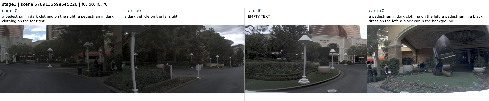

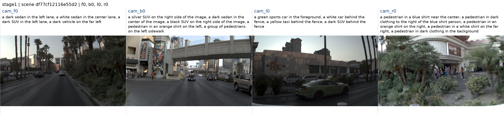

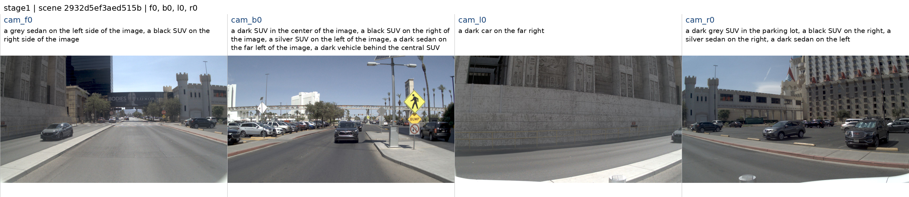

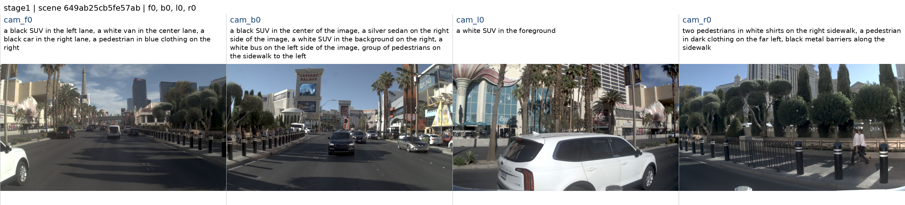

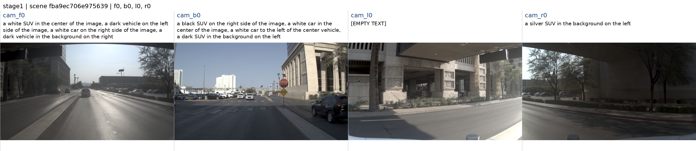

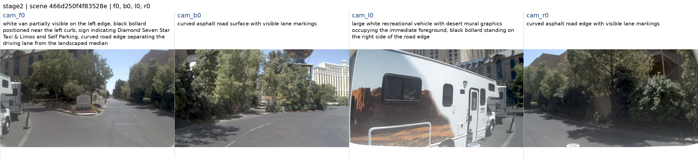

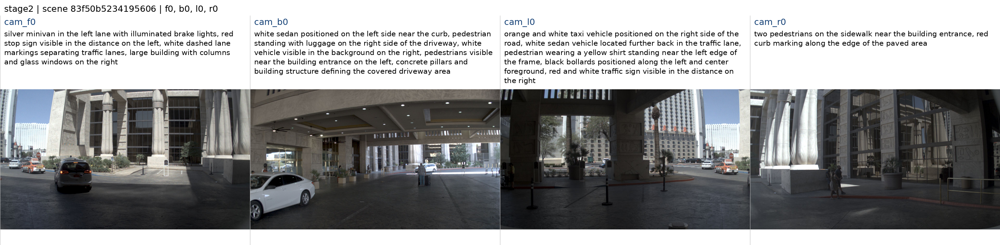

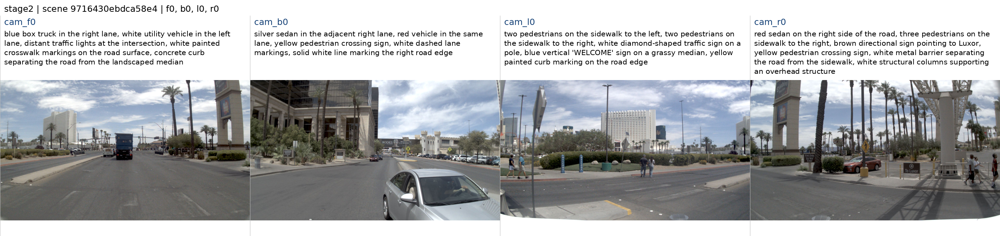

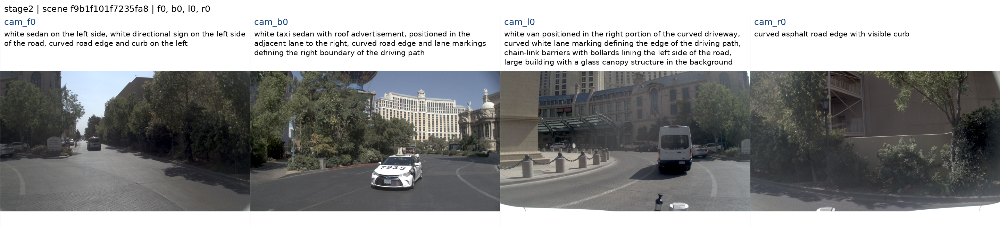

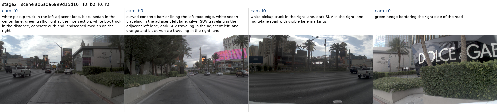

## 7. 一个当前帧的原始标定、标注和前视原图

以下直接读取原始 NAVSIM log pickle 中 token 对应当前帧；boxes 映射来自 Scene._build_annotations：anns.gt_boxes，names 来自 anns.gt_names。完整 names 保留，另给前 10 个以对齐 boxes 前 10 行。calibration/annotations_original_arrays.npz 保存原始数值数组；prepared_ground_truth_full.json 保存该场景的全部框、缩放内参与逆变换，便于对比。

**原始标定与标注完整数值（展开）**

````json
{
  "scene_token": "85d81e8ed2eb5034",
  "log_name": "2021.08.17.18.11.12_veh-08_00629_01599",
  "source_log_pickle": "/mnt/zhaozc_workspace/project/LQH/DrivoR-main-copy/dataset/navsim_logs/trainval/2021.08.17.18.11.12_veh-08_00629_01599.pkl",
  "index_in_log_pickle": 680,
  "scene_current_frame_index": 3,
  "timestamp": 1629224951700278,
  "annotations.boxes_first_10": [
    [
      24.084980004531715,
      0.4182666538251992,
      0.9440626626143068,
      6.092099666595459,
      2.380375385284424,
      2.5204713344573975,
      0.0015688678138801038
    ],
    [
      -33.03860000651479,
      -0.15180084680026054,
      0.7887307123766413,
      5.602990627288818,
      2.2399344444274902,
      2.171217203140259,
      -0.020284837896646923
    ],
    [
      -74.63804808721689,
      11.666768314243772,
      0.6978806386997173,
      6.315352439880371,
      2.240334987640381,
      2.0528945922851562,
      -3.1349367993828254
    ],
    [
      -67.81697810301812,
      11.473094671294234,
      0.5478549423525979,
      4.555532455444336,
      1.9988237619400024,
      1.8457443714141846,
      -3.1331421829991792
    ],
    [
      -60.60022488615349,
      -3.799742030906943,
      0.8080394176496422,
      4.70139741897583,
      1.9731773138046265,
      1.7409940958023071,
      -0.030920485549623677
    ],
    [
      -40.72755718065366,
      13.762010941098238,
      0.17548267739371748,
      0.7632870958112071,
      0.7707936255752694,
      1.798884539482278,
      -1.6004153050429997
    ],
    [
      -42.80818065840941,
      -5.960540639806959,
      0.4273557432108044,
      0.7311198246135004,
      0.7569044030539042,
      1.0174253925492698,
      -5.162720609976276
    ],
    [
      -76.21398699262276,
      -8.402143910700971,
      1.3111364115955229,
      0.8982351693945482,
      0.8783254970604054,
      1.867656630624967,
      0.0568417899815703
    ],
    [
      -3.256215905009194,
      -4.117038415869936,
      0.467763686351488,
      4.626341819763184,
      1.8826028108596802,
      1.5796312093734741,
      0.004800212192999087
    ],
    [
      -53.29562619309932,
      7.349621934094885,
      0.5488110356199186,
      4.791387557983398,
      1.9704681634902954,
      1.7521854639053345,
      -3.154407692929498
    ]
  ],
  "annotations.names": [
    "vehicle",
    "vehicle",
    "vehicle",
    "vehicle",
    "vehicle",
    "pedestrian",
    "generic_object",
    "pedestrian",
    "vehicle",
    "vehicle",
    "vehicle",
    "vehicle",
    "vehicle",
    "pedestrian",
    "vehicle",
    "generic_object",
    "vehicle",
    "vehicle",
    "vehicle",
    "vehicle",
    "generic_object",
    "generic_object",
    "vehicle",
    "traffic_cone",
    "traffic_cone",
    "vehicle",
    "traffic_cone",
    "traffic_cone",
    "traffic_cone",
    "vehicle",
    "traffic_cone",
    "generic_object",
    "vehicle",
    "generic_object",
    "vehicle",
    "pedestrian",
    "vehicle",
    "generic_object"
  ],
  "annotations.names_first_10": [
    "vehicle",
    "vehicle",
    "vehicle",
    "vehicle",
    "vehicle",
    "pedestrian",
    "generic_object",
    "pedestrian",
    "vehicle",
    "vehicle"
  ],
  "box_count": 38,
  "box_columns": [
    "x",
    "y",
    "z",
    "length",
    "width",
    "height",
    "heading"
  ],
  "lidar2ego": [
    [
      1.0,
      0.0,
      0.0,
      0.0
    ],
    [
      0.0,
      1.0,
      0.0,
      0.0
    ],
    [
      0.0,
      0.0,
      1.0,
      0.0
    ],
    [
      0.0,
      0.0,
      0.0,
      1.0
    ]
  ],
  "cameras": {
    "cam_f0": {
      "image_path": "/mnt/data/navsim/trainval_all/trainval_sensor_blobs/trainval/2021.08.17.18.11.12_veh-08_00629_01599/CAM_F0/9b28b36e32255ac8.jpg",
      "original_size_width_height": [
        1920,
        1080
      ],
      "intrinsics": [
        [
          1528.7116139183488,
          0.0,
          970.4598578520903
        ],
        [
          0.0,
          1526.0806221858866,
          578.4137787158188
        ],
        [
          0.0,
          0.0,
          1.0
        ]
      ],
      "sensor2lidar_rotation": [
        [
          -0.00019078115761307388,
          -0.02788375556655805,
          0.9996111542885338
        ],
        [
          -0.999913631883923,
          -0.013130818421192127,
          -0.0005571178443337782
        ],
        [
          0.013141247096554174,
          -0.9995249260439153,
          -0.02787884218638181
        ]
      ],
      "sensor2lidar_translation": [
        1.6785796140415636,
        -0.014291982239247016,
        1.5015919266759081
      ],
      "distortion": [
        -0.352685780947211,
        0.18267703606145225,
        -0.0012372574989579015,
        -0.001275385309694291,
        -0.06804828412153424
      ]
    },
    "cam_b0": {
      "image_path": "/mnt/data/navsim/trainval_all/trainval_sensor_blobs/trainval/2021.08.17.18.11.12_veh-08_00629_01599/CAM_B0/a9603ba3641b5c00.jpg",
      "original_size_width_height": [
        1920,
        1080
      ],
      "intrinsics": [
        [
          1528.7116139183488,
          0.0,
          970.4598578520903
        ],
        [
          0.0,
          1526.0806221858866,
          578.4137787158188
        ],
        [
          0.0,
          0.0,
          1.0
        ]
      ],
      "sensor2lidar_rotation": [
        [
          -0.0006195169380727682,
          0.032347161077126534,
          -0.9994765016592505
        ],
        [
          0.9999843875981954,
          0.005570579873142689,
          -0.0004395449225134211
        ],
        [
          0.005553445653412869,
          -0.9994611697360369,
          -0.03235010712883683
        ]
      ],
      "sensor2lidar_translation": [
        -0.5271640273377134,
        -0.0010743996226055626,
        1.4482452238194012
      ],
      "distortion": [
        -0.352685780947211,
        0.18267703606145225,
        -0.0012372574989579015,
        -0.001275385309694291,
        -0.06804828412153424
      ]
    },
    "cam_l0": {
      "image_path": "/mnt/data/navsim/trainval_all/trainval_sensor_blobs/trainval/2021.08.17.18.11.12_veh-08_00629_01599/CAM_L0/609c3fb0caf25330.jpg",
      "original_size_width_height": [
        1920,
        1080
      ],
      "intrinsics": [
        [
          1528.7116139183488,
          0.0,
          970.4598578520903
        ],
        [
          0.0,
          1526.0806221858866,
          578.4137787158188
        ],
        [
          0.0,
          0.0,
          1.0
        ]
      ],
      "sensor2lidar_rotation": [
        [
          0.8189457721176276,
          0.008751793762493245,
          0.5738041725507075
        ],
        [
          -0.5734963462971041,
          -0.023639029548648893,
          0.8188669837439234
        ],
        [
          0.020730728750705918,
          -0.9996822507116638,
          -0.014339961559494036
        ]
      ],
      "sensor2lidar_translation": [
        1.6648883703200392,
        0.198978420564235,
        1.510771618631435
      ],
      "distortion": [
        -0.352685780947211,
        0.18267703606145225,
        -0.0012372574989579015,
        -0.001275385309694291,
        -0.06804828412153424
      ]
    },
    "cam_r0": {
      "image_path": "/mnt/data/navsim/trainval_all/trainval_sensor_blobs/trainval/2021.08.17.18.11.12_veh-08_00629_01599/CAM_R0/ef83fc7a368559f8.jpg",
      "original_size_width_height": [
        1920,
        1080
      ],
      "intrinsics": [
        [
          1575.9969057097444,
          0.0,
          950.5342450825345
        ],
        [
          0.0,
          1570.7220753877214,
          598.1094693208069
        ],
        [
          0.0,
          0.0,
          1.0
        ]
      ],
      "sensor2lidar_rotation": [
        [
          -0.8141265511273069,
          0.016444320193819698,
          0.5804546003633015
        ],
        [
          -0.5801683297636586,
          0.019224903590947397,
          -0.8142696802786934
        ],
        [
          -0.024549295077528403,
          -0.9996799424892361,
          -0.00611103067530578
        ]
      ],
      "sensor2lidar_translation": [
        1.57867841215648,
        -0.08950344921968285,
        1.5039631448368116
      ],
      "distortion": [
        -0.3676786789584157,
        0.20426090028939242,
        -0.0028019126494076086,
        0.0008453529298972442,
        -0.08258539433854961
      ]
    }
  }
}
````

intrinsics 对应 raw cams.CAM_*.cam_intrinsic，sensor2lidar_rotation 为 3×3 矩阵，不是四元数。使用列向量 convention：p_lidar=R·p_camera+t；投影需其逆变换。原图尺寸与原始内参、缩放到 1148×672 的 cam_K 必须对应。数据准备代码要求 lidar2ego 为单位矩阵，否则停止准备，避免静默混用坐标系。distortion 原值一并给出，当前投影代码未额外做畸变校正；此报告没有据此宣称投影已通过人工核对。

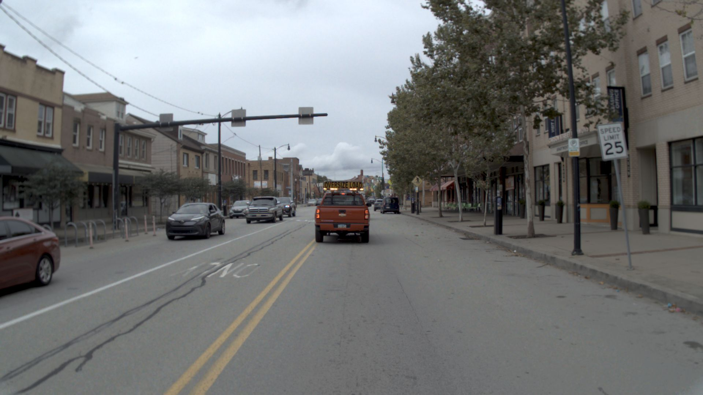

## 8. 已写代码、接入状态与尚未完成部分

已复制实际生成代码到 code/scripts/data_generation/：stage1 启动/worker/generate_captions，stage2 启动/worker/generate，prepare_navsim/selection/navigation，caption_repair/text_processing/text_policy，geometry/build_grounding，校验与合并脚本及当前 prompts。code/index.json 给出每个文件的原路径、归档路径和 SHA-256。以下关键生成与投影源码也直接内嵌在报告，便于单文件查看。

Dataset 接入尚未实现：本工程 navsim/planning/training/dataset.py 没有读取这些 scene_text/grounding 文件的逻辑。已附该文件当前原版，不能把 stage2/check_feature_input.py 的兼容性测试当作训练 Dataset 已接入。也未实现本方案两阶段训练中的空文本特征置零、CA 绕过、text dropout/grounding-valid 联动；这些属于后续模型训练代码，而非本次离线生成。

GT 投影及 mask 代码已经写好：GT 三维框 12 条边在 z=0.1m 近平面截断，再投影、裁剪到图像；取水平距离≤50m 且文本提及类别的全部有效框。patch 覆盖按二维矩形并集计算，重叠不重复计数，按 14×14 patch 汇总归一化。当前仍是按类别取全部框，未实施“提及 n 次选最近 n 框”的实例近似。traffic_light/traffic_sign/other 无 GT 接地监督。空文本相机 valid=False。

全量生成的顺序是准备→该分片全部文本→该分片全部投影/mask→验证→全局合并。当前全量目录没有成品 NPZ/最终索引并不等于投影代码缺失；不能直接启动接地训练。报告的四视图拼图只审查文本与图像，不能替代投影框的人工几何验收。离线本身无 GridMask；后续训练关闭 GridMask 仍需在训练实现中落实。

**scripts/data_generation/generate_captions.py 完整源码**

````python
"""Single-view Qwen-Drive captions, reusing official encode_vqa and VQA defaults.

VLM-only loading is adapted from DrivoR-main-copy/navsim/agents/qwen_text/backend.py.
Optional navigation uses the current AgentInput command and official Qwen vocabulary.
No history, GT annotations or future frames are supplied to the VLM.
"""
import argparse
import hashlib
from pathlib import Path
import sys
import time
from collections import Counter

from common import CAMERAS, CAMERA_NAMES, GROUND_CATEGORIES, fingerprint, read_json, sha256, write_json
from caption_cache import load_scene_cache, rule_status
from text_processing import PROMPT, clean_caption
from caption_repair import repair_caption
from navigation import build_question, navigation_text, qwen_navigation_text


def main():
    parser = argparse.ArgumentParser(description=__doc__)
    parser.add_argument("--prepared", type=Path, required=True)
    parser.add_argument("--output", type=Path, required=True)
    parser.add_argument("--scenes", type=int, default=2)
    parser.add_argument("--model", type=Path, default=Path("/mnt/zhaozc_workspace/project/LQH/Qwen-drive/checkpoint"))
    parser.add_argument("--source", type=Path, default=Path("/mnt/zhaozc_workspace/project/LQH/Qwen-drive/Qwen-Drive-1.0-main/src"))
    parser.add_argument("--roberta", type=Path, default=Path("/mnt/zhaozc_workspace/project/LQH/RoBERTa"))
    parser.add_argument("--max-new-tokens", type=int, default=1024)
    parser.add_argument("--device", default="cuda:0")
    parser.add_argument("--prompt-file", type=Path, help="Literal prompt with {camera_name} and optional {navigation_command}")
    parser.add_argument("--with-navigation", action="store_true", help="Use current NAVSIM input command with Qwen's official vocabulary")
    parser.add_argument("--stage1", action="store_true", help="Enforce five grounding classes and omit navigation")
    parser.add_argument("--stream-cache", action="store_true", help="Atomic per-scene audit files for bulk generation")
    parser.add_argument("--resume", action="store_true", help="Reuse matching completed stream caches")
    args = parser.parse_args()
    prompt = args.prompt_file.read_text(encoding="utf-8").strip() if args.prompt_file else PROMPT
    if "{camera_name}" not in prompt:
        parser.error("Prompt must contain {camera_name}")
    if ("{navigation_command}" in prompt) != args.with_navigation:
        parser.error("--with-navigation requires a prompt containing {navigation_command}, and vice versa")
    if args.stage1 and args.with_navigation:
        parser.error("Stage 1 does not take navigation")
    if args.resume and not args.stream_cache:
        parser.error("--resume requires --stream-cache")
    manifest_path = args.prepared / "manifest.json"
    manifest = read_json(manifest_path)
    assert manifest["camera_order"] == list(CAMERAS)
    if not 0 <= args.scenes <= len(manifest["records"]):
        parser.error("--scenes must select a nonempty subset of the prepared manifest")
    records = manifest["records"][:args.scenes] if args.scenes else manifest["records"]
    if args.with_navigation:
        for record in records:
            if "driving_command" not in record:
                parser.error("Prepared manifest has no current navigation command; prepare a new manifest")
            if record.get("navigation_text") != navigation_text(record["driving_command"]):
                parser.error("Prepared command vector and text disagree")
    args.output.mkdir(parents=True, exist_ok=args.resume)
    sys.path.insert(0, str(args.source.resolve()))
    import torch
    import transformers
    from safetensors import safe_open
    import qwen_drive
    from qwen_drive import NAV_COMMANDS, QwenDriveConfig, QwenDriveProcessor
    from qwen_drive.modeling_qwen_drive import VQA_DECODE_DEFAULTS, _strip_thinking
    from transformers import AutoTokenizer, RobertaTokenizer, Qwen3_5ForConditionalGeneration
    assert Path(qwen_drive.__file__).resolve().parent == args.source.resolve() / "qwen_drive"
    if not torch.cuda.is_available() and args.device.startswith("cuda"):
        raise RuntimeError("PPU/GPU not available; run via the documented device launcher")
    if args.device.startswith("cuda"):
        torch.cuda.set_device(torch.device(args.device))
    config = QwenDriveConfig.from_pretrained(args.model, local_files_only=True)
    tokenizer = AutoTokenizer.from_pretrained(args.model, local_files_only=True)
    roberta = RobertaTokenizer.from_pretrained(args.roberta, local_files_only=True)
    processor = QwenDriveProcessor(tokenizer, config)
    with safe_open(str(args.model / "model.safetensors"), framework="pt", device="cpu") as weights:
        keys = list(weights.keys())
    if not keys or not all(k.startswith("vlm.") for k in keys):
        raise ValueError("Expected root Qwen-Drive VLM-only checkpoint")
    print("Loading Qwen-Drive VLM only (BF16/eager), using existing reference loader", flush=True)
    model, info = Qwen3_5ForConditionalGeneration.from_pretrained(
        args.model, config=config.vlm_config, key_mapping={r"^vlm\.": ""},
        dtype=torch.bfloat16, device_map=args.device, attn_implementation="eager",
        local_files_only=True, output_loading_info=True)
    errors = {k: [str(x) for x in v] for k, v in info.items() if v}
    if errors:
        raise RuntimeError(f"Incomplete VLM load: {errors}")
    model.eval().requires_grad_(False)
    if config.vlm_config.tie_word_embeddings:
        assert model.get_input_embeddings().weight is model.get_output_embeddings().weight
    metadata = {"manifest_sha256": sha256(manifest_path), "camera_order": CAMERAS,
                "model": str(args.model.resolve()), "model_weight_bytes": (args.model / "model.safetensors").stat().st_size,
                "model_config_sha256": sha256(args.model / "config.json"),
                "model_weight_mtime_ns": (args.model / "model.safetensors").stat().st_mtime_ns,
                "source_hashes": {str(p): sha256(p) for p in sorted((args.source / "qwen_drive").glob("*.py"))},
                "pipeline_source_hashes": {p.name: sha256(p) for p in sorted(Path(__file__).parent.glob("*.py"))},
                "prompt": prompt, "prompt_sha256": hashlib.sha256(prompt.encode()).hexdigest(),
                "prompt_file": str(args.prompt_file.resolve()) if args.prompt_file else None,
                "python": sys.executable, "torch": torch.__version__, "transformers": transformers.__version__,
                "dtype": "bfloat16", "attention": "eager", "current_image_pixels": config.current_image_pixels,
                "device": args.device,
                "checkpoint_tensors": len(keys), "loading_errors": errors, "planner_instantiated": False,
                "roberta_tokenizer": str(args.roberta), "max_text_tokens": 128,
                "scenes": len(records), "views": 4 * len(records), "batch_size": 1,
                "navigation_conditioned": args.with_navigation,
                "stage1": args.stage1, "stream_cache": args.stream_cache,
                "qwen_nav_commands": list(NAV_COMMANDS),
                "navigation_by_scene": {r["token"]: {
                    "driving_command": r["driving_command"],
                    "text": qwen_navigation_text(r["driving_command"], NAV_COMMANDS),
                    "source": r["navigation_source"]} for r in records} if args.with_navigation else {},
                "phrase_repair": {"enabled": True, "max_attempts_per_phrase": 2,
                                  "same_current_image": True, "category_preserved": True},
                "decoding": dict(VQA_DECODE_DEFAULTS, max_new_tokens=args.max_new_tokens)}
    version = fingerprint(metadata)
    metadata["cache_version"] = version
    if args.resume and (args.output / "metadata.json").is_file():
        if read_json(args.output / "metadata.json").get("cache_version") != version:
            raise ValueError("Output version changed; use a new output directory")
    write_json(args.output / "metadata.json", metadata)
    if args.stream_cache:
        (args.output / "scenes").mkdir(exist_ok=True)
    texts, audits = {}, {}
    statuses, scene_statuses, review_tokens = [], Counter(), []
    repair_count = repaired_count = reused_count = written_count = 0
    eos = model.generation_config.eos_token_id
    eos = set(eos if isinstance(eos, (tuple, list)) else [eos])

    def generate_answer(image_path, question, token_budget):
        start = time.monotonic()
        inputs = processor.encode_vqa([image_path], question, device=args.device)
        assert inputs["image_grid_thw"].shape[0] == 1
        inputs["pixel_values"] = inputs["pixel_values"].to(model.dtype)
        inputs["mm_token_type_ids"] = (inputs["input_ids"] == config.vlm_config.image_token_id).long()
        width = inputs["input_ids"].shape[1]
        params = dict(VQA_DECODE_DEFAULTS)
        torch.manual_seed(params.pop("seed"))
        params.pop("presence_penalty", None)
        params.update(max_new_tokens=token_budget, pad_token_id=tokenizer.pad_token_id, use_cache=True)
        with torch.inference_mode():
            generated = model.generate(**inputs, **params)
        ids = generated[0, width:].tolist()
        raw = tokenizer.decode(ids, skip_special_tokens=True)
        return {"raw_text": raw, "answer": _strip_thinking(raw),
                "generated_tokens": len(ids), "seconds": time.monotonic() - start,
                "finish_reason": "eos" if any(i in eos for i in ids) else "length",
                "question": question, "image": image_path,
                "image_grid_thw": inputs["image_grid_thw"].tolist()}

    for record in records:
        token = record["token"]
        cache_path = args.output / "scenes" / f"{token}.json"
        if args.resume and cache_path.is_file():
            for camera, path in record["images"].items():
                if sha256(path) != record["image_sha256"][camera]:
                    raise ValueError(f"Source image changed: {path}")
            cached = load_scene_cache(cache_path, version, record)
            if cached["rule_status"] == "passed" and rule_status(cached["audit"], args.stage1) == "passed":
                texts[token] = cached["scene_text"]
                for view in cached["audit"].values():
                    statuses.append(view["status"])
                    repair_count += len(view.get("repairs", []))
                    repaired_count += sum(r["accepted"] for r in view.get("repairs", []))
                reused_count += 1
                scene_statuses["passed"] += 1
                print(f"Reused scene {token}", flush=True)
                continue
            write_json(args.output / "review_history" / f'{token}.{fingerprint(cached)[:16]}.json', cached)
        texts[token], audits[token] = {}, {}
        for camera, camera_name in zip(CAMERAS, CAMERA_NAMES):
            path = record["images"][camera]
            if sha256(path) != record["image_sha256"][camera]:
                raise RuntimeError(f"Image changed since preparation: {path}")
            command_text = qwen_navigation_text(record["driving_command"], NAV_COMMANDS) if args.with_navigation else None
            question = (build_question(prompt, camera_name, command_text) if args.prompt_file
                        else prompt.format(camera_name=camera_name))
            attempts, cleaned = [], None
            for attempt in range(2):
                attempt_question = question
                if attempt:
                    attempt_question += ("\nYour previous answer failed JSON/schema validation. Return exactly the specified JSON object. "
                                         "Use only these category values: vehicle, pedestrian, bicycle, traffic_cone, barrier, "
                                         "traffic_light, traffic_sign, other. The category traffic_conditions is NOT allowed; "
                                         "traffic conditions, road markings and buildings must use other. "
                                         "Include image position in every phrase. No markdown fences or additional text.")
                    if args.stage1:
                        attempt_question += " For this stage use ONLY vehicle, pedestrian, bicycle, traffic_cone, barrier."
                result = generate_answer(path, attempt_question, args.max_new_tokens * (attempt + 1))
                answer = result["answer"]
                error = None
                try:
                    if result["finish_reason"] != "eos":
                        raise ValueError("generation_truncated")
                    cleaned = clean_caption(answer, roberta)
                    if args.stage1 and not set(cleaned["categories"]) <= GROUND_CATEGORIES:
                        raise ValueError("Stage 1 only supports the five grounding categories")
                except (ValueError, TypeError) as exc:
                    error = str(exc)
                    cleaned = None
                attempts.append(dict(result, error=error))
                if cleaned is not None:
                    break
            repairs, initial_cleaning = [], cleaned
            if cleaned is not None:
                cleaned, repairs = repair_caption(answer, roberta,
                    lambda repair_question: generate_answer(path, repair_question, 512), camera_name,
                    navigation_command=command_text)
                for repair in repairs:
                    print(f'{token} {camera}: repair {repair["accepted"]}: {repair["original"]["phrase"]} -> {repair["replacement"]}', flush=True)
            else:
                cleaned = {"text": "", "categories": [], "objects": [], "removed": [],
                           "token_count": len(roberta.encode("")), "status": "generation_failed"}
            texts[token][camera] = {k: cleaned[k] for k in ("text", "categories")}
            audits[token][camera] = dict(cleaned, attempts=attempts, initial_cleaning=initial_cleaning,
                                        repairs=repairs, navigation_command=command_text)
            if not args.stream_cache:
                write_json(args.output / "scene_text.json", texts)
                write_json(args.output / "audit.json", audits)
            print(f'{token} {camera}: {cleaned["status"]}, {cleaned["token_count"]} tokens; {cleaned["text"]}', flush=True)
        status = rule_status(audits[token], args.stage1)
        scene_statuses[status] += 1
        for view in audits[token].values():
            statuses.append(view["status"])
            repair_count += len(view.get("repairs", []))
            repaired_count += sum(r["accepted"] for r in view.get("repairs", []))
        if status != "passed":
            review_tokens.append(token)
        if args.stream_cache:
            write_json(cache_path, {"token": token, "cache_version": version,
                "input_hash": fingerprint(record), "rule_status": status,
                "scene_text": texts[token], "audit": audits[token]})
            written_count += 1
            if status != "passed":
                texts.pop(token)
            audits.pop(token)
    if args.stream_cache:
        write_json(args.output / "scene_text.json", texts)
    write_json(args.output / "review_queue.json", {"tokens": review_tokens,
        "meaning": "rule failures; semantic image review is still needed for passed entries"})
    write_json(args.output / "summary.json", {"scenes": len(records), "views": len(statuses),
               "statuses": {s: statuses.count(s) for s in sorted(set(statuses))},
               "scene_rule_statuses": dict(scene_statuses), "resumed_scenes": reused_count,
               "written_scenes": written_count, "phrase_repairs_attempted": repair_count,
               "phrase_repairs_accepted": repaired_count,
               "peak_device_memory_bytes": torch.cuda.max_memory_allocated(torch.device(args.device)) if args.device.startswith("cuda") else None})
    if "generation_failed" in statuses and not args.stream_cache:
        raise SystemExit("Pilot contains failed generations; empty fallbacks saved for inspection, not approved for bulk use")
    if args.stream_cache and records and not texts:
        raise SystemExit("No scenes passed rule checks; inspect per-scene caches and review_queue.json")


if __name__ == "__main__":
    main()

````

**scripts/data_generation/stage2/generate.py 完整源码**

````python
"""One original-image VQA call per camera; keep valid text from every other view."""
import argparse
from collections import Counter
import hashlib
from pathlib import Path
import sys
import time

SCRIPTS = Path(__file__).resolve().parents[1]
sys.path.insert(0, str(SCRIPTS))
from common import CAMERAS, CAMERA_NAMES, fingerprint, read_json, sha256, write_json
from caption_cache import load_scene_cache
from navigation import build_question, navigation_text, qwen_navigation_text
from text_policy import POLICY_VERSION, clean_response, scene_status, view_needs_review, empty_cameras, fallback_cameras


def process_scene(record, prompt, vocabulary, tokenizer, generate_answer):
    """The callable sees only this camera image, its prompt and current command."""
    command = qwen_navigation_text(record["driving_command"], vocabulary)
    audit = {}
    for camera, name in zip(CAMERAS, CAMERA_NAMES):
        question = build_question(prompt, name, command)
        call = generate_answer(record["images"][camera], question)
        cleaned = clean_response(call, tokenizer)
        call["error"] = cleaned["error"]
        audit[camera] = dict(cleaned, attempts=[call], repairs=[], navigation_command=command)
    texts = {c: {k: audit[c][k] for k in ("text", "categories")} for c in CAMERAS}
    return texts, audit


def main():
    p = argparse.ArgumentParser(description=__doc__)
    p.add_argument("--prepared", type=Path, required=True)
    p.add_argument("--output", type=Path, required=True)
    p.add_argument("--prompt-file", type=Path, required=True)
    p.add_argument("--model", type=Path, default=Path("/mnt/zhaozc_workspace/project/LQH/Qwen-drive/checkpoint"))
    p.add_argument("--source", type=Path, default=Path("/mnt/zhaozc_workspace/project/LQH/Qwen-drive/Qwen-Drive-1.0-main/src"))
    p.add_argument("--reference-repo", type=Path, default=Path("/mnt/zhaozc_workspace/project/LQH/DrivoR-main-copy"))
    p.add_argument("--roberta", type=Path, default=Path("/mnt/zhaozc_workspace/project/LQH/RoBERTa"))
    p.add_argument("--device", default="cuda:0")
    p.add_argument("--max-new-tokens", type=int, default=1024)
    p.add_argument("--scenes", type=int, default=0)
    p.add_argument("--with-navigation", action="store_true", required=True)
    p.add_argument("--stream-cache", action="store_true", required=True)
    p.add_argument("--resume", action="store_true")
    a = p.parse_args()
    prompt = a.prompt_file.read_text(encoding="utf-8").strip()
    manifest_path = a.prepared / "manifest.json"
    manifest = read_json(manifest_path)
    assert manifest["camera_order"] == list(CAMERAS)
    if not 0 <= a.scenes <= len(manifest["records"]) or a.max_new_tokens < 1:
        p.error("Invalid scene/token limit")
    records = manifest["records"][:a.scenes] if a.scenes else manifest["records"]
    for record in records:
        assert navigation_text(record["driving_command"]) == record["navigation_text"]
    a.output.mkdir(parents=True, exist_ok=a.resume)
    (a.output / "scenes").mkdir(exist_ok=True)
    # Reuse the reference's strict VLM loader and the official single-image VQA processor.
    sys.path.insert(0, str(a.reference_repo.resolve()))
    import torch
    import transformers
    from transformers import RobertaTokenizer
    from navsim.agents.qwen_text import backend
    assert Path(backend.__file__).resolve().is_relative_to(a.reference_repo.resolve())
    if a.device.startswith("cuda"):
        if not torch.cuda.is_available():
            raise RuntimeError("Device unavailable; use the documented PPU launcher")
        torch.cuda.set_device(torch.device(a.device))
    processor = backend.load_processor(a.model, source_path=a.source)
    package = backend.import_qwen_drive(a.source)
    from qwen_drive.modeling_qwen_drive import VQA_DECODE_DEFAULTS
    tokenizer = RobertaTokenizer.from_pretrained(a.roberta, local_files_only=True)
    meta = {"manifest_sha256": sha256(manifest_path), "camera_order": CAMERAS,
        "model": str(a.model.resolve()), "model_weight_bytes": (a.model/"model.safetensors").stat().st_size,
        "model_config_sha256": sha256(a.model/"config.json"),
        "model_weight_mtime_ns": (a.model/"model.safetensors").stat().st_mtime_ns,
        "source_hashes": backend.source_identity(a.source),
        "backend_source_hashes": {f.name: sha256(f) for f in Path(backend.__file__).parent.glob("*.py")},
        "pipeline_source_hashes": {str(f.relative_to(SCRIPTS)): sha256(f)
            for f in sorted([*SCRIPTS.glob("*.py"), *Path(__file__).parent.glob("*.py")])},
        "prompt": prompt, "prompt_sha256": hashlib.sha256(prompt.encode()).hexdigest(),
        "prompt_file": str(a.prompt_file.resolve()), "python": sys.executable,
        "torch": torch.__version__, "transformers": transformers.__version__, "dtype": "bfloat16",
        "attention": "eager", "current_image_pixels": processor.config.current_image_pixels,
        "device": a.device, "roberta_tokenizer": str(a.roberta), "max_text_tokens": 128,
        "scenes": len(records), "views": 4*len(records), "batch_size": 1,
        "navigation_conditioned": True, "stage1": False, "stream_cache": True,
        "qwen_nav_commands": list(package.NAV_COMMANDS),
        "navigation_by_scene": {r["token"]: {"driving_command": r["driving_command"],
            "text": qwen_navigation_text(r["driving_command"], package.NAV_COMMANDS),
            "source": r["navigation_source"]} for r in records},
        "phrase_repair": {"enabled": False, "max_attempts_per_phrase": 0},
        "text_policy": POLICY_VERSION, "model_calls_per_view": 1,
        "decoding": dict(VQA_DECODE_DEFAULTS, max_new_tokens=a.max_new_tokens),
        "loading_errors": {}, "planner_instantiated": False}
    version = fingerprint(meta)
    meta["cache_version"] = version
    if (a.output/"metadata.json").exists() and read_json(a.output/"metadata.json").get("cache_version") != version:
        raise ValueError("Caption policy/input version changed; use a new output directory")
    cached_scenes, pending = {}, []
    for record in records:
        for camera, path in record["images"].items():
            if sha256(path) != record["image_sha256"][camera]:
                raise ValueError(f"Source image changed: {path}")
        path = a.output/"scenes"/(record["token"]+".json")
        cache = load_scene_cache(path, version, record) if a.resume else None
        if cache is None:
            pending.append(record)
        else:
            assert cache["rule_status"] == scene_status(cache["audit"])
            cached_scenes[record["token"]] = cache
    generator = backend.FrozenQwenTextGenerator(a.model, processor, a.device, "eager") if pending else None
    if generator:
        assert not generator.loading_report["loading_errors"]
    write_json(a.output/"metadata.json", meta)

    def generate_answer(image, question):
        start = time.monotonic()
        inputs = processor.encode_batch([[image]], [question], system=None)
        assert inputs["image_grid_thw"].shape[0] == 1
        grid = inputs["image_grid_thw"].tolist()
        result = generator.generate(inputs, a.max_new_tokens)[0]
        return {"answer": result["text"], "raw_text": result["raw_text"],
            "finish_reason": result["finish_reason"], "generated_tokens": result["generated_tokens"],
            "seconds": time.monotonic()-start, "question": question, "image": image, "image_grid_thw": grid}

    texts, reviews, statuses = {}, [], Counter()
    empty_count = fallback_count = all_empty = 0
    for record in records:
        token = record["token"]
        cache = cached_scenes.get(token)
        if cache is None:
            text, audit = process_scene(record, prompt, package.NAV_COMMANDS, tokenizer, generate_answer)
            cache = {"token": token, "cache_version": version, "input_hash": fingerprint(record),
                "rule_status": scene_status(audit), "scene_text": text, "audit": audit}
            write_json(a.output/"scenes"/(token+".json"), cache)
        else:
            print(f"Reused scene {token}", flush=True)
        texts[token] = cache["scene_text"]
        audit = cache["audit"]
        empty_count += len(empty_cameras(audit))
        fallback_count += len(fallback_cameras(audit))
        all_empty += len(empty_cameras(audit)) == 4
        for camera in CAMERAS:
            view = audit[camera]
            statuses[view["status"]] += 1
            if view_needs_review(view):
                reviews.append({"token": token, "camera": camera, "status": view["status"],
                    "has_text": bool(view["text"]), "removed": view["removed"], "local_edits": view["local_edits"]})
            print(f'{token} {camera}: {view["status"]}, {view["token_count"]} tokens; {view["text"]}', flush=True)
    write_json(a.output/"scene_text.json", texts)
    write_json(a.output/"review_queue.json", {"tokens": sorted({v["token"] for v in reviews}),
        "views": reviews, "meaning": "Review only; retain usable phrases and all other cameras"})
    write_json(a.output/"summary.json", {"scenes": len(records), "views": 4*len(records), "statuses": dict(statuses),
        "resumed_scenes": len(cached_scenes), "written_scenes": len(pending), "model_calls": 4*len(pending),
        "phrase_repairs_attempted": 0, "phrase_repairs_accepted": 0,
        "empty_text_views": empty_count, "empty_text_fallback_views": fallback_count,
        "all_texts_empty_scenes": all_empty, "review_views": len(reviews), "text_policy": POLICY_VERSION})
    # Even a fully empty shard is a complete, auditable planning dataset.


if __name__ == "__main__":
    main()

````

**scripts/data_generation/geometry.py 完整源码**

````python
"""GT projection using nuPlan Box3D corners, near-plane edge clipping and Shapely.

Matrices use column-vector transforms; boxes follow NAVSIM x,y,z,l,w,h,yaw.
"""
import sys
import numpy as np
from common import IMAGE_SIZE, PATCH_SIZE, ROOT

sys.path.insert(0, str(ROOT / "nuplan-devkit"))
from nuplan.database.utils.boxes.box3d import Box3D
from pyquaternion import Quaternion
from shapely.geometry import box as rectangle
from shapely.ops import unary_union

EDGES = ((0, 1), (1, 2), (2, 3), (3, 0), (4, 5), (5, 6),
         (6, 7), (7, 4), (0, 4), (1, 5), (2, 6), (3, 7))


def box_corners(box):
    box = np.asarray(box, dtype=np.float64)
    if box.shape != (7,) or not np.isfinite(box).all() or np.any(box[3:6] <= 0):
        raise ValueError("Invalid NAVSIM box")
    return Box3D(center=box[:3], size=box[[4, 3, 5]],
                 orientation=Quaternion(axis=[0, 0, 1], radians=box[6])).corners().T


def clip_edges(corners, near=0.1):
    if near <= 0:
        raise ValueError("near must be positive")
    segments = []
    for i, j in EDGES:
        a, b = corners[i].copy(), corners[j].copy()
        if a[2] < near and b[2] < near:
            continue
        if a[2] < near or b[2] < near:
            intersection = a + (near - a[2]) / (b[2] - a[2]) * (b - a)
            intersection[2] = near
            if a[2] < near:
                a = intersection
            else:
                b = intersection
        segments.append(np.stack([a, b]))
    return np.asarray(segments, dtype=np.float64).reshape(-1, 2, 3)


def project_box(box, intrinsics, lidar_to_camera, near=0.1):
    transform = np.asarray(lidar_to_camera, dtype=np.float64)
    intrinsics = np.asarray(intrinsics, dtype=np.float64)
    corners = box_corners(box) @ transform[:3, :3].T + transform[:3, 3]
    edges = clip_edges(corners, near)
    if not len(edges):
        return None
    points = edges.reshape(-1, 3) @ intrinsics.T
    pixels = points[:, :2] / points[:, 2:3]
    if not np.isfinite(pixels).all():
        raise ValueError("Non-finite projection")
    low, high = pixels.min(axis=0), pixels.max(axis=0)
    low, high = np.maximum(low, 0), np.minimum(high, IMAGE_SIZE)
    if np.any(high <= low):
        return None
    return {"bbox": [float(low[0]), float(low[1]), float(high[0]), float(high[1])],
            "segments": pixels.reshape(-1, 2, 2).tolist(),
            "near_clipped": bool(np.any(corners[:, 2] < near))}


def patch_distribution(boxes):
    """Exact union area per patch: overlaps counted once, including partial patches."""
    width, height = IMAGE_SIZE
    result = np.zeros((height // PATCH_SIZE, width // PATCH_SIZE), dtype=np.float32)
    if not boxes:
        return result.reshape(-1), False
    union = unary_union([rectangle(*b) for b in boxes]).intersection(rectangle(0, 0, width, height))
    if union.is_empty or union.area <= 0:
        return result.reshape(-1), False
    x0, y0, x1, y1 = union.bounds
    for row in range(max(0, int(y0 // PATCH_SIZE)), min(result.shape[0], int(np.ceil(y1 / PATCH_SIZE)))):
        for col in range(max(0, int(x0 // PATCH_SIZE)), min(result.shape[1], int(np.ceil(x1 / PATCH_SIZE)))):
            cell = rectangle(col * PATCH_SIZE, row * PATCH_SIZE, (col + 1) * PATCH_SIZE, (row + 1) * PATCH_SIZE)
            result[row, col] = union.intersection(cell).area / PATCH_SIZE**2
    total = float(result.sum())
    if total == 0:
        return result.reshape(-1), False
    result /= total
    return result.reshape(-1), True

````

**scripts/data_generation/build_grounding.py 完整源码**

````python
"""Render all-view GT projection audit and optional caption-conditioned soft masks."""
import argparse
import html
from pathlib import Path
import numpy as np
from PIL import Image, ImageDraw, ImageFont
from common import CAMERAS, GROUND_CATEGORIES, IMAGE_SIZE, fingerprint, read_json, sha256, write_json, write_npz
from geometry import patch_distribution, project_box

COLORS = {"vehicle": "#00e78a", "pedestrian": "#ffda44", "bicycle": "#57b9ff",
          "traffic_cone": "#ff8b3d", "barrier": "#f278ee"}


def pack_grounding_arrays(token, projections, distributions, valid, input_hash):
    boxes, cameras, indices, categories = [], [], [], []
    for ci, camera in enumerate(CAMERAS):
        source = projections[camera]
        selected = set(source["selected_gt_indices"])
        for obj in source["objects"]:
            if obj["gt_index"] in selected:
                boxes.append(obj["bbox"])
                cameras.append(ci)
                indices.append(obj["gt_index"])
                categories.append(obj["category"])
    return {"soft_mask": np.stack(distributions).astype(np.float32),
        "valid": np.asarray(valid, dtype=bool), "camera_order": np.asarray(CAMERAS),
        "scene_token": np.asarray(token), "grid_shape": np.asarray([48, 82]),
        "image_size": np.asarray(IMAGE_SIZE), "coordinate_format": np.asarray("xyxy"),
        "boxes_2d": np.asarray(boxes, dtype=np.float32).reshape(-1, 4),
        "box_camera_index": np.asarray(cameras, dtype=np.int64),
        "box_gt_index": np.asarray(indices, dtype=np.int64),
        "box_category": np.asarray(categories, dtype="U16"), "input_hash": np.asarray(input_hash)}


def load_projection(directory, token, legacy=None):
    if legacy is not None:
        return legacy[token]
    return read_json(Path(directory) / "scenes" / f"{token}.json")["cameras"]


def draw_projection(image_path, objects, camera, token):
    image = Image.open(image_path).convert("RGB").resize(IMAGE_SIZE)
    draw = ImageDraw.Draw(image)
    font = ImageFont.truetype("/usr/share/fonts/truetype/dejavu/DejaVuSans.ttf", 17)
    for obj in objects:
        color = COLORS[obj["category"]]
        for segment in obj["segments"]:
            draw.line([tuple(p) for p in segment], fill=color, width=2)
        draw.rectangle(obj["bbox"], outline=color, width=2)
        x, y = obj["bbox"][:2]
        label = f'{obj["category"]} #{obj["gt_index"]}'
        draw.text((x + 2, y + 2), label, font=font, fill=color, stroke_width=1, stroke_fill="black")
    draw.rectangle((0, 0, IMAGE_SIZE[0], 30), fill="black")
    draw.text((8, 5), f"{token}  {camera}  current frame=3  boxes={len(objects)}", font=font, fill="white")
    return image


def main():
    parser = argparse.ArgumentParser(description=__doc__)
    parser.add_argument("--prepared", type=Path, required=True)
    parser.add_argument("--captions", type=Path, help="Caption directory; omitted for geometric audit only")
    parser.add_argument("--output", type=Path, required=True)
    parser.add_argument("--near", type=float, default=0.1)
    parser.add_argument("--radius", type=float, default=50.0)
    parser.add_argument("--no-render", action="store_true", help="Save training labels without millions of audit images")
    parser.add_argument("--stream", action="store_true", help="Write per-scene projection files instead of a large global JSON")
    parser.add_argument("--resume", action="store_true")
    args = parser.parse_args()
    if args.near <= 0 or args.radius <= 0:
        parser.error("near and radius must be positive")
    if args.resume and not args.stream:
        parser.error("--resume requires --stream")
    if args.stream and not args.no_render:
        parser.error("Bulk --stream mode requires --no-render; render a selected audit subset separately")
    args.output.mkdir(parents=True, exist_ok=args.resume)
    (args.output / "images").mkdir(exist_ok=args.resume)
    (args.output / "masks").mkdir(exist_ok=args.resume)
    (args.output / "scenes").mkdir(exist_ok=args.resume)
    manifest = read_json(args.prepared / "manifest.json")
    assert manifest["camera_order"] == list(CAMERAS)
    gt = read_json(args.prepared / "ground_truth.json")
    captions = {}
    if args.captions:
        metadata = read_json(args.captions / "metadata.json")
        if metadata["manifest_sha256"] != sha256(args.prepared / "manifest.json"):
            raise ValueError("Captions were generated for a different input manifest")
        captions = read_json(args.captions / "scene_text.json")
        unknown = set(captions) - {r["token"] for r in manifest["records"]}
        if unknown:
            raise ValueError(f"Unknown caption scene tokens: {unknown}")
        if any(set(v) != set(CAMERAS) for v in captions.values()):
            raise ValueError("Caption scene is incomplete")
    page = ['<!doctype html><meta charset="utf-8"><title>NAVSIM per-view data pilot</title>',
            '<style>body{font:16px sans-serif;max-width:1500px;margin:24px auto;background:#171b22;color:#eee} img{max-width:100%} .views{display:grid;grid-template-columns:1fr 1fr;gap:16px} article{background:#252b35;padding:12px} pre{white-space:pre-wrap}</style>',
            '<h1>Current-frame GT projection audit</h1><p>Order: f0, b0, l0, r0. GridMask OFF. GT boxes are for audit/targets only; VLM receives original images.</p>']
    projections, count_valid, clipped, resumed = {}, 0, 0, 0
    scene_index = {}
    records = [r for r in manifest["records"] if not args.stream or r["token"] in captions]
    geometry_hash = sha256(Path(__file__).with_name("geometry.py"))
    for record in records:
        token = record["token"]
        source = gt[token]
        input_hash = fingerprint({"record": record, "gt": source, "caption": captions.get(token),
            "near": args.near, "radius": args.radius, "geometry_sha256": geometry_hash, "label_schema": 2})
        scene_path = args.output / "scenes" / f"{token}.json"
        mask_path = args.output / "masks" / f"{token}.npz"
        if args.resume and scene_path.is_file() and mask_path.is_file():
            old = read_json(scene_path)
            with np.load(mask_path, allow_pickle=False) as target:
                matches = (old.get("input_hash") == input_hash and str(target["input_hash"]) == input_hash
                           and target["soft_mask"].shape == (4, 3936) and "boxes_2d" in target)
                if matches:
                    count_valid += int(target["valid"].sum())
            if matches:
                clipped += old["near_clipped_box_views"]
                scene_index[token] = {"boxes": f"scenes/{token}.json", "mask": f"masks/{token}.npz"}
                resumed += 1
                continue
        projections[token] = {}
        distributions, valid_flags = [], []
        scene_clipped = 0
        if not args.no_render:
            sheet = Image.new("RGB", (1148, 672))
            page.append(f'<h2>{html.escape(token)}</h2><p>{html.escape(record["log_name"])}</p><div class="views">')
        for index, camera in enumerate(CAMERAS):
            objects = []
            for gi, (box, category) in enumerate(zip(source["boxes"], source["names"])):
                if category not in GROUND_CATEGORIES or np.linalg.norm(np.asarray(box)[:2]) > args.radius:
                    continue
                projected = project_box(box, source["cam_K"][index], source["lidar_to_camera"][index], args.near)
                if projected is not None:
                    objects.append(dict(projected, category=category, gt_index=gi))
                    clipped += int(projected["near_clipped"])
                    scene_clipped += int(projected["near_clipped"])
            caption = captions.get(token, {}).get(camera, {"text": "", "categories": []})
            selected = [o for o in objects if o["category"] in caption["categories"]] if caption["text"].strip() else []
            distribution, valid = patch_distribution([o["bbox"] for o in selected])
            distributions.append(distribution)
            valid_flags.append(valid)
            count_valid += int(valid)
            projections[token][camera] = {"objects": objects, "selected_gt_indices": [o["gt_index"] for o in selected], "valid": valid}
            if args.no_render:
                for obj in objects:
                    obj.pop("segments", None)
                continue
            image = draw_projection(record["images"][camera], objects, camera, token)
            relative = f"images/{token}_{camera}.jpg"
            image.save(args.output / relative, quality=92)
            sheet.paste(image.resize((574, 336)), ((index % 2) * 574, (index // 2) * 336))
            page.append(f'<article><h3>{camera}</h3><a href="{relative}"></a><pre>{html.escape(caption["text"])}</pre><p>Grounding valid: {valid}; selected GT: {[o["gt_index"] for o in selected]}</p></article>')
            if token in captions:
                base = Image.open(record["images"][camera]).convert("RGB").resize(IMAGE_SIZE).convert("RGBA")
                intensity = distribution.reshape(48, 82)
                intensity = intensity / intensity.max() if valid else intensity
                alpha = Image.fromarray((intensity * 110).astype(np.uint8)).resize(IMAGE_SIZE, Image.Resampling.NEAREST)
                overlay = Image.new("RGBA", IMAGE_SIZE, (255, 80, 30, 0))
                overlay.putalpha(alpha)
                heatmap = Image.alpha_composite(base, overlay).convert("RGB")
                heatmap_relative = f"images/{token}_{camera}_grounding.png"
                heatmap.save(args.output / heatmap_relative)
                page.append(f'<article><h3>{camera}: category grounding target</h3><a href="{heatmap_relative}"></a><p>Valid: {valid}; normalized patch target, not VLM-generated boxes.</p></article>')
        if not args.no_render:
            page.append('</div>')
            sheet.save(args.output / "images" / f"{token}_sheet.jpg", quality=93)
        if token in captions:
            masks = np.stack(distributions)
            assert masks.shape == (4, 3936) and np.isfinite(masks).all()
            write_npz(mask_path, **pack_grounding_arrays(token, projections[token], distributions, valid_flags, input_hash))
        write_json(scene_path, {"token": token, "input_hash": input_hash, "image_size": IMAGE_SIZE,
            "coordinate_format": "xyxy", "near_clipped_box_views": scene_clipped,
            "cameras": projections[token]})
        scene_index[token] = {"boxes": f"scenes/{token}.json", "mask": f"masks/{token}.npz"}
        print(f"Projected {token}: {[len(projections[token][c]['objects']) for c in CAMERAS]}", flush=True)
        if args.stream:
            projections.pop(token)
    (args.output / "index.html").write_text("\n".join(page), encoding="utf-8")
    if not args.stream:
        write_json(args.output / "projections.json", projections)
    write_json(args.output / "index.json", scene_index)
    write_json(args.output / "summary.json", {
        "scenes": len(records), "views": 4 * len(records), "resumed_scenes": resumed,
        "rendered": not args.no_render, "stream": args.stream, "label_schema": 2,
        "caption_scenes": len(captions), "valid_grounding_views": count_valid,
        "near_plane_m": args.near, "near_clipped_box_views": clipped,
        "radius_m": args.radius, "distance_reference": "annotation/lidar horizontal origin, per native NAVSIM convention",
        "camera_order": CAMERAS, "grid_mask": False, "selection": "all valid boxes of mentioned supported categories",
        "manifest_sha256": sha256(args.prepared / "manifest.json"),
        "gt_sha256": sha256(args.prepared / "ground_truth.json"),
        "caption_sha256": sha256(args.captions / "scene_text.json") if args.captions else None,
        "visual_review": "numeric labels saved; visual sampling is separate from automatic checks"})


if __name__ == "__main__":
    main()

````

**scripts/data_generation/merge_stage1_shards.py 完整源码**

````python
"""Merge completed disjoint shards; quarantine rule failures from training index."""
import argparse
import json
import os
from pathlib import Path
import numpy as np
from common import CAMERAS, fingerprint, read_json, write_json


def main():
    p = argparse.ArgumentParser(description=__doc__)
    p.add_argument("--output", type=Path, required=True)
    p.add_argument("--world-size", type=int, required=True)
    a = p.parse_args()
    root = a.output.resolve()
    seen, texts, review, no_labels, counts = set(), {}, [], [], []
    temporary = root / f"training_index.jsonl.{os.getpid()}.tmp"
    settings = None
    try:
        with temporary.open("w", encoding="utf-8") as index:
            for rank in range(a.world_size):
                shard = root / "shards" / f"rank_{rank:04d}"
                config = read_json(shard / "run_config.json")
                complete = read_json(shard / "COMPLETE.json")
                assert complete["configuration_hash"] == fingerprint(config)
                assert complete["rank"] == rank and complete["world_size"] == a.world_size
                assert complete["validation"] == read_json(shard / "validation.json")["status"] == "passed"
                shared = {k: v for k, v in config.items() if k != "rank"}
                if settings is None:
                    settings = shared
                assert settings == shared
                manifest = read_json(shard / "prepared/manifest.json")
                records = {r["token"]: r for r in manifest["records"]}
                assert not seen.intersection(records), "Rank selections overlap"
                seen.update(records)
                meta = read_json(shard / "captions/metadata.json")
                assert meta["stage1"] and not meta["navigation_conditioned"]
                captions = read_json(shard / "captions/scene_text.json")
                for token, caption in captions.items():
                    mask = shard / "grounding/masks" / f"{token}.npz"
                    with np.load(mask, allow_pickle=False) as labels:
                        assert str(labels["scene_token"]) == token and "boxes_2d" in labels
                        if not labels["valid"].any():
                            no_labels.append(token)
                            continue
                    texts[token] = caption
                    index.write(json.dumps({"scene_token": token, "log_name": records[token]["log_name"],
                        "camera_order": CAMERAS, "caption_cache": str(shard / "captions/scenes" / f"{token}.json"),
                        "grounding_npz": str(mask), "boxes_json": str(shard / "grounding/scenes" / f"{token}.json")}) + "\n")
                for token in read_json(shard / "captions/review_queue.json")["tokens"]:
                    review.append({"token": token, "rank": rank,
                        "audit_cache": str(shard / "captions/scenes" / f"{token}.json")})
                counts.append(read_json(shard / "captions/summary.json"))
        os.replace(temporary, root / "training_index.jsonl")
    finally:
        temporary.unlink(missing_ok=True)
    write_json(root / "scene_text.json", texts)
    write_json(root / "review_queue.json", {"rule_failures": review, "no_valid_grounding": no_labels,
        "meaning": "These scenes are excluded from training_index.jsonl; passed rules do not prove semantic accuracy"})
    write_json(root / "summary.json", {"world_size": a.world_size, "prepared_scenes": len(seen),
        "training_scenes": len(texts), "rule_review_scenes": len(review), "no_label_scenes": len(no_labels),
        "navigation_conditioned": False, "stage1": True, "rank_counts": counts,
        "settings": settings, "status": "completed_with_review_items" if review else "completed_rule_checks"})
    print(f"Merged {len(texts)} training scenes; {len(review)} rule review, {len(no_labels)} without targets: {root}")


if __name__ == "__main__":
    main()

````

**scripts/data_generation/stage2/merge.py 完整源码**

````python
"""Keep every selected planning scene; grounding validity never selects eval samples."""
import argparse
import json
import os
from pathlib import Path
import sys
import numpy as np

sys.path.insert(0, str(Path(__file__).resolve().parents[1]))
from common import CAMERAS, fingerprint, read_json, write_json
from caption_cache import load_scene_cache
from text_policy import POLICY_VERSION, scene_status, view_needs_review, empty_cameras, fallback_cameras
from worker import PARTITIONS


def generation_contract(meta):
    keys = ("model", "model_weight_bytes", "model_config_sha256", "model_weight_mtime_ns",
            "source_hashes", "pipeline_source_hashes", "prompt", "prompt_sha256",
            "torch", "transformers", "dtype", "attention", "current_image_pixels",
            "roberta_tokenizer", "max_text_tokens", "decoding", "phrase_repair",
            "stage1", "navigation_conditioned", "backend_source_hashes", "text_policy", "model_calls_per_view")
    return {k: meta[k] for k in keys}


def merge_partition(output, partition, world_size):
    if partition not in PARTITIONS or world_size < 1:
        raise ValueError("Invalid partition/world size")
    bundle = Path(output).resolve()
    root = bundle / partition
    root.mkdir(parents=True, exist_ok=True)
    (root / "COMPLETE.json").unlink(missing_ok=True)
    texts, seen, reviews, counts = {}, set(), [], []
    settings, contract = None, None
    no_grounding = empty_count = fallback_count = fallback_scene_count = all_empty = 0
    temporary = root / f"dataset_index.jsonl.{os.getpid()}.tmp"
    try:
        with temporary.open("w", encoding="utf-8") as index:
            for rank in range(world_size):
                shard = root / "shards" / f"rank_{rank:04d}"
                config = read_json(shard / "run_config.json")
                complete = read_json(shard / "COMPLETE.json")
                assert complete["configuration_hash"] == fingerprint(config)
                assert complete["rank"] == config["rank"] == rank
                assert complete["world_size"] == config["world_size"] == world_size
                assert config["partition"] == partition and not config["stage1"]
                assert complete["validation"] == read_json(shard / "validation.json")["status"] == "passed"
                shared = {k: v for k, v in config.items() if k != "rank"}
                if settings is None:
                    settings = shared
                assert settings == shared, "Rank settings differ"
                manifest = read_json(shard / "prepared/manifest.json")
                records = manifest["records"]
                tokens = {r["token"] for r in records}
                assert len(tokens) == len(records), "Duplicate token within a rank"
                assert not seen.intersection(tokens), "Rank selections overlap"
                assert not manifest.get("skipped"), "Missing images cannot silently shrink the dataset"
                seen.update(tokens)
                meta = read_json(shard / "captions/metadata.json")
                assert not meta["stage1"] and meta["navigation_conditioned"]
                assert meta["text_policy"] == POLICY_VERSION and meta["model_calls_per_view"] == 1
                assert not meta["phrase_repair"]["enabled"]
                current_contract = generation_contract(meta)
                if contract is None:
                    contract = current_contract
                assert contract == current_contract, "Rank generators differ"
                captions = read_json(shard / "captions/scene_text.json")
                flagged = set(read_json(shard / "captions/review_queue.json")["tokens"])
                assert set(captions) == tokens, "Incomplete caption coverage"
                assert flagged <= tokens
                for record in records:
                    token = record["token"]
                    cache_path = shard / "captions/scenes" / f"{token}.json"
                    cache = load_scene_cache(cache_path, meta["cache_version"], record)
                    audit = cache["audit"]
                    status = scene_status(audit)
                    assert cache["rule_status"] == status
                    assert (status != "passed") == (token in flagged)
                    assert captions[token] == cache["scene_text"]
                    text = captions[token]
                    mask = shard / "grounding/masks" / f"{token}.npz"
                    boxes = shard / "grounding/scenes" / f"{token}.json"
                    assert boxes.is_file()
                    with np.load(mask, allow_pickle=False) as labels:
                        assert str(labels["scene_token"]) == token
                        assert labels["camera_order"].tolist() == list(CAMERAS)
                        assert labels["valid"].shape == (4,)
                        valid = labels["valid"].tolist()
                    empty = empty_cameras(audit)
                    fallback = fallback_cameras(audit)
                    empty_count += len(empty)
                    fallback_count += len(fallback)
                    fallback_scene_count += bool(fallback)
                    all_empty += len(empty) == 4
                    for ci, camera in enumerate(CAMERAS):
                        if camera in empty:
                            assert not valid[ci], "Empty camera must not receive grounding supervision"
                        if view_needs_review(audit[camera]):
                            reviews.append({"token": token, "rank": rank, "camera": camera,
                                "status": audit[camera]["status"], "has_text": bool(text[camera]["text"]),
                                "empty_text_fallback": camera in fallback, "audit_cache": str(cache_path)})
                    texts[token] = text
                    no_grounding += not any(valid)
                    index.write(json.dumps({"scene_token": token, "log_name": record["log_name"],
                        "partition": partition, "camera_order": CAMERAS, "images": record["images"],
                        "driving_command": record["driving_command"], "navigation_text": record["navigation_text"],
                        "scene_text": text, "caption_cache": str(cache_path), "caption_status": status,
                        "text_fallback": bool(fallback), "text_fallback_cameras": fallback,
                        "empty_text_cameras": empty, "view_status": {c: audit[c]["status"] for c in CAMERAS},
                        "grounding_npz": str(mask), "boxes_json": str(boxes),
                        "grounding_valid": valid,
                        "grounding_role": "audit_only" if partition == "test" else "auxiliary_supervision"},
                        ensure_ascii=False, allow_nan=False) + "\n")
                counts.append(read_json(shard / "captions/summary.json"))
        # This contract is shared across train/val/test, independent of rank or scene lists.
        contract_path = bundle / "generation_contract.json"
        if contract_path.exists():
            assert read_json(contract_path) == contract, "Train/val/test must use identical generators/prompts"
        for other in PARTITIONS:
            if other == partition or not (bundle / other / "COMPLETE.json").is_file():
                continue
            other_tokens = set(read_json(bundle / other / "scene_text.json"))
            assert not seen.intersection(other_tokens), f"Scene overlap with {other}"
            other_config = read_json(bundle / other / "summary.json")["settings"]
            assert {k: v for k, v in settings.items() if k not in {"partition", "split", "subset"}} == {
                k: v for k, v in other_config.items() if k not in {"partition", "split", "subset"}}
        write_json(contract_path, contract)
        os.replace(temporary, root / "dataset_index.jsonl")
    finally:
        temporary.unlink(missing_ok=True)
    write_json(root / "scene_text.json", texts)
    write_json(root / "review_queue.json", {"rule_failures": reviews,
        "fallback_policy": "Per camera: keep usable phrases and all other views; never clear the whole scene"})
    summary = {"stage": 2, "partition": partition, "world_size": world_size,
        "prepared_scenes": len(seen), "dataset_scenes": len(texts), "empty_text_fallback_scenes": fallback_scene_count,
        "empty_text_views": empty_count, "empty_text_fallback_views": fallback_count,
        "all_texts_empty_scenes": all_empty, "review_views": len(reviews), "text_policy": POLICY_VERSION,
        "scenes_without_grounding": no_grounding, "navigation_conditioned": True,
        "settings": settings, "generation_contract_hash": fingerprint(contract), "rank_counts": counts,
        "grounding_role": "audit_only" if partition == "test" else "auxiliary_supervision",
        "status": "complete_with_review_items" if reviews else "complete_rule_checks"}
    write_json(root / "summary.json", summary)
    write_json(root / "COMPLETE.json", {"dataset_scenes": len(texts), "summary_hash": fingerprint(summary)})
    print(f"Merged {partition}: {len(texts)} scenes, {fallback_count} camera fallbacks, {no_grounding} without grounding", flush=True)
    return summary


if __name__ == "__main__":
    p = argparse.ArgumentParser(description=__doc__)
    p.add_argument("--output", type=Path, required=True)
    p.add_argument("--partition", choices=PARTITIONS, required=True)
    p.add_argument("--world-size", type=int, required=True)
    a = p.parse_args()
    merge_partition(a.output, a.partition, a.world_size)

````

**navsim/planning/training/dataset.py 完整源码**

````python
from typing import Dict, List, Optional, Tuple
from pathlib import Path
import logging
import pickle
import gzip
import os

import torch
from tqdm import tqdm

from navsim.common.dataloader import SceneLoader
from navsim.planning.training.abstract_feature_target_builder import AbstractFeatureBuilder, AbstractTargetBuilder

logger = logging.getLogger(__name__)


def load_feature_target_from_pickle(path: Path) -> Dict[str, torch.Tensor]:
    """Helper function to load pickled feature/target from path."""
    with gzip.open(path, "rb") as f:
        data_dict: Dict[str, torch.Tensor] = pickle.load(f)
    return data_dict


def dump_feature_target_to_pickle(path: Path, data_dict: Dict[str, torch.Tensor]) -> None:
    """Helper function to save feature/target to pickle."""
    # Use compresslevel = 1 to compress the size but also has fast write and read.
    with gzip.open(path, "wb", compresslevel=1) as f:
        pickle.dump(data_dict, f)


class CacheOnlyDataset(torch.utils.data.Dataset):
    """Dataset wrapper for feature/target datasets from cache only."""

    def __init__(
        self,
        cache_path: str,
        feature_builders: List[AbstractFeatureBuilder],
        target_builders: List[AbstractTargetBuilder],
        log_names: Optional[List[str]] = None,
    ):
        """
        Initializes the dataset module.
        :param cache_path: directory to cache folder
        :param feature_builders: list of feature builders
        :param target_builders: list of target builders
        :param log_names: optional list of log folder to consider, defaults to None
        """
        super().__init__()
        assert Path(cache_path).is_dir(), f"Cache path {cache_path} does not exist!"
        self._cache_path = Path(cache_path)

        if log_names is not None:
            self.log_names = [Path(log_name) for log_name in log_names if (self._cache_path / log_name).is_dir()]
        else:
            self.log_names = [log_name for log_name in self._cache_path.iterdir()]

        self._feature_builders = feature_builders
        self._target_builders = target_builders
        self._valid_cache_paths: Dict[str, Path] = self._load_valid_caches(
            cache_path=self._cache_path,
            feature_builders=self._feature_builders,
            target_builders=self._target_builders,
            log_names=self.log_names,
        )
        self.tokens = list(self._valid_cache_paths.keys())

    def __len__(self) -> int:
        """
        :return: number of samples to load
        """
        return len(self.tokens)

    def __getitem__(self, idx: int) -> Tuple[Dict[str, torch.Tensor], Dict[str, torch.Tensor]]:
        """
        Loads and returns pair of feature and target dict from data.
        :param idx: index of sample to load.
        :return: tuple of feature and target dictionary
        """
        return self._load_scene_with_token(self.tokens[idx])

    @staticmethod
    def _load_valid_caches(
        cache_path: Path,
        feature_builders: List[AbstractFeatureBuilder],
        target_builders: List[AbstractTargetBuilder],
        log_names: List[Path],
    ) -> Dict[str, Path]:
        """
        Helper method to load valid cache paths.
        :param cache_path: directory of training cache folder
        :param feature_builders: list of feature builders
        :param target_builders: list of target builders
        :param log_names: list of log paths to load
        :return: dictionary of tokens and sample paths as keys / values
        """

        valid_cache_paths: Dict[str, Path] = {}

        for log_name in tqdm(log_names, desc="Loading Valid Caches"):
            log_path = cache_path / log_name
            for token_path in log_path.iterdir():
                # found_caches: List[bool] = []
                # for builder in feature_builders + target_builders:
                #     data_dict_path = token_path / (builder.get_unique_name() + ".gz")
                #     found_caches.append(data_dict_path.is_file())
                # if all(found_caches):
                valid_cache_paths[token_path.name] = token_path

        return valid_cache_paths

    def _load_scene_with_token(self, token: str) -> Tuple[Dict[str, torch.Tensor], Dict[str, torch.Tensor]]:
        """
        Helper method to load sample tensors given token
        :param token: unique string identifier of sample
        :return: tuple of feature and target dictionaries
        """

        token_path = self._valid_cache_paths[token]

        features: Dict[str, torch.Tensor] = {}
        for builder in self._feature_builders:
            data_dict_path = token_path / (builder.get_unique_name() + ".gz")
            data_dict = load_feature_target_from_pickle(data_dict_path)
            features.update(data_dict)

        targets: Dict[str, torch.Tensor] = {}
        for builder in self._target_builders:
            data_dict_path = token_path / (builder.get_unique_name() + ".gz")
            data_dict = load_feature_target_from_pickle(data_dict_path)
            targets.update(data_dict)

        return (features, targets)


class Dataset(torch.utils.data.Dataset):
    def __init__(
        self,
        scene_loader: SceneLoader,
        feature_builders: List[AbstractFeatureBuilder],
        target_builders: List[AbstractTargetBuilder],
        cache_path: Optional[str] = None,
        force_cache_computation: bool = False,
        append_token_to_batch: bool = False,
    ):
        super().__init__()
        self._scene_loader = scene_loader
        self._feature_builders = feature_builders
        self._target_builders = target_builders

        self._cache_path: Optional[Path] = Path(cache_path) if cache_path else None
        self._force_cache_computation = force_cache_computation
        self._valid_cache_paths: Dict[str, Path] = self._load_valid_caches(
            self._cache_path, feature_builders, target_builders
        )
        self.append_token_to_batch = append_token_to_batch
        if self._cache_path is not None:
            self.cache_dataset()

    @staticmethod
    def _load_valid_caches(
        cache_path: Optional[Path],
        feature_builders: List[AbstractFeatureBuilder],
        target_builders: List[AbstractTargetBuilder],
    ) -> Dict[str, Path]:
        """
        Helper method to load valid cache paths.
        :param cache_path: directory of training cache folder
        :param feature_builders: list of feature builders
        :param target_builders: list of target builders
        :return: dictionary of tokens and sample paths as keys / values
        """

        valid_cache_paths: Dict[str, Path] = {}

        if (cache_path is not None) and cache_path.is_dir():
            for log_path in cache_path.iterdir():
                for token_path in log_path.iterdir():
                    found_caches: List[bool] = []
                    for builder in feature_builders + target_builders:
                        data_dict_path = token_path / (builder.get_unique_name() + ".gz")
                        found_caches.append(data_dict_path.is_file())
                    if all(found_caches):
                        valid_cache_paths[token_path.name] = token_path

        return valid_cache_paths

    def _cache_scene_with_token(self, token: str) -> None:
        """
        Helper function to compute feature / targets and save in cache.
        :param token: unique identifier of scene to cache
        """

        scene = self._scene_loader.get_scene_from_token(token)
        agent_input = scene.get_agent_input()

        metadata = scene.scene_metadata
        token_path = self._cache_path / metadata.log_name / metadata.initial_token
        os.makedirs(token_path, exist_ok=True)

        for builder in self._feature_builders:
            data_dict_path = token_path / (builder.get_unique_name() + ".gz")
            data_dict = builder.compute_features(agent_input)
            dump_feature_target_to_pickle(data_dict_path, data_dict)

        for builder in self._target_builders:
            data_dict_path = token_path / (builder.get_unique_name() + ".gz")
            data_dict = builder.compute_targets(scene)
            dump_feature_target_to_pickle(data_dict_path, data_dict)

        self._valid_cache_paths[token] = token_path

    def _load_scene_with_token(self, token: str) -> Tuple[Dict[str, torch.Tensor], Dict[str, torch.Tensor]]:
        """
        Helper function to load feature / targets from cache.
        :param token:  unique identifier of scene to load
        :return: tuple of feature and target dictionaries
        """

        token_path = self._valid_cache_paths[token]

        features: Dict[str, torch.Tensor] = {}
        for builder in self._feature_builders:
            data_dict_path = token_path / (builder.get_unique_name() + ".gz")
            data_dict = load_feature_target_from_pickle(data_dict_path)
            features.update(data_dict)

        targets: Dict[str, torch.Tensor] = {}
        for builder in self._target_builders:
            data_dict_path = token_path / (builder.get_unique_name() + ".gz")
            data_dict = load_feature_target_from_pickle(data_dict_path)
            targets.update(data_dict)

        return (features, targets)

    def cache_dataset(self) -> None:
        """Caches complete dataset into cache folder."""

        assert self._cache_path is not None, "Dataset did not receive a cache path!"
        os.makedirs(self._cache_path, exist_ok=True)

        # determine tokens to cache
        if self._force_cache_computation:
            tokens_to_cache = self._scene_loader.tokens
        else:
            tokens_to_cache = set(self._scene_loader.tokens) - set(self._valid_cache_paths.keys())
            tokens_to_cache = list(tokens_to_cache)
            logger.info(
                f"""
                Starting caching of {len(tokens_to_cache)} tokens.
                Note: Caching tokens within the training loader is slow. Only use it with a small number of tokens.
                You can cache large numbers of tokens using the `run_dataset_caching.py` python script.
                """
            )

        for token in tqdm(tokens_to_cache, desc="Caching Dataset"):
            self._cache_scene_with_token(token)

    def __len__(self) -> None:
        """
        :return: number of samples to load
        """
        return len(self._scene_loader)

    def __getitem__(self, idx: int) -> Tuple[Dict[str, torch.Tensor], Dict[str, torch.Tensor], str]:
        """
        Get features or targets either from cache or computed on-the-fly.
        :param idx: index of sample to load.
        :return: tuple of feature and target dictionary
        """

        token = self._scene_loader.tokens[idx]
        features: Dict[str, torch.Tensor] = {}
        targets: Dict[str, torch.Tensor] = {}

        if self._cache_path is not None:
            assert (
                token in self._valid_cache_paths.keys()
            ), f"The token {token} has not been cached yet, please call cache_dataset first!"

            features, targets = self._load_scene_with_token(token)
        else:
            scene = self._scene_loader.get_scene_from_token(self._scene_loader.tokens[idx])
            agent_input = self._scene_loader.get_agent_input_from_token(self._scene_loader.tokens[idx])
            for builder in self._feature_builders:
                features.update(builder.compute_features(agent_input))
            for builder in self._target_builders:
                targets.update(builder.compute_targets(scene))

        features["scenario_token"] = token
        if self.append_token_to_batch:
            return (features, targets, token)
        else:
            return (features, targets,)

````

**全部代码附件索引与校验值**

````json
[
  {
    "source": "/mnt/zhaozc_workspace/project/LQH/Driv-calude_data/DrivoR-main/scripts/data_generation/build_grounding.py",
    "copy": "code/scripts/data_generation/build_grounding.py",
    "sha256": "6cc09cc8ace2765fced048e2b1f07e8acf007a7f24667adf61b97f6832d33bdc"
  },
  {
    "source": "/mnt/zhaozc_workspace/project/LQH/Driv-calude_data/DrivoR-main/scripts/data_generation/caption_cache.py",
    "copy": "code/scripts/data_generation/caption_cache.py",
    "sha256": "6d562c378f2193ac635c28da212f90436347ab831642dafc6cc3feabc928c830"
  },
  {
    "source": "/mnt/zhaozc_workspace/project/LQH/Driv-calude_data/DrivoR-main/scripts/data_generation/caption_repair.py",
    "copy": "code/scripts/data_generation/caption_repair.py",
    "sha256": "dc0b37fe2e7321f7fc85cfa3d886d4192bc65db54a814a5acccf3cf780a2eda4"
  },
  {
    "source": "/mnt/zhaozc_workspace/project/LQH/Driv-calude_data/DrivoR-main/scripts/data_generation/common.py",
    "copy": "code/scripts/data_generation/common.py",
    "sha256": "0eebaff86654b3ea0be63497c99ce753b49be6fac79cd454815783c41def0a22"
  },
  {
    "source": "/mnt/zhaozc_workspace/project/LQH/Driv-calude_data/DrivoR-main/scripts/data_generation/generate_captions.py",
    "copy": "code/scripts/data_generation/generate_captions.py",
    "sha256": "f4c892d0845f9ba47569aee04c50392f12370ffc8242752bcf102cca1a8243ef"
  },
  {
    "source": "/mnt/zhaozc_workspace/project/LQH/Driv-calude_data/DrivoR-main/scripts/data_generation/geometry.py",
    "copy": "code/scripts/data_generation/geometry.py",
    "sha256": "e467ccf42579213e8065ac3df8b8324b5c10bf169e861941fdc47ee250eb030a"
  },
  {
    "source": "/mnt/zhaozc_workspace/project/LQH/Driv-calude_data/DrivoR-main/scripts/data_generation/merge_stage1_shards.py",
    "copy": "code/scripts/data_generation/merge_stage1_shards.py",
    "sha256": "1b3135b56c5bfddd75206ef6cd39ece54e7306439fd056967e0d483c33890797"
  },
  {
    "source": "/mnt/zhaozc_workspace/project/LQH/Driv-calude_data/DrivoR-main/scripts/data_generation/navigation.py",
    "copy": "code/scripts/data_generation/navigation.py",
    "sha256": "e9b823b57b6cd83621043633348fd7b59b4d1b236b5cffbe6081d19b5e8ebf83"
  },
  {
    "source": "/mnt/zhaozc_workspace/project/LQH/Driv-calude_data/DrivoR-main/scripts/data_generation/prepare_navsim.py",
    "copy": "code/scripts/data_generation/prepare_navsim.py",
    "sha256": "6c9baefd1edded8f1345ad8ae83d0ab2f8f681c51bdb44230a844b46f84668f1"
  },
  {
    "source": "/mnt/zhaozc_workspace/project/LQH/Driv-calude_data/DrivoR-main/scripts/data_generation/render_2d_boxes.py",
    "copy": "code/scripts/data_generation/render_2d_boxes.py",
    "sha256": "1c58416aeebe9c3dcde3bcb0a8d3e3169a9cf03e7a158ac8748535073f7a544e"
  },
  {
    "source": "/mnt/zhaozc_workspace/project/LQH/Driv-calude_data/DrivoR-main/scripts/data_generation/render_caption_preview.py",
    "copy": "code/scripts/data_generation/render_caption_preview.py",
    "sha256": "a94b27db9e5f7e056f1bda662fcab3c840525e63cdadff52ebc03383df1b1870"
  },
  {
    "source": "/mnt/zhaozc_workspace/project/LQH/Driv-calude_data/DrivoR-main/scripts/data_generation/selection.py",
    "copy": "code/scripts/data_generation/selection.py",
    "sha256": "3a1e8e3b54018c9bd9215940937392a960f886af7ac83c49a4842f65117c51f6"
  },
  {
    "source": "/mnt/zhaozc_workspace/project/LQH/Driv-calude_data/DrivoR-main/scripts/data_generation/stage1_worker.py",
    "copy": "code/scripts/data_generation/stage1_worker.py",
    "sha256": "92da91e8780218fe0f02cc8908fc2e95ea5ec5f174aa03caa9599f2406e48cda"
  },
  {
    "source": "/mnt/zhaozc_workspace/project/LQH/Driv-calude_data/DrivoR-main/scripts/data_generation/stage2/check_feature_input.py",
    "copy": "code/scripts/data_generation/stage2/check_feature_input.py",
    "sha256": "fbfb2759e03c63c8d6990e97c60dcd6bb1330b694599620f062f1f030f1b6350"
  },
  {
    "source": "/mnt/zhaozc_workspace/project/LQH/Driv-calude_data/DrivoR-main/scripts/data_generation/stage2/generate.py",
    "copy": "code/scripts/data_generation/stage2/generate.py",
    "sha256": "9b6c56c8b683ba5dc382489cae8e64c6d1c6fb3bc7b309d7935bc04eba290d76"
  },
  {
    "source": "/mnt/zhaozc_workspace/project/LQH/Driv-calude_data/DrivoR-main/scripts/data_generation/stage2/merge.py",
    "copy": "code/scripts/data_generation/stage2/merge.py",
    "sha256": "4c8005ec7dc457dcc9d5fc8d32282a9a1d468cddde4d85ca4eed219826b43c20"
  },
  {
    "source": "/mnt/zhaozc_workspace/project/LQH/Driv-calude_data/DrivoR-main/scripts/data_generation/stage2/test_stage2.py",
    "copy": "code/scripts/data_generation/stage2/test_stage2.py",
    "sha256": "055723d92fa56a73fe5dd816b40e81ff11a99a72e4d74cc180b6b7ae156c0c43"
  },
  {
    "source": "/mnt/zhaozc_workspace/project/LQH/Driv-calude_data/DrivoR-main/scripts/data_generation/stage2/text_policy.py",
    "copy": "code/scripts/data_generation/stage2/text_policy.py",
    "sha256": "35eeb782ec88e8734f7521a6d30438487a8c83ccb2d43de191f64c339cecf106"
  },
  {
    "source": "/mnt/zhaozc_workspace/project/LQH/Driv-calude_data/DrivoR-main/scripts/data_generation/stage2/validate.py",
    "copy": "code/scripts/data_generation/stage2/validate.py",
    "sha256": "3d2fd7b84b68e9f695d9e09d6d97531521d05cc0e10efaea2fa4c1a031a2bc24"
  },
  {
    "source": "/mnt/zhaozc_workspace/project/LQH/Driv-calude_data/DrivoR-main/scripts/data_generation/stage2/worker.py",
    "copy": "code/scripts/data_generation/stage2/worker.py",
    "sha256": "572411dce37956cdc4e7d6e3686e0b0a54e454099f50eb5659143c45e1758056"
  },
  {
    "source": "/mnt/zhaozc_workspace/project/LQH/Driv-calude_data/DrivoR-main/scripts/data_generation/test_data_pipeline.py",
    "copy": "code/scripts/data_generation/test_data_pipeline.py",
    "sha256": "53ab944737e8c2e00783c56a568f424fed23b04b41921757739a1919da68b1d4"
  },
  {
    "source": "/mnt/zhaozc_workspace/project/LQH/Driv-calude_data/DrivoR-main/scripts/data_generation/text_processing.py",
    "copy": "code/scripts/data_generation/text_processing.py",
    "sha256": "08d5ed8233f871d045dc1fa90042367adade3907e1a2b4bea72641f032c85918"
  },
  {
    "source": "/mnt/zhaozc_workspace/project/LQH/Driv-calude_data/DrivoR-main/scripts/data_generation/validate_pilot.py",
    "copy": "code/scripts/data_generation/validate_pilot.py",
    "sha256": "ab28afd545f739ea4c3ed76c457c38ac86f819c16bae4d7f386cc3c3a8306c3c"
  },
  {
    "source": "/mnt/zhaozc_workspace/project/LQH/Driv-calude_data/DrivoR-main/scripts/data_generation/run_data_pilot.sh",
    "copy": "code/scripts/data_generation/run_data_pilot.sh",
    "sha256": "791c8aff02bb22d056efb2bfd51d6077c1eeda2d8095a5b9b3b21802ce1eb3f9"
  },
  {
    "source": "/mnt/zhaozc_workspace/project/LQH/Driv-calude_data/DrivoR-main/scripts/data_generation/run_stage1_data_8gpu_dlc.sh",
    "copy": "code/scripts/data_generation/run_stage1_data_8gpu_dlc.sh",
    "sha256": "0f4129716a5bb2dfc0abca694db4e504ec903f55f9e6ffb576f43d0dd0c94ed7"
  },
  {
    "source": "/mnt/zhaozc_workspace/project/LQH/Driv-calude_data/DrivoR-main/scripts/data_generation/run_stage2_data_8gpu_dlc.sh",
    "copy": "code/scripts/data_generation/run_stage2_data_8gpu_dlc.sh",
    "sha256": "055ccb9e5bfd85ab9862cac4b00de2b7208f95b904c3f63d724bfe0b3b9da9ab"
  },
  {
    "source": "/mnt/zhaozc_workspace/project/LQH/Driv-calude_data/DrivoR-main/scripts/data_generation/prompts/scene_navigation_v1.txt",
    "copy": "code/scripts/data_generation/prompts/scene_navigation_v1.txt",
    "sha256": "97cc6be01495de602d58e89092d0fc86ccc960e63a3979b12c2aacc545bc7012"
  },
  {
    "source": "/mnt/zhaozc_workspace/project/LQH/Driv-calude_data/DrivoR-main/scripts/data_generation/prompts/scene_navigation_v2.txt",
    "copy": "code/scripts/data_generation/prompts/scene_navigation_v2.txt",
    "sha256": "8ae2f1199f4617636762bc07f707c722cc0506c40d0138aa7670a10f4468259e"
  },
  {
    "source": "/mnt/zhaozc_workspace/project/LQH/Driv-calude_data/DrivoR-main/scripts/data_generation/prompts/scene_path_v1.txt",
    "copy": "code/scripts/data_generation/prompts/scene_path_v1.txt",
    "sha256": "ff5b5d9738629e40678d299edfb669ecee10f19df4aa2694a6349885602fff79"
  },
  {
    "source": "/mnt/zhaozc_workspace/project/LQH/Driv-calude_data/DrivoR-main/scripts/data_generation/prompts/scene_path_v2.txt",
    "copy": "code/scripts/data_generation/prompts/scene_path_v2.txt",
    "sha256": "4af5bfd6e3f67fac1eb7fab079e11de7a99f19f3156f8f6b4e2f73fa7341751f"
  },
  {
    "source": "/mnt/zhaozc_workspace/project/LQH/Driv-calude_data/DrivoR-main/scripts/data_generation/prompts/scene_path_v3.txt",
    "copy": "code/scripts/data_generation/prompts/scene_path_v3.txt",
    "sha256": "cc506e064ed2e8b7e63c74debe84321351838ec2cdcb30aea8e8561b030b999c"
  },
  {
    "source": "/mnt/zhaozc_workspace/project/LQH/Driv-calude_data/DrivoR-main/scripts/data_generation/prompts/stage1_grounding_v1.txt",
    "copy": "code/scripts/data_generation/prompts/stage1_grounding_v1.txt",
    "sha256": "a4c4ecc3f66ad71e8dd53aae30357db1ce4f12593191f62e40d1fde9cc7f3ac6"
  },
  {
    "source": "/mnt/zhaozc_workspace/project/LQH/Driv-calude_data/DrivoR-main/navsim/planning/training/dataset.py",
    "copy": "code/navsim/planning/training/dataset.py",
    "sha256": "68cbfa75f2dfc4087eb22b743357145806c62bb0d57b12692ab39b23b24d8831"
  },
  {
    "source": "/mnt/zhaozc_workspace/project/LQH/Driv-calude_data/DrivoR-main/navsim/common/dataclasses.py",
    "copy": "code/navsim/common/dataclasses.py",
    "sha256": "8aa265c1d7f8934e1cb55bf4893817365819b3c20d86f07ab87358e7fc840503"
  },
  {
    "source": "/mnt/zhaozc_workspace/project/LQH/Driv-calude_data/DrivoR-main/navsim/common/dataloader.py",
    "copy": "code/navsim/common/dataloader.py",
    "sha256": "4bd8f475d0d931750e5d601c73da1dcf4c6b9539c74b3d9bc04de8e911891574"
  },
  {
    "source": "/mnt/zhaozc_workspace/project/LQH/Driv-calude_data/DrivoR-main/navsim/agents/drivoR/drivor_features.py",
    "copy": "code/navsim/agents/drivoR/drivor_features.py",
    "sha256": "82137a3b59fcb6fd614bd9073d2a5b31ef8b97efde2b675ac5010aee331ced7a"
  },
  {
    "source": "/mnt/zhaozc_workspace/project/LQH/Driv-calude_data/DrivoR-main/navsim/planning/script/config/common/train_test_split/scene_filter/navtrain.yaml",
    "copy": "code/navsim/planning/script/config/common/train_test_split/scene_filter/navtrain.yaml",
    "sha256": "c37fea567a0cfdbc29076cca893d4f5dd32db59baec18ae214527206d6b64e6f"
  },
  {
    "source": "/mnt/zhaozc_workspace/project/LQH/Driv-calude_data/DrivoR-main/navsim/planning/script/config/common/train_test_split/scene_filter/navtest.yaml",
    "copy": "code/navsim/planning/script/config/common/train_test_split/scene_filter/navtest.yaml",
    "sha256": "61284edf5003c0291f843ce9817c822ba306609a62d54544223adae3fc7fc9cd"
  },
  {
    "source": "/mnt/zhaozc_workspace/project/LQH/Driv-calude_data/DrivoR-main/navsim/planning/script/config/training/default_train_val_test_log_split.yaml",
    "copy": "code/navsim/planning/script/config/training/default_train_val_test_log_split.yaml",
    "sha256": "3c2182f5ed60442710f34d8ce6bab5b4eae9a38ae5ac3f5615e470aa4c6cd150"
  },
  {
    "source": "/mnt/zhaozc_workspace/project/LQH/Qwen-drive/Qwen-Drive-1.0-main/src/qwen_drive/scene.py",
    "copy": "code/reference/qwen_scene.py",
    "sha256": "653519b847f2c1561352752277618a5b3625f24d67434ca0845d2a66c372e8d6"
  },
  {
    "source": "/mnt/zhaozc_workspace/project/LQH/Qwen-drive/Qwen-Drive-1.0-main/src/qwen_drive/images.py",
    "copy": "code/reference/qwen_images.py",
    "sha256": "006ac155a799935801906e4dc1d73acf5a144130870029ef94d6dea5937f71e6"
  },
  {
    "source": "/mnt/zhaozc_workspace/project/LQH/Qwen-drive/Qwen-Drive-1.0-main/src/qwen_drive/modeling_qwen_drive.py",
    "copy": "code/reference/qwen_modeling_qwen_drive.py",
    "sha256": "dd2dc3bad492f9f53030f66495b2159093d5565a040459fa5308ebe8c812a18c"
  },
  {
    "source": "/mnt/zhaozc_workspace/project/LQH/DrivoR-main-copy/navsim/agents/qwen_text/backend.py",
    "copy": "code/reference/backend.py",
    "sha256": "4d833dc60e65be2cc2ca9905857a534da818e68693902b59afd8e63cb81600fd"
  }
]
````

本次检查限于文件、统计、输出样本和图像可视化，没有替你重新生成数据或修改既有训练/生成逻辑。后续若指定“两组”为其他目录，应重新按指定目录统计，不能沿用本报告的分母。
